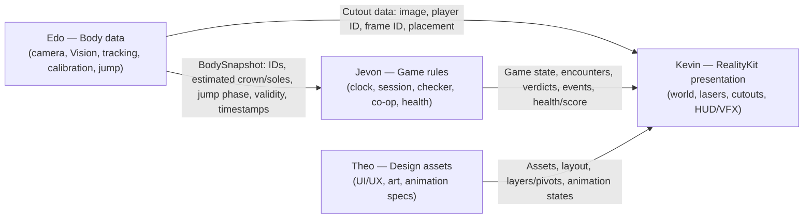

# LaserHeist — Cooperative Active Gameplay Backlog
# LaserHeist — Cooperative Active Gameplay Backlog

| | |
|---|---|
| **Status** | **v0.8 approved (28 October 2026). v0.9 adds ownership corrections and is pending final team review. Not yet published.** |
| **Version** | v0.9 |
| **Last updated** | 28 October 2026 |
| **Source** | `M02-ADA/Sedactive`, branch `feat/architecture`, commit `dcc321e` (re-checked 28 Oct 2026: no newer remote commits) |
| **Architecture baseline** | `Docs/LaserHeist-Architecture-Reference.md`, plus the team's 28 Oct 2026 decision to render LaserHeist with **RealityKit** (the Reference still describes SpriteKit; see open item D-ArchDoc) |
| **Scope** | LaserHeist game mode only. Shared Sedactive systems are dependencies (S1–S8), not LaserHeist work. |
| **Team** | **Edo** (camera, motion, body-data contracts) · **Jevon** (game logic, session) · **Kevin** (RealityKit, rendering) · **Theo** (UI/UX, game visual design) |
| **Document owner** | TBD (team to confirm) |
| **Workflow** | Draft → Review → Revise → Final ACC → task-board / GitHub publication |

> **Repository state at `dcc321e`:** the architecture is documented, but almost no production code exists. 45 Swift files are empty skeletons, 5 screens are Xcode "Hello, World" templates, and there is no unit-test target. The rendering skeletons carry names from the earlier SpriteKit plan. **LH-23** moves the tests into a separate `SedactiveTests` target (Confirmed). Renaming the rendering files is **Proposed** (Kevin's decision), as is moving `CalibrationSession.swift` (Edo and Jevon's decision). This backlog uses the **current** file names until a rename or move is agreed.

### Conventions

- **Task IDs** use `LH-xx` so they never clash with task-board or GitHub numbers. IDs are never renumbered: a new task gets the next free ID and is listed next to the tasks it belongs with (for example, LH-23 and LH-22 sit next to LH-00).
- **Each task has one Assignee** (accountable for delivery). **Collaborators** review or integrate their own part; they do not build a second version of the same thing.
- **Status** for every task is **BACKLOG** until the team approves this draft.
- **Priority:**
  - **P0** — blocks the first playable replay slice (M1).
  - **P1** — needed for the MVP release.
  - **P2** — release polish.
- **Dependency types:**
  - **Hard** — cannot start without it.
  - **Contract** — needs only an agreed interface.
  - **Placeholder OK** — can proceed with temporary assets or stubs.
- **Tasks spanning milestones** (LH-00, LH-02, LH-04, LH-19): the task stays open until its final deliverable is done. Earlier checkpoints are checklist items inside the task, and a checkpoint never closes the task.
- **"Merged"** means merged into the team's integration branch through the team's review process. The remote has `main`, `staging` and feature branches; the workflow itself is open item O7.

---

## Fact & Assumption Register

### 1. Verified API facts
Source: Apple Developer documentation, checked 26–28 October 2026.

| Fact | Consequence for LaserHeist |
|---|---|
| Vision 2D body pose (`VNDetectHumanBodyPoseRequest`, iPadOS 14+) provides nose, eyes, ears, neck, shoulders, elbows, wrists, root, hips, knees and ankles. It has **no top-of-head, heel, toe or sole points**. | Crown and soles are *estimated* boundaries, produced by Edo (see "Body boundary estimates" below). |
| Vision 3D body pose (iPadOS 17+) adds `topHead`/`centerHead` but no foot-bottom joint. | Not in the current plan; adopting it would be Edo's decision. |
| `VNGeneratePersonSegmentationRequest` (iPadOS 15+) produces a person matte with no per-person labels. `VNGeneratePersonInstanceMaskRequest` (iPadOS 17+) labels individual people. | Per-player cutouts need each mask matched to a tracked player ID. Edo owns this matching. |
| RealityKit `RealityView` and `RealityViewCamera` (including the virtual, non-AR camera) need **iPadOS 18+**. `ARView` in non-AR mode, `PerspectiveCamera` and `UnlitMaterial` work on iPadOS 13+. | The choice of render host sets the minimum iPadOS (D-RenderHost, B2). |
| `TextureResource.DrawableQueue` (iPadOS 15+) and `LowLevelTexture` (iPadOS 18+) support updating textures without creating new texture resources. | These are the candidate approaches for live cutout textures (LH-14). Performance must be measured on the device. |
| `ModelSortGroupComponent`, `OpacityComponent` and `BillboardComponent` need iPadOS 18+. | `ModelSortGroupComponent` is a candidate for controlling the draw order of overlapping transparent planes. |
| The Swift-native Vision API needs iPadOS 18+. `@Observable` needs iPadOS 17+. | Further inputs to the minimum-iPadOS decision. |

### 2. Architecture decisions

**From the Architecture Reference:**
- Domain code imports no Apple UI, rendering or camera frameworks.
- `GameClock` is the only game clock.
- Motion produces body measurements, the judge evaluates them, and only `LaserGame` changes health and score.
- There is one canonical player-plane coordinate system: Y points up from the calibrated floor, in game units.
- Low laser = valid airborne phase **and** sole clearance. High laser = crown clearance.
- Missing or stale evidence produces UNAVAILABLE.
- Replay input implements the same interface as live input.

**Team decision, 28 Oct 2026:** LaserHeist renders with **RealityKit 2.5D**, meaning mostly 2D assets on flat planes placed in a virtual 3D scene and viewed through a virtual perspective camera.
- RealityKit handles perspective, entity transforms, scene rendering and depth where supported.
- RealityKit does **not** handle player tracking, jump detection, laser collision checking, transparent-texture sorting, cutout-to-world alignment or live-texture performance. Those remain our implementation and validation work.
- The laser checker never uses RealityKit entities or physics collisions.

### 3. Proposed game rules
These need approval (Section G): the Co-op Gate, damage policy, completion conditions, tracking-loss recovery, the crossing-evidence policy, comfort limits and the activity metric definitions.

### 4. Unvalidated assumptions
These are tested in LH-20 and LH-21. Nothing in this document is evidence for them.
- Estimated boundaries are accurate enough for verdicts that feel fair.
- Offsets measured once while standing stay valid while players duck, jump and move slightly within their zone.
- Tracking of two players stays stable at play distance, even when they come close together.
- Overlapping players can be separated into correct cutouts.
- The bounded judgment delay still feels responsive.
- RealityKit can update two live cutout textures at an acceptable frame rate on the target iPads.
- Transparent planes layer correctly where lasers cross the player planes.
- The game produces meaningful physical activity for the parent.
- Children understand the cues and find the movements comfortable.
- Replay fixtures represent real input well enough to catch regressions.

### Body boundary estimates (crown and sole)

- **Producer:** Edo (`BodyMeasurementExtractor`, part of the shared body-input contract S2 — defined in LH-00 — and pipeline S3). Jevon and Kevin only consume these values.
- **How they're estimated:**
  - Crown comes from head landmarks (nose, eyes, ears, neck) plus the player's calibrated head offset.
  - Each sole comes from the matching ankle plus a calibrated foot offset.
  - Either can optionally be refined with that player's segmentation extent from the same frame.
- **Calibration first:** the head and foot offsets come from each player's standing calibration (LH-22). Estimates therefore scale with body size and with distance from the camera.
- **Units:** player-plane units.
- **Validity:** each estimate is one of *valid*, *low confidence*, *missing landmarks*, *out of frame*, *stale* or *identity uncertain*. Anything not *valid* is treated as UNAVAILABLE evidence.
- **Not pixel-perfect:** the judge compares estimates against a beam band using a clearance margin.

---

## A. User Story

**(User Story)** As a full-time working parent, I want to play a cooperative, movement-based laser game with my child on our iPad, so that I become more physically active while spending quality time with my child.

**Intended outcome:** a hypothesis, validated in LH-21. In one short session, the parent performs repeated ducks and jumps alongside their child, both understand what to do, and they succeed or fail together.

**Acceptance Criteria:**

1. A parent and a child can play at the same time, and the game keeps track of who is who for the whole round.
2. Both players appear as live cutouts inside a RealityKit corridor, each at their own correct size and position, moving in step with their real bodies.
3. Players avoid high lasers by ducking and low lasers by jumping. In co-op gates, the parent and child must perform different moves at the same time.
4. Every laser gives each player their own result — CLEAR, HIT or UNAVAILABLE — based on their tracked body when the laser crosses. Missing body data never counts as a success.
5. The team only progresses when both players clear a co-op gate. Health is shared, and a laser can never cost health twice.
6. Players can always see what is coming, what to do and what happened.
7. If the camera loses a player, the game pauses safely, and resuming never causes unfair damage.
8. Every round ends in success or failure and shows a simple summary that does not overstate exercise.
9. The game is validated with two people on a physical iPad and playtested with real parent–child pairs under a safety checklist.

**MVP boundaries**

| In MVP | Not in MVP (unless the team approves it later) |
|---|---|
| Two simultaneous players (parent + child) | Body-Fit Gate |
| High lasers (duck) and low lasers (jump) | Rotating or diagonal laser patterns |
| Split-lane co-op gates | Boss encounters, cinematic escape sequences |
| Laser checker with CLEAR / HIT / UNAVAILABLE | New movement types, including a low-impact alternative (open question O3) |
| Shared team health | Fully modelled 3D characters or environments, AR world tracking, custom ML models |
| RealityKit 2.5D world with 2D assets and live-body cutouts | Calorie, heart-rate or clinical activity metrics |
| Essential feedback (placeholder first, polished later) | Persistent history or analytics (Results story) |
| Round summary handoff | More than two players |

**Movement recognition is not collision judgement.** Each step has one owner:

```text
Edo    (Motion, S2/S3)   identity, calibration, estimated crown/sole + validity, jump phase/cycles, capture time
   → Jevon LH-09          evidence selection: which sample is judged for this crossing (causal, bounded)
   → Jevon LH-10          laser checker: CLEAR / HIT / UNAVAILABLE per player, per crossing, exactly once
   → Jevon LH-16          co-op progress, shared health, score, events
   → Kevin LH-11 / LH-18  RealityKit presentation of state and events (never changes game state)
```

---

## B. Subtasks

### LH-23 · Prepare the Project Foundation
**Assignee:** Edo · **Collaborators:** Jevon (review); Kevin decides the rendering renames; Edo and Jevon decide the calibration move · **Priority:** P0 · **Status:** BACKLOG · **Category:** Engineering (shared foundation, S1)

> Listed first because every other engineering task starts from it. IDs are never renumbered.

**Description:** Make the agreed folder-structure changes as **one change, before anyone else starts coding**. All of these touch the Xcode project or file locations, so doing them while others edit the same files would cause merge conflicts.
- **Separate test target:** create a `SedactiveTests` Unit Testing target at the repo root and move `Sedactive/Tests/*` into `SedactiveTests/`, keeping the subfolders. Test files must no longer compile into the app. The test target uses the same Swift settings as the app.
- **Rendering file renames — Proposed, Kevin's decision.** Edo makes them in this change only if Kevin agrees on the names and timing; otherwise Kevin renames the files later, in LH-11/LH-14. Edo does not rename Kevin's files on his own. Candidate names:
  - `PlayerProjection.swift` → `GameWorldMapping.swift`
  - `PlayerCutoutNode.swift` → `PlayerCutoutEntity.swift`
  - `LaserScene.swift` keeps its name.
  - File header comments describe their RealityKit roles.
- **Calibration move — Proposed, needs Edo and Jevon to agree.** `Features/Setup/CalibrationSession.swift` → `Motion/CalibrationSession.swift`, made only once both agree. Calibration processing (Edo) and the calibration screen and flow (Jevon's coordinator) stay separate either way.
- **Remove unused view models:** delete `Features/Play/PlayViewModel.swift` and `Features/Results/ResultsViewModel.swift`, which the Reference doc says are not needed. They can be added back if a screen genuinely needs one.
- **Camera permission:** add the camera usage description (`NSCameraUsageDescription`), which is needed before any live camera work.
- **Update the Architecture Reference (D-ArchDoc):**
  - RealityKit rendering
  - any renames or moves that were agreed
  - the cutout handoff type defined in `PlayerCutoutCompositor.swift`
  - body-sample selection in `LaserCollisionJudge.swift`
  - four-person team ownership
- **Team decision B2** (concurrency convention, Swift mode, minimum iPadOS) is applied here once the team has decided it. If the decision comes later, it is applied as a follow-up change by Edo.

**Acceptance Criteria:**
1. The app builds with no test file compiled into it, and an empty test in `SedactiveTests` runs and passes with one command (⌘U).
2. Every move or rename that was agreed is at its new path, the Xcode project has no broken references, and the two view-model files are gone.
3. The Architecture Reference describes RealityKit rendering and any agreed names or locations, and Jevon and Kevin have reviewed it.
4. The change is merged before LH-00, LH-07 or LH-11 begin, and the team is told to update their local branches.

**Dependencies:** Hard: none. Contract: Kevin decides the rendering renames; Edo and Jevon decide the calibration move. **Neither blocks the test-target work**, which can be merged on its own.
**Definition of Done:** One merged change; app builds; ⌘U runs the empty test; Reference doc updated and reviewed.

### LH-00 · Define the Shared Body-Input & Cutout Contracts
**Assignee:** Edo · **Collaborators:** Jevon, Kevin · **Priority:** P0 · **Status:** BACKLOG · **Category:** Engineering (shared contract)

**Description:** Define in Swift the shared data that Edo's camera and Motion work hands to everyone else. Jevon and Kevin then build against the same types from day one instead of waiting for the live camera.
- **Scope:** these are the shared S2 body-input types plus the S4 cutout handoff. The task covers values and interfaces only; the camera, Vision and segmentation *implementation* stays in S3/S4.
- **Shared contract:** if the Camera/Motion user story already tracks this work, link that task here instead of creating a duplicate.

**Checkpoint 1 — body-input contract (due M0; blocks M1):**
- `Player`, `PlayerID`, role (parent/child) and assigned zone.
- `PlayerCalibration`: per-player standing crown, left/right standing soles, standing hip, relative body height in the image, head and foot offsets (relative to body height), torso-length scale reference, floor line, image-to-player-plane conversion, zone, calibration and camera-geometry revision, and timestamp. The values are produced by LH-22.
- `BodyGeometry`: estimated crown and left/right soles in player-plane units, each with a validity state (valid, low confidence, missing landmarks, out of frame, stale, identity uncertain).
- The coordinate and mirror convention: player plane, Y up from the calibrated floor, unmirrored.
- `BodySnapshot`: capture timestamp, frame ID, session generation and calibration revision, plus one sample per player with tracking status, geometry and `JumpPhase` (and optional jump-cycle events).
- `BodyInputProviding`: start/stop, latest snapshot, and a status that reports interruption or failure even when no frames arrive.
- `ReplayBodyInput` with a documented fixture format and a starter fixture set: standing, ducking, jumping, missing ankle, stale frame, duplicate frame, tracking loss. Each fixture includes the players' calibration values, so M1 does not wait for live calibration (LH-22).
- `PoseFrame` (in `Motion/PoseFrame.swift`, used inside Edo's pipeline): raw pose values per detected person, plus each person's mask top and bottom edges as **plain numbers**, not image buffers, so Motion stays free of image frameworks.
- **Test file:** `SedactiveTests/BodyInputTests/ReplayBodyInputTests.swift` (replay determinism, AC 3).

**Checkpoint 2 — cutout handoff contract (due before LH-14 starts, M2):** the per-player cutout packet — player ID, image handle, source frame ID, placement/calibration metadata — and the rule for masks that cannot be matched to a player. Agreed with Kevin (D-Cutout).
- **Where:** defined as the output type of `Infrastructure/Compositing/PlayerCutoutCompositor.swift`. It cannot live in `Domain`, because it carries an image.
- **Rules:**
  - It uses the same frame ID as `BodySnapshot`.
  - Placement data uses `BodyGeometry` units.
  - It does not allocate a new image buffer every frame.
  - Edo and Kevin agree the image format together, because it affects live texture performance.

**Acceptance Criteria:**
1. The types import no SwiftUI, RealityKit, Vision, AVFoundation or Core Image, follow the S1 concurrency convention, and can be passed from background processing to the main thread without warnings.
2. Jevon confirms that LH-07, LH-09 and LH-10 can be written using only these types. Kevin confirms that LH-11 and LH-14 can position bodies and cutouts from them. Neither defines their own body or cutout types.
3. `ReplayBodyInput` plays the starter fixtures through `BodyInputProviding` and produces identical snapshots on every run.
4. Every geometry value states its units, coordinate convention and validity. Missing data is represented explicitly, never as zero or a guessed position.
5. Any later change to these types is reviewed by Edo, Jevon and Kevin before it is merged.

**Dependencies:** Hard: LH-23 (test target), B2 (concurrency convention). Contract: LH-01 v1 (which body facts the rules need); D-Cutout for checkpoint 2.
**Definition of Done:** Checkpoint 1 merged, with reviews from Jevon and Kevin and a unit test that plays a starter fixture. Checkpoint 2 agreed and merged before LH-14 starts. The task closes in M2.

### LH-22 · Build Per-Player Standing Calibration
**Assignee:** Edo · **Collaborators:** Jevon, Theo, Kevin · **Priority:** P1 · **Status:** BACKLOG · **Category:** Engineering (shared Motion)

> Listed here, next to LH-00, because it is foundational. IDs are never renumbered.

**Description:** Measure each player's **standing baseline** before play, so crown and sole estimates work the same for a tall parent and a small child, and whether a player stands nearer to or farther from the camera. Vision has no crown or sole landmarks, so this baseline is what Edo's live crown/sole estimates are built on.
- **Priority:** P1, not P0. The M1 replay slice uses recorded calibration values from the LH-00 fixtures, but live play (LH-13) cannot start without this task.
- **Shared Sedactive work:** if a Setup/Calibration user story exists, link it here rather than duplicating it.

**What is measured for each player, standing still in their zone (proposed method, D-Calibration):**
- **Standing crown:** the top of the head, taken from the top edge of that player's segmentation mask.
- **Standing soles (left/right):** the bottom of each foot, taken from the bottom edge of the mask below each ankle.
- **Standing hip:** from the hip/root landmarks. It is the reference for hip movement and jump detection.
- **Relative body height in the image:** the standing crown-to-sole span. This is the player's scale reference.
- **Head and foot offsets:** how far the standing crown sits above the head landmarks, and the soles below the ankles. They are stored *relative to body height*, so they scale with the player.
- **Torso length (neck to hip):** a second scale reference, used to notice when a player moves closer or farther during play.
- **Also stored:**
  - floor line
  - standing centre and zone
  - image-to-player-plane conversion
  - calibration and camera-geometry revision
  - time

During play, Edo's measurement code (S3) estimates crown and soles from live landmarks plus these offsets. **A duck or jump never becomes the new standing baseline.**

**Who does what:**
- **Edo:** `CalibrationSession` logic in `CalibrationSession.swift` (currently `Features/Setup/`; proposed move to `Motion/`) — collects stable samples, validates them and produces `PlayerCalibration`.
- **Jevon:** `GameSessionCoordinator` runs the calibration phase (start, progress, complete, fail/retry) and passes the result to Motion. There is one source of truth.
- **Theo:** designs the calibration screen and instructions (for example, "stand still, arms down, whole body visible").
- **Kevin:** uses the calibration for cutout scale and placement (LH-14).
- **Calibration screen implementation:** TBD (S7a).

**Acceptance Criteria:**
1. Parent and child each get their own `PlayerCalibration`. Calibration completes only after a stable standing period, with the required landmarks valid and the whole body (head to feet) in frame. Otherwise it reports a specific reason, such as "feet not visible" or "please stand still".
2. Once calibrated, a standing player's estimated crown and soles match their calibrated standing values within the agreed tolerance. This is checked with players of clearly different heights.
3. Ducking or jumping never changes the stored baseline. Recalibration is required when the camera geometry changes (rotation, device moved) or a player's identity cannot be recovered.
4. If a player stands noticeably closer to or farther from the camera than during calibration (detected from body height or torso length), their measurements are marked low confidence and the pause reason asks them to return to their spot, instead of producing wrong heights. Tolerances are tuned in LH-20.
5. Calibration logic is unit-tested with recorded standing samples (stable, unstable, partial body, two players) without a camera, in `SedactiveTests/MotionTests/CalibrationSessionTests.swift`.

**Dependencies:** Hard: LH-23, LH-00 checkpoint 1 (`PlayerCalibration` fields). Contract: S3 pose and segmentation output (Edo), LH-08 session phase (Jevon), S7a calibration screen design (Theo). Placeholder OK: calibration screen UI.
**Definition of Done:** Merged with unit tests passing; device recording of a parent and child calibrating, with the debug view showing calibrated crown, sole and hip lines on their bodies; reviewed by Jevon and Kevin; finished before LH-13 starts.

### LH-01 · Define LaserHeist Gameplay Rules & Safety Limits
**Assignee:** Jevon · **Collaborators:** Theo, Edo, Kevin · **Priority:** P0 · **Status:** BACKLOG · **Category:** Game Design

**Description:** Write and agree the one rule set everyone builds against:
- the MVP encounters (high, low, split-lane) and the move each requires
- the Co-op Gate rule
- the damage policy
- how a round ends
- what happens when tracking is lost
- first-round instructions
- comfort and safety limits: maximum required obstacle clearance per player relative to their calibration; safe jump frequency (maximum required jumps in a time window, minimum recovery spacing, maximum consecutive jumps); play-space requirements
- activity metric definitions with their stated limitations
- a tuning table with conservative values marked "to tune"

Collaborators' parts:
- **Theo:** shapes the player-facing and first-round parts.
- **Edo:** confirms the rules only need body data his contract can supply.
- **Kevin:** confirms each rule can be shown clearly on screen.

**Acceptance Criteria:**
1. Every MVP encounter states who is affected, the required move, when it is judged and the consequence.
2. The damage policy covers every parent/child CLEAR/HIT combination and UNAVAILABLE.
3. Comfort limits are relative to each player's calibration, so a child is never required to clear an obstacle sized for an adult.
4. Edo confirms no rule needs body data the shared contract cannot provide. Every open item is listed in Section G.

**Dependencies:** Hard: none. Contract: Architecture Reference.
**Definition of Done:** Rules v1 approved by all four team members in a team meeting and linked from the User Story.

### LH-02 · Design Gameplay Cues & HUD
**Assignee:** Theo · **Collaborators:** Kevin · **Priority:** P1 · **Status:** BACKLOG · **Category:** UI/UX

**Description:** Design how the game tells players what to do and what happened. Players stand away from the iPad and cannot tap it or read small text.
- **Checkpoint 1 (due M1):** cue language covering the incoming hazard, the required move per player, the crossing moment and CLEAR/HIT/UNAVAILABLE. If it isn't ready, Kevin uses placeholders.
- **Final (M3):** HUD design covering countdown, team health, mission progress, pause screens with reasons, resume countdown and round success/failure.

Theo and Kevin agree, for each element, whether it lives in the SwiftUI overlay or inside the RealityKit scene.

**Acceptance Criteria:**
1. Duck and jump cues are understandable without reading, and parent and child cues are distinguishable without relying on color alone.
2. Every pause screen tells players how to recover (for example, "Child: step back into your zone").
3. The HUD leaves the cutouts and the crossing area clear, and readability is checked on an iPad at the LH-01 play distance.

**Dependencies:** Hard: LH-01. Contract: event and state names from LH-07/LH-08.
**Definition of Done:** Checkpoint 1 used in LH-11 (or replaced by placeholders); final designs reviewed by Kevin and Jevon; task closes in M3.

### LH-03 · Create Corridor Environment Artwork
**Assignee:** Theo · **Collaborators:** Kevin · **Priority:** P2 · **Status:** BACKLOG · **Category:** Art

**Description:** Set the LaserHeist art direction and create the corridor as **layered 2D artwork** (floor, walls, ceiling, background layers). Kevin places these layers on flat planes at different depths in RealityKit.
- Style exploration (2–3 options for the mission fantasy) can start immediately.
- Each asset follows an agreed spec: naming, resolution, transparency, pivot/anchor point, intended depth layer and export format.

**Acceptance Criteria:**
1. A composite mock-up with a sample cutout and beam shows players and lasers visually dominant, and nothing in the background resembles a laser.
2. Every layer includes pivot and depth-layer information, and repeating pieces tile without visible seams.
3. The floor line matches the player plane agreed with Kevin.

**Dependencies:** Hard: none for exploration. Contract: LH-11 world scale and camera parameters (final export only); mission fantasy T1 (final art only).
**Definition of Done:** Asset pack and spec delivered; Kevin confirms they display correctly in a RealityKit test scene.

### LH-04 · Create Laser, Gate & Machinery Artwork
**Assignee:** Theo · **Collaborators:** Kevin · **Priority:** P1 · **Status:** BACKLOG · **Category:** Art

**Description:** Design readable hazards whose visible core matches the area that counts as a hit (the judged band). If a drawn laser looks thicker or thinner than the judged one, hits will feel unfair.
- **Checkpoint 1 (before M2 ends):** beam visual spec — the solid core is the judged band, glow is decoration only, and the spec shows how thickness reads at different depths. M1 does not wait for it; Kevin's placeholder beams are drawn directly from the judged band.
- **Final (M4):** high, low and split-lane beams, emitters and gates, each with inactive, warning, active, hit and disabled states, exported as layered 2D assets with pivot and layer information.

**Acceptance Criteria:**
1. Jevon confirms that the beam spec's core edges equal LH-10's judged band.
2. High, low and split variants are distinguishable by shape or position, not color alone.
3. Each state can be triggered by a game event without editing art.

**Dependencies:** Hard: LH-01. Contract: LH-07 beam geometry fields.
**Definition of Done:** Checkpoint 1 approved; final pack approved and displayed by Kevin; task closes in M4.

### LH-05 · Specify Animation & Visual-Effect States
**Assignee:** Theo · **Collaborators:** Kevin · **Priority:** P2 · **Status:** BACKLOG · **Category:** Art

**Description:** Define and prepare how warnings and outcomes move: warning anticipation, gate open/close, per-player hit and clear effects, Co-op Gate success, health loss and round end.
- **Theo delivers:** frame assets or parameter specs, plus a **trigger table** mapping each effect to one game event.
- **Kevin builds:** the effects in RealityKit.

**Acceptance Criteria:**
1. The gate animation has anticipation, opening, impact and recovery states, and its anticipation length follows the encounter's warning time.
2. Every effect maps to one named game event and changes no game state.
3. No effect moves the beam core or a player's displayed head or feet away from the judged geometry, and nothing flashes rapidly across the full screen.

**Dependencies:** Hard: LH-01. Contract: LH-07 events.
**Definition of Done:** Assets/specs and trigger table delivered and previewed by Kevin in a RealityKit test scene.

### LH-06 · Produce Gameplay Sound Effects & Music
**Assignee:** TBD · **Collaborators:** Theo, Kevin · **Priority:** P2 (a minimal set of warning cues is recommended before LH-21) · **Status:** BACKLOG · **Category:** Art (Audio)

**Description:** Create the sounds and music that signal warnings, results and rewards. Sound lets players react without watching the screen constantly.
- Deliverables: sound effects for countdown, high/low warnings, crossing, clear, hit, Co-op Gate success, health lost, pause/resume and round end; a music loop; an event-to-sound table; a licence record for every sound.
- Playback goes through the shared `AudioService` (owner TBD). Kevin triggers sounds from game events in LH-18.
- **No team member has been assigned audio production.**

**Acceptance Criteria:**
1. High and low warnings sound different.
2. Each sound maps to one event, is level-matched and stays audible over music.
3. Every sound has a documented licence that permits use.

**Dependencies:** Hard: LH-01, an assigned owner. Contract: LH-07 events.
**Definition of Done:** Audio pack, mapping table and licences delivered; checked on iPad speakers at play distance.

### LH-07 · Define LaserHeist Game Data & Replay Scenarios
**Assignee:** Jevon · **Collaborators:** Edo, Kevin · **Priority:** P0 · **Status:** BACKLOG · **Category:** Engineering

**Description:** Define the game's vocabulary in code, plus recorded test situations that always produce the same result.

The LaserHeist domain types:
- lasers: `LaserEncounter`, with a per-player `LaserTarget` holding the required move, beam band in player-plane units, warning time and crossing time
- verdicts: `Judgement` — PENDING / CLEAR / HIT / UNAVAILABLE with a reason
- `GameEvent`
- the shapes of `LaserGameState` and `RoundSummary`
- round configuration, including the LH-09 window and delay values

**Replay scenarios**, including the LH-09 cases R1–R9.

These types **use Edo's shared body-input contract from LH-00** (`BodySnapshot`, `PlayerCalibration`, jump/movement types) and never redefine it. Kevin checks that the renderer can draw from them.

**Acceptance Criteria:**
1. The types import no SwiftUI, RealityKit, Vision, AVFoundation or Core Image, and follow the S1 concurrency convention without warnings.
2. Beam bands and body boundaries share Edo's player-plane units and validity states. No LaserHeist type duplicates `Player`, `PlayerCalibration`, `BodySnapshot` or `BodyInputProviding`.
3. Each scenario uses fixed IDs, capture timestamps and delivery order, and produces identical output on every run.

**Dependencies:** Hard: LH-23, LH-00 checkpoint 1 (Edo's body-input contract). Contract: LH-01 v1.
**Definition of Done:** Merged; reviewed by Edo and Kevin; the scenarios load in a unit test.

### LH-08 · Connect LaserHeist to the Game Session & Clock
**Assignee:** Jevon · **Collaborators:** Edo, Kevin · **Priority:** P0 · **Status:** BACKLOG · **Category:** Engineering

**Description:** Jevon owns `GameSessionCoordinator` and `GameClock`, the single authoritative game time. LaserHeist must stop exactly when paused and continue correctly afterwards; a second timer or a missed pause would skip lasers, judge them twice or take health unfairly. Deliverables:
- a `LaserGame` tick that takes active game time plus newly delivered body snapshots
- conversion from camera capture time to game time
- encounter behaviour on pause, following LH-01

**One per-frame driver** advances gameplay. The proposal (D-RenderHost) is that Kevin's renderer forwards its per-frame update event to the coordinator once per frame. Edo's tracking and camera status feed the pause reasons. Kevin's renderer only reads game state; it never advances it.

**Acceptance Criteria:**
1. While paused, no encounter advances, no verdict is finalized and health does not change.
2. After resume, timing continues from the frozen game time. No encounter is skipped or judged twice, and unresolved encounters follow LH-01.
3. Snapshots from before a pause, or from an old session, are never judged after resume.
4. Exactly one per-frame driver advances gameplay; RealityKit animations and timers never do. Tests use supplied timestamps.

**Dependencies:** Hard: LH-07. Contract: Edo's tracking-status signal (S3), Kevin's frame-update hook (LH-11). The game logic can be unit-tested with injected time before either exists.
**Definition of Done:** Merged, with tests for pausing during the warning, pausing during the crossing, and resuming.

### LH-09 · Select Body Evidence at Each Laser Crossing
**Assignee:** Jevon · **Collaborators:** Edo · **Priority:** P0 · **Status:** BACKLOG · **Category:** Engineering

**Description:** When a laser reaches a player, choose which body-tracking sample to judge.
- Camera data arrives slightly late, so the game waits a short, fixed time, then decides using only data that has actually arrived.
- This task uses Edo's `BodySnapshot` data. It does not detect movement, and Edo does not build a second checker.
- **In short:** look at samples captured around the crossing, wait a fixed short time for late ones, then judge the closest valid sample — or report UNAVAILABLE.
- **Where it lives:** inside `Domain/LaserHeist/LaserCollisionJudge.swift`, with `LaserGame` keeping the short per-player sample history. It moves into its own file only if it grows. The coordinator does not select samples; it only converts camera time to game time through `GameClock`.

**Technical notes — policy (proposed, D-Evidence).** *Tc* is the player's crossing time in game time. Every sample's capture time is converted to game time; arrival time is never used.
1. **Window:** a sample is eligible if its capture time is within **[Tc − W_before, Tc + W_after]**.
2. **Bounded delay:** the verdict stays **PENDING** until game time **Tc + W_after + A** (*A* is the delivery allowance). It is then finalized from samples that have arrived; the game never waits longer. With *W_after = 0*, the policy is purely causal.
3. **Selection:** among eligible samples whose *required* measurements are valid (crown for high lasers; both soles plus jump phase for low lasers), choose the one closest to *Tc*. Ties go to the earlier sample.
4. **One sample at a time:** geometry, jump phase and timestamp all come from the same sample.
5. **No valid eligible sample** gives UNAVAILABLE with a reason (none, invalid, late or stale).
6. A **duplicate frame ID** counts as one observation. History is kept only for the longest active window plus *A*.
7. A **pause before finalization** leaves the crossing unresolved, and the LH-01 recovery rule applies.

| Case | Input | Expected |
|---|---|---|
| R1 | Valid clearing sample in the window, arrives on time | CLEAR at *Tc + W_after + A* |
| R2 | Nearest valid sample overlaps the beam | HIT |
| R3 | Only samples before *Tc − W_before* | UNAVAILABLE (stale) |
| R4 | Eligible sample arrives after finalization | Ignored. UNAVAILABLE if there is no other eligible sample |
| R5 | Sample A is airborne with feet low; sample B is grounded with feet high | Judged on one sample; never A's phase combined with B's geometry |
| R6 | The same frame ID is delivered twice | One observation |
| R7 | Pause between *Tc* and finalization | No verdict; recovery rule applies |
| R8 | Parent and child have different *Tc* | Each player is judged in their own window |
| R9 | Nearest sample is invalid; a valid sample is later in the window | The valid sample is used |

**Acceptance Criteria:**
1. R1–R9 pass as replay unit tests (`CollisionTimingTests`).
2. No verdict is finalized before *Tc + W_after + A*, and none after a pause or exit.
3. History stays bounded over a long replay, and the time conversion is correct across pauses.

**Dependencies:** Hard: LH-07, D-Evidence (B4). Contract: validity and `JumpPhase` semantics from LH-00; LH-08 time conversion. Placeholder OK: *W* and *A* values.
**Definition of Done:** Merged with R1–R9 passing; policy approved by the team as part of the LH-01 review.

### LH-10 · Build the Laser Hit Checker (CLEAR / HIT / UNAVAILABLE)
**Assignee:** Jevon · **Collaborators:** Edo, Kevin · **Priority:** P0 · **Status:** BACKLOG · **Category:** Engineering

**Description:** Build `LaserCollisionJudge`, which decides for each player at each laser whether they avoided it (CLEAR), were hit (HIT), or could not be judged because body data was missing or unreliable (UNAVAILABLE). This is LaserHeist's central mechanic.
- It works purely on game data. It **never reads RealityKit entities, transforms or physics collisions**.
- **Edo** confirms the evidence is interpreted correctly.
- **Kevin** confirms the drawn beam matches the judged band.

**Acceptance Criteria:**
1. **High laser:** with a valid crown estimate, the verdict is CLEAR when the estimated crown is below the beam's lower edge minus the margin, and HIT otherwise.
2. **Low laser:** the verdict is CLEAR only when the jump phase is airborne **and** the lower of the two estimated soles is above the beam's upper edge plus the margin. Any other valid evidence is HIT.
3. **Split laser:** each player is judged on their own move and evidence; one player's verdict never affects the other's.
4. UNAVAILABLE evidence stays UNAVAILABLE, never CLEAR. Each target resolves exactly once, and later data cannot change it.
5. The checker never changes health or score, and boundary cases at exactly edge ± margin follow the documented rule.

**Dependencies:** Hard: LH-07, LH-09. Placeholder OK: margin values (T2).
**Definition of Done:** Merged with all cases tested; reviewed by Edo.

### LH-11 · Build the RealityKit Game World & Laser Rendering
**Assignee:** Kevin · **Collaborators:** Theo, Jevon · **Priority:** P0 · **Status:** BACKLOG · **Category:** Engineering

**Description:** Build the LaserHeist world in RealityKit as **2.5D**: mostly 2D artwork on flat planes placed at X/Y/Z positions and viewed through a virtual perspective camera. Placeholder art comes first. Deliverables:
- **Render host:** decide and set up the render host (D-RenderHost) inside `PlayView` with SwiftUI. The options are `RealityView` with a virtual camera (iPadOS 18+) or `ARView` in non-AR mode (iPadOS 13+).
- **World mapping:** one agreed conversion from game player-plane units to RealityKit world positions. It lives in `Rendering/LaserHeist/PlayerProjection.swift` (proposed rename to `GameWorldMapping.swift` — Kevin's decision; perspective itself now comes from RealityKit's camera). Its tests go in `SedactiveTests/RenderingTests/`, named after the mapping file. Lasers, cutouts (LH-14) and debug markers all use this mapping. Mirroring happens only here, for display.
- **Corridor and lasers:** placeholder corridor and laser entities positioned from Jevon's `LaserTarget` geometry and encounter timing.
- **Essential feedback** (Theo's checkpoint-1 cues or placeholders): incoming hazard, required move per player, crossing moment, PENDING → verdict per player. A placeholder SwiftUI HUD shows health and progress from game state.
- **Rendering debug view** (`Debug/PoseDebugOverlay.swift`, owned by Kevin, wrapped in `#if DEBUG`): estimated crown/soles, beam bands, player IDs, validity, crossing and finalization times, frame age.
- **Frame-update hook:** forwards one tick per frame to the coordinator (LH-08).

**Acceptance Criteria:**
1. Laser and debug-marker positions come only from game data through the single world mapping. Game data is never mirrored, and is never read back from entities.
2. In replay, players can see for each encounter what is coming, each player's move, the crossing and each verdict. Health and progress changes are visible.
3. Laser entities are created and removed by `EncounterID`, with no growth over a long replay. RealityKit animations never change game state.
4. Transparent layers (corridor, beams, placeholder bodies) render in the agreed order from the fixed camera. The debug view can be toggled and is excluded from Release builds.

**Dependencies:** Hard: LH-07. Contract: coordinate and mirror convention from LH-00, Jevon's state and events (LH-08), D-RenderHost, B2 (minimum iPadOS). Placeholder OK: all art and cues.
**Definition of Done:** Merged; replay screen recording showing feedback and the debug view; reviewed by Jevon (verdicts match beams) and Theo (cue readability).

### LH-12 · Ship the First Playable Replay Slice
**Assignee:** Jevon · **Collaborators:** Kevin, Edo · **Priority:** P0 · **Status:** BACKLOG · **Category:** Engineering

**Description:** Prove the complete game loop with recorded body data before live camera work begins. The deliverable is a short scripted sequence with at least one high, one low and one split laser.
- **Jevon:** integrates the gameplay.
- **Kevin:** provides the RealityKit renderer.
- **Edo:** provides replay body data through the shared contract.

**Acceptance Criteria:**
1. The slice runs to completion with no camera (in the Simulator, or on a device if the chosen render host requires it) and can be understood from the essential feedback alone.
2. Every LH-07 scenario gives the expected per-player verdicts, and two runs give identical sequences.
3. The debug view confirms that drawn beams and estimated boundaries agree with each verdict.

**Dependencies:** Hard: LH-00 checkpoint 1, LH-07–LH-11.
**Definition of Done:** Demoed in a team meeting with a recorded video; M1 closed.

### LH-13 · Connect Live Two-Player Camera Input
**Assignee:** Edo · **Collaborators:** Jevon, Kevin · **Priority:** P1 · **Status:** BACKLOG · **Category:** Engineering

**Description:** Replace replay data with Edo's live pipeline (camera, Vision, tracking, calibration data, jump detection, `BodyInputService`) so two real people can play, without changing any game rules.
- **Edo:** detects tracking loss and camera interruptions.
- **Jevon:** handles pause and resume in the coordinator.
- **Kevin:** displays the pause reasons (placeholder UI is fine).

**Acceptance Criteria:**
1. Switching between replay and live input changes only dependency wiring; the game and checker code are unchanged.
2. Parent and child keep their player IDs all round. If identity becomes uncertain, the game pauses instead of swapping them.
3. Losing either player pauses the round and names that player. The resume countdown starts only after every pause reason clears, and the loss itself causes no damage.
4. On the device, the debug view shows live validity states. A camera interruption appears as a pause even if no further frames arrive, and one camera session runs from Setup through Play.

**Dependencies:** Hard: LH-12, LH-22 (standing calibration), S3 (Edo).
**Definition of Done:** Merged; device recording of two people playing the M1 sequence with the debug view.

### LH-14 · Render Live Player Cutouts in RealityKit
**Assignee:** Kevin · **Collaborators:** Edo · **Priority:** P1 · **Status:** BACKLOG · **Category:** Engineering

**Description:** Show each player's live camera cutout as a transparent textured plane in RealityKit, at the right size and position, in step with the body data being judged. If the picture and the judged body disagree, players see themselves dodge but still get hit.
- **Edo provides** (S4; the handoff type is defined in `PlayerCutoutCompositor.swift`): segmentation, mask-to-player matching and a per-player cutout handoff containing player ID, image, source frame ID and placement/calibration metadata. **Kevin does not implement segmentation.**
- **Kevin handles** (in `Rendering/LaserHeist/PlayerCutoutNode.swift`; proposed rename to `PlayerCutoutEntity.swift` — Kevin's decision):
  - updating the cutout textures each camera frame without creating new texture resources every frame (candidates: `TextureResource.DrawableQueue` or `LowLevelTexture`, chosen in D-RenderHost)
  - independent per-player scaling
  - transparency and draw order where lasers cross the player planes
  - a fallback when a cutout is missing

**Acceptance Criteria:**
1. **In sync:** in any displayed frame, a player's cutout and the debug-view body geometry come from the same source frame ID, or differ by no more than an agreed, device-validated lag. The debug view shows the difference.
2. **Independent scaling:** each cutout is scaled from its own player's calibration, so the child's size never changes the parent's.
3. **Aligned:** with the debug view on, the displayed head and feet line up with the estimated crown and soles when standing, ducking and jumping. Jumps visibly lift the cutout.
4. **Fallback:** a missing or unmatched cutout shows the defined fallback (for example, last good frame, dimmed) and never affects judging.

**Device validation cases** (recorded with LH-20):

| Case | Pass condition |
|---|---|
| Two people side by side, then close or overlapping | Each cutout stays with the correct player. Unclear matches use the fallback, never a swap. |
| One player briefly leaves and returns | The correct ID is restored, or the game pauses through LH-13. |
| Parent and child of clearly different heights | Both are scaled and aligned correctly at the same time. |
| A laser passes through a player's plane | Beam and cutout layer in the agreed order without flicker. |

**Dependencies:** Hard: LH-11, LH-13, LH-00 checkpoint 2 (cutout handoff contract), S4 (Edo's segmentation implementation).
**Definition of Done:** Merged; device video of the four validation cases; reviewed by Edo.

### LH-15 · Schedule Lasers with Per-Player Difficulty & Comfort Limits
**Assignee:** Jevon · **Collaborators:** Edo, Theo · **Priority:** P1 · **Status:** BACKLOG · **Category:** Engineering

**Description:** Build `LaserWaveDirector`, which decides which laser comes next, when, and how high.
- Rounds are deterministic, sized to each player's body (from Edo's calibration) and paced within the LH-01 comfort limits.
- Theo checks that warning timing matches the cue and animation specs.
- The director supports overlapping encounters.

**Acceptance Criteria:**
1. The same script and calibrations always produce the same encounter order, IDs and timings.
2. No low laser requires more obstacle clearance than that player's limit. No player is asked to jump more often than the safe jump frequency, and the minimum recovery spacing always holds (tested over a full round).
3. Split-lane encounters give each player their own move and crossing time.
4. Difficulty and comfort values live in the round configuration, so they can differ per player without code changes. The director never reads wall-clock time, creates entities or changes health.

**Dependencies:** Hard: LH-07, LH-10. Contract: LH-01 comfort-limit structure; `PlayerCalibration` from LH-00. Placeholder OK: tuning values.
**Definition of Done:** Merged with `LaserWaveDirectorTests`; replay demo of a full scripted round.

### LH-16 · Build Co-op Gates, Shared Health & Scoring
**Assignee:** Jevon · **Collaborators:** Theo · **Priority:** P1 · **Status:** BACKLOG · **Category:** Engineering

**Description:** Make cooperation a real gameplay requirement. Shared health alone does not make players cooperate.

**Co-op Gate (proposed, D-Rules):**
- The parent and child are given **different** moves at the same time.
- The gate is a **team success only if both are CLEAR**. Each success advances shared **mission progress**, and reaching the target completes the mission.
- Any HIT fails the gate: there is no progress, and damage follows the damage policy.

Other responsibilities:
- `LaserGame` also handles shared health, score and per-player stats.
- It emits the events `playerCleared`, `playerHit`, `coopGateSucceeded`, `coopGateFailed`, `teamDamaged` and `roundEnded`.
- Theo designs how co-op success and failure are communicated.

**Acceptance Criteria:**
1. A Co-op Gate advances progress only when both players are CLEAR, and every other combination gives exactly the LH-01 outcome.
2. A crossing never deducts health twice. UNAVAILABLE causes no damage and no progress. Health stays within 0…max, and reaching 0 ends the round once.
3. Only `LaserGame` changes health, progress or score, and each player's CLEARs are recorded individually.
4. Health and progress changes are exposed as state and events, and appear in LH-11's placeholder HUD during a replay round.

**Dependencies:** Hard: LH-10, LH-15, D-Rules (B5).
**Definition of Done:** Merged with `LaserGameTests`; replay demo showing Co-op Gate success, Co-op Gate failure and health changes.

### LH-17 · End the Round & Hand the Summary to Results
**Assignee:** Jevon · **Collaborators:** Results owner (TBD) · **Priority:** P1 · **Status:** BACKLOG · **Category:** Engineering

**Description:** End each round cleanly and pass a simple, read-only `RoundSummary` to the Results screen, keeping game results separate from movement estimates. None of these fields is measured physical activity.

| Field | Meaning | Limitation |
|---|---|---|
| Active game duration | Game-clock time, pauses excluded | Time in the game, not time spent moving |
| Successful avoidances (per player) | CLEARs, by laser type | A game result, not a movement count |
| Validated jump cycles (per player) | Complete takeoff → airborne → landing cycles from Edo's jump detection | Only if Edo's contract exposes jump-cycle events. No duck cycles in MVP. |
| Movement-challenge time (per player) | Total action windows the player was asked to respond to while tracked | **Not measured physical activity time** |
| Mission outcome, Co-op Gate results, team health, score | Game results | — |

The parent's figures are the primary activity-related outcome.

**Acceptance Criteria:**
1. Success, failure and early exit each produce exactly one final outcome, and nothing resolves after it.
2. Unit tests confirm each field matches the final game state for scripted rounds, including rounds with pauses. A scripted CLEAR without a jump cycle adds no jump cycle.
3. Estimate fields carry their limitation in the contract, and no field is named or described as calories, intensity or a health measure.
4. Results receives only the `RoundSummary`, and Retry starts a fresh round with no leftover state.

**Dependencies:** Hard: LH-16, D-Rules (completion). Contract: D-Metrics, S5 session handoff, S6 Results interface, jump-cycle events from LH-00 (optional). A stub Results screen is fine; the full Results feature is not required.
**Definition of Done:** Merged with summary tests; demo of a replay round ending in Results (stub or real); wording reviewed by the Results owner.

### LH-18 · Integrate Final Art, Animation, HUD & Feedback
**Assignee:** Kevin · **Collaborators:** Theo, Jevon · **Priority:** P2 · **Status:** BACKLOG · **Category:** Engineering

**Description:** Replace placeholders in the RealityKit scene and the SwiftUI HUD with Theo's final assets and specs (LH-02 to LH-05).
- Trigger effects and sounds from Jevon's game events.
- Optimize rendering performance.
- Sounds play through the shared `AudioService` (owner TBD).

Essential feedback already works from LH-11 and LH-16, so this task is polish.

**Acceptance Criteria:**
1. Every trigger-table and audio-map entry fires once for its event in a replay round.
2. Turning off all effects gives an identical verdict, progress and health sequence on replay.
3. Final beam art still lines up with the judged bands, and frame rate with final assets is measured on the target iPad against the LH-20 threshold.

**Dependencies:** Hard: LH-11, LH-16, LH-17. Contract: S8 `AudioService`. Assets can arrive incrementally.
**Definition of Done:** Merged; before/after replay recording; design sign-off from Theo.

### LH-19 · Maintain Automated Replay Tests
**Assignee:** Jevon · **Collaborators:** Edo, Kevin · **Priority:** P1 · **Status:** BACKLOG · **Category:** Testing

**Description:** Keep automated tests that play full recorded rounds from start to finish, so changes don't silently break the game. Live camera testing is slow and inconsistent.
- **Jevon:** owns the test harness and the game scenarios.
- **Edo:** adds body-data fixtures such as missing landmarks, tracking loss and uncertain identity.
- **Kevin:** adds tests for the world-mapping calculations (in `SedactiveTests/RenderingTests/`, named after the mapping file).
- Unit tests for each task stay inside that task.

**Acceptance Criteria:**
1. All tests run from the `SedactiveTests` target with one command and pass in the Simulator, with no camera, no AVFoundation and no sleeps.
2. Scenarios cover every verdict type, R1–R9, Co-op Gate success and failure, damage deduplication, tracking loss and recovery, and round success, failure and exit.
3. Each reproducible bug from LH-13, LH-14, LH-20 or LH-21 gets a regression scenario.

**Dependencies:** Hard: LH-23 (test target), LH-07.
**Definition of Done:** Suite passes on the integration branch before each milestone demo; task closes in M5.

### LH-20 · Validate Two-Player Play on a Physical iPad
**Assignee:** Edo · **Collaborators:** Kevin, Jevon · **Priority:** P1 · **Status:** BACKLOG · **Category:** Testing

**Description:** Gather evidence — not assumptions — about how the game performs on real hardware with two people of different sizes. Simulator and replay tests cannot show real tracking, lighting or performance.
- **Edo:** leads tracking and body-input validation.
- **Kevin:** evaluates rendering — live texture updates, transparency, spatial alignment and frame rate.
- **Jevon:** evaluates game timing, verdicts and fairness.
- **Deliverables:** a short test plan (device, iPadOS, mounting, distance, lighting); a test matrix (standing, duck, jump, split lanes, the LH-14 cases, stepping out, back-to-back rounds); a report with recordings.

**Acceptance Criteria:**
1. Pass thresholds (frame rate, acceptable verdict mismatches, acceptable judgment delay) are agreed and recorded **before** testing.
2. Each row compares the observed verdict with the expected one from video. Mismatches are logged by cause: identity, boundary estimate, timing, rendering alignment or texture sync.
3. Estimated crown and soles are compared visually against video for players of different heights, and the error observed informs margin tuning (T2).
4. Tracking loss never causes health loss. Frame rate and device heat over back-to-back rounds are measured.

**Dependencies:** Hard: LH-13, LH-14, LH-16, LH-17; LH-18 for the final performance pass.
**Definition of Done:** Report shared with pass/fail per row and a list of observed limitations (not accuracy claims); P0/P1 defects fixed or explicitly accepted.

### LH-21 · Run Parent–Child Playtests & Tune the Game
**Assignee:** Theo · **Collaborators:** Edo, Jevon, Kevin · **Priority:** P1 · **Status:** BACKLOG · **Category:** Testing / Game Design

**Description:** Test the unvalidated assumptions with real parent–child pairs. Only real families can tell us whether the game is understandable, cooperative, comfortable and active enough for the parent.
- **Theo:** leads observation and usability evaluation.
- **Developers:** fix technical issues in their own areas.
- **Deliverables:**
  - a playtest plan covering guardian and recording consent, minimal data retention, a safety checklist (clear space, non-slip floor, stable iPad stand, rest breaks, adult supervision), an observation sheet, short parent questions and age-appropriate child questions
  - a findings report
  - tuning changes
  - evidence for open question O3 (whether a low-impact alternative is needed)

**Acceptance Criteria:**
1. No session runs without signed guardian consent and a completed safety checklist.
2. Observations record cue comprehension, whether the Co-op Gate felt cooperative, perceived fairness, comfort and fatigue for each player, and the parent's summary figures.
3. Any safety or comfort issue leads to a tuning change before the next session, and findings are reported as observations from this sample, not proven benefits.

**Dependencies:** Hard: LH-20. Placeholder OK: LH-18 polish.
**Definition of Done:** Findings report shared; agreed changes applied and verified in a follow-up session.

---

## C. Backlog Summary

| ID | Subtask | What We're Building | Assignee | Priority |
|---|---|---|---|---|
| LH-23 | Prepare the project foundation | Set up the test target, clean up the project, and update the architecture doc so everyone starts from the same project. | Edo | P0 |
| LH-00 | Define shared body-input & cutout contracts | Define the shared body and cutout data that Edo, Jevon and Kevin all build against. | Edo | P0 |
| LH-22 | Build per-player standing calibration | Measure each player's standing head, feet, hip and body height, so tracking works for any body size and distance. | Edo | P1 |
| LH-01 | Define gameplay rules & safety limits | Agree the game's rules: lasers, teamwork, damage, how a round ends, safety limits, and what activity we report. | Jevon | P0 |
| LH-02 | Design gameplay cues & HUD | Design the icons and on-screen information that tell players what to do, readable from where they stand. | Theo | P1 |
| LH-03 | Create corridor environment artwork | Create the layered 2D corridor artwork the game takes place in. | Theo | P2 |
| LH-04 | Create laser, gate & machinery artwork | Create laser and gate artwork whose visible beam matches the area that counts as a hit. | Theo | P1 |
| LH-05 | Specify animation & visual-effect states | Define how warnings, hits, dodges and round results animate, and which game event triggers each. | Theo | P2 |
| LH-06 | Produce sound effects & music | Create the sounds and music that signal warnings, results and rewards. | TBD | P2 |
| LH-07 | Define game data & replay scenarios | Define the game's shared data (lasers, verdicts, results) and recorded test situations everyone tests against. | Jevon | P0 |
| LH-08 | Connect to game session & clock | Make the game follow one shared clock, so pausing and resuming never skip a laser or take health unfairly. | Jevon | P0 |
| LH-09 | Select body evidence at laser crossing | Choose the correct body-tracking data when a laser reaches a player. | Jevon | P0 |
| LH-10 | Build the laser hit checker | Determine whether each player successfully avoids a laser or gets hit. | Jevon | P0 |
| LH-11 | Build the RealityKit game world | Render the 2.5D corridor, moving lasers and visual gameplay feedback in RealityKit. | Kevin | P0 |
| LH-12 | Ship the first playable replay slice | Play a first complete laser sequence from recorded body data, without a camera. | Jevon | P0 |
| LH-13 | Connect live two-player camera input | Let two real players play through the camera, and pause safely if the camera loses one of them. | Edo | P1 |
| LH-14 | Render live player cutouts | Display both players inside the game with correct size, positioning and synchronization. | Kevin | P1 |
| LH-15 | Schedule lasers, difficulty & comfort | Decide which lasers come, when and how high, sized and paced for each player. | Jevon | P1 |
| LH-16 | Build co-op gates, shared health & scoring | Make the team progress only when both players succeed together, with shared health and scoring. | Jevon | P1 |
| LH-17 | End round & hand summary to Results | End each round and send a simple summary of results and movement to the Results screen. | Jevon | P1 |
| LH-18 | Integrate final art, animation & feedback | Replace placeholders with the final artwork, animation, effects, on-screen info and sound. | Kevin | P2 |
| LH-19 | Maintain automated replay tests | Keep automated tests that replay full rounds, so mistakes are caught early. | Jevon | P1 |
| LH-20 | Validate two-player play on a real iPad | Test tracking, fairness, rendering and performance with two people on a real iPad. | Edo | P1 |
| LH-21 | Run parent–child playtests & tune | Playtest safely with real parents and children, then tune the game from what we learn. | Theo | P1 |

**Priority:** P0 = 9 tasks that block the first playable · P1 = 11 tasks needed for the MVP release · P2 = 4 polish tasks.
Dependencies and collaborators for each task are in Section B. Milestones are in Section D.

---

## D. Development Milestones

| Milestone | Goal | Gate | Runs in parallel |
|---|---|---|---|
| **M0 — Foundations** | Blocking decisions B1–B5. Edo's LH-23 project foundation change. Edo's LH-00 body-input contract (checkpoint 1) with starter replay fixtures. Kevin's D-RenderHost decision. | Owners confirmed, contract merged, test target runs an empty test, render host chosen | LH-01 v1; Theo's LH-02 checkpoint and LH-03 exploration; Theo + Kevin agree the asset spec |
| **M1 — Replay-playable high/low lasers** | Jevon: LH-07 → LH-08 → LH-09 → LH-10. Kevin: LH-11. Integrated in LH-12. | LH-12 demo | Edo builds the live pipeline (S3/S4) and standing calibration (LH-22); LH-19 starts; art exploration |
| **M2 — Two real players** | Edo: LH-13. Kevin: LH-14. | Device recording with the LH-14 validation cases | Jevon starts LH-15/LH-16 on replay; LH-04 checkpoint; LH-20 spot checks |
| **M3 — Cooperative complete rounds** | Jevon: LH-15, LH-16, LH-17 | Full replay round from start to Results with Co-op Gates and health | Theo: LH-02 final, LH-05; LH-06 (if an owner is assigned) |
| **M4 — Presentation** | Kevin: LH-18 | Final-asset replay recording with no change in verdicts | LH-19 regressions |
| **M5 — Validation** | Edo: LH-20, then Theo: LH-21 | Device report and playtest findings applied | Tuning through round configuration |

---

## E. Shared System Ownership

**Producer** = builds and owns the system. **Consumers** = integrate or use it, and never build their own version.

| ID | Shared system | Producer | Consumers | Used by |
|---|---|---|---|---|
| S1 | Project foundation: test target, file moves and renames, camera usage string; concurrency convention, Swift mode and minimum iPadOS (decided by the team in B2) | **Edo** | Everyone | LH-23; all engineering |
| S2 | Body-input contract: `Player`, `PlayerCalibration`, `BodyGeometry` (estimated crown/soles, validity, canonical coordinates, mirror rule), `BodySnapshot`/`JumpPhase` (+ optional jump-cycle events), `BodyInputProviding`, `ReplayBodyInput` | **Edo** | Jevon, Kevin | Defined in **LH-00**; used by LH-07, 09, 10, 11, 15, 17 |
| S3 | Live input: AVFoundation camera, Vision pose, player tracking, boundary estimation, `MotionEngine`, `JumpDetector`, tracking-loss detection, `BodyInputService` | **Edo** | Jevon (pause), Kevin (status display) | LH-13, LH-20 |
| S4 | Person segmentation, mask-to-player matching, per-player cutout image handoff | **Edo** | Kevin | Handoff contract in **LH-00** (checkpoint 2); used by LH-14 |
| S5 | `GameSessionCoordinator`, `GameClock`, session lifecycle | **Jevon** | Kevin (reads state), Edo (supplies status) | LH-08, 17 |
| S5a | App start-up, navigation and dependency wiring (`SedactiveApp`, `RootView`, `AppDependencies`): a **shared integration hotspot** | **Edo** (maintains) | Jevon and Kevin coordinate their wiring changes with Edo | LH-12, 13 |
| S6 | Results feature and persistence | **TBD — team to confirm** | Jevon (`RoundSummary` handoff) | LH-17 |
| S7 | Setup and calibration: per-player standing calibration (`CalibrationSession.swift` → `PlayerCalibration`; currently `Features/Setup/`, proposed move to `Motion/`) | **Edo** | Jevon (runs the calibration phase), Kevin (cutout scale) | Built in **LH-22**; used by LH-13, 14, 15 |
| S7a | Setup and calibration screens: design / implementation | **Theo** (design) / **TBD** (implementation) | — | LH-13 |
| S8 | `AudioService` and audio assets | **TBD — team to confirm** | Kevin (triggers sounds) | LH-06, 18 |
| R | RealityKit render host, world mapping, rendering debug view (LaserHeist-specific) | **Kevin** | — | LH-11, 14, 18 |
| V | UI/UX designs and visual assets (LaserHeist-specific) | **Theo** | Kevin | LH-02–05 |

### File ownership map (current paths)

Each file has one owner. Others may make **small, separate additions** to a file they don't own (for example, wiring in `AppDependencies.swift`), reviewed by the owner. Paths are the current names. Proposed renames and moves are noted next to each file and apply only once agreed.

**Edo — body data, calibration, camera, app foundation**
| File | Subtask |
|---|---|
| `App/SedactiveApp.swift`, `App/AppDependencies.swift`, `App/RootView.swift` | S5a (app start-up, navigation, wiring) |
| `Domain/Players/Player.swift`, `Domain/Players/PlayerCalibration.swift` | LH-00 (values from LH-22) |
| `Domain/BodyInput/BodyGeometry.swift`, `BodySnapshot.swift`, `BodyInputProviding.swift` | LH-00 |
| `Motion/PoseFrame.swift` (per-person mask edges as plain numbers) | LH-00, LH-13 |
| `Motion/MotionEngine.swift`, `PlayerTracker.swift`, `BodyMeasurementExtractor.swift`, `JumpDetector.swift` | LH-13, LH-22 |
| `Features/Setup/CalibrationSession.swift` (proposed move to `Motion/`) | LH-22 |
| `Infrastructure/BodyInputService.swift`, `Camera/CameraPipeline.swift`, `Camera/FrameStore.swift`, `Vision/PoseEstimator.swift`, `Vision/PersonSegmenter.swift` | LH-13 |
| `Infrastructure/Compositing/PlayerCutoutCompositor.swift` (cutout handoff type) | LH-00 checkpoint 2, LH-14 |
| `Debug/ReplayBodyInput.swift` | LH-00 |
| `SedactiveTests/MotionTests/` (tracker, extractor, jump, `CalibrationSessionTests`), `SedactiveTests/BodyInputTests/ReplayBodyInputTests.swift` | LH-00, LH-13, LH-22 |

**Jevon — game rules, session, clock**
| File | Subtask |
|---|---|
| `Domain/LaserHeist/LaserEncounter.swift` | LH-07 |
| `Domain/LaserHeist/LaserGameState.swift` | LH-07, LH-16 |
| `Domain/LaserHeist/LaserGame.swift` (events, tick, co-op, health, score, round end, per-player sample history) | LH-07, 08, 16, 17 |
| `Domain/LaserHeist/LaserWaveDirector.swift` | LH-15 |
| `Domain/LaserHeist/LaserCollisionJudge.swift` (hit checker + body-sample selection) | LH-09, LH-10 |
| `Domain/LaserHeist/RoundSummary.swift` | LH-07, LH-17 |
| `Features/Session/GameSessionCoordinator.swift`, `SessionState.swift`, `GameClock.swift` | LH-08, 12, 13, 17, 22 |
| `SedactiveTests/CollisionTests/`, `GameLogicTests/`, `SessionTests/` | LH-08, 09, 10, 15, 16, 19 |

**Kevin — RealityKit rendering**
| File | Subtask |
|---|---|
| `Rendering/LaserHeist/LaserScene.swift` | LH-11, LH-18 |
| `Rendering/LaserHeist/PlayerProjection.swift` (proposed rename to `GameWorldMapping.swift` — Kevin's decision) | LH-11 |
| `Rendering/LaserHeist/PlayerCutoutNode.swift` (proposed rename to `PlayerCutoutEntity.swift` — Kevin's decision) | LH-14 |
| `Features/Play/PlayView.swift` (RealityKit view + SwiftUI HUD) | LH-11, LH-18 |
| `Debug/PoseDebugOverlay.swift` (wrap in `#if DEBUG`) | LH-11 |
| `SedactiveTests/RenderingTests/` (world-mapping tests, named after the mapping file) | LH-11, LH-19 |

**Theo — design:** design files and game art. Theo and Kevin agree where RealityKit textures live (asset catalog or a resources folder) in the LH-03/LH-04 asset spec.

**No owner yet:** `Features/Home/HomeView.swift`; `Features/Setup/PlayerSetupView.swift`, `PlayerSetupState.swift`, `CalibrationView.swift` (Theo designs, builder TBD); `Features/Results/ResultsView.swift` (S6); `Infrastructure/Audio/AudioService.swift` (S8).

**Debug code:** Edo and Kevin wrap their own debug files in `#if DEBUG` when those files get real code. If Edo needs a camera debug view, he adds a separate file (for example `Debug/CameraDebugView.swift`) instead of sharing `PoseDebugOverlay.swift`.

**Test files:** each owner creates their test file when they start the related task; the folders appear automatically.

**Canonical coordinate rule:**
- Edo converts pose and segmentation into the player plane (Y up from the calibrated floor) using **unmirrored** camera coordinates.
- Kevin maps the player plane into RealityKit world space through one mapping, and applies display mirroring only there.
- Game data, judging and replay fixtures are never mirrored.

**Ownership and data flow:**



**Overlap rule:** one producer per system. If a producer is TBD, nobody builds a substitute inside LaserHeist; the team assigns an owner first.

---

## F. GitHub-Ready Checklist

> ✅ **v0.8 approved (28 October 2026); v0.9 ownership corrections pending final team review. Not yet published to the task board or GitHub.** Section B is the reference for implementation and review.

```markdown
### LaserHeist subtasks
**M0–M1 — Shared contracts and replay-playable high/low lasers (P0)**
- [ ] LH-23 Prepare the Project Foundation — Edo
- [ ] LH-00 Define the Shared Body-Input & Cutout Contracts — Edo
- [ ] LH-01 Define LaserHeist Gameplay Rules & Safety Limits — Jevon
- [ ] LH-07 Define LaserHeist Game Data & Replay Scenarios — Jevon
- [ ] LH-08 Connect LaserHeist to the Game Session & Clock — Jevon
- [ ] LH-09 Select Body Evidence at Each Laser Crossing — Jevon
- [ ] LH-10 Build the Laser Hit Checker (CLEAR / HIT / UNAVAILABLE) — Jevon
- [ ] LH-11 Build the RealityKit Game World & Laser Rendering — Kevin
- [ ] LH-12 Ship the First Playable Replay Slice — Jevon

**M2 — Two real players**
- [ ] LH-22 Build Per-Player Standing Calibration — Edo
- [ ] LH-13 Connect Live Two-Player Camera Input — Edo
- [ ] LH-14 Render Live Player Cutouts in RealityKit — Kevin

**M3 — Cooperative complete rounds**
- [ ] LH-15 Schedule Lasers with Per-Player Difficulty & Comfort Limits — Jevon
- [ ] LH-16 Build Co-op Gates, Shared Health & Scoring — Jevon
- [ ] LH-17 End the Round & Hand the Summary to Results — Jevon

**Design, art & presentation**
- [ ] LH-02 Design Gameplay Cues & HUD — Theo
- [ ] LH-03 Create Corridor Environment Artwork — Theo
- [ ] LH-04 Create Laser, Gate & Machinery Artwork — Theo
- [ ] LH-05 Specify Animation & Visual-Effect States — Theo
- [ ] LH-06 Produce Gameplay Sound Effects & Music — TBD
- [ ] LH-18 Integrate Final Art, Animation, HUD & Feedback — Kevin

**Validation**
- [ ] LH-19 Maintain Automated Replay Tests — Jevon
- [ ] LH-20 Validate Two-Player Play on a Physical iPad — Edo
- [ ] LH-21 Run Parent–Child Playtests & Tune the Game — Theo

**Out of MVP:** Body-Fit Gate · rotating patterns · boss encounters · cinematic escape · new movement types (incl. low-impact alternative, pending O3) · fully modelled 3D assets · calorie/clinical metrics
```

---

## G. Open Decisions & Blockers

### Blocking decisions (before M1 parallel work)

| ID | Decision | Blocks | Proposed default | Decided by |
|---|---|---|---|---|
| **B1** | Assign the remaining TBD owners: S6 Results, S7a setup-screen implementation, S8 audio/LH-06, document owner (S1 and S5a are now Edo's) | LH-06, LH-17, setup screens | Assigned in the M0 meeting | Whole team |
| **B2** | Project foundation (S1): concurrency convention, Swift mode, test target, **minimum iPadOS** | LH-07 onward, LH-11, LH-19 | Main-actor default for UI; domain/motion values `nonisolated` + `Sendable` (safe to pass between background and main threads); one camera-pipeline owner; Swift 6 mode; `SedactiveTests` at the repo root. iPadOS 18 if `RealityView` is chosen. | Whole team |
| **B3** | Shared body-input contract (S2): estimated crown/sole fields, validity states, coordinates and mirror rule, jump phase (+ optional cycle events), replay fixture format | LH-07, 09, 10, 11 (delivered by **LH-00**) | As in LH-00 checkpoint 1 | Edo (Jevon and Kevin review) |
| **B4** | **D-Evidence:** shape of the crossing-evidence policy, including the bounded judgment delay | LH-09, LH-10 | The LH-09 policy; values tuned later | Jevon (team approves) |
| **B5** | **D-Rules:** Co-op Gate, damage policy, completion conditions, tracking-loss recovery | LH-08 (recovery part), LH-16, LH-17 | Co-op Gate as in LH-16; at most one health point per encounter; success at the progress target, failure at 0 health; pause and reissue unresolved encounters | Whole team |

### Decide before the dependent milestone

| ID | Decision | Owner | Needed by |
|---|---|---|---|
| D-RenderHost | `RealityView` (virtual camera, iPadOS 18+) vs `ARView` non-AR (iPadOS 13+); live-texture approach (`DrawableQueue` vs `LowLevelTexture`); transparent draw-order approach; per-frame hook into the coordinator | Kevin (Jevon reviews the frame hook) | LH-11 (M1) |
| D-ArchDoc | Update the Architecture Reference: RealityKit rendering, any agreed renames or moves, cutout handoff in `PlayerCutoutCompositor.swift`, body-sample selection in `LaserCollisionJudge.swift`, four-person team | Edo (in LH-23) | Before M1 |
| D-Calibration | Confirm the calibration method proposed in LH-22 (mask edges for standing crown/soles, landmarks for hip and offsets) and the distance-drift tolerance | Edo | LH-22, before LH-13 (M2) |
| D-Cutout | Cutout handoff contract (image format, frame ID, placement metadata), delivered in LH-00 checkpoint 2, defined in `PlayerCutoutCompositor.swift` | Edo + Kevin | LH-14 (M2) |
| D-Metrics | Activity field definitions and limitation wording | Jevon + Results owner | LH-17 (M3) |
| D-Orientation | Device family and orientation (iPad only, landscape proposed) | Whole team | LH-11 camera setup, LH-03 export |
| D-Comfort | Structure of the comfort limits | Jevon + Theo | LH-15 (M3) |

### Decided in the folder-structure review (28 Oct 2026)

| # | Decision | Owner |
|---|---|---|
| 1 | Separate `SedactiveTests` target at the repo root | Edo (LH-23) |
| 2 | **Proposed:** rename `PlayerProjection.swift` → `GameWorldMapping.swift` and `PlayerCutoutNode.swift` → `PlayerCutoutEntity.swift`. **Confirmed:** update the Reference doc for RealityKit. | Renames: Kevin decides; Edo may carry them out in LH-23 if Kevin agrees. Reference update: Edo. |
| 3 | **Proposed:** move `CalibrationSession.swift` from `Features/Setup/` to `Motion/` | Edo and Jevon decide |
| 4 | Define the cutout handoff type in `Infrastructure/Compositing/PlayerCutoutCompositor.swift` | Edo (LH-00 checkpoint 2); Kevin reviews |
| 5 | Body-sample selection lives in `LaserCollisionJudge.swift`; `LaserGame` keeps the sample history | Jevon (LH-09) |
| 6 | Each owner adds their test file when they start the related task | All |
| 7 | Kevin owns `Debug/PoseDebugOverlay.swift`; Edo adds a separate camera debug file if needed | Kevin / Edo |
| 8 | Delete `PlayViewModel.swift` and `ResultsViewModel.swift` | Edo (LH-23) |
| 9 | Debug files are wrapped in `#if DEBUG` when they get real code | File owners |
| 10 | `PoseFrame` carries per-person mask edges as plain numbers, not image buffers | Edo (LH-00) |
| 11 | Edo maintains `App/` (`AppDependencies.swift`, `RootView.swift`, `SedactiveApp.swift`) as a **shared integration hotspot**; Jevon and Kevin coordinate their wiring changes with Edo | Edo (S5a) |
| 12 | Theo and Kevin agree where game textures live; Edo updates the "three developers" wording | Theo + Kevin; Edo |

### Open product questions

| ID | Question | Evidence from |
|---|---|---|
| O3 | Is a low-impact alternative to jumping needed? Any new movement mode needs explicit approval. | LH-21 |
| O7 | Confirm the Git workflow (feature → `staging` → `main`?) and review rule | M0 |

### Can tune during development

| ID | Item | Tuned in |
|---|---|---|
| T1 | Mission fantasy (needed for final art only) | M1–M3 |
| T2 | Clearance margins | LH-10, LH-20 |
| T3 | Evidence window *W* and delivery allowance *A* | LH-20 |
| T4 | Round duration, encounter spacing, warning lead time | LH-15, LH-21 |
| T5 | Maximum health, progress target, scores | LH-16, LH-21 |
| T6 | Comfort-limit values and starting difficulty | LH-20, LH-21 |
| T7 | Parent-weighted movement demand | LH-15, LH-21 |
| T8 | Performance and judgment-delay thresholds (agreed before LH-20) | LH-20 |

---

## H. Review Findings & Change Log

### v0.8 → v0.9 (28 October 2026) — ownership corrections

Aligned with `Docs/TEAM_ALIGNMENT.md`. No tasks, IDs, priorities, scope or unrelated acceptance criteria changed.
- **Rendering renames** (`GameWorldMapping`, `PlayerCutoutEntity`) are now **Proposed — Kevin's decision**. Edo does not rename Kevin's files on his own.
- **Moving `CalibrationSession.swift` to `Motion/`** is now **Proposed — Edo and Jevon decide**. Calibration processing and the calibration screen and flow stay separate.
- **`SedactiveTests` target** stays **Confirmed** and is independent of both proposals.
- **`App/`** is a shared integration hotspot that Edo maintains; Jevon and Kevin coordinate their wiring changes with him.
- **File paths:** the whole backlog now uses current file names, with proposed names shown alongside them (LH-11, LH-14, LH-19, LH-22, S7, the file map, D-ArchDoc and the decisions table).
- **Reason:** the earlier wording in LH-23 and in decisions 2, 3 and 11 is superseded.

### v0.7 → v0.8 (28 October 2026) — folder-structure review

- **Approved by the team on 28 October 2026** as the version development starts from. Publishing to the task board or GitHub is a separate step.

- **Added LH-23 · Prepare the Project Foundation (Edo, P0).** One change before coding starts, covering:
  - the separate `SedactiveTests` target
  - renaming the rendering files (`GameWorldMapping.swift`, `PlayerCutoutEntity.swift`; Kevin confirms the names)
  - moving `CalibrationSession.swift` to `Motion/`
  - deleting the unused view models
  - the camera permission text
  - the Architecture Reference update
- **Section E:** added a file ownership map (who works in which file) and assigned S1 and S5a (`AppDependencies`, `RootView`, `SedactiveApp`) to Edo.
- **Section G:** added a table of the 12 folder-structure decisions. B1 now lists only the remaining TBD owners, and D-ArchDoc and D-Cutout have owners and locations.
- **Subtask updates:**
  - LH-00 now includes the cutout handoff location and rules, `PoseFrame` mask edges as plain numbers, and its test file.
  - LH-09 now says where sample selection lives.
  - LH-11, LH-14 and LH-19 use the new file names and test files.
  - LH-22 now names the `Motion/` location and its test file.
  - Dependencies on "S1" now point to LH-23.
- **Counts:** the backlog now has 24 subtasks; P0 = 9. Edo now has 5 primary tasks, plus ownership of the app wiring files.

### v0.6 → v0.7 (28 October 2026)

- **Added LH-22 · Build Per-Player Standing Calibration (Edo, P1).** Calibration had only appeared as a type in LH-00 and as shared system S7, with no task to build it.
  - The task measures each player's standing crown, soles, hip and relative body height in the image, plus head/foot offsets stored relative to body height.
  - Crown and sole estimates therefore stay consistent across body sizes and camera distances.
  - Ducks and jumps never overwrite the baseline, and a distance change is flagged instead of producing wrong heights.
- **LH-00:** `PlayerCalibration` now lists these fields, and the starter replay fixtures include calibration values, so M1 replay is not blocked.
- **Updated references:**
  - LH-13 now depends on LH-22.
  - Sections C, D, E (S7), F and G (D-Calibration) list LH-22.
  - The Fact Register notes that calibration comes first.
- **Counts:** the backlog now has 23 subtasks; P1 = 11. Edo now has 4 primary tasks, and LH-22 sits on the M2 critical path next to his S3/S4 pipeline work.

### v0.5 → v0.6 (28 October 2026)

- **Added LH-00 · Define the Shared Body-Input & Cutout Contracts (Edo, P0).** In v0.5 the shared body-input contract existed only as shared system S2 and blocking decision B3, so there was no task where Edo actually delivered it.
  - Checkpoint 1 (M0) gives Jevon and Kevin the same body types to build against.
  - Checkpoint 2 (before LH-14) fixes the cutout handoff.
  - It includes a starter set of replay fixtures, which partly applies the earlier recommendation that Edo provide body fixtures.
- **Updated references:**
  - Dependencies in LH-07, 09, 11, 12, 14, 15 and 17 now point to LH-00.
  - Sections C, D, E, F and G list LH-00.
- **Counts:** the backlog now has 22 subtasks; P0 = 8. Edo now has 3 primary tasks.
- **Contract map:** body input → LH-00 (Edo). Game data, state and events → LH-07 (Jevon). Game-to-world mapping → LH-11 (Kevin). Cutout handoff → LH-00 checkpoint 2 (Edo with Kevin).

### v0.4 → v0.5 (28 October 2026)

**RealityKit rendering decision**
- LH-11 is rewritten for a RealityKit 2.5D world: render host choice, a virtual perspective camera, one game-plane → world mapping (`PlayerProjection.swift`'s new role), and a single frame-update hook.
- LH-14 is rewritten for transparent textured planes, live texture updates and draw order, with a fourth validation case (a laser crossing a player's plane).
- SpriteKit scene ownership, node/z-order assumptions and the custom projection math have been removed. Their underlying requirements (one mapping, layer order, one frame driver) now sit with the matching RealityKit responsibilities.
- The laser checker explicitly ignores RealityKit entities and physics.
- RealityKit API facts were added to the Fact Register.

**Team assignments**
- Every subtask has one Assignee (Edo, Jevon, Kevin, Theo or TBD), separate Collaborators, and Status BACKLOG, following the proposed map.
- No assignment conflicts with the role agreement: Kevin consumes Edo's cutout data and does not implement segmentation; Edo provides evidence and does not build a checker.

**Format**
- The User Story uses the team's task-board format with nine numbered acceptance criteria.
- Subtasks use Title / Assignee / Collaborators / Priority / Status / Description / Acceptance Criteria / Dependencies / Definition of Done.
- Titles are shorter and action-oriented.
- The summary table is now ID / Subtask / What We're Building / Assignee / Priority.

**Shared systems**
- Section E names producers and consumers, splits navigation (S5a) and setup screens (S7a), and adds an ownership diagram.
- TBD systems: S1, S5a, S6, S7a implementation, S8 audio.

**Preserved:** all 21 IDs and priorities; CLEAR / HIT / UNAVAILABLE; causal, bounded evidence (R1–R9); per-player verdicts; the Co-op Gate; shared health; replay-first M1; one game clock; cutout sync; device validation and playtesting; honest activity metrics.

**Remaining risks**
1. **Jevon has 10 of the 21 tasks**, including the whole serial M1 critical path (LH-07 → 08 → 09 → 10 → 12) and the test harness. See the workload recommendations below.
2. **Edo's upstream load** (S2/S3/S4/S7) is mostly outside this backlog but on the M2 critical path. The S2 contract and replay fixtures must come first.
3. **RealityKit technical risk:** two live cutout textures, transparent draw order and frame rate on the target iPad are unproven. D-RenderHost should be settled with an early on-device spike.
4. **The Architecture Reference still describes SpriteKit** (D-ArchDoc), and the `Rendering/LaserHeist` skeleton names are SpriteKit-era.
5. **Unassigned:** audio (LH-06/S8), Results (S6), project foundation (S1), navigation wiring, setup-screen implementation, document owner.

**Workload recommendations** (not applied; for team decision)
- Edo delivers the replay body fixtures (including the inputs for R1–R9) as part of the S2 contract, which reduces Jevon's M1 load.
- In LH-19, each owner is accountable for their own scenarios; Jevon maintains only the harness and the game scenarios.
- Theo co-drafts the player-facing and safety sections of LH-01.
- Do not default the TBD foundation work (S1, S5a) to Jevon.

### Earlier versions (summary)
- **v0.3 → v0.4 (26 Oct):** readability pass — plain-English summary column and "Why it matters" lines; no scope changes.
- **v0.2 → v0.3 (26 Oct):** estimated crown/sole boundaries (Vision has no such landmarks); causal, bounded evidence policy with R1–R9; cutout/geometry synchronization; corrected activity metrics; comfort limits instead of "maximum jump height"; P0/P1/P2 redefined; five blocking decisions.
- **v0.1 → v0.2 (25 Oct):** Co-op Gate added; activity metrics introduced; essential feedback moved into M1; typed dependencies; LH- IDs.
