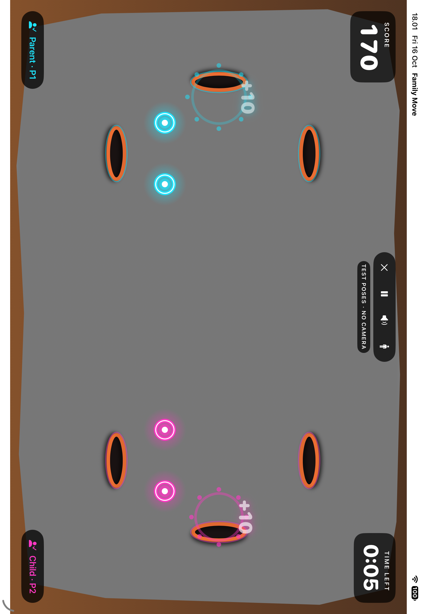

# Game kamera + Vision

Family Move adalah game gerakan dua pemain: kamera menampilkan pemain secara mirror, Apple Vision mendeteksi tubuh, lalu koordinat pergelangan mengendalikan pukulan. Game bisa dijalankan di iPad fisik maupun langsung di MacBook dengan webcam bawaannya.

## Menjalankan di MacBook

Pilih scheme **FamilyMove** dan run destination **My Mac (Mac Catalyst)** di Xcode, lalu **⌘R**. Izinkan kamera, buat dua profil, dan mulai game. Kamera MacBook dipakai langsung oleh aplikasi. Lihat [panduan lengkap MacBook](MACBOOK.md).

## Menjalankan di iPad

1. Buka `FamilyMove.xcodeproj`, pilih scheme **FamilyMove** dan iPad fisik sebagai run destination. Pilih development team pada Signing & Capabilities bila diperlukan.
2. Tekan **⌘R**, pilih game dan dua profil, lalu izinkan kamera.
3. Letakkan iPad mendatar pada posisi stabil. Berdiri berdampingan: P1 di kiri layar, P2 di kanan layar. Mundur sampai bahu dan pinggul terlihat; Birds & Alligators juga membutuhkan kaki terlihat.
4. Angkat tangan untuk melihat penanda cyan milik P1 dan pink milik P2. Berdiri tenang sampai kedua pemain siap; kalibrasi dan countdown berjalan otomatis.
5. Untuk Whack the Mole, arahkan salah satu tangan ke mole. Penanda pergelangan yang mengenai target menghasilkan efek pukulan dan +10. Ada target samping, atas, dan bawah di wilayah masing-masing pemain.

Lubang disusun dari ukuran tubuh saat kalibrasi dan tetap di tempat selama ronde. Jika perlu berpindah jauh, tekan Pause lalu Continue untuk mengatur posisi ulang. Target tidak mengikuti pemain menjauh ketika sedang dikejar.

Ronde memakai skor bersama dan durasi 60 detik sesuai rancangan sebelumnya. Referensi Active Arcade dipakai untuk arah interaksi kamera dan presentasi arena; sistem tiga nyawa dari gambar tidak ditambahkan. Ilustrasi dan efek dibuat khusus di proyek ini.

## Memeriksa tracking nyata

Tombol ikon tubuh di toolbar mengaktifkan debug: titik pergelangan/bahu/pinggul harus menempel pada gambar kamera, P1/P2 harus sesuai sisi layar, dan efek tangan harus hilang ketika tangan tidak terdeteksi. Jaga kedua pemain terlihat dan hindari saling menutupi tubuh. Tracking memakai posisi tubuh, tanpa pengenalan wajah.

Pemeriksaan dua orang sungguhan, jangkauan dewasa/anak, orientasi mirror, latensi, dan akurasi pukulan masih membutuhkan iPad fisik. Tes otomatis memeriksa koordinat/logika dan alur aplikasi; hasil tersebut tidak membuktikan kualitas tracking kamera nyata.

## Simulator

**FamilyMove** tetap memilih kamera. iPad Simulator menampilkan petunjuk menjalankan aplikasi langsung di MacBook melalui **My Mac (Mac Catalyst)** atau di iPad fisik.

**FamilyMove Simulator** adalah preview Debug terpisah dengan kontrol simulasi yang ditandai “NO CAMERA”. Mode ini membantu memeriksa arena, skor, pause, hasil, dan penyimpanan. Lihat [kontrol preview](SIMULATOR.md). Gerakan simulasi bukan gerakan yang diukur kamera.

Frame kamera diproses di perangkat, tanpa menyimpan atau mengunggah video.

## Tampilan arena dalam pengujian

Gambar berikut memakai pose otomatis untuk memeriksa efek tangan dan lubang. Latar abu-abu adalah lingkungan uji tanpa kamera; pada iPad fisik area tersebut menampilkan kamera depan. Skor dan timer singkat dalam gambar berasal dari fixture pengujian, bukan aktivitas pemain nyata.

