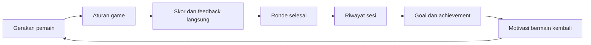
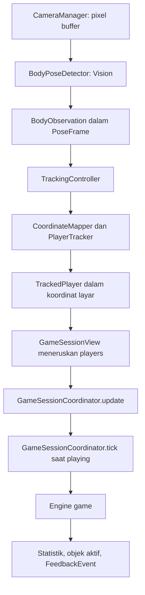
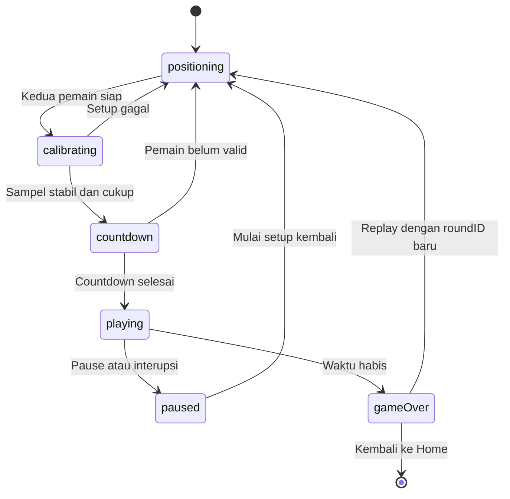

# Memahami prototype Family Move dan merancang arsitekturmu sendiri

**Snapshot kode: 19 Oktober 2026.** Panduan ini disusun dengan membaca source prototype yang ada. Tujuannya membantu kamu memahami pembagian tanggung jawab dan alasan di baliknya, lalu memilih struktur yang sesuai untuk aplikasi barumu.

Ada dua jenis penjelasan di sini:

- **Saat ini:** perilaku dan struktur yang sudah ada di prototype.
- **Usulan:** rancangan untuk pembangunan ulang. Nama folder, tipe, dan API di bagian ini belum dibuat di proyek.

Untuk pembacaan pertama, ikuti bagian 1–5, lalu lompat ke bagian 10–12. Detail tracking, penyimpanan, dan evaluasi prototype bisa dibaca sambil membuka kodenya. Dokumen ini tidak mengubah implementasi aplikasi.

## Daftar isi

1. [Gambaran besar: dua siklus yang berjalan bersama](#1-gambaran-besar-dua-siklus-yang-berjalan-bersama)
2. [Arsitektur dan struktur file saat ini](#2-arsitektur-dan-struktur-file-saat-ini)
3. [Siapa memiliki state dan mengatur apa?](#3-siapa-memiliki-state-dan-mengatur-apa)
4. [Perjalanan satu sesi dari buka aplikasi sampai tersimpan](#4-perjalanan-satu-sesi-dari-buka-aplikasi-sampai-tersimpan)
5. [Bagaimana satu gerakan berubah menjadi skor?](#5-bagaimana-satu-gerakan-berubah-menjadi-skor)
6. [Kamera, Vision, koordinat, dan identitas pemain](#6-kamera-vision-koordinat-dan-identitas-pemain)
7. [State machine, waktu, dan interupsi](#7-state-machine-waktu-dan-interupsi)
8. [Data yang hidup sementara dan data yang disimpan](#8-data-yang-hidup-sementara-dan-data-yang-disimpan)
9. [Lapisan gamification dan keputusan produknya](#9-lapisan-gamification-dan-keputusan-produknya)
10. [Bagian yang bisa dipertahankan dan yang layak dirapikan](#10-bagian-yang-bisa-dipertahankan-dan-yang-layak-dirapikan)
11. [Usulan struktur untuk membangun ulang](#11-usulan-struktur-untuk-membangun-ulang)
12. [Urutan implementasi yang bisa kamu ikuti](#12-urutan-implementasi-yang-bisa-kamu-ikuti)
13. [Strategi pengujian](#13-strategi-pengujian)
14. [Urutan membaca kode dan latihan pemahaman](#14-urutan-membaca-kode-dan-latihan-pemahaman)
15. [Checklist sebelum menetapkan arsitektur](#15-checklist-sebelum-menetapkan-arsitektur)

## 1. Gambaran besar: dua siklus yang berjalan bersama

Family Move adalah aplikasi aktivitas fisik dua pemain. Kamera menangkap tubuh, Vision membaca posisi sendi, dan aturan game menentukan apakah gerakan tersebut menghasilkan keberhasilan. UI memberi respons, kemudian hasil ronde menjadi bahan untuk halaman progress.

Ada dua siklus dengan kebutuhan teknis berbeda:

| Siklus | Contoh | Yang harus dijaga |
| --- | --- | --- |
| Permainan selama ronde | Melihat mole → menggerakkan tangan → mengenai target → mendapat +10 | Respons cepat, koordinat benar, satu target dihitung sekali |
| Progress antarsesi | Menyelesaikan ronde → melihat pencapaian → mendekati target mingguan → bermain lagi | Riwayat konsisten, perhitungan dapat dijelaskan, hasil tersimpan sekali |



**Implikasi untuk arsitektur:** perhitungan collision tidak perlu mengetahui database. Penyimpanan riwayat tidak perlu mengetahui frame kamera. Halaman progress cukup membaca hasil sesi; ia tidak perlu mengulang proses tracking.

Kamu bisa memakai pola yang sama untuk gamified app lain. Jika inputnya nanti tombol, jawaban kuis, atau aktivitas yang dicatat pengguna, lapisan input berubah sementara pemisahan aturan, feedback, hasil, dan progress tetap berguna.

## 2. Arsitektur dan struktur file saat ini

### 2.1 Pola yang benar-benar dipakai

Prototype menggabungkan **pengelompokan per fitur**, **service/repository**, dan **aturan game berbentuk value type**. Beberapa layar memakai ViewModel; beberapa memakai `@State`, `@Query`, dan repository secara langsung. `ObservableObject` dan `@Published` menghubungkan controller/coordinator dengan SwiftUI.

Pemisahan ini terutama berupa folder dan tanggung jawab kode. Aplikasi masih satu target Xcode. Paket `TrackingCore` untuk tes juga memuat sebagian coordinator dan persistence, sehingga isinya lebih luas dari aturan domain murni.

### 2.2 Peta folder aktual

```text
Challenge5Coba/
├── FamilyMove.xcodeproj/          # Proyek aplikasi iPad + Mac Catalyst
├── FamilyMove/
│   ├── App/                      # Startup, routing, penghubung tracking
│   ├── Features/
│   │   ├── Onboarding/           # Profil dan pemeriksaan kamera MacBook
│   │   ├── Home/                 # Pilihan game, detail, ringkasan rumah tangga
│   │   ├── PlayerSelection/      # Memilih dua profil dan urutan P1/P2
│   │   ├── GameSession/          # Setup, ronde, HUD, hasil, diagnostic view
│   │   └── Progress/             # Statistik pribadi, goal, edit pengukuran
│   ├── Camera/                   # AVFoundation dan preview kamera
│   ├── BodyTracking/             # Vision, mapping, matching, smoothing
│   ├── Games/
│   │   ├── Shared/               # Clock, konfigurasi, stats, feedback
│   │   ├── WhackAMole/           # Engine, spawn, collision, tampilan mole
│   │   └── BirdsAndAlligators/   # Engine, deteksi gerakan, tampilan obstacle
│   ├── Models/                   # SwiftData models dan GameType
│   ├── Persistence/              # Repository, mapping record, statistik
│   ├── DesignSystem/             # Warna, tipografi, komponen, audio
│   └── Resources/                # Asset, privacy plist, entitlement Mac
├── Tests/
│   ├── TrackingCoreTests/        # Logika, koordinat, persistence, kalender
│   └── UITests/                  # Alur layar dan game dengan input uji
├── Package.swift                 # Mengompilasi source terpilih untuk unit test
├── Scripts/                      # Build, peluncuran Mac, sinkronisasi source
└── Docs/                         # Panduan dan catatan validasi
```

Folder membantu orang menemukan kode. **Batas ketergantungan** ditentukan oleh isi kode: siapa membuat objek, siapa memanggilnya, dan tipe data apa yang lewat. Membuat folder bernama `Domain` saja belum memisahkan aturan game dari UI atau database.

### 2.3 File penunjuk utama

| Ingin memahami | Mulai dari |
| --- | --- |
| Startup dan database | [FamilyMoveApp.swift](/Users/jevon/ADA/Challenge5Coba/FamilyMove/App/FamilyMoveApp.swift) |
| Pergantian layar utama | [AppCoordinator.swift](/Users/jevon/ADA/Challenge5Coba/FamilyMove/App/AppCoordinator.swift), [AppRootView.swift](/Users/jevon/ADA/Challenge5Coba/FamilyMove/App/AppRootView.swift) |
| Integrasi satu ronde | [GameSessionView.swift](/Users/jevon/ADA/Challenge5Coba/FamilyMove/Features/GameSession/GameSessionView.swift) |
| Aturan fase dan timer ronde | [GameSessionCoordinator.swift](/Users/jevon/ADA/Challenge5Coba/FamilyMove/Features/GameSession/GameSessionCoordinator.swift) |
| Kamera menjadi posisi pemain | [TrackingController.swift](/Users/jevon/ADA/Challenge5Coba/FamilyMove/App/TrackingController.swift) |
| Aturan pukulan | [WhackAMoleEngine.swift](/Users/jevon/ADA/Challenge5Coba/FamilyMove/Games/WhackAMole/WhackAMoleEngine.swift), [CollisionDetector.swift](/Users/jevon/ADA/Challenge5Coba/FamilyMove/Games/WhackAMole/CollisionDetector.swift) |
| Aturan squat/jump | [MovementDetector.swift](/Users/jevon/ADA/Challenge5Coba/FamilyMove/Games/BirdsAndAlligators/MovementDetector.swift) |
| Penyimpanan hasil | [SessionRepository.swift](/Users/jevon/ADA/Challenge5Coba/FamilyMove/Persistence/SessionRepository.swift) |
| Goal, streak, achievement | [StatisticsService.swift](/Users/jevon/ADA/Challenge5Coba/FamilyMove/Persistence/StatisticsService.swift) |

## 3. Siapa memiliki state dan mengatur apa?

**State** adalah informasi yang perlu diingat agar langkah berikutnya benar: layar aktif, waktu tersisa, target yang masih hidup, atau jumlah hit.

| Pemilik saat ini | State/tanggung jawab | Batas yang perlu dipahami |
| --- | --- | --- |
| `AppCoordinator` | Layar utama, game terpilih, dua anggota terpilih | Mengatur perjalanan aplikasi |
| `TrackingController` | Pemain terdeteksi, geometri preview, error dan metrik Vision | Menghasilkan input gerakan untuk sesi |
| `GameSessionCoordinator` | Fase ronde, kalibrasi, clock, engine, skor dan objek aktif | Mengatur kapan aturan game boleh berjalan |
| `WhackAMoleEngine` | Mole aktif, jadwal spawn, statistik hit/miss tiap pemain | Menentukan hasil interaksi dengan mole |
| `BirdsAlligatorsEngine` | Obstacle, detektor gerakan, statistik tiap pemain | Menentukan hasil interaksi dengan bird/alligator |
| `GameSessionView` | Lifecycle, rendering, audio, error save, pilihan input, penyimpanan hasil | Saat ini juga menjadi tempat banyak komponen dirangkai |
| SwiftData melalui `ModelContext` | Profil, settings, sesi selesai, statistik peserta | Menyimpan riwayat yang bertahan setelah aplikasi ditutup |

`AppCoordinator` dan `GameSessionCoordinator` melayani dua skala berbeda. Mengubah halaman Home menjadi Game tidak sama dengan mengubah fase ronde dari countdown menjadi playing.

Skor juga perlu dibaca dengan jelas: engine menyimpan statistik peserta, `PlayerRoundStats.scoreContribution` menghitung `hits × 10`, dan coordinator menjumlahkannya menjadi skor bersama. UI menampilkan hasil perhitungan tersebut.

**Pelajaran untuk pembangunan ulang:** tetapkan satu pemilik untuk setiap keputusan. Jika tombol UI, efek animasi, dan engine semuanya bisa menambah skor secara independen, kamu akan sulit menelusuri penghitungan ganda.

## 4. Perjalanan satu sesi dari buka aplikasi sampai tersimpan

1. `FamilyMoveApp` membuat `ModelContainer` dan schema SwiftData. Jika pembukaan store gagal, UI menampilkan kegagalan startup.
2. `AppRootView` membaca profil dengan `@Query`. `AppCoordinator` mengarahkan ke onboarding bila profil kurang dari dua, atau Home bila cukup.
3. Di Home, pemain memilih game, melihat detail, lalu memilih tepat dua profil. Urutan pemilihan menentukan kaitan profil ke P1 dan P2.
4. `AppCoordinator.play(...)` memvalidasi dua profil berbeda dan membuka `GameSessionView`.
5. `GameSessionView` membuat tracking controller dan session coordinator. Pada mode normal, kamera mulai berjalan ketika layar aktif.
6. Dua pemain harus terlihat stabil. Sistem mengambil kalibrasi, lalu menjalankan countdown.
7. Saat `playing`, coordinator menjalankan engine yang sesuai, memperbarui waktu, objek aktif, feedback, dan skor.
8. Saat waktu habis, coordinator berpindah ke `gameOver`. View memanggil `SessionRepository.saveCompleted(...)`, menghentikan kamera, dan menampilkan hasil.
9. Save memakai ID ronde yang sama pada percobaan ulang. Replay memberi ronde berikutnya ID baru; Done mengembalikan pengguna ke Home.
10. `@Query` pada Home membaca riwayat yang sudah berubah. `StatisticsService` menghitung ulang ringkasan dan progress berdasarkan riwayat itu.

**Perhatikan lokasi penyimpanan:** saat ini coordinator tidak menyimpan database sendiri. Pemanggilan save berada di `GameSessionView`. Ini salah satu sambungan yang bisa kamu perjelas dalam rancangan baru.

## 5. Bagaimana satu gerakan berubah menjadi skor?

### 5.1 Jalur input sampai engine



Preview kamera punya jalur render tersendiri melalui `AVCaptureVideoPreviewLayer`. Engine tidak perlu menerima gambar untuk menghitung hit; engine menerima hasil tracking yang sudah dipetakan.

### 5.2 Contoh konkret Whack the Mole

Misalkan target P1 mempunyai pusat `(200, 300)` dan radius `40` dalam koordinat layar. Pergelangan P1 terdeteksi di `(225, 300)`.

```text
jarak tangan ke pusat target = 25
batas hit                   = radius × 1.3 = 52
25 <= 52                    → hit, jika target milik P1 dan masih aktif
```

`CollisionDetector` memeriksa tangan yang tersedia dan cukup confidence. Coordinator sudah menyaring pose yang kedaluwarsa sebelum memanggil engine.

Jika berhasil, `WhackAMoleEngine`:

1. Menghapus mole dari daftar aktif.
2. Menambah `hits` dan jenis reach milik pemain.
3. Mencatat waktu reaksi sejak mole muncul.
4. Menghasilkan `FeedbackEvent` di posisi target.
5. Menjadwalkan spawn berikutnya setelah jeda.

Coordinator kemudian menjumlahkan kontribusi skor. View memperbarui HUD, menggambar efek pukulan, dan memainkan suara ketika skor naik.

Mole hilang dari state aktif segera setelah hit, sehingga pemeriksaan frame berikutnya tidak menghitung target yang sama lagi. Rendering efek tidak menambah skor.

`MoleArenaLayout` dipakai bersama oleh spawner dan renderer. Keduanya menghitung lubang dari kalibrasi yang sama, sehingga titik yang harus disentuh sesuai dengan titik yang terlihat. Lubang tetap di tempat sampai kalibrasi ulang.

### 5.3 Birds & Alligators memerlukan urutan gerakan

Bird mengharapkan squat; alligator mengharapkan jump. Sebuah pose sesaat belum berarti satu gerakan lengkap. `MovementDetector` mengingat apakah pemain mulai berdiri, bergerak cukup jauh, lalu kembali berdiri.

```text
berdiri → mulai bergerak → melewati ambang gerakan → kembali berdiri
                                                   ↓
                                      satu MovementKind dihasilkan
```

Engine membandingkan hasil gerakan dengan obstacle yang aktif. Gerakan yang salah tidak menyelesaikan obstacle. Ada batas durasi dan cooldown agar satu gerakan tidak dihitung berkali-kali.

Ambang gerakan memakai proporsi torso hasil kalibrasi. Ini lebih sesuai untuk pemain dengan ukuran tubuh berbeda dibanding satu jarak pixel untuk semua orang. Nilainya tetap membutuhkan pengujian gerakan nyata.

## 6. Kamera, Vision, koordinat, dan identitas pemain

### 6.1 Tiga pekerjaan yang berbeda

| Komponen | Pekerjaan |
| --- | --- |
| `CameraManager` | Izin kamera, memilih perangkat, memulai/menghentikan capture, menangani interupsi |
| `BodyPoseDetector` | Mengubah pixel buffer menjadi posisi sendi melalui Vision |
| `TrackingController` dan helper tracking | Mengubah koordinat, menjaga P1/P2, menyaring data lama, menerbitkan input siap pakai |

Kamera tidak mengetahui skor. Vision tidak menentukan apakah target berhasil dipukul. Pemisahan ini memungkinkan aturan game diuji tanpa membuka webcam.

### 6.2 Ada lebih dari satu sistem koordinat

- `BodyObservation`: posisi hasil Vision yang dinormalisasi, origin di kiri bawah; capture input tidak di-mirror.
- `TrackedPlayer`: posisi yang sudah dipetakan ke ruang preview/layar, origin di kiri atas.
- Preview: memakai `resizeAspectFill`, sehingga sebagian gambar mungkin terpotong.

[CoordinateMapper.swift](/Users/jevon/ADA/Challenge5Coba/FamilyMove/BodyTracking/CoordinateMapper.swift) memperhitungkan ukuran buffer, skala aspect fill, crop, pembalikan Y, dan mirror X. Jika renderer menggambar titik dengan konversi berbeda dari collision, pemain akan melihat tangan mengenai mole tetapi skor tidak naik.

Efek tangan dan collision saat ini sama-sama memakai `TrackedPlayer.confidentHands`. Efek glow/trail membantu pemain memahami kontrol; efek tersebut tidak melakukan mapping kedua dan tidak menjadi sumber perhitungan skor.

**Untuk rancanganmu:** dokumentasikan satuan dan ruang koordinat setiap tipe data. Kamu boleh mulai dengan koordinat layar seperti prototype. Jika nanti banyak resolusi, kamera, atau layout, pertimbangkan ruang arena tersendiri dengan transform ke layar yang jelas. Perubahan ini memerlukan pengujian mapping, bukan sekadar mengganti nama field.

### 6.3 P1/P2 berbeda dari profil manusia

Ada empat identitas yang sebaiknya tidak tercampur:

| Identitas | Dipakai untuk |
| --- | --- |
| `FamilyMember.id` (`UUID`) | Profil persisten dan riwayat anggota |
| `TrackedPlayer.id` (`1` atau `2`) | Slot tubuh dalam ronde, berdasarkan posisi dan kontinuitas tracking |
| `roundID` (`UUID`) | Satu sesi yang boleh disimpan satu kali |
| `Mole.id` / `Obstacle.id` | Satu target tertentu yang dapat selesai atau habis waktunya |

Profil yang dipilih pertama dikaitkan dengan slot P1, profil kedua dengan P2. Sistem tidak mengenali wajah untuk memastikan siapa orang di slot itu.

Pada awal deteksi, kiri/kanan layar menentukan slot. Setelahnya, tracker membandingkan jarak pusat tubuh dengan frame sebelumnya. Pergelangan yang hilang segera dibuang; anchor pusat tubuh dipertahankan sebentar untuk membantu pencocokan ulang. Pemain yang saling menyilang atau lama menghilang tetap dapat tertukar.

### 6.4 Data realtime punya masa berlaku

Frame yang lama tidak boleh terus dipakai sebagai tangan yang masih aktif. Prototype menerapkan confidence minimum, timestamp, smoothing, dan watchdog untuk menghapus input yang kedaluwarsa.

Konfigurasi saat ini mencakup confidence minimum `0.30`, umur pose maksimum `0.30` detik, dan EMA smoothing `0.30`. Menambah smoothing dapat mengurangi jitter sekaligus menambah keterlambatan respons. Pilih nilainya dengan mengamati pengalaman pemain, bukan hanya tampilan marker yang terlihat halus.

Capture dan Vision berjalan pada satu queue background serial. Vision dibatasi hingga 15 request/detik dan menahan gate sampai hasil dikonsumsi main thread. State untuk UI diterbitkan di main thread. Timer game mempunyai jadwal sendiri sekitar 30 tick/detik; nilai tersebut bukan jaminan FPS tampilan atau throughput deteksi.

### 6.5 iPad, MacBook, dan mode uji

| Lingkungan | Input saat ini |
| --- | --- |
| iPad fisik, mode normal | Kamera depan, rotasi sesuai landscape perangkat |
| MacBook melalui Mac Catalyst | Webcam bawaan/eksternal yang ditemukan; rotasi native webcam, preview mirror |
| iPad Simulator, scheme normal | Petunjuk menjalankan kamera di MacBook atau iPad fisik |
| Scheme `FamilyMove Simulator` pada Debug | Kontrol manual yang menghasilkan pose simulasi |
| UI test dengan flag synthetic | Pose otomatis untuk memeriksa alur, tanpa Vision nyata |

`SessionInputMode` memilih jalur tersebut. Mode simulasi tetap mengirim data ke aturan collision/movement yang sama, sehingga tombol tidak langsung menambahkan skor. Ini seam pengujian yang berguna, walau pemilihan jalurnya saat ini masih berada di view.

## 7. State machine, waktu, dan interupsi

### 7.1 Dua state machine

State aplikasi adalah `onboarding`, `home`, dan `gameSession`. Di dalam `gameSession` ada state ronde tersendiri:



Diagram ini menunjukkan jalur utama. Kode juga mengatur penyebab pause secara terpisah melalui `SessionPauseReason`, karena kehilangan tracking dan pause manual memerlukan aturan resume yang berbeda.

Readiness memerlukan dua pemain valid terus-menerus selama satu detik. Kalibrasi mengambil sedikitnya lima sampel berbeda selama sekitar satu detik, memeriksa kestabilan, lalu menyimpan baseline tubuh. Countdown mendahului dimulainya waktu bermain.

Saat kedua pemain hilang selama dua detik, ronde di-pause. Jika hanya satu hilang, pemain lain tetap dapat bermain. Setelah pause/interupsi, setup dan kalibrasi diulang; target lama dibuang, sedangkan skor dan waktu bermain yang telah terpakai dipertahankan.

### 7.2 Tiga jenis waktu

| Waktu | Contoh penggunaan | Representasi saat ini |
| --- | --- | --- |
| Waktu monotonic perangkat | Umur pose dan pengukuran selisih waktu | `ProcessInfo.processInfo.systemUptime` |
| Waktu aktif ronde | Lifetime mole, reaction time, sisa ronde | `RoundClock`, tidak menghitung pause/setup |
| Tanggal kalender | Riwayat, minggu berjalan, streak | `Date` dan `Calendar` |

Timer memberi kesempatan melakukan `tick`; sisa waktu dihitung dari selisih timestamp. Prototype tidak mengandalkan asumsi bahwa setiap tick selalu datang tepat waktu.

Jangan menggunakan angka dari dua jenis waktu secara bergantian. Misalnya, membandingkan `mole.spawnedAt` yang berisi waktu aktif ronde dengan tanggal kalender akan membuat expiry salah.

### 7.3 Lifecycle adalah bagian aturan permainan

Saat aplikasi masuk background, kamera berhenti dan sesi di-pause. Saat kembali, pemain melakukan setup ulang. Perubahan ukuran preview atau orientasi menghapus geometri/kalibrasi yang lama. Pause manual tetap menunggu tindakan Continue.

Dalam rancangan baru, tulis aturan untuk setiap transisi ini sebelum menghubungkan UI. Contoh pertanyaan: jika kamera terputus setelah skor bertambah tetapi sebelum save, apakah ronde boleh dilanjutkan? Prototype menyimpan hasil setelah ronde lengkap; ronde yang ditinggalkan tidak disimpan sebagai hasil selesai.

## 8. Data yang hidup sementara dan data yang disimpan

### 8.1 Bedakan model realtime, hasil, dan model database

| Tipe aktual | Masa hidup dan peran |
| --- | --- |
| `BodyObservation`, `PoseFrame` | Satu hasil inferensi dan metadata frame |
| `TrackedPlayer` | Input pemain terbaru; dapat hilang/kedaluwarsa |
| `CalibrationSnapshot` | Baseline ukuran dan posisi tubuh untuk setup saat itu |
| `Mole`, `Obstacle`, `FeedbackEvent` | Objek/efek sementara selama ronde |
| `PlayerRoundStats` | Akumulasi sementara hasil per pemain selama ronde |
| `FamilyMember`, `AppSettings` | SwiftData models untuk profil dan preferensi |
| `GameSession`, `ParticipantSessionStat` | SwiftData models untuk ronde selesai dan kontribusi peserta |
| `SessionRecord`, `ParticipantRecord` | Value records untuk menghitung statistik tanpa bergantung pada objek SwiftData |

Nama `GameSession` di `Models/` mengacu pada **rekaman persisten**. Yang mengatur permainan yang sedang berlangsung adalah `GameSessionCoordinator`. Membedakan nama seperti `RoundState` dan `SessionRecord` pada proyek baru bisa mengurangi kebingungan ini.

### 8.2 Relasi data yang disimpan

```text
GameSession
  └── participantStats[] → ParticipantSessionStat
                               ├── member → FamilyMember
                               └── session → GameSession

AppSettings → preferensi perangkat: goal mingguan, debug, suara
```

Satu ronde dua pemain menghasilkan satu rekaman sesi dan dua rekaman peserta. Durasi rumah tangga dihitung sekali per ronde; statistik pribadi mengambil peserta yang sesuai.

Menghapus sesi memiliki aturan cascade ke statistik pesertanya. Relasi dari profil memakai nullify. Perhatikan bahwa mapping `GameSession.record` saat ini melewati participant yang profilnya sudah tidak ada. Jika kelak ada fitur hapus profil, tentukan terlebih dahulu bagaimana riwayat anonim dan pencapaian harus diperlakukan.

### 8.3 Menyimpan sekali, walau dipanggil beberapa kali

Save bisa dicoba ketika `gameOver`, Retry Save, Done, atau Play Again. Semua memakai `roundID` yang sama. Repository memeriksa apakah ID itu sudah tersimpan sebelum melakukan insert. Inilah **idempotensi**: mengulang permintaan yang sama tidak menggandakan hasil.

Saat replay, ID ronde diganti. Jika save gagal, error terlihat dan dapat dicoba lagi. Repository melakukan rollback perubahan context ketika save gagal.

Pemeriksaan ID saat ini mengambil seluruh sesi, lalu mencari ID di memori. Ini cukup sederhana untuk prototype; jika riwayat membesar, query berdasarkan ID lebih sesuai. Pertahankan batasan unik database dan uji juga pemanggilan save berulang.

### 8.4 Snapshot hasil lebih mudah dibaca

**Usulan:** setelah ronde selesai, bentuk satu nilai hasil yang tidak berubah, misalnya `RoundResult`. Isinya ID ronde, peserta, game, tanggal mulai, durasi aktif, skor, dan kontribusi per peserta. Service penyimpanan menerima nilai ini dan memetakannya ke SwiftData.

Manfaatnya: layar hasil, Retry Save, dan progress mempunyai sumber hasil yang jelas. Data hasil tidak ikut berubah ketika state game direset untuk replay. Tipe `RoundResult` tersebut belum ada pada prototype saat ini.

## 9. Lapisan gamification dan keputusan produknya

### 9.1 Apa yang sudah ada?

| Mekanik | Implementasi sekarang | Pertanyaan untuk aplikasi barumu |
| --- | --- | --- |
| Skor | +10 per keberhasilan; total bersama dua pemain | Apakah keberhasilan berdasarkan ketepatan, usaha, atau keduanya? |
| Feedback langsung | Glow tangan, efek hit, suara, countdown | Apakah pemain mengerti mengapa berhasil/gagal tanpa membaca instruksi? |
| High score | Skor sesi tertinggi per game | Apakah perbandingan skor adil jika kesulitan/durasi berubah? |
| Weekly goal | Jumlah sesi pribadi dibanding goal | Apakah goal sebaiknya per anggota atau bersama? |
| Streak | Hari bermain berurutan yang berakhir hari ini/kemarin | Apa perilaku yang ingin didorong dan bagaimana hari istirahat diperlakukan? |
| Achievement | Kondisi dari riwayat: sesi, hit, jump, streak | Apakah unlock permanen atau hanya menggambarkan kondisi sekarang? |
| Ringkasan aktivitas | Jumlah ronde, menit, gerakan, perkiraan kalori | Metrik mana yang berguna dan benar-benar bisa diukur? |

XP, level progression, currency, leaderboard online, akun cloud, dan sistem quest terjadwal belum menjadi bagian prototype ini.

### 9.2 Tiga detail yang mudah terlewat

**High score pribadi saat ini masih skor tim.** `StatisticsService.highScore(game:member:)` memilih sesi yang diikuti anggota tersebut, lalu mengambil `SessionRecord.score`, yaitu skor bersama ronde. Jika kamu menginginkan skor kontribusi individu, data dan agregasinya perlu disesuaikan.

**Nilai goal dipakai bersama pada perangkat.** `AppSettings.weeklyGameGoal` menyimpan satu nilai, sedangkan progress dihitung untuk anggota terpilih. Jika setiap anggota perlu target berbeda, cakupan penyimpanan goal juga perlu berubah.

**Achievement dihitung ulang dari riwayat.** Tidak ada tabel unlock permanen dengan tanggal mendapat badge. Achievement berbasis current streak dapat kembali menjadi locked ketika streak putus. Tentukan apakah perilaku tersebut sesuai dengan arti badge di produkmu.

### 9.3 Progress perlu definisi data yang konsisten

`StatisticsService` menerima value records, tanggal acuan, dan kalender. Ini memudahkan pengujian minggu berjalan dan streak tanpa membuka UI.

Tetapkan apakah sesi masuk minggu tertentu berdasarkan waktu mulai atau waktu selesai. Saat ini prototype memakai `startedAt`. Tentukan juga apakah ronde yang dibatalkan, latihan singkat, dan mode simulasi berhak memengaruhi progress.

Mode manual Simulator saat ini dapat menyimpan sesi melalui jalur normal pada store Simulator. Pose sintetis UI test menggunakan store terpisah. Jika aplikasi baru menyediakan demo/latihan, simpan asal input atau jenis sesi agar aktivitas simulasi bisa dibedakan dari aktivitas yang diukur.

Perkiraan kalori saat ini menggunakan berat, durasi, dan nilai intensitas yang diasumsikan, bukan pengukuran metabolisme dari kamera. Memasukkan sebuah angka ke dashboard tidak menjadikannya hasil ukur. Untuk rancanganmu, pilih metrik yang bisa dijelaskan asal dan batasnya kepada pengguna.

## 10. Bagian yang bisa dipertahankan dan yang layak dirapikan

| Temuan dari kode sekarang | Pelajaran untuk pembangunan ulang |
| --- | --- |
| Collision dan movement detector terpisah dari rendering | Pertahankan aturan yang bisa diuji dengan data sederhana |
| Lifecycle ronde memakai enum state | Pertahankan transisi eksplisit; hindari banyak boolean yang dapat saling bertentangan |
| Mapping sendi dan arena digunakan bersama | Pertahankan satu definisi geometri untuk tampilan dan hit detection |
| History menjadi sumber statistik | Pertahankan sumber perhitungan yang dapat ditelusuri ke sesi |
| Save hasil memakai ID ronde | Pertahankan idempotensi dan error/retry yang terlihat |
| `GameSessionView` merangkai tracking, timer, audio, settings, save, dan input uji | Pindahkan koordinasi efek samping ke objek sesi yang fokus, agar view lebih mudah dipahami |
| Coordinator membuat kedua engine dan memakai percabangan game | Mulai sederhana; buat abstraksi engine hanya jika penambahan game menghasilkan duplikasi yang nyata |
| `StatisticsService` berada di folder `Persistence`, walau kalkulasinya memakai value records | Pada rancangan baru, pisahkan perhitungan progress dari akses database |
| `Models/` berisi SwiftData models sekaligus `GameType` yang tidak persisten | Pisahkan tipe domain dan model penyimpanan bila perbedaannya mulai penting |
| ViewModel/helper/komponen kadang berada dalam satu file view | Pisahkan ketika tanggung jawabnya sudah dapat dijelaskan sendiri; satu tipe tidak selalu membutuhkan satu file |
| Spawner memakai randomness global dan engine memanggil `NSLog` | Untuk tes yang perlu hasil persis, sediakan sumber random/event logger yang dapat dikendalikan |
| Objek kamera bertipe implicitly unwrapped optional pada controller | Pertimbangkan constructor/factory yang memastikan dependency siap tanpa state inisialisasi sementara |
| Package mengompilasi source pilihan dari app | Berguna untuk tes; jika benar-benar ingin batas modul, buat package domain yang mandiri setelah kebutuhannya jelas |

Engine berbentuk `struct` di prototype mudah diuji tanpa SwiftUI, tetapi tidak semuanya fungsi murni/deterministik: ada state internal, random spawn, dan logging. Belajar membedakan hal tersebut lebih berguna daripada memberi satu label arsitektur untuk seluruh proyek.

`App/RootView.swift` berisi `TrackingRootView`, yaitu layar pemeriksaan kamera. Root aplikasi normal berada di `AppRootView.swift`. Nama file historis seperti ini dapat dirapikan ketika membangun ulang. `TrackingTestView` saat ini dipakai oleh pemeriksaan kamera MacBook, jadi tetap ada kegunaan runtime-nya meski namanya mengandung “Test”.

## 11. Usulan struktur untuk membangun ulang

### 11.1 Mulai dari satu alur kecil yang utuh

Untuk tahap pertama, kamu cukup membuktikan: kamera terlihat → satu posisi tangan terbaca → satu target terkena → skor bertambah → ronde selesai. Profil lengkap dan dashboard dapat menyusul setelah jalur ini dipahami.

Struktur awal yang cukup kecil bisa berupa:

```text
MyGame/                           # USULAN, belum ada di prototype
├── App/
│   ├── MyGameApp.swift
│   └── AppRootView.swift
├── Features/Play/
│   ├── PlayView.swift
│   └── PlaySessionController.swift
├── Domain/
│   ├── RoundState.swift
│   ├── RoundClock.swift
│   ├── PlayerInput.swift
│   ├── MoleEngine.swift
│   └── RoundResult.swift
├── Infrastructure/Camera/
│   ├── CameraCapture.swift
│   ├── VisionPoseDetector.swift
│   └── PoseMapper.swift
└── Resources/
```

`PlaySessionController` merangkai input, clock, dan engine. `PlayView` merender snapshot yang dibutuhkan layar. `Domain` berisi aturan dan nilai yang dapat dipakai tanpa membuka kamera atau database.

### 11.2 Ketika profil, riwayat, dan beberapa game mulai diperlukan

Berikut contoh perluasan, bukan daftar file yang wajib langsung dibuat:

```text
MyGamifiedApp/                    # USULAN
├── App/
│   ├── MyGamifiedApp.swift        # Membuat dependency dan data container
│   ├── AppRouter.swift           # Navigasi tingkat aplikasi
│   └── AppDependencies.swift     # Jika wiring dependency sudah perlu dipusatkan
├── Features/
│   ├── Onboarding/
│   ├── Profiles/
│   ├── GameLibrary/
│   ├── Play/
│   │   ├── PlayView.swift
│   │   ├── PlaySessionController.swift
│   │   └── Components/           # HUD, setup, pause
│   ├── Results/
│   └── Progress/
├── Domain/
│   ├── Session/                  # State, clock, konfigurasi, hasil ronde
│   ├── Player/                   # Identitas slot, input dan baseline
│   ├── Games/
│   │   ├── WhackAMole/           # Target, spawn, hit rules
│   │   └── BirdsAndAlligators/   # Obstacle dan movement rules
│   └── Progress/                 # Goal, achievement, agregasi statistik
├── Infrastructure/
│   ├── Camera/                   # AVFoundation, izin, pemilihan perangkat
│   ├── Vision/                   # Body pose adapter dan transform koordinat
│   ├── Persistence/
│   │   ├── Models/               # Tipe @Model SwiftData
│   │   ├── SessionRepository.swift
│   │   └── RecordMapper.swift
│   └── Audio/                    # Pelaksana sound effect
├── SharedUI/                     # Warna, tipografi, komponen lintas fitur
├── Resources/
└── Tests/
    ├── DomainTests/
    ├── PersistenceTests/
    ├── InputMappingTests/
    └── UITests/
```

Beberapa aturan ketergantungan yang bisa kamu tulis di README proyek baru:

- View merender state dan meneruskan aksi pengguna.
- Controller sesi mengatur lifecycle dan menghubungkan komponen.
- Aturan game menerima data input, konfigurasi, dan waktu; menghasilkan state/kejadian game.
- Kode domain tidak membuka kamera, memainkan audio, atau memanggil `ModelContext`.
- Infrastructure menerjemahkan framework Apple menjadi tipe data yang disepakati aplikasi.
- Repository memetakan hasil domain ke penyimpanan, dan record penyimpanan ke data yang diperlukan progress.

Folder tersebut boleh tetap berada dalam satu target di awal. Ekstrak menjadi package jika ada kebutuhan nyata untuk pemakaian ulang atau pemeriksaan batas modul.

### 11.3 Kontrak data lebih dahulu, protocol seperlunya

Sebelum membuat banyak service, sepakati data yang lewat pada tiga batas berikut:

| Batas | Kontrak yang perlu jelas |
| --- | --- |
| Input → game | ID slot, sendi/aksi yang tersedia, confidence, timestamp, sistem koordinat |
| Game → presentasi | State ronde, target aktif, skor, feedback/kejadian |
| Ronde selesai → storage/progress | ID ronde, peserta, hasil, durasi, tanggal, versi aturan bila dibutuhkan |

**Contoh pseudocode usulan**, bukan API prototype sekarang:

```text
inputSource menghasilkan PlayerInput terbaru

setiap tick:
    snapshot, events = game.update(input, calibration, activeTime)
    view menampilkan snapshot
    session controller meneruskan events ke audio/visual feedback

saat ronde selesai:
    result = hasil tetap untuk roundID ini
    repository.save(result)       // aman dipanggil ulang
    results screen menampilkan result dan status penyimpanannya
```

Prototype saat ini mengembalikan `[FeedbackEvent]` dari engine, mengambil state/statistiknya, dan memicu suara lewat perubahan skor di view. Jika kebutuhan efek bertambah, kamu bisa memperkenalkan kejadian seperti `targetHit`, `targetMissed`, dan `roundFinished` agar audio atau animasi tidak harus menebak kejadian dari selisih skor.

Interface seperti `PlayerInputSource` berguna ketika kamera dan input uji memang harus dapat diganti. `RoundClock` sudah dapat diuji menggunakan parameter waktu; kamu tidak perlu menambah abstraksi clock jika pendekatan itu sudah cukup. Protocol per class dan dependency-injection framework tidak menjadi prasyarat pemisahan tanggung jawab.

### 11.4 Memutuskan lokasi file baru

| Pertanyaan | Lokasi yang masuk akal |
| --- | --- |
| Apakah hanya mengatur tampilan suatu layar? | Fitur yang memiliki layar tersebut |
| Apakah menentukan keberhasilan, skor, atau transisi aturan game? | Domain sesi atau domain game terkait |
| Apakah menghitung pencapaian dari riwayat? | Domain progress |
| Apakah bergantung pada kamera, audio, atau database? | Infrastructure sesuai framework/tugas |
| Apakah benar-benar dipakai oleh beberapa fitur? | Shared UI atau domain bersama dengan nama tanggung jawab yang spesifik |

Jika suatu file sulit dimasukkan ke salah satu kelompok, periksa apakah file itu sedang mengerjakan beberapa tugas sekaligus. Hindari menjadikan `Utils`, `Managers`, atau `Shared` sebagai tempat untuk semua hal yang belum dipahami.

## 12. Urutan implementasi yang bisa kamu ikuti

| Tahap | Yang kamu buat | Bukti selesai sebelum melanjutkan |
| --- | --- | --- |
| 1. Definisi permainan | Satu game, aturan hit/miss, durasi, jumlah pemain, arti progress | Aturannya bisa kamu jelaskan dalam satu halaman |
| 2. Pilih platform uji | Proyek SwiftUI pada MacBook atau iPad yang tersedia | Aplikasi terbuka di perangkat yang akan dipakai untuk kamera |
| 3. Pahami input kamera | Capture, Vision, mapper, marker satu pemain | Pergelangan terpetakan sesuai preview; kehilangan sendi terlihat jelas |
| 4. Aturan game kecil | Satu target, collision, skor; input buatan untuk unit test | Input yang sama dapat membuktikan hit, miss, dan satu-hit-satu-skor |
| 5. Satukan alur | Kamera → input → engine → HUD/feedback | Satu orang dapat mengenai target dengan gerakan nyata |
| 6. Lengkapi sesi | State machine, timer aktif, pause, replay, nilai hasil | Pause tidak memakan waktu bermain; replay tidak membawa target lama |
| 7. Dua pemain dan kalibrasi | Slot stabil, ukuran tubuh, target per pemain, tracking loss | Pemain tidak mendapat skor dari target milik slot lain; jangkauan dapat diuji |
| 8. Simpan hasil | Profil, repository, relasi peserta, retry/idempotensi | Satu ronde menghasilkan satu sesi; hasil tetap ada setelah relaunch |
| 9. Tambah gamification | Satu goal dan satu achievement dari riwayat | Pengguna memahami syaratnya dan progress sesuai data sesi |
| 10. Perluas seperlunya | Game kedua, penyempurnaan UI, tuning platform, aksesibilitas | Setiap tambahan punya kebutuhan yang jelas dan tes yang relevan |

Pada setiap tahap, tulis alur datanya dengan namamu sendiri sebelum menambah file. Setelah satu alur utuh bekerja, baru ekstrak bagian yang memang digunakan ulang. Ini membantu kamu memahami alasan pemisahannya.

## 13. Strategi pengujian

### 13.1 Uji aturan tanpa kamera

Ambil input dengan koordinat dan timestamp yang kamu tentukan. Periksa hal seperti:

- Tangan di dalam/di luar radius, sendi tidak tersedia, confidence rendah.
- P1 menyentuh target P2, target sudah selesai, target kedaluwarsa.
- Gerakan squat/jump harus kembali berdiri dan tidak berulang saat diam.
- Pause tidak mengurangi sisa waktu aktif; selesai berhenti pada nol.
- Save berulang memakai ID yang sama menghasilkan satu sesi.
- Minggu, streak, dan achievement mengambil anggota yang benar.

Tes yang sudah ada bisa dibaca sebagai contoh konkret: [GameSystemsTests.swift](/Users/jevon/ADA/Challenge5Coba/Tests/TrackingCoreTests/GameSystemsTests.swift), [SessionCoordinatorTests.swift](/Users/jevon/ADA/Challenge5Coba/Tests/TrackingCoreTests/SessionCoordinatorTests.swift), dan [StatisticsTests.swift](/Users/jevon/ADA/Challenge5Coba/Tests/TrackingCoreTests/StatisticsTests.swift).

### 13.2 Uji integrasi dan hardware secara terpisah

| Pengujian | Yang bisa dibuktikan |
| --- | --- |
| Mapper/tracker dengan observasi buatan | Transform, matching, dan expiry mengikuti aturan yang ditulis |
| SwiftData in-memory pada tes persistence | Relasi, save berulang, dan nilai historis tersimpan sesuai harapan |
| UI test dengan pose sintetis | Alur setup, ronde, pause, hasil, dan replay berjalan |
| Kamera nyata pada MacBook/iPad | Posisi marker, latensi yang dirasakan, occlusion, jangkauan, dua tubuh nyata |

Input uji otomatis dapat tepat mengenai target setiap saat. Karena itu, skor tinggi pada UI test tidak membuktikan akurasi Vision pada manusia.

Catatan validasi prototype sebelumnya mencatat 59 unit test lulus, pemeriksaan kamera MacBook dengan satu pemain, dan beberapa alur UI. Pengujian dua orang nyata masih perlu dilakukan. Angka tersebut adalah hasil pemeriksaan terdahulu, bukan hasil menjalankan ulang tes saat menulis panduan ini. Detailnya ada di [VALIDATION.md](/Users/jevon/ADA/Challenge5Coba/Docs/VALIDATION.md).

## 14. Urutan membaca kode dan latihan pemahaman

### 14.1 Mulai dari aturan, lalu telusuri sambungannya

| Urutan | File | Pertanyaan yang perlu bisa kamu jawab |
| --- | --- | --- |
| 1 | [Mole.swift](/Users/jevon/ADA/Challenge5Coba/FamilyMove/Games/WhackAMole/Mole.swift), [CollisionDetector.swift](/Users/jevon/ADA/Challenge5Coba/FamilyMove/Games/WhackAMole/CollisionDetector.swift) | Apa syarat satu hit? Data minimum apa yang dibutuhkan? |
| 2 | [WhackAMoleEngine.swift](/Users/jevon/ADA/Challenge5Coba/FamilyMove/Games/WhackAMole/WhackAMoleEngine.swift) | Siapa menghapus target dan siapa menghitung statistik? |
| 3 | [GameSessionState.swift](/Users/jevon/ADA/Challenge5Coba/FamilyMove/Games/Shared/GameSessionState.swift), [RoundClock.swift](/Users/jevon/ADA/Challenge5Coba/FamilyMove/Games/Shared/RoundClock.swift) | Apa yang tetap ada ketika pause? Waktu apa yang dipakai? |
| 4 | [GameSessionCoordinator.swift](/Users/jevon/ADA/Challenge5Coba/FamilyMove/Features/GameSession/GameSessionCoordinator.swift) | Kapan engine dipanggil dan kapan input ditolak? |
| 5 | [TrackingController.swift](/Users/jevon/ADA/Challenge5Coba/FamilyMove/App/TrackingController.swift), [CoordinateMapper.swift](/Users/jevon/ADA/Challenge5Coba/FamilyMove/BodyTracking/CoordinateMapper.swift) | Bagaimana posisi kamera menjadi posisi layar? |
| 6 | [GameSessionView.swift](/Users/jevon/ADA/Challenge5Coba/FamilyMove/Features/GameSession/GameSessionView.swift) | Di mana objek dirangkai dan efek samping dipicu? |
| 7 | [SessionRepository.swift](/Users/jevon/ADA/Challenge5Coba/FamilyMove/Persistence/SessionRepository.swift), [SessionRecordMapping.swift](/Users/jevon/ADA/Challenge5Coba/FamilyMove/Persistence/SessionRecordMapping.swift) | Apa yang disimpan dan apa yang menjadi input progress? |
| 8 | [StatisticsService.swift](/Users/jevon/ADA/Challenge5Coba/FamilyMove/Persistence/StatisticsService.swift) | Dari data apa setiap goal/badge dihitung? |
| 9 | [FamilyMoveApp.swift](/Users/jevon/ADA/Challenge5Coba/FamilyMove/App/FamilyMoveApp.swift), [AppRootView.swift](/Users/jevon/ADA/Challenge5Coba/FamilyMove/App/AppRootView.swift) | Bagaimana seluruh sistem mulai hidup dan memilih layar? |

### 14.2 Latihan kecil sebelum membuat ulang semuanya

1. Gambar jalur satu hit dari input sampai hasil tersimpan tanpa melihat diagram panduan ini.
2. Tulis collision sederhana sendiri, lalu buktikan kondisi di dalam, di luar, dan pemain salah melalui tes.
3. Buat `RoundClock` versi sendiri yang bisa kamu jalankan dengan angka waktu manual; jelaskan mengapa pause tidak menghitung durasi.
4. Tentukan satu achievement baru dan tulis fungsi yang menghitungnya dari tiga sesi buatan sebelum membuat kartu UI-nya.
5. Pilih satu tugas yang sekarang berada di `GameSessionView`, misalnya penyimpanan hasil, lalu desain satu batas data untuk memindahkannya. Jelaskan siapa yang tetap memiliki hasil dan siapa yang mengeksekusi save.

Keberhasilan latihan ini adalah kamu dapat menjelaskan input, output, dan pemilik state masing-masing bagian. Setelah itu, menyusun folder menjadi keputusan yang lebih mudah.

## 15. Checklist sebelum menetapkan arsitektur

- [ ] Aku bisa menjelaskan perilaku utama yang ingin didorong oleh gamification.
- [ ] Aku sudah menentukan apa yang dianggap keberhasilan, kegagalan, dan satu ronde selesai.
- [ ] Aku membedakan profil persisten, slot pemain, ID ronde, dan ID target.
- [ ] Aku tahu pemilik state, skor, timer, dan penyimpanan hasil.
- [ ] Sistem koordinat, satuan, confidence, dan masa berlaku input sudah tertulis.
- [ ] Ada jalur pengujian aturan tanpa kamera dan rencana pengujian kamera nyata.
- [ ] Pause, background, resize, izin ditolak, dan kehilangan tracking memiliki aturan yang jelas.
- [ ] Save dapat diulang tanpa menggandakan sesi atau progress.
- [ ] Definisi skor individu/tim, goal pribadi/bersama, dan unlock permanen/sementara sudah diputuskan.
- [ ] Demo/simulasi dapat dibedakan dari aktivitas nyata jika hasilnya masuk riwayat.
- [ ] Perubahan aturan game, versi data, penghapusan profil, dan migrasi penyimpanan sudah dipertimbangkan.
- [ ] Aku sudah menentukan aksesibilitas, alternatif input bila diperlukan, dan jangkauan gerakan yang akan diuji.
- [ ] Penggunaan kamera, penyimpanan frame, dan data profil sesuai dengan fitur yang diperlukan.
- [ ] Struktur awal cukup kecil untuk aku pahami dan jalankan sendiri.

Dokumen pendamping: [IMPLEMENTATION.md](/Users/jevon/ADA/Challenge5Coba/Docs/IMPLEMENTATION.md) untuk detail implementasi, [FILES.md](/Users/jevon/ADA/Challenge5Coba/Docs/FILES.md) untuk inventaris, dan [MACBOOK.md](/Users/jevon/ADA/Challenge5Coba/Docs/MACBOOK.md) untuk menjalankan prototype di MacBook.
