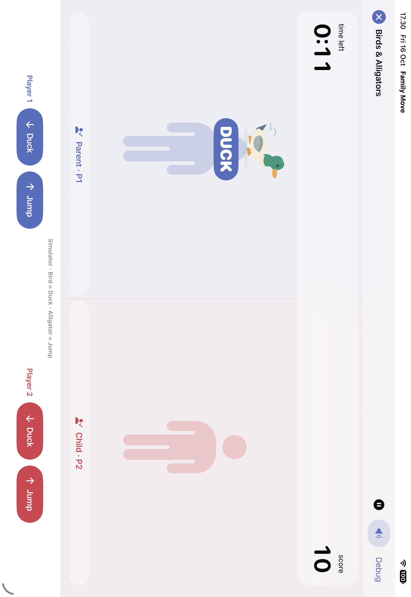

# Preview di Simulator

Game utama memakai kamera + Apple Vision untuk mengubah gerakan tubuh menjadi kontrol. Untuk bermain di MacBook dengan kamera bawaannya, pilih **My Mac (Mac Catalyst)**, sesuai [panduan MacBook](MACBOOK.md). Simulator menyediakan alat uji kontrol terpisah.

1. Buka `FamilyMove.xcodeproj`.
2. Pilih scheme **FamilyMove Simulator**, lalu perangkat iPad Simulator.
3. Tekan **⌘R**, buat/pilih dua profil, dan pilih game.
4. Tekan **Start Round**, lalu tunggu countdown.

## Kontrol

**Whack the Mole:** klik atau tap mole yang muncul. Mole cyan milik P1, mole pink milik P2. Target yang tidak diklik habis waktunya; skor tidak berjalan sendiri.

**Birds & Alligators:** masing-masing pemain memiliki tombol **Duck** dan **Jump**. Bird meminta Duck, alligator meminta Jump. Tombol menjalankan satu gerakan lengkap, termasuk kembali berdiri; aksi salah tidak mendapat skor. Tekan sesegera mungkin saat rintangan muncul.

Ronde manual berlangsung 60 detik. Pause, Continue, Play Again, hasil, dan penyimpanan tetap tersedia. Profil Simulator tidak direset saat aplikasi dijalankan ulang.

## Cara kerja

Scheme preview memasang argumen `--simulator-controls`, yang hanya berlaku pada build Debug di Simulator. Tanpa argumen tersebut, **FamilyMove** menjelaskan cara menjalankan kamera langsung di MacBook atau iPad fisik. Mode preview memakai `SimulatorInput` dan `SimulatedBodyPose` untuk menghasilkan perubahan pergelangan/pinggul/kaki dari tindakan pengguna. CollisionDetector dan MovementDetector yang sama tetap memvalidasi aksi tersebut; tombol tidak langsung menambah skor. Tidak ada permintaan izin kamera pada mode preview.

Mode otomatis delapan detik tetap dikhususkan untuk UI test dengan dua argumen eksplisit `--ui-testing --synthetic-poses`. Argumen `--short-round` hanya mempersingkat ronde manual saat `--ui-testing` juga aktif di Debug; jalur manual biasa tetap 60 detik.

Di iPad fisik, mode normal memakai kamera. Mouse/touch Simulator membantu memeriksa permainan dan alur aplikasi, bukan membuktikan akurasi Vision, latensi kamera, kalibrasi tubuh nyata, atau aktivitas fisik/kalori.

