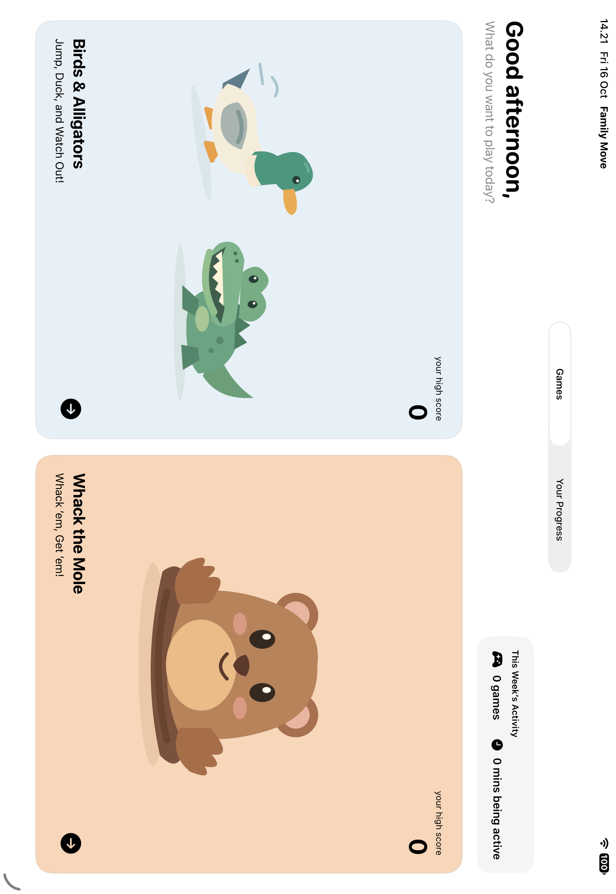

# Family Move

A native iPad and MacBook app for two family members to play body-controlled movement games together. Built with SwiftUI, SwiftData, AVFoundation, and Apple Vision. iPadOS 17+ and macOS 14+ through Mac Catalyst, no third-party dependencies.

**Ingin memahami prototype dan menyusun arsitektur sendiri?** Baca [panduan arsitektur gamified app](/Users/jevon/ADA/Challenge5Coba/Docs/PANDUAN-ARSITEKTUR-GAMIFIED-APP.md): alur kode saat ini, pemilik state, hubungan kamera–game–progress, evaluasi desain, dan contoh struktur untuk membangun ulang.

**Play on your MacBook:** open `FamilyMove.xcodeproj`, choose the **FamilyMove** scheme and **My Mac (Mac Catalyst)** as the run destination, then press **⌘R**. Allow camera access, add two family members, and choose a game. The built-in MacBook webcam supplies real frames to Vision. The app also discovers USB webcams. First-launch **Check MacBook Camera** verifies capture/tracking before profiles are created. See [panduan MacBook](Docs/MACBOOK.md).

Alternatively, run `bash Scripts/run-mac.sh` from this folder to build and open the MacBook app. Local Mac builds use ad-hoc signing and need no development team. Release: `bash Scripts/build-mac.sh Release`.

Open **`FamilyMove.xcodeproj`**, select **FamilyMove**, choose your development team in Signing & Capabilities, and run on a physical iPad. Both players share a score; the selected P1 stands on the screen's left and P2 on its right.

For Simulator, select an iPad run destination and press **⌘R**. Open the `.xcodeproj` directly: opening this folder or `Package.swift` instead selects the **FamilyMoveCore** library package, which can build successfully without launching an app. **⌘B** only builds; **⌘R** builds and launches.

**Camera gameplay:** the **FamilyMove** scheme uses the front camera and Apple Vision. Stand beside each other, wait for calibration/countdown, and reach toward the moles with either hand. Cyan and pink wrist effects follow the same mapped coordinates used for collisions. Six holes surround the players at calibrated side, overhead, and low positions; the holes stay fixed during play. See [panduan game kamera](Docs/CAMERA-GAMEPLAY.md).

**Optional Simulator preview:** choose **FamilyMove Simulator** with an iPad Simulator and press **⌘R**. This Debug-only scheme explicitly enables simulated mouse/touch controls. Select two family members, then choose **Start Round**.

- **Whack the Mole:** click/tap cyan and pink mole targets to test P1 and P2 scoring.
- **Birds & Alligators:** use each player’s **Duck** button for birds and **Jump** button for alligators. Press promptly: the move must finish before its obstacle disappears.
- Normal manual rounds last **60 seconds**, support pause/replay, and use the same collision, movement, score, and session-save systems. Players do not move or score automatically. These are simulated actions, not measured physical activity.

The normal **FamilyMove** scheme never silently substitutes touch input for the camera. On iPad Simulator it explains how to run directly on the MacBook or an iPad. The preview scheme uses `--simulator-controls` in Debug on Simulator only. Automated pose fixtures require both `--ui-testing` and `--synthetic-poses`. Simulated modes display a visible no-camera label.

## Included

- First-launch onboarding, validated family profiles, and local persistence (up to eight members).
- Home game cards, household high scores and weekly activity, game details, and exactly two-player selection.
- Mirrored front camera, two-person pose tracking, stable spatial assignment, smoothing, and optional debug markers.
- One-second readiness, sampled body calibration, countdown, 60-second rounds, pause/reposition/recalibrate/resume.
- **Whack the Mole:** personalized side, overhead, and low targets; wrist collision; single-hit scoring; timeouts.
- **Birds & Alligators:** duck for birds, jump for alligators; calibrated movement states require returning to standing.
- Results, replay, completed session records, participant contributions and movement statistics, and idempotent saves.
- Manual pause, protected round exit, stable calibration checks, and recalibration after landscape changes.
- Personal progress, editable weight/height, calendar-week totals, streaks, editable weekly goals, achievements, and history.

Artwork uses project-owned vector illustrations, with short local audio cues and a persistent mute toggle. No camera frames are saved or uploaded. Calories are labeled estimates and use centralized provisional intensity values.

## Build and test

```sh
bash Scripts/build.sh local
DEVELOPER_DIR=/Applications/Xcode.app/Contents/Developer swift test --scratch-path .build/PackageTests
```

The shared Xcode scheme includes an iPad Simulator UI-test target. Run **Product → Test** for onboarding/relaunch, game selection, progress editing, and both complete game/results flows using Debug-only synthetic poses. UI tests use a separate SwiftData store; normal family records are not reset.

`Scripts/test-core.sh` runs the original 15 mapper/tracker checks using Command Line Tools if a full Xcode test environment is unavailable. `Scripts/sync-project.py` refreshes app source membership when Swift files are added. Generated build output and test logs live in `.build/` and are ignored.

See [penyempurnaan terbaru](Docs/PERFECTING.md) for the latest refinements. See [implementation notes](Docs/IMPLEMENTATION.md) for architecture, algorithms, source inventory, and assumptions, and [validation](Docs/VALIDATION.md) for tested behavior and the physical-iPad checklist.


