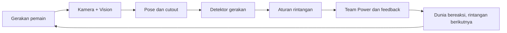
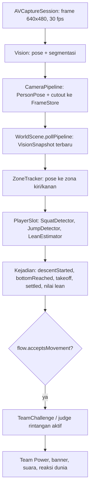
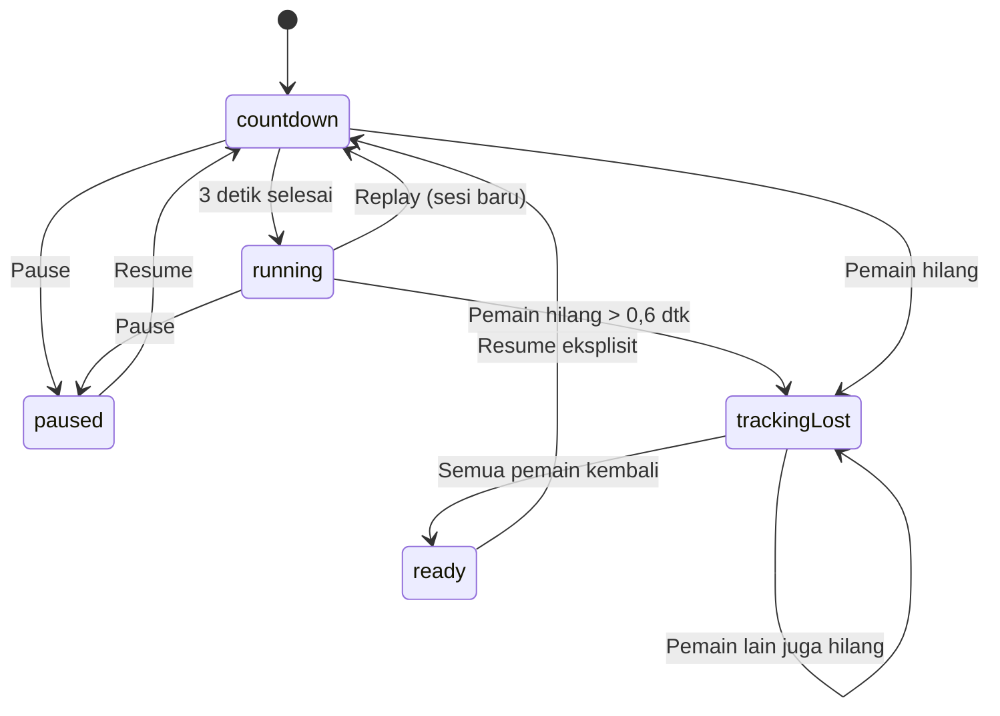

# Memahami prototype StuntRunSpike dan merancang arsitekturmu sendiri

**Snapshot kode: 22 Oktober 2026 (Revisi 11).** Panduan ini disusun dengan membaca source prototype yang ada. Tujuannya membantu kamu memahami pembagian tanggung jawab dan alasan di baliknya, lalu memilih struktur yang sesuai untuk aplikasi barumu.

Ada dua jenis penjelasan di sini:

- **Saat ini:** perilaku dan struktur yang sudah ada di prototype.
- **Usulan:** rancangan untuk pembangunan ulang. Nama folder, tipe, dan API di bagian ini belum dibuat di proyek.

Untuk pembacaan pertama, ikuti bagian 1–5, lalu lompat ke bagian 10–12. Detail kamera, waktu, dan gamification bisa dibaca sambil membuka kodenya. Dokumen ini tidak mengubah implementasi aplikasi.

## Daftar isi

1. [Gambaran besar: dua lajur yang berjalan bersama](#1-gambaran-besar-dua-lajur-yang-berjalan-bersama)
2. [Arsitektur dan struktur file saat ini](#2-arsitektur-dan-struktur-file-saat-ini)
3. [Siapa memiliki state dan mengatur apa?](#3-siapa-memiliki-state-dan-mengatur-apa)
4. [Perjalanan satu sesi dari buka aplikasi sampai replay](#4-perjalanan-satu-sesi-dari-buka-aplikasi-sampai-replay)
5. [Bagaimana satu gerakan berubah menjadi Team Power?](#5-bagaimana-satu-gerakan-berubah-menjadi-team-power)
6. [Kamera, Vision, koordinat, dan identitas pemain](#6-kamera-vision-koordinat-dan-identitas-pemain)
7. [State machine, waktu, dan interupsi](#7-state-machine-waktu-dan-interupsi)
8. [Data yang hidup sementara dan data yang disimpan](#8-data-yang-hidup-sementara-dan-data-yang-disimpan)
9. [Lapisan gamification dan keputusan produknya](#9-lapisan-gamification-dan-keputusan-produknya)
10. [Bagian yang bisa dipertahankan dan yang layak dirapikan](#10-bagian-yang-bisa-dipertahankan-dan-yang-layak-dirapikan)
11. [Usulan struktur untuk membangun ulang](#11-usulan-struktur-untuk-membangun-ulang)
12. [Urutan implementasi yang bisa kamu ikuti](#12-urutan-implementasi-yang-bisa-kamu-ikuti)
13. [Strategi pengujian](#13-strategi-pengujian)
14. [Urutan membaca kode dan latihan pemahaman](#14-urutan-membaca-kode-dan-latihan-pemahaman)
15. [Checklist sebelum menetapkan arsitektur](#15-checklist-sebelum-menetapkan-arsitektur)

## 1. Gambaran besar: dua lajur yang berjalan bersama

StuntRunSpike adalah prototype game gerak kooperatif untuk dua pemain (Parent dan Child) di iPad. Kamera menangkap tubuh, Vision membaca posisi sendi dan memotong siluet pemain, lalu detektor gerakan mengubah pose menjadi kejadian seperti "jongkok sampai bawah" atau "kaki lepas dari lantai". Aturan game menilai kejadian itu terhadap rintangan yang sedang aktif, dan dunia SpriteKit memberi respons.

Ada dua mode dalam satu aplikasi: **Stunt Run** (atap kereta, gerbang yang harus dihindari dengan jongkok) dan **Jungle Drift** (rakit di sungai: jongkok untuk burung, condong untuk buaya yang menyeruduk, lompat untuk piranha, batang kayu, dan kibasan ekor buaya).

Berbeda dari aplikasi dengan riwayat dan progress, prototype ini **tidak punya siklus antarsesi**: tidak ada profil, riwayat, atau penyimpanan hasil. Yang ada adalah dua lajur dengan kebutuhan teknis berbeda, berjalan bersamaan di dalam satu sesi:

| Lajur | Contoh | Yang harus dijaga |
| --- | --- | --- |
| Kamera dan Vision (queue background) | Frame kamera → pose + mask segmentasi → cutout berwarna | Tidak menumpuk frame; paling banyak satu frame diproses; tidak menyentuh state game |
| Game loop (main thread, 60 fps) | Ambil snapshot terbaru → detektor → aturan → dunia, HUD, suara | Respons cepat, satu kontribusi dihitung sekali, waktu permainan berhenti saat pause |



**Implikasi untuk arsitektur:** detektor gerakan dan aturan rintangan tidak perlu tahu tentang kamera atau SpriteKit. Lajur kamera tidak perlu tahu skor. Karena itu hampir semua aturan bisa diuji di macOS tanpa kamera dan tanpa simulator (lihat bagian 13).

Pola ini berguna untuk game gerak lain. Jika inputnya nanti berupa sensor lain atau tombol, lapisan input berubah, sementara pemisahan detektor, aturan, dan presentasi tetap berguna.

## 2. Arsitektur dan struktur file saat ini

### 2.1 Pola yang benar-benar dipakai

Prototype ini satu target app SwiftUI yang menampilkan satu `SKScene` lewat `SpriteView`. Polanya:

- **Aturan sebagai value type murni.** File `*Logic.swift`, `SquatDetector.swift`, `Pose.swift`, dan `JungleAnimation.swift` berisi `struct`/`enum` yang ditandai `nonisolated`, tanpa SpriteKit, Vision, atau UIKit. Semuanya dikompilasi juga ke dalam tes logika.
- **Satu scene besar dipecah lewat extension.** `WorldScene` adalah satu kelas `SKScene` untuk kedua mode, dibagi ke beberapa file `WorldScene+*.swift`. Mode dipilih dengan `gameMode`.
- **State mode Jungle di kelas bantu.** Extension Swift tidak boleh punya stored property, jadi semua state Jungle Drift dikumpulkan di `JungleRuntime`.
- **Gambar digambar lewat kode.** File `Art*.swift` membuat tekstur dengan Core Graphics saat runtime; `Shaders*.swift` berisi shader SpriteKit untuk langit, lantai, dan sungai.
- **SwiftUI hanya untuk bingkai dan panel developer.** `GameModel` (`@Observable`) menghubungkan panel SwiftUI dengan scene. Scene membaca setting sekali per frame dan menulis balik status dengan frekuensi rendah.

Swift 6 dengan isolasi default `MainActor` dipakai di seluruh target, sehingga tipe yang perlu dipakai lintas thread atau di tes ditandai `nonisolated` secara eksplisit.

### 2.2 Peta folder aktual

```text
StuntRunSpike/
├── StuntRunSpike.xcodeproj/        # Target app (iPad + Mac Catalyst) dan StuntRun3D
├── StuntRunSpike/                  # Semua source app (folder datar, tanpa subfolder)
│   ├── StuntRunApp.swift           # @main, ContentView, panel developer, panel metrik
│   ├── GameModel.swift             # Setting dan status yang dibagi SwiftUI ↔ scene
│   ├── CameraPipeline.swift        # AVFoundation + Vision + cutout (queue background)
│   ├── Pose.swift                  # PersonPose, Joint, Zone, ZoneTracker (murni)
│   ├── SquatDetector.swift         # Deteksi jongkok + simulasi jongkok (murni)
│   ├── CoopLogic.swift             # TeamChallenge, SessionFlow, EncounterTiming (murni)
│   ├── JungleLogic.swift           # Rakit, buaya, director Jungle, lean (murni)
│   ├── PiranhaLogic.swift          # JumpDetector, piranha (murni)
│   ├── JumpSweepLogic.swift        # Penilaian lompat bersama, kayu, ekor buaya (murni)
│   ├── JungleAnimation.swift       # Akting buaya dan burung sebagai fungsi waktu (murni)
│   ├── WorldScene.swift            # SKScene: proyeksi, frame loop, properti bersama
│   ├── WorldScene+Gameplay.swift   # Input → kejadian → aturan (Stunt Run)
│   ├── WorldScene+Session.swift    # Pause, resume, replay, skrip, team lock
│   ├── WorldScene+Feedback.swift   # HUD, banner, Team Power, efek, metrik
│   ├── WorldScene+Environment.swift, +Hero.swift   # Dunia dan efek TEAM DUCK Stunt Run
│   ├── WorldScene+Jungle.swift     # Jungle Drift: runtime, director, burung, buaya, rakit, skrip
│   ├── WorldScene+Piranha.swift, +JumpSweeps.swift # Bahaya lompat Jungle Drift
│   ├── JungleWorld.swift, JungleLife.swift         # Sungai, tepian, satwa, landmark
│   ├── JungleCreatures.swift       # Rig buaya dan burung (node SpriteKit)
│   ├── Art*.swift, Shaders*.swift  # Tekstur dan shader yang dibuat lewat kode
│   ├── AudioFX.swift               # Efek suara sintetis (AVAudioEngine)
│   └── TeamDuckShatter.*           # Sprite sheet hasil bake 3D untuk efek TEAM DUCK
├── StuntRun3D/                     # Eksperimen versi RealityKit (target terpisah)
├── LogicTests/                     # run.sh + main.swift: tes logika di macOS
├── Tools/BakeTeamDuck/             # Tool pembuat sprite sheet efek TEAM DUCK
├── DesignerKit/                    # Spesifikasi aset untuk desainer
├── Evidence/                       # Screenshot, klip, dan log dari tiap revisi
├── README.md, FINDINGS.md, JUNGLE_ART_DIRECTION.md
└── StuntRunSpike-Mac.entitlements
```

Folder `StuntRunSpike/` sengaja datar; pengelompokan dilakukan lewat nama file (`*Logic`, `Art+*`, `WorldScene+*`). **Batas ketergantungan** ditentukan oleh isi kode, bukan nama: file `*Logic.swift` tidak mengimpor SpriteKit, dan itulah yang membuatnya bisa diuji tanpa simulator.

### 2.3 File penunjuk utama

| Ingin memahami | Mulai dari |
| --- | --- |
| Startup, ganti mode, panel developer | [StuntRunApp.swift](StuntRunSpike/StuntRunApp.swift), [GameModel.swift](StuntRunSpike/GameModel.swift) |
| Frame loop dan proyeksi pseudo-3D | [WorldScene.swift](StuntRunSpike/WorldScene.swift) |
| Kamera menjadi pose dan cutout | [CameraPipeline.swift](StuntRunSpike/CameraPipeline.swift), [Pose.swift](StuntRunSpike/Pose.swift) |
| Pose menjadi kejadian gerakan | [SquatDetector.swift](StuntRunSpike/SquatDetector.swift), `JumpDetector` di [PiranhaLogic.swift](StuntRunSpike/PiranhaLogic.swift), `LeanEstimator` di [JungleLogic.swift](StuntRunSpike/JungleLogic.swift) |
| Kerja sama dua pemain dan alur sesi | [CoopLogic.swift](StuntRunSpike/CoopLogic.swift) |
| Kejadian menjadi Team Power | [WorldScene+Gameplay.swift](StuntRunSpike/WorldScene+Gameplay.swift), `handleJungle` di [WorldScene+Jungle.swift](StuntRunSpike/WorldScene+Jungle.swift) |
| Aturan lompat bersama | [JumpSweepLogic.swift](StuntRunSpike/JumpSweepLogic.swift) |
| Pause, replay, skrip uji | [WorldScene+Session.swift](StuntRunSpike/WorldScene+Session.swift) |
| Team Power, TURBO, HUD | [WorldScene+Feedback.swift](StuntRunSpike/WorldScene+Feedback.swift) |

## 3. Siapa memiliki state dan mengatur apa?

**State** adalah informasi yang perlu diingat agar langkah berikutnya benar: fase sesi, siapa ada di zona mana, rintangan yang sedang aktif, atau jumlah Team Power.

| Pemilik saat ini | State/tanggung jawab | Batas yang perlu dipahami |
| --- | --- | --- |
| `ContentView` | Membuat dan menyimpan `GameModel`, `CameraPipeline`, `WorldScene`; membuat ulang scene saat mode diganti; menghentikan kamera saat background | Perakit aplikasi; tidak tahu aturan game |
| `GameModel` | Setting dari panel (mode tampilan, Reduce Motion, autoplay, swap roles, suara, mode game) dan cermin status dari scene (state sesi, metrik, sumber input) | Jembatan SwiftUI ↔ scene, bukan pemilik aturan |
| `CameraPipeline` | Sesi kamera, request Vision, `FrameStore` (buffer ganda) yang menerbitkan `VisionSnapshot` | Berjalan di queue sendiri; tidak tahu skor |
| `WorldScene` | `flow` (`SessionFlow`), `slots` per zona, `zoneTracker`, `roster`, `teamPower`, `gameTime`, rintangan Stunt Run (`encounter`, `gates`), skrip uji | Pusat koordinasi sesi dan presentasi |
| `PlayerSlot` (per zona) | Detektor jongkok dan lompat, sumber input (`live`, `simulated`, `absent`), simulasi, hitungan rep, combo | Satu slot = satu posisi bermain, bukan satu orang tertentu |
| `JungleRuntime` | Rakit (`RaftBalance`), director, timing tiap bahaya, bahaya aktif (burung, buaya, piranha, kayu, ekor), nilai lean, node HUD rakit, skrip Jungle | Kantong state mode Jungle |
| `TeamChallenge` dan turunannya | Siapa sudah berkontribusi pada satu rintangan; hasil TEAM / partial / cancelled | Satu-satunya tempat yang menentukan kontribusi |

Skor perlu dibaca dengan jelas: detektor hanya menghasilkan kejadian; `TeamChallenge.contribute(...)` mengembalikan Team Power yang boleh ditambahkan (sekali per pemain per rintangan), dan `resolve()` mengembalikan bonus tim satu kali. Scene memanggil `addTeamPower(_:)` dengan angka itu. Animasi, banner, dan suara tidak pernah menambah Team Power sendiri.

**Pelajaran untuk pembangunan ulang:** tetapkan satu pemilik untuk setiap keputusan. Di prototype ini aturan kontribusi sudah punya satu pemilik (`TeamChallenge`), tetapi pemicu dan pemanggilnya tersebar di beberapa extension scene.

## 4. Perjalanan satu sesi dari buka aplikasi sampai replay

1. `ContentView` membuat `GameModel` (membaca launch argument seperti `-gameMode jungle` dan `-cleanUI YES`), `CameraPipeline`, dan `WorldScene` untuk mode yang dipilih.
2. `SpriteView` menampilkan scene. `didMove(to:)` membangun dunia; untuk Jungle Drift, `buildJungle()` membuat semua tekstur di awal (115 tekstur, sekitar 90 ms) supaya tidak ada patah-patah saat landmark atau buaya pertama muncul.
3. `.task` memanggil `pipeline.start()`. Di Simulator, kamera diganti test card sintetis. Di perangkat, aplikasi meminta izin kamera, mengonfigurasi sesi, lalu mulai capture. Jika kamera dipakai, autoplay dimatikan kecuali `-autoplay YES`.
4. `SessionFlow` mulai dalam `countdown` 3 detik, lalu `running`.
5. Setiap frame, `WorldScene.update(_:)` menjalankan urutan tetap: `updateFlow` → `pollPipeline` (snapshot baru → salin tekstur cutout, `applyLivePoses`) → `updateInputs` (slot yang disimulasikan) → update mode (`advanceWorld`/`updateGates` untuk Stunt Run, `updateJungle` untuk Jungle) → visual pemain, HUD, metrik.
6. Rintangan datang berurutan. Stunt Run membuat satu gerbang per encounter. Jungle Drift memakai `JungleDirector` yang memutar 15 "beat" (burung, piranha, buaya, kayu, ekor, kombo, tenang).
7. Saat pause atau tracking hilang, rintangan aktif ditarik tanpa hasil (`withdrawGates` / `withdrawJungleHazards`). Setelah semua pemain kembali, state menjadi `ready` dan menunggu Resume eksplisit, lalu countdown lagi.
8. Replay menaikkan nomor sesi, mengosongkan Team Power, hitungan, simulasi yang terjadwal, dan rintangan, lalu countdown.
9. **Tidak ada yang disimpan.** Menutup aplikasi atau mengganti mode game (scene dibuat ulang) menghilangkan seluruh state sesi.

**Perhatikan lokasi keputusan:** `SessionFlow` adalah value type murni, tetapi efek dari perubahan state (menarik rintangan, banner, rearm detektor) dijalankan di `updateFlow` pada scene. Ini salah satu sambungan yang bisa kamu perjelas dalam rancangan baru.

## 5. Bagaimana satu gerakan berubah menjadi Team Power?

### 5.1 Jalur input sampai aturan



Input simulasi (tombol panel developer, autoplay, skrip) masuk ke **detektor yang sama** lewat `SimulatedSquat`, `SimulatedJump`, dan `SimulatedLean`. Tombol tidak pernah menambah skor secara langsung.

Cutout tubuh punya jalur render tersendiri: `FrameStore` menyimpan piksel RGBA, dan scene menyalinnya ke tekstur `bodySprite`. Aturan game tidak membaca gambar; mereka hanya membaca pose.

### 5.2 Contoh konkret: jongkok di bawah gerbang

`SquatDetector` mengubah sudut lutut menjadi kedalaman 0–1: 165° = berdiri (0), 100° = jongkok penuh (1). Jika pergelangan kaki tidak terlihat, ia memakai turunnya pinggul dibanding tinggi berdiri yang dikalibrasi.

```text
sudut lutut 140° → kedalaman (165 − 140) / 65 = 0,38 → lewat 0,22 → descentStarted
sudut lutut 128° → kedalaman 0,57               → lewat 0,50 → bottomReached
kembali tegak    → kedalaman di bawah 0,16       → repCompleted (jika sudah ≥ 0,6 dtk sejak turun)
```

Kedalaman dihaluskan dengan EMA (bobot sampel baru 0,6), dan ambang naik/turun berbeda (histeresis) supaya getaran di sekitar satu ambang tidak menghasilkan rep tambahan.

Yang terjadi pada tiap kejadian:

1. `descentStarted`: jika ada gerbang di jendela aksi, lajur pemain merespons dan team lock menyala sementara. Belum ada poin. Kejadian ini juga dipakai untuk mengukur jeda kamera-ke-feedback.
2. `bottomReached`: `TeamChallenge.contribute(zone, at:)` mengembalikan 1 jika pemain ini belum berkontribusi pada gerbang ini, lalu Team Power +1. Panggilan kedua untuk gerbang yang sama mengembalikan 0.
3. Saat gerbang lewat (atau lebih awal jika semua pemain sudah berkontribusi), `resolve()` sekali: semua berkontribusi → TEAM + bonus 1; sebagian → partial, tanpa bonus, kontribusi yang sudah ada tetap.
4. `repCompleted`: menambah hitungan jongkok di kartu pemain. Rep ini terpisah dari kontribusi.
5. `aborted` (turun setengah lalu naik): "GO DEEPER!" jika pemain sempat mulai tapi belum berkontribusi.

### 5.3 Lompat dan condong punya urutan sendiri

**Lompat** (`JumpDetector`): "lift" = naiknya pinggul di atas tinggi berdiri, dalam satuan panjang torso. Lift di atas 0,14 → `takeoff`; di bawah 0,07 → `landed`; berdiri tenang 0,2 detik setelah mendarat → `settled`. Hanya `settled` yang menambah hitungan lompat. Jika pergelangan kaki terlihat, kaki juga harus naik, supaya berjinjit tidak dihitung lompat.

Penilaian bahaya lompat dipakai bersama oleh piranha, kayu, dan ekor buaya (`JumpSweepJudge`): pemain lolos jika sedang di udara kapan saja dalam jendela **[waktu bahaya sampai di kakinya − 0,35 dtk, + 0,20 dtk]**. Setiap bahaya menghitung waktu sampainya dari lintasannya sendiri (lengkung ikan, guling kayu yang dipercepat, ayunan ekor).

**Condong** (`LeanEstimator`): sudut torso dari leher ke pinggul. Di bawah 2,5° dianggap tegak; 12° = condong penuh. Nilai lean kedua pemain dijumlahkan menjadi gaya pada `RaftBalance`. Untuk serangan buaya, `GatorChallenge` mencatat kontribusi jika pemain menahan condong ke arah yang benar minimal 0,4 detik.

## 6. Kamera, Vision, koordinat, dan identitas pemain

### 6.1 Tiga pekerjaan yang berbeda

| Komponen | Pekerjaan |
| --- | --- |
| `CameraPipeline` (capture) | Izin kamera, memilih kamera depan, preset 640×480 di 30 fps, mematikan Center Stage, mirror, rotasi |
| `CameraPipeline` (Vision dan composite) | `VNDetectHumanBodyPoseRequest` dan `VNGeneratePersonSegmentationRequest`, lalu cutout dengan tepi berwarna pemain |
| `WorldScene` + `ZoneTracker` + detektor | Mengambil snapshot terbaru, menentukan zona, mengubah pose jadi kejadian |

Kamera tidak mengetahui skor. Vision tidak menentukan apakah rintangan berhasil dilewati. Pemisahan ini memungkinkan aturan diuji tanpa webcam.

### 6.2 Ada lebih dari satu sistem koordinat

- **Vision:** posisi dinormalisasi terhadap frame kamera (origin kiri bawah). Koneksi kamera sudah di-mirror, jadi gambar dan pose sama-sama seperti cermin.
- **`PersonPose`:** dinormalisasi terhadap tekstur tampilan 640×480 setelah aspect fill (crop tengah), origin kiri bawah, sudah di-mirror. Sendi dengan confidence di bawah 0,1 dibuang; pose dengan kurang dari 4 sendi dibuang. `point(_:)` memakai minimum confidence 0,3 secara default. `aspect` (4:3) dipakai agar sudut dihitung dalam piksel persegi.
- **Dunia:** `Projection` adalah kamera pinhole pseudo-3D. `x` ke samping, `h` tinggi di atas lantai/dek, `z` kedalaman dari kamera; pemain berdiri di `z = 1,9`. `screen(x:h:z:)` memberi titik layar, `ppu(z)` memberi piksel per unit, `depthZ(z)` memberi `zPosition`.
- **Layar:** titik scene SpriteKit, origin kiri bawah.

Aturan bahaya Jungle ditulis dalam satuan dunia (`FootZone.laneX = 0,65`, `playerZ = 1,9`). Renderer memproyeksikan posisi yang sama, sehingga titik yang dinilai sesuai dengan yang terlihat.

Cutout pemain tidak memakai koordinat dunia secara langsung: `layoutLiveBody()` menskala tekstur kamera supaya tinggi badan orang dewasa ≈ 1,0 unit di bidang pemain, dan menaruh kaki di garis lantai.

**Untuk rancanganmu:** dokumentasikan satuan dan ruang koordinat setiap tipe data, termasuk apakah sudah di-mirror. Di prototype ini, satu kesalahan mirror akan membuat "condong kanan" terbaca sebagai condong kiri.

### 6.3 Zona berbeda dari orang

Ada beberapa identitas yang sebaiknya tidak tercampur:

| Identitas | Dipakai untuk |
| --- | --- |
| `Zone` (`.left` / `.right`) | Slot bermain: detektor, warna, jalur |
| Peran (Parent / Child) | Label dan warna; `swapRoles` menukar peran tanpa memindahkan zona |
| `flow.session` | Nomor sesi; efek tertunda dari sesi lama dibuang setelah replay |
| `TeamChallenge.id` | Satu rintangan yang dinilai sekali |

Tidak ada profil atau pengenalan wajah. `ZoneTracker` mengambil dua orang terbesar (berdasarkan panjang torso) dan mengurutkannya dari kiri ke kanan. Jika hanya satu orang terlihat, ia tetap di zona terakhirnya kecuali jelas menyeberang garis tengah (margin 0,1) dan posisi zona diingat 1 detik. Ini mencegah satu pemain di dekat garis tengah berpindah-pindah zona. Dua pemain yang saling menyilang tetap bisa tertukar.

### 6.4 Data realtime punya masa berlaku

Pose dianggap hilang setelah 0,6 detik tanpa sampel. Setelah seseorang (kembali) terdeteksi, gerakan baru dihitung setelah 0,4 detik (masa tenang), sehingga orang yang terdeteksi dalam posisi duduk tidak langsung dapat poin.

Capture, Vision, dan composite berjalan sinkron di **satu queue serial**. `alwaysDiscardsLateVideoFrames` aktif, jadi paling banyak satu frame sedang diproses dan frame lama dibuang oleh AVFoundation, bukan diantrekan. Game loop membaca snapshot terbaru (dicek dengan nomor urut) sekali per frame render.

Hasil terukur di iPad Pro 13" untuk Stunt Run: render 60 fps, Vision sekitar 30 fps, jeda dari jongkok sampai feedback sekitar 69 ms. Jungle Drift belum diukur di perangkat.

### 6.5 iPad, Mac, dan mode uji

| Lingkungan | Input saat ini |
| --- | --- |
| iPad fisik | Kamera depan, rotasi mengikuti `RotationCoordinator` |
| Mac (Mac Catalyst) | Webcam, rotasi dikunci 0° karena webcam selalu landscape |
| iPad Simulator | Test card sintetis lewat pipeline yang sama; pemain digerakkan simulasi |
| Panel developer dan keyboard | `SimulatedSquat`, `SimulatedJump`, `SimulatedLean` lewat detektor yang sama |
| Skrip uji (`-scenario coop`, `-scenario sweeps`) | Jadwal gerakan simulasi per langkah, dicatat ke game log |

`PlayerSlot.driver` memilih sumber per zona setiap frame: pose kamera yang baru, simulasi (jika tidak ada kamera, autoplay, skrip, atau input manual dalam 20 detik terakhir), atau kosong.

## 7. State machine, waktu, dan interupsi

### 7.1 Satu state machine sesi

`PlayState` di [CoopLogic.swift](StuntRunSpike/CoopLogic.swift):



Gerakan hanya dihitung saat `running` (`acceptsMovement`). Dunia, rintangan, dan `gameTime` berhenti saat `paused`, `trackingLost`, dan `ready` (`isHalted`).

Diagram ini menunjukkan jalur utama; replay dan kehilangan tracking sebenarnya bisa terjadi dari state mana pun.

Saat kembali ke `running`, semua detektor di-`rearm()`: jongkok yang dimulai saat berhenti tidak bisa selesai menjadi rep atau kontribusi. Rintangan berikutnya diberi jeda (Stunt Run minimal 2 detik, Jungle 2,5 detik setelah rintangan ditarik). Selain itu, setiap mode punya fase rintangannya sendiri, misalnya `EncounterPhase` (warning → approach → action → passed) dan `CrocPose.State` untuk akting buaya.

### 7.2 Tiga jenis waktu

| Waktu | Contoh penggunaan | Representasi saat ini |
| --- | --- | --- |
| Waktu nyata | Detektor gerakan, umur pose, animasi efek | `now` = `CACurrentMediaTime()` |
| Waktu permainan | Jadwal rintangan berikutnya, simulasi gerakan | `gameTime`, hanya maju saat tidak berhenti |
| Jam encounter | Fase dan posisi rintangan, penilaian lompat | `t` per rintangan, maju sebesar `dt × kecepatan dunia / kecepatan jelajah` |

Jam encounter mengikuti kecepatan dunia yang sebenarnya, sehingga rintangan tetap menempel pada pemandangan saat dunia melambat, berhenti, atau mengalami hit-stop. Waktu capture kamera (`captureTime`) hanya dipakai untuk mengukur jeda feedback.

Jangan mencampur jenis waktu. Contoh: simulasi lompat dijadwalkan dengan waktu permainan, sedangkan detektor berjalan dengan waktu nyata; karena itu replay harus membuang lompatan yang dijadwalkan untuk sesi lama.

### 7.3 Lifecycle adalah bagian aturan permainan

Saat aplikasi masuk background, `ContentView` menghentikan kamera. Tidak ada pause eksplisit. Menurut kodenya (belum diuji di perangkat), karena pose berhenti datang, detektor melaporkan pemain hilang setelah 0,6 detik tanpa pose, paling lambat saat aplikasi aktif lagi. Sesi masuk `trackingLost` dan rintangan ditarik; setelah kamera kembali state menjadi `ready`, dan pemain melanjutkan dengan Resume.

Mengganti mode game membuat scene baru; sesi lama hilang. Perubahan ukuran tampilan memanggil `layoutForSize()` dan proyeksi dihitung ulang.

Dalam rancangan baru, tulis aturan untuk setiap transisi ini sebelum menghubungkan UI. Contoh pertanyaan: jika satu pemain keluar frame saat bahaya lompat sudah di udara, apakah kontribusi pemain lain dipertahankan? Di prototype: ya, rintangan dibatalkan tanpa hasil dan Team Power yang sudah didapat tetap.

## 8. Data yang hidup sementara dan data yang disimpan

### 8.1 Semua state saat ini bersifat sementara

| Tipe aktual | Masa hidup dan peran |
| --- | --- |
| `VisionSnapshot`, `PersonPose` | Satu hasil Vision dan metadatanya |
| `PlayerSlot` | Detektor dan sumber input per zona selama sesi |
| `TeamChallenge`, `GatorChallenge`, `JumpSweepJudge` | Penilaian satu rintangan |
| `Gate`, `BirdHazard`, `GatorHazard`, `PiranhaHazard`, `LogHazard`, `TailHazard` | Rintangan aktif beserta node SpriteKit-nya |
| `RaftBalance` | Sudut dan kecepatan rakit |
| `teamPower`, hitungan jongkok/lompat, combo | Hasil sesi, hilang saat replay |
| `GameModel` | Setting yang dibaca dari launch argument dan panel; tidak ditulis ke disk |

Satu-satunya yang ditulis ke disk adalah **evidence harness**, dan hanya jika aplikasi dijalankan dengan `-evidenceDir`: screenshot event, `game.log`, dan `metrics.log`. Ini alat verifikasi, bukan penyimpanan hasil. Hati-hati: di perangkat dengan kamera, screenshot ini bisa berisi gambar orang sungguhan.

### 8.2 Jika nanti butuh riwayat

**Usulan:** setelah sesi atau ronde selesai, bentuk satu nilai hasil yang tidak berubah, misalnya `RoundResult`: ID ronde, mode, durasi aktif, Team Power, kontribusi per zona per jenis gerakan, dan jumlah rintangan TEAM/partial. Service penyimpanan menerima nilai ini dan memetakannya ke SwiftData. Simpan dengan ID ronde supaya pemanggilan ulang tidak menggandakan hasil.

Sebelum itu, tentukan dulu kapan sebuah sesi "selesai". Saat ini sesinya tanpa akhir (mode endless); hanya replay yang memulai sesi baru. Tipe `RoundResult` belum ada di prototype.

## 9. Lapisan gamification dan keputusan produknya

### 9.1 Apa yang sudah ada?

| Mekanik | Implementasi sekarang | Pertanyaan untuk aplikasi barumu |
| --- | --- | --- |
| Team Power | Satu meter bersama 0–10; +1 per kontribusi | Apakah usaha individu juga perlu terlihat? |
| Bonus tim | +1 jika semua peserta berkontribusi pada rintangan yang sama | Apakah bonus ini cukup mendorong kerja sama? |
| Hadiah meter penuh | Stunt Run: TURBO (kecepatan 2× sekitar 2,6 dtk, siang ↔ malam). Jungle: RIVER SPIRIT (perayaan dunia). Meter kembali ke 0 | Apakah hadiah perlu berarti di gameplay, atau cukup perayaan? |
| Feedback langsung | Lajur menyala saat mulai bergerak, team lock 0/2 → 2/2, label GREAT!, DUCKED!, CLEARED!, GO DEEPER!, TOO LATE!, suara | Apakah anak mengerti kenapa berhasil/gagal tanpa membaca? |
| Hukuman | Hampir tidak ada. Gagal hanya memberi reaksi lucu. Satu-satunya pengurangan: SPLASH di Jungle (−2) | Apakah tanpa hukuman membuat tantangan terasa kosong? |
| Hitungan rep | Jongkok dan lompat per pemain di kartu HUD | Apakah rep berarti "olahraga" bagi orang tua? |

High score, goal, streak, achievement, profil, dan riwayat **belum ada**.

### 9.2 Tiga detail yang mudah terlewat

**Kontribusi bukan rep.** Kontribusi dihitung saat titik terendah jongkok (atau saat kaki di udara) berada di jendela rintangan. Rep dihitung saat gerakan selesai lengkap. Pemain bisa mendapat rep tanpa kontribusi (jongkok di luar jendela) dan sebaliknya (jika tracking hilang sebelum berdiri lagi).

**TURBO bisa ditunda.** Jika meter penuh saat game berhenti atau saat encounter berlangsung, TURBO disimpan sebagai `pendingTurbo` dan dijalankan pada GO berikutnya. Efek ini dijaga dengan nomor sesi supaya tidak muncul di sesi baru.

**Bahaya digabung dengan jeda yang dijamin.** Director Jungle tidak pernah menaruh dua beat lompat berurutan, dan kayu serta ekor buaya menunggu rakit stabil sebelum peringatannya mulai. Pada kombo buaya → ekor, aba-aba lompat baru muncul setelah jendela pemulihan buaya ditutup (dijaga tes).

### 9.3 Keputusan yang belum diambil

Semua angka waktu (jendela aksi, jeda peringatan, jendela lompat) masih **provisional**, disetel agar terbaca di simulator, dan bisa diubah lewat launch argument. Belum ada yang divalidasi dengan anak-anak. Intensitas fisik (seberapa sering orang tua jongkok/lompat) juga belum diukur dengan orang sungguhan.

## 10. Bagian yang bisa dipertahankan dan yang layak dirapikan

| Temuan dari kode sekarang | Pelajaran untuk pembangunan ulang |
| --- | --- |
| Detektor gerakan, `TeamChallenge`, timing, dan judge adalah value type murni yang dites di macOS | Pertahankan aturan yang bisa diuji dengan data sederhana |
| Input simulasi melewati detektor yang sama dengan kamera | Pertahankan satu jalur aturan untuk semua sumber input |
| `PlayState` berupa enum dengan transisi eksplisit | Pertahankan; hindari banyak boolean yang saling bertentangan |
| Satu `JumpSweepJudge` untuk tiga bahaya lompat | Pertahankan aturan bersama; variasi ada di lintasan, bukan penilaian |
| Akting makhluk sebagai fungsi murni dari jam encounter (`CrocAnimator`, `BirdFlight`, `LogAnimator`) | Pertahankan: animasi tidak bisa melenceng dari waktu penilaian, dan bisa dites |
| Pipeline kamera dibatasi oleh konstruksi (satu queue, frame lama dibuang) | Pertahankan pola "paling banyak satu frame diproses" |
| `WorldScene` adalah satu kelas untuk dua mode, dibagi ke banyak extension (ribuan baris) | Pisahkan scene per mode, atau pengendali per mode yang dipanggil scene |
| `JungleRuntime` menampung semua state Jungle karena extension tidak boleh punya property | Buat objek per tanggung jawab (rakit, director, bahaya) daripada satu kantong |
| `WorldScene+Jungle.swift` mencampur director, burung, buaya, rakit, HUD, dan skrip uji | Pisahkan aturan beat, presentasi bahaya, dan skrip uji |
| Kelas bahaya (`GatorHazard`, `LogHazard`, dll.) memegang state aturan dan node sekaligus | Pisahkan state aturan (murni) dari node presentasi |
| Skrip uji dan evidence harness ada di kode aplikasi | Pindahkan ke target/folder debug dengan flag yang jelas |
| Semua gambar dibuat lewat kode saat startup | Untuk produksi, ganti dengan aset dari desainer (lihat `DesignerKit/`) dan texture atlas |
| `GameModel` mencampur setting dan cermin status scene | Pisahkan setting pengguna dari status sesi yang diamati UI |
| Tes logika dikompilasi dengan `swiftc` lewat skrip, bukan target tes Xcode | Cukup untuk spike; untuk proyek tim, jadikan package tes agar bisa jalan di CI |

Engine aturan di prototype ini mudah diuji, tetapi tidak semuanya deterministik: beberapa spawn pemandangan memakai generator acak (sebagian dengan seed tetap), dan autoplay memakai `Double.random`. Skrip uji sengaja mematikan autoplay supaya hasilnya bisa dibandingkan antar-revisi.

## 11. Usulan struktur untuk membangun ulang

### 11.1 Mulai dari satu alur kecil yang utuh

Untuk tahap pertama, cukup buktikan: kamera terlihat → satu pose terbaca → satu jongkok terdeteksi → satu rintangan dinilai → Team Power bertambah. Mode kedua, makhluk, dan dunia yang hidup bisa menyusul.

```text
MotionGame/                        # USULAN, belum ada di prototype
├── App/
│   ├── MotionGameApp.swift
│   └── RootView.swift
├── Features/Play/
│   ├── PlayView.swift             # SpriteView + HUD SwiftUI bila perlu
│   └── PlaySession.swift          # Merangkai input, flow, mode aktif
├── Domain/
│   ├── Pose.swift                 # Tipe pose tanpa Vision
│   ├── SquatDetector.swift
│   ├── SessionFlow.swift
│   └── TeamChallenge.swift
├── Infrastructure/Camera/
│   └── CameraPipeline.swift
└── Presentation/
    └── PlayScene.swift            # SKScene: hanya menggambar state
```

`PlaySession` memegang state sesi dan memanggil aturan. `PlayScene` menggambar state dan memutar efek. `Domain` dipakai tanpa membuka kamera atau SpriteKit.

### 11.2 Ketika mode, makhluk, dan riwayat mulai diperlukan

Berikut contoh perluasan, bukan daftar file yang wajib langsung dibuat:

```text
MotionGame/                        # USULAN
├── App/                           # Startup, routing, dependency
├── Features/
│   ├── Play/                      # Sesi, HUD, pause, replay
│   ├── Results/                   # Jika ada akhir ronde
│   └── DeveloperPanel/            # Hanya di build Debug
├── Domain/
│   ├── Input/                     # Pose, zona, detektor jongkok/lompat/lean
│   ├── Session/                   # SessionFlow, waktu, hasil ronde
│   ├── Coop/                      # TeamChallenge, JumpSweepJudge, Team Power
│   └── Modes/
│       ├── StuntRun/              # Encounter gerbang
│       └── Jungle/                # Rakit, director, timing tiap bahaya, animator
├── Presentation/
│   ├── Scenes/StuntRun/
│   ├── Scenes/Jungle/             # Satu file per bahaya + dunia
│   ├── Creatures/                 # Rig buaya, burung, ikan
│   ├── Art/, Shaders/, Audio/
├── Infrastructure/
│   ├── Camera/                    # AVFoundation, Vision, cutout
│   └── Persistence/               # Jika ada riwayat
├── Debug/
│   ├── Scripts/                   # Skrip skenario uji
│   └── Evidence/                  # Snapshot dan log
└── Tests/
    ├── DomainTests/
    └── InputTests/
```

Beberapa aturan ketergantungan yang bisa kamu tulis di README proyek baru:

- Scene merender state dan memutar efek; scene tidak menambah skor.
- Sesi mengatur lifecycle dan menghubungkan komponen.
- Detektor menerima pose (atau nilai simulasi) dan waktu, lalu menghasilkan kejadian.
- Aturan rintangan menerima kejadian dan waktu encounter, lalu menghasilkan kontribusi dan hasil.
- Domain tidak mengimpor SpriteKit, AVFoundation, atau Vision.
- Infrastructure menerjemahkan framework Apple menjadi tipe yang disepakati aplikasi.

Folder tersebut boleh tetap berada dalam satu target di awal. Ekstrak menjadi package jika memang perlu.

### 11.3 Kontrak data lebih dahulu, protocol seperlunya

| Batas | Kontrak yang perlu jelas |
| --- | --- |
| Kamera → input | Pose per orang (sendi, confidence, ruang koordinat, sudah di-mirror atau belum), waktu capture, cutout |
| Input → aturan | Zona, jenis kejadian (`descentStarted`, `bottomReached`, `takeoff`, `settled`, nilai lean), waktu |
| Aturan → presentasi | Fase rintangan, pose makhluk, kontribusi, hasil TEAM/partial, Team Power |
| Sesi selesai → penyimpanan | Jika diperlukan: ID ronde, mode, hasil, durasi |

**Contoh pseudocode usulan**, bukan API prototype sekarang:

```text
setiap frame:
    snapshot = camera.latest()                 // bisa sama dengan frame sebelumnya
    events   = detectors.update(snapshot or simulation, now)
    session.apply(events, encounterClock)      // aturan memutuskan kontribusi
    scene.render(session.state)                // presentasi saja
    feedback.play(session.drainEffects())      // banner, suara, reaksi dunia
```

Prototype saat ini memanggil efek langsung dari dalam penanganan kejadian di scene. Jika efek bertambah, kejadian domain seperti `contributed`, `resolved(team:)`, dan `splashed` bisa dipakai agar audio atau animasi tidak tercampur dengan aturan.

### 11.4 Memutuskan lokasi file baru

| Pertanyaan | Lokasi yang masuk akal |
| --- | --- |
| Apakah hanya menggambar atau menganimasikan node? | Presentation, di scene atau rig terkait |
| Apakah menentukan kontribusi, hasil, atau transisi sesi? | Domain sesi, coop, atau mode terkait |
| Apakah mengubah pose menjadi kejadian? | Domain input |
| Apakah bergantung pada kamera, Vision, atau audio? | Infrastructure |
| Apakah hanya untuk uji atau verifikasi? | Debug |

Jika sebuah file sulit dimasukkan ke salah satu kelompok, periksa apakah file itu mengerjakan beberapa tugas sekaligus. `WorldScene+Jungle.swift` adalah contoh nyata di prototype ini.

## 12. Urutan implementasi yang bisa kamu ikuti

| Tahap | Yang kamu buat | Bukti selesai sebelum melanjutkan |
| --- | --- | --- |
| 1. Definisi permainan | Satu mode, satu jenis rintangan, satu gerakan, arti "berhasil bersama" | Aturannya bisa dijelaskan dalam satu halaman |
| 2. Kamera dan pose | Capture, Vision, overlay sendi untuk satu orang | Sendi tergambar di tempat yang benar, termasuk mirror |
| 3. Detektor gerakan | Jongkok (atau gerakan pilihanmu) dengan histeresis; input simulasi | Tes membuktikan satu jongkok = satu rep, getaran tidak menambah rep |
| 4. Satu rintangan | Fase warning → action → passed, `TeamChallenge` | Tes: kontribusi sekali, TEAM vs partial benar |
| 5. Satukan alur | Kamera → detektor → rintangan → HUD | Satu orang bisa melewati rintangan dengan gerakan nyata |
| 6. Dua pemain | Zona stabil, warna per pemain, team lock | Pemain tidak berganti zona saat diam di dekat garis tengah |
| 7. Sesi | Countdown, pause, tracking hilang, ready, replay | Gerakan saat berhenti tidak menjadi poin; replay tidak membawa state lama |
| 8. Cutout dan dunia | Segmentasi, cutout di dunia 2.5D | Tetap 60 fps di perangkat target bersama Vision |
| 9. Variasi | Mode atau rintangan kedua, gerakan kedua | Rintangan baru memakai aturan yang sama, bukan salinan |
| 10. Hasil dan progress | Jika diperlukan: hasil ronde dan penyimpanan | Satu ronde = satu hasil, tetap ada setelah relaunch |

Pada setiap tahap, tulis alur datanya dengan namamu sendiri sebelum menambah file.

## 13. Strategi pengujian

### 13.1 Uji aturan tanpa kamera

Tes logika ada di [LogicTests/main.swift](LogicTests/main.swift) dan dijalankan dengan:

```bash
./LogicTests/run.sh
```

Skrip ini mengompilasi file murni (`Pose`, `SquatDetector`, `CoopLogic`, `JungleLogic`, `JungleAnimation`, `PiranhaLogic`, `JumpSweepLogic`) bersama `main.swift` dengan `swiftc`, lalu menjalankannya di macOS. Saat snapshot ini ada **47 kelompok tes**, semuanya lolos. Contoh yang dicakup:

- Sudut lutut dihitung benar meski ruang koordinat tidak persegi; jongkok dangkal tidak menjadi rep; getaran di ambang tidak menambah rep.
- Kontribusi tercatat sekali; partial mempertahankan kontribusi; cancel tidak menghapus yang sudah didapat.
- Alur sesi: pause, tracking hilang, ready, resume eksplisit, replay; gerakan yang dimulai saat berhenti tidak menjadi rep.
- Rakit, buaya, lean, piranha, kayu, ekor: jendela penilaian, label terlalu cepat/lambat, kombo tidak tumpang tindih.
- Animasi: urutan state buaya, gigitan tepat pada waktu serangan, tidak ada lompatan antar-frame.

### 13.2 Uji integrasi dan hardware secara terpisah

| Pengujian | Yang bisa dibuktikan |
| --- | --- |
| Tes logika di macOS | Aturan, detektor, timing, animator |
| Skrip skenario di Simulator (`-scenario coop`, `-scenario sweeps`) | Alur lengkap dengan input simulasi; game log bisa dibandingkan antar-revisi |
| Evidence harness (`-evidenceDir`) | Screenshot per kejadian dan metrik per detik |
| Kamera nyata di iPad/Mac | Akurasi pose, jeda feedback, jarak main, dua tubuh nyata |

Input simulasi selalu sempurna. Karena itu, skrip yang lolos di Simulator tidak membuktikan akurasi Vision pada manusia, apalagi anak-anak.

Yang sudah divalidasi di perangkat: Stunt Run di iPad Pro 13" (60 fps, sekitar 69 ms jeda feedback, dua orang). Yang belum: deteksi lompat dan lean dari pose asli, seluruh Jungle Drift di iPad, uji dengan anak-anak, dan tes panas 10 menit. Detail dan angka lengkap ada di [FINDINGS.md](FINDINGS.md).

## 14. Urutan membaca kode dan latihan pemahaman

### 14.1 Mulai dari aturan, lalu telusuri sambungannya

| Urutan | File | Pertanyaan yang perlu bisa kamu jawab |
| --- | --- | --- |
| 1 | [Pose.swift](StuntRunSpike/Pose.swift) | Ruang koordinat apa yang dipakai pose? Bagaimana zona ditentukan? |
| 2 | [SquatDetector.swift](StuntRunSpike/SquatDetector.swift) | Kapan `bottomReached` dan `repCompleted` dikirim? Kenapa ada histeresis? |
| 3 | [CoopLogic.swift](StuntRunSpike/CoopLogic.swift) | Siapa yang menentukan kontribusi dan bonus? Kapan gerakan ditolak? |
| 4 | [WorldScene+Gameplay.swift](StuntRunSpike/WorldScene+Gameplay.swift) | Bagaimana kejadian dari kamera atau simulasi sampai ke `TeamChallenge`? |
| 5 | [WorldScene+Session.swift](StuntRunSpike/WorldScene+Session.swift) | Apa yang terjadi saat pause, tracking hilang, dan replay? |
| 6 | [CameraPipeline.swift](StuntRunSpike/CameraPipeline.swift) | Kenapa paling banyak satu frame diproses? Di mana mirror terjadi? |
| 7 | [WorldScene.swift](StuntRunSpike/WorldScene.swift) | Apa urutan kerja satu frame? Bagaimana `Projection` memetakan dunia ke layar? |
| 8 | [JungleLogic.swift](StuntRunSpike/JungleLogic.swift), [JumpSweepLogic.swift](StuntRunSpike/JumpSweepLogic.swift) | Bagaimana tiga gerakan berbagi satu sesi? Bagaimana waktu bahaya lompat dihitung? |
| 9 | [JungleAnimation.swift](StuntRunSpike/JungleAnimation.swift), [WorldScene+Jungle.swift](StuntRunSpike/WorldScene+Jungle.swift) | Bagaimana animasi dikunci ke waktu penilaian? Di mana director memulai beat? |
| 10 | [StuntRunApp.swift](StuntRunSpike/StuntRunApp.swift), [GameModel.swift](StuntRunSpike/GameModel.swift) | Bagaimana aplikasi mulai hidup dan bagaimana panel bicara ke scene? |

### 14.2 Latihan kecil sebelum membuat ulang semuanya

1. Gambar jalur satu jongkok dari frame kamera sampai Team Power +1 tanpa melihat diagram di panduan ini.
2. Tulis detektor jongkok sederhana sendiri dengan dua ambang, lalu buktikan lewat tes bahwa getaran di sekitar ambang tidak menambah rep.
3. Buat `SessionFlow` versimu dan jelaskan kenapa resume dari `trackingLost` harus lewat `ready` dulu.
4. Tambahkan satu jenis rintangan lompat baru di atas kertas: tulis lintasannya dan hitung waktu sampainya di tiap zona, lalu pakai ulang `JumpSweepJudge`.
5. Pilih satu tugas yang sekarang ada di `WorldScene+Jungle.swift`, misalnya director beat, lalu rancang batas data untuk memindahkannya keluar dari scene.

Keberhasilan latihan ini adalah kamu bisa menjelaskan input, output, dan pemilik state setiap bagian.

## 15. Checklist sebelum menetapkan arsitektur

- [ ] Aku bisa menjelaskan gerakan apa yang ingin didorong dan untuk siapa (orang tua, anak, atau keduanya).
- [ ] Aku sudah menentukan arti berhasil, gagal, dan berhasil bersama untuk setiap rintangan.
- [ ] Aku membedakan zona/slot, peran, orang sungguhan, nomor sesi, dan ID rintangan.
- [ ] Aku tahu pemilik state sesi, Team Power, waktu, dan penilaian.
- [ ] Ruang koordinat, mirror, satuan, confidence, dan masa berlaku pose sudah tertulis.
- [ ] Kontribusi dan rep didefinisikan terpisah, dan animasi tidak bisa menambah poin.
- [ ] Ada jalur pengujian aturan tanpa kamera dan rencana pengujian kamera nyata dengan anak-anak.
- [ ] Pause, background, ganti mode, tracking hilang, dan replay memiliki aturan yang jelas.
- [ ] Waktu nyata, waktu permainan, dan jam encounter tidak tercampur.
- [ ] Jika ada riwayat: satu ronde menghasilkan satu hasil, dan aktivitas simulasi bisa dibedakan dari aktivitas nyata.
- [ ] Anggaran performa (render, Vision, memori, panas) sudah ditentukan untuk perangkat target.
- [ ] Keamanan gerakan (lompat, condong, jarak ke layar) dan kenyamanan visual sudah dipertimbangkan.
- [ ] Penggunaan kamera, gambar orang, dan penyimpanan frame sesuai dengan yang benar-benar diperlukan.
- [ ] Struktur awal cukup kecil untuk aku pahami dan jalankan sendiri.

Dokumen pendamping: [README.md](README.md) untuk ringkasan dan cara menjalankan, [FINDINGS.md](FINDINGS.md) untuk pengukuran dan riwayat revisi, [JUNGLE_ART_DIRECTION.md](JUNGLE_ART_DIRECTION.md) untuk gaya visual, dan [DesignerKit/ASSET_SPEC.md](DesignerKit/ASSET_SPEC.md) untuk spesifikasi aset desainer.
