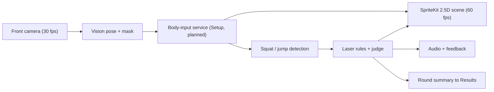
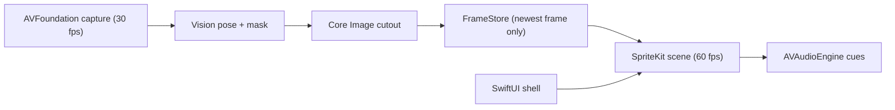
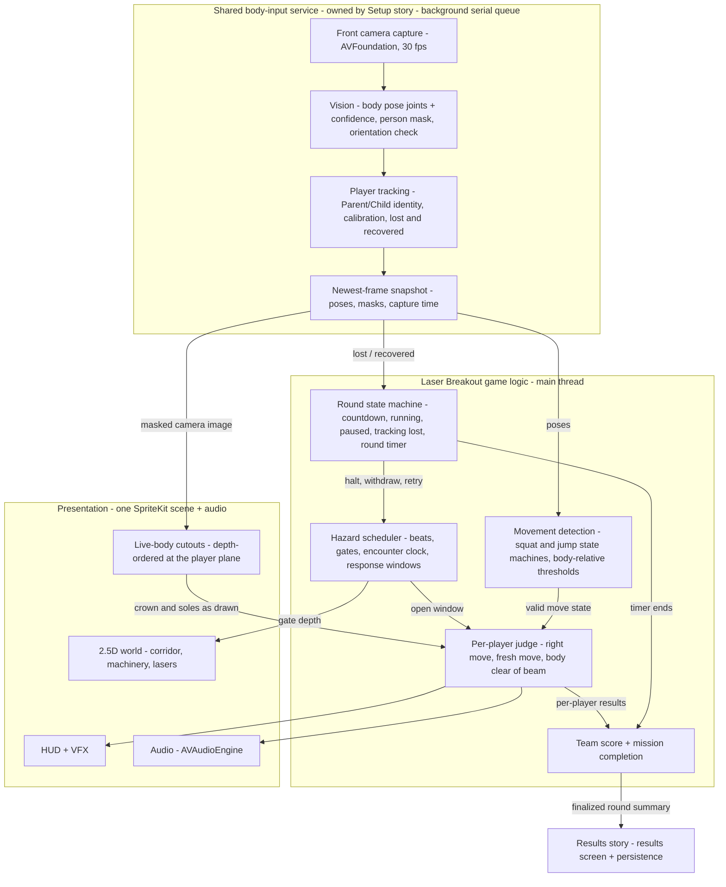
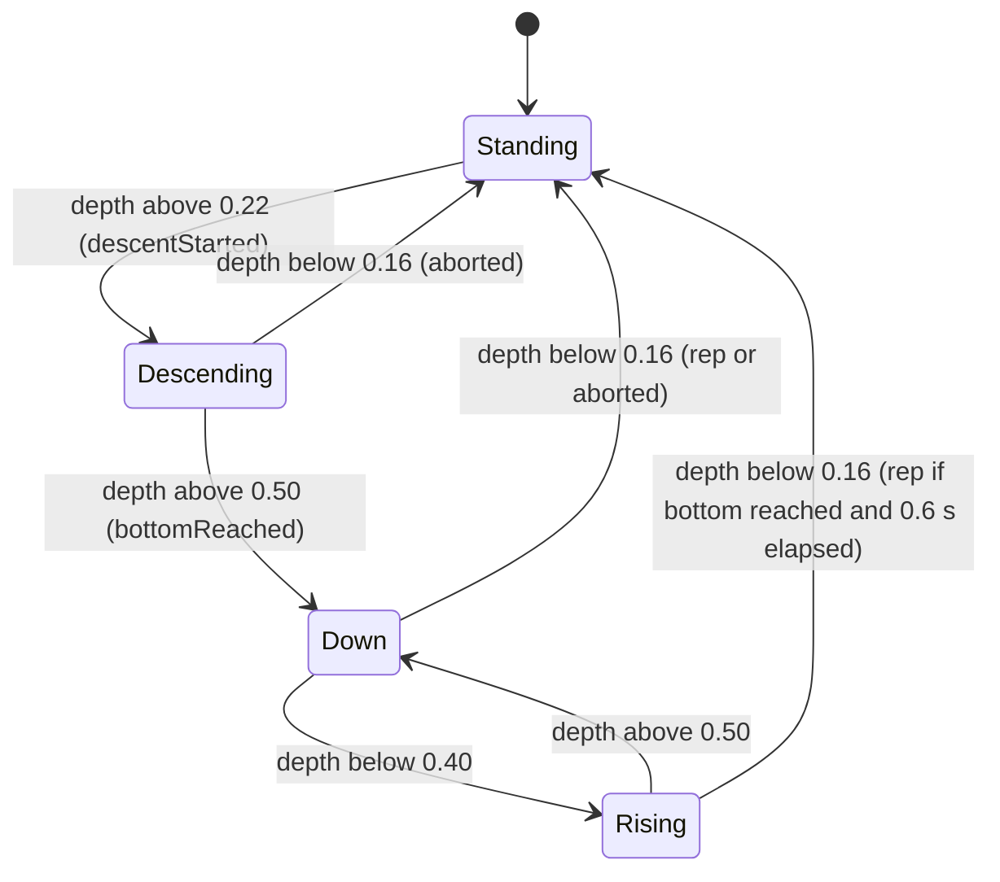
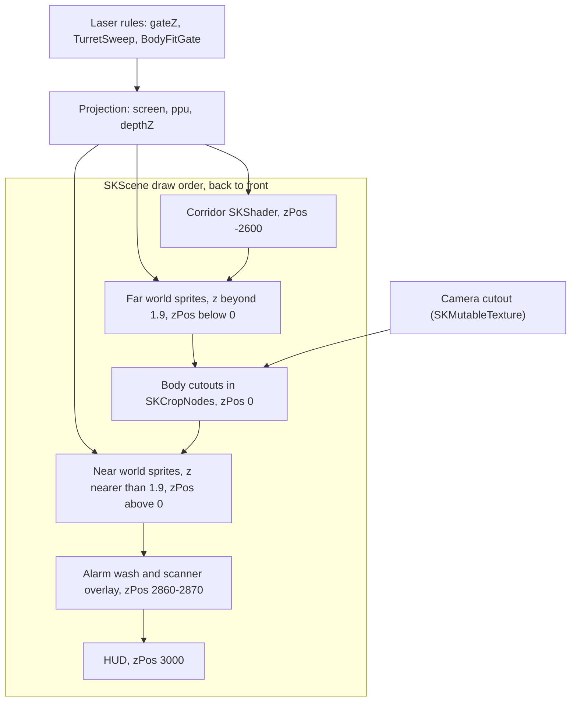
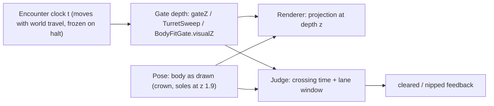
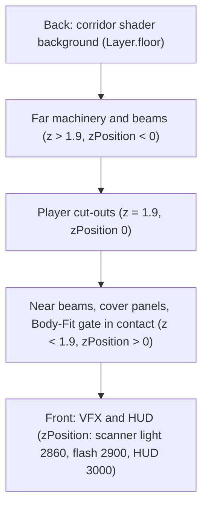
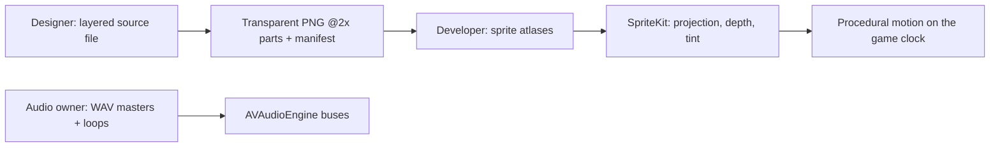
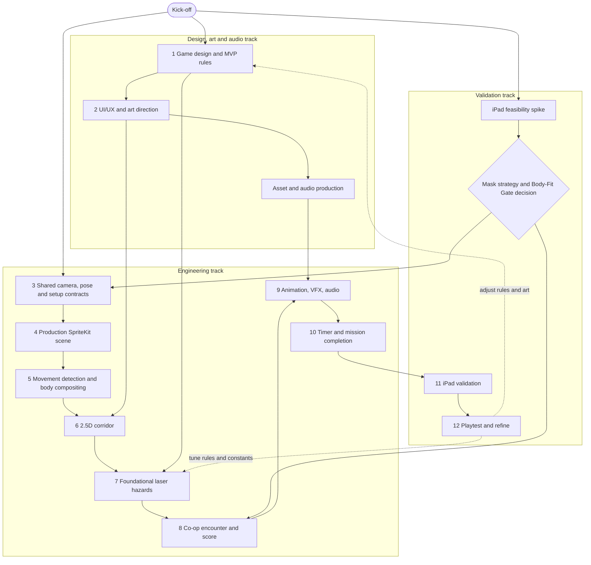
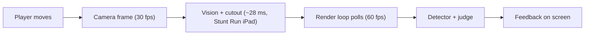

# Laser Breakout — Technical Feasibility & Production Architecture

**Sedactive · iPadOS camera-based co-op arcade game · 23 October 2026**

This document explains how Laser Breakout can be built as a native iPadOS game, which Apple frameworks it uses, how the main systems work, what our trial prototype has demonstrated, and what still has to be proven on a real iPad.

> The trial prototype in this folder is a **feasibility experiment, not the production implementation**. Production will be built from scratch in the Sedactive app, reusing the approaches that worked. Laser Breakout itself has **never run on a physical iPad or with real players moving**. The only on-device measurements come from the earlier Stunt Run mode, which uses the same camera pipeline.

**Status legend** (describes what the *trial* demonstrated):
✅ Device-proven (Stunt Run, shared pipeline) · 🔵 Mac camera / Mac Vision · 🟢 Simulator · 🧪 Logic-tested · 🟡 Code exists, unvalidated · 📄 Proposed only · ❌ Not implemented

**Contents:** Meeting Summary · A. Executive Summary · B. Technology Stack · C. Architecture · D. Camera, Tracking & Movement · E. 2.5D Rendering · F. Laser Mechanics · G. Real-Body Compositing · H. Asset Pipeline · I. Implementation Plan · J. Evidence & Risks · K. Recommendations


---

## Meeting Summary (one page)

> Laser Breakout looks **feasible as a native iPadOS game using only Apple frameworks, with validation still required**: it has not yet run on a physical iPad. Findings come from the local trial (`StuntRunSpike/`) and Apple's docs; architecture and next steps are proposals. Production will be built from scratch in the Sedactive app.

### 1. Technology Stack
- **Recommended:** **Swift 6 + SwiftUI** shell, **SpriteKit** scene, **AVFoundation** camera, **Vision** pose + person segmentation, **Core Image** cutout, **AVAudioEngine** sound.
- No third-party runtime libraries, no RealityKit at runtime, no custom Metal (used only indirectly, via SpriteKit shaders and the Core Image context).
- Game rules are plain Swift with tests (trial: 65 test groups pass, 11 cover Laser).

### 2. System Architecture
- **Planned (backlog draft):** the **Setup story** owns one body-input service (camera, pose, two Parent/Child players, masks, standing calibration, tracking lost/recovered).
- **Laser Breakout** owns movement rules, rendering, hazards, scoring and the round, and passes a round summary to **Results**.
- In the trial, camera + Vision run on one background queue at ~30 fps; the 60 fps game takes the newest frame without waiting.
- **The beam drawn is the beam judged:** renderer and judge share one timing and geometry.



### 3. Rendering & Laser Animation
- **2.5D, not 3D:** one SpriteKit scene with a custom perspective camera.
- One full-screen corridor shader (a GPU program that paints the whole corridor); one shared laser glow shader with per-beam values.
- Beams, panels and gates nearer the camera than the bodies are drawn in front of them.
- Each gate is staged: a 1.8 s alarm warning, then it deploys, charges and fires while travelling toward the players; a DUCK/JUMP cue shows 1.4 s before it arrives. Turret beams sweep the lanes. Timings are prototype values.
- Simulator only: **~60 fps, 67–72 MB**; SpriteKit was chosen over RealityKit in a Stunt Run test. iPad: **not measured**.

### 4. Designer–Developer Workflow
- **Designer:** art direction and sprite assets (corridor, emitters, gates, set pieces, HUD) for texture atlases (art packed into one image for speed).
- **Developer:** runtime animation, laser rendering, compositing, game logic, performance.
- Trial art (code-drawn) and 55 synthesized sounds are placeholders.
- **Audio production needs a named owner** (unassigned).
- Optional 3D hero moments (e.g. Blender) baked offline to sprite sheets (precedent: `TeamDuckShatter`).

### 5. Feasibility, Risks & Next Steps
- **Verdict: feasible, with validation still required.** Shared camera pipeline ✅ in Stunt Run (iPad Pro M4: 60 fps, ~30 fps Vision, ≈69 ms squat feedback); Laser has only logic tests and Simulator runs.
- **Top risks:** real jump detection · two-player identity and cutouts · Vision + cutout use ≈28 of 33 ms per camera frame · Laser GPU cost on iPad.
- **Next step:** iPad run with two real players: fps, latency via 240 fps video, accuracy, 10-min thermal, mask-strategy comparison.
- **Decisions pending:** "Operation Rescue Bot" narrative, ~3-minute round, Body-Fit Gate (each player fits through their own opening) in the MVP, per-player mask strategy, target iPad/OS, audio owner.

## A. Executive Summary

Laser Breakout puts a parent and a child, as their **real bodies** cut out live from the iPad's front camera, inside an **animated 2.5D security facility**. Laser gates come at them down the corridor. A high beam means **squat/duck**, a low beam means **jump**, and a split gate asks each player for a different move. Shared objectives need **both** players: in the trial, a two-lock override gate opens when each player's squats crank their own lock (or by itself after 18 s, as an assist). A final two-lock exit gate is the proposed MVP objective. The technical approach is a native iPadOS stack built only from Apple frameworks:

- AVFoundation captures the front camera at 30 fps.
- Vision finds each player's 2D body pose and a person mask.
- Core Image turns the mask into a live cutout.
- Pure-Swift rules turn poses into squats and jumps and judge them against each beam.
- One SpriteKit scene draws the corridor, the lasers and the bodies in a shared perspective at 60 fps.

**Can we realistically build Laser Breakout as a native iPadOS game? Yes. It is feasible, but it still needs validation.**

- Apple documents every API the trial's Laser path uses, all available at the iOS/iPadOS 18.0 target (docs prove the APIs exist, not iPad performance). Examples: [VNDetectHumanBodyPoseRequest](https://developer.apple.com/documentation/vision/vndetecthumanbodyposerequest), [person segmentation](https://developer.apple.com/documentation/vision/applying-matte-effects-to-people-in-images-and-video), [AVCaptureVideoDataOutput](https://developer.apple.com/documentation/avfoundation/avcapturevideodataoutput) and [SKShader](https://developer.apple.com/documentation/spritekit/skshader). Two small API checks remain: evaluate [420v capture instead of BGRA](https://developer.apple.com/documentation/technotes/tn3121-selecting-a-pixel-format-for-an-avcapturevideodataoutput) (~2.6× less memory; confirm Vision and Core Image accept it), and check the `AVAudioPlayerNode.play()` deprecation (listed at OS 27) against the build SDK (that deprecation does not block the iOS 18 target).
- ✅ (Stunt Run, shared pipeline): the same camera → Vision → cutout pipeline has already run on a physical iPad Pro 13" M4. It rendered at 60 fps, ran Vision at ~30 fps and gave squat feedback in ≈69 ms (`FINDINGS.md:74-81`).
- Passing logic tests (🧪) cover the core Laser Breakout rules, and scripted/autoplay runs with simulated players (🟢) go end to end in the iPad Simulator. No real person has played it.
- **However, Laser Breakout itself has never run on a physical iPad, never used a live camera and never been played by real people moving** (`ARCHITECTURE.md:588`, `Evidence/laser-body-interaction/README.md:4-8`). Feasibility for this mode is credible but not yet proven. None of this is production-ready.

**Most important technical challenges**
1. **Reliable squat and jump detection for real parents and children at 2.5–3 m.** Jump detection has never been tested on real bodies (`TECHNOLOGY_BREAKDOWN.md:250`, `FINDINGS.md:899`). Squat accuracy has never been checked against a manual count (`FINDINGS.md:130`).
2. **Two players with two identities and two cutouts.** The trial uses one combined mask split by a vertical line, so players who cross can swap places or bleed into each other's lane. Per-person instance masks (a separate cutout per person) look promising (🔵 6.2 ms on a Mac, one real frame) but have not been tested on iPad.
3. **Frame budget on the device.** Vision plus cutout compositing already use ≈28 of the 33 ms per camera frame on the iPad M4 (✅ Stunt Run, `FINDINGS.md:88`). The Laser renderer's GPU cost (full-screen corridor shader, additive glow layers, crop nodes that clip each body) has never been measured on iPad.
4. **Timing fairness.** A move is judged in a window from 0.35 s before to 0.25 s after the beam crosses the player, ×1.2 for the child on normal difficulty (`StuntRunSpike/LaserLogic.swift:81, 514-520`). These window values are prototype numbers to be tuned with families. Camera-to-feedback delay was ≈69 ms, measured in Stunt Run on iPad (✅, `FINDINGS.md:81`).
5. **Production content and round design.** Trial art and audio are code-generated placeholders. Designer atlases, designed audio (owner unassigned), a visible team score and a fixed-length round still have to be built.

Production will be **built from scratch** in the Sedactive app. It will reuse the approaches the trial demonstrated (evidence level per row in the table below), not the trial code. The trial plays a diamond-heist getaway. The preferred production narrative, **"Operation Rescue Bot"** (free a captured helper robot and escape before lockdown), is **pending team approval**. It does not change the technical approach.

Status key: ✅ Device-proven · 🔵 Mac-camera / Mac-Vision · 🟢 Simulator-demonstrated · 🧪 Logic-tested · 🟡 Code exists, unvalidated · 📄 Proposed only · ❌ Not implemented. The markers describe what the **trial** showed. In production, everything is still to be built.

| Area | Approach | Trial evidence | Verdict |
|---|---|---|---|
| Camera + pose | Front camera at 640×480, 30 fps. Vision 2D body pose on one serial queue. Late frames are dropped and the newest frame goes to the game | ✅ (Stunt Run, shared pipeline): Vision 29.7 fps, pose 11.1 ms on iPad Pro M4 (`FINDINGS.md:76-77`). Laser: no live pose. 🟢 Simulator with simulated input, plus one real still frame posed by Vision on a Mac (🔵) and replayed with `-recordedFrame` (`Evidence/laser-body-interaction/README.md:6-8`) | Feasible with validation (shared pipeline ✅ in Stunt Run). Re-validate in Laser with two moving players |
| Movement detection | Pure squat and jump state machines using body-relative pose measures. Each lane has its own judging window around the crossing | Squat ✅ (Stunt Run, shared pipeline): ≈69 ms feedback, accuracy not measured. Jump 🧪 🟢 only, never on real bodies | Feasible with validation. **Highest risk** (jump) |
| Body compositing | Person segmentation plus a Core Image cutout into a SpriteKit texture. Each player gets a crop. Depth comes from draw order | ✅ (Stunt Run, shared pipeline): segmentation 13.0 ms + cutout 3.7 ms. Laser occlusion 🟢 on one real still frame. Instance masks 🔵 6.2 vs 9.3 ms (`Evidence/laser-body-interaction/instance-mask-check.txt:1-3`) | Feasible with validation. Separating the two players is unresolved |
| 2.5D rendering | One SpriteKit scene with a custom perspective projection, a full-screen corridor shader and one shared beam shader | 🟢 59.8–60.2 fps, sampled max frame (longest frame in the sampled windows) 16.7 ms, 67–72 MB in the Simulator. SpriteKit was chosen over RealityKit in Stunt Run (Simulator) (`FINDINGS.md:388-392, 404-418`) | Feasible with validation. iPad GPU cost not measured |
| Lasers & mechanics | Pure rules: high, low and split beams, sequences, turret sweep, Body-Fit gate and checkpoint. A minimum gap is enforced between moves | 🧪 11 Laser test groups pass (48–52, 60–65, `LogicTests/main.swift:975`). 🟢 scripted and autoplay runs | Feasible with validation. Timings need tuning with real families |
| Cooperation & scoring | Each lane contributes, with a team bonus when both clear. A two-lock override gate is driven by squat reps. The Security Alert (an alarm level that rises on misses) never ends the run | 🧪 🟢. Team Power is hidden in the Laser HUD. There is no fixed round timer (≈180 s of game time observed) | Feasible with validation. Scoring and round length need decisions |
| Audio / VFX / feedback | AVAudioEngine buses with adaptive music, additive (glowing) laser effects, and ratings and tints shown on each player | 🟢 HUD and effects in the Simulator. 🟡 Audio: 55 synthesized placeholder sounds, never recorded or listened to | Feasible with validation. Needs designed assets and an audio owner |
| Physical-device performance | Targets: ~60 fps (≥95% of frames ≤16.7 ms), ~30 fps pose, median movement→feedback under 100 ms, stable for 10 minutes | ✅ (Stunt Run, shared pipeline): 60 fps, ~370 MB, thermal nominal, 10-minute run not completed. Laser: never run on iPad (not measured) | **Not yet validated.** This is the first production milestone |

**Recommended position** (full lists in Section K)
- **Keep** (the approaches, not the code): pure rules covered by logic tests, and "the beam drawn is the beam judged".
- **Change:** standing calibration from Setup, a per-player mask strategy chosen on iPad, designer art atlases, a visible fixed-length round timer.
- **MVP (proposed):** squat + jump, high/low/split lasers, a final two-lock gate, a fixed-length round, score and feedback.
- **Body-Fit Gate:** a serious MVP candidate pending iPad feasibility; fallback is a split-lane laser gate.

**Acceptance gate for the first iPad milestone.** These are provisional targets. Laser Breakout has not yet been measured against any of them on an iPad.

| Measure | Target |
|---|---|
| Display rendering | ~60 fps, with ≥95% of frames within 16.7 ms over full rounds |
| Camera/pose processing | ~30 fps |
| Movement → feedback | Median under 100 ms (also report p90, the delay 90% of moves stay under), measured with an external 240 fps video of the players and the screen |
| Movement recognition | ≥90% against an annotated video count (≥40 moves per player, 3 pairs), with false detections ≤5% |
| Stability | 3 consecutive rounds (~10 min), with thermal state recorded |

**Conclusion: Laser Breakout is feasible with validation as a native iPadOS game built only on Apple frameworks. The shared camera pipeline is proven on a device, but the mode itself is not yet proven, and a physical-iPad run with two real players is the decisive next step.**

---

## B. Technology Stack & Framework Decisions

The whole stack uses Apple frameworks only. The status markers describe what the **trial** demonstrated. In production, every row is still "to be built". Laser Breakout itself has never run on a physical iPad or with a live camera, so every ✅ below comes from Stunt Run, which uses the same shared pipeline.

### B.1 Technology matrix

| Component | Framework / Library | Key API / Technique | Responsibility | Feasibility Status |
|---|---|---|---|---|
| Language | Swift 6 | Swift 6 language mode, code on the main thread unless marked otherwise (`MainActor` default) | All app and rules code, with compile-time checks against threads clashing over data | ✅ Device-proven (Stunt Run, shared pipeline) |
| App shell | SwiftUI | `SpriteView` host, `@Observable` model, `scenePhase`, `accessibilityReduceMotion` | Hosts the game scene, overlays, lifecycle and settings | ✅ Device-proven (Stunt Run, shared pipeline) |
| Game scene | SpriteKit | `SKScene`, draw order from depth (`zPosition = depthZ(z)`), `SKShader` + `SKAttribute`, `SKCropNode`, `SKMutableTexture`, `SKWarpGeometryGrid` | 2.5D corridor, lasers, gates, live bodies, HUD | 🟢 Simulator-demonstrated (Laser). SpriteView + shader + live cutout ✅ (Stunt Run, shared pipeline) |
| Camera capture | AVFoundation | `AVCaptureSession` (.vga640x480, 30 fps), `AVCaptureVideoDataOutput` (drops late frames), `RotationCoordinator`, Center Stage off | Front-camera frames delivered on one serial queue | ✅ Device-proven (Stunt Run, shared pipeline) for 30 fps capture. Center Stage off: 🟡 Code exists, unvalidated (see D.1) |
| Body pose | Vision | `VNDetectHumanBodyPoseRequest` on a reused `VNSequenceRequestHandler` | Joints for squat/jump, zones, crown and sole heights | ✅ Device-proven (Stunt Run, shared pipeline). Laser moves on live input: 🟡 Code exists, unvalidated (never run with a live camera); Laser rules 🧪 Logic-tested (groups 48–52, 60–65) |
| Person mask | Vision | `VNGeneratePersonSegmentationRequest` (.balanced, 8-bit mask) | One combined mask (matte) for the cutout | ✅ Device-proven (Stunt Run, shared pipeline) |
| Per-player masks (optional) | Vision | `VNGeneratePersonInstanceMaskRequest` (iOS 17+) | A separate mask for each player | 🔵 Mac-Vision (one real still frame). Not in the app |
| Cutout compositing | Core Image | `CIBlendWithMask`, coloured rim from a widened mask, GPU-backed `CIContext` | Players' cutout (colour plus transparency) written into a two-slot frame buffer | ✅ Device-proven (Stunt Run, shared pipeline) |
| GPU | Metal (indirect only) | GLSL source in `SKShader`, converted to Metal by SpriteKit; `MTLCreateSystemDefaultDevice` for the `CIContext` | No custom Metal code | ✅ indirect use (Stunt Run, shared pipeline). Custom Metal ❌ not implemented |
| Core Animation | QuartzCore | `CACurrentMediaTime()` timestamps only | Not used for animation and not needed | n/a (timing clock only) |
| Audio | AVFAudio | `AVAudioEngine`, `AVAudioMixerNode` buses, `AVAudioPlayerNode` voice pool, synthesized `AVAudioPCMBuffer` | SFX, beam hums, adaptive music stems | 🟡 Code exists, unvalidated (Laser audio never captured) |
| Concurrency | Dispatch + Swift Concurrency | One serial `DispatchQueue` and a lock-protected two-slot frame buffer; `async`/`await` only at camera start | Keeps Vision off the render loop | ✅ Device-proven (Stunt Run, shared pipeline) |
| Logic tests (trial) | Foundation + `swiftc` | `LogicTests/run.sh` compiles `main.swift` with a custom `check()` | Tests rules that do not depend on the renderer | 🧪 Logic-tested (65 groups, 11 for Laser) |
| Logic tests (production) | Swift Testing / XCTest | Parameterized `@Test`, Xcode test plans | The same rules, run in Sedactive CI | 📄 Proposed / researched only |

### B.2 How the pieces connect



The scene polls the store once per frame and never waits for it ([`WorldScene.swift:551-555`](StuntRunSpike/WorldScene.swift)). In production, everything to the left of the FrameStore belongs to the Setup story's shared body-input service. Laser Breakout consumes it.

### B.3 Notes per technology

- **Swift 6 (strict concurrency).** The programming language. Its compiler checks that two threads cannot change the same data at once.
  - Trial: Swift 6 mode, with code on the main thread unless marked otherwise (`SWIFT_DEFAULT_ACTOR_ISOLATION = MainActor`, [`project.pbxproj:269-272`](StuntRunSpike.xcodeproj/project.pbxproj)). Deployment target is iOS 18.0 (`project.pbxproj:215`).
  - Rules are plain data types that any thread may use (e.g. `LaserEncounter`, [`LaserLogic.swift:135`](StuntRunSpike/LaserLogic.swift)), so they compile into a test runner without SpriteKit.
  - Production: keep these settings.
- **SwiftUI.** Apple's framework for screens and menus. It hosts the game and the screens around it.
  - Trial: `ContentView` holds the model, camera pipeline and scene. It hosts `SpriteView` at 60 fps, drawing by depth and skipping off-screen nodes (`.ignoresSiblingOrder`, `.shouldCullNonVisibleNodes`; [`StuntRunApp.swift:13-31`](StuntRunSpike/StuntRunApp.swift)), and starts the camera when the view appears (`StuntRunApp.swift:48-51`).
  - Production: SwiftUI is the Sedactive shell. The Setup and Results screens are SwiftUI, and Laser Breakout runs inside one [`SpriteView`](https://developer.apple.com/documentation/spritekit/spriteview).
- **SpriteKit.** Apple's 2D game engine. It draws the corridor, lasers, gates and live bodies every frame.
  - Trial: one `SKScene` is drawn through a hand-written pinhole `Projection`, simple camera maths that makes far things smaller ([`WorldScene.swift:7-50`](StuntRunSpike/WorldScene.swift)). The corridor is one full-screen `SKShader` ray-cast: the GPU computes each corridor pixel, driven by `SKUniform` values ([`Shaders+Laser.swift:123-138`](StuntRunSpike/Shaders+Laser.swift)).
  - Every beam shares one shader, `Shaders.laserBeam`, and gets its own length, brightness, colour and shape through per-node attributes ([`LaserFX.swift:35-37`](StuntRunSpike/LaserFX.swift), [`WorldScene+Laser.swift:1084-1087`](StuntRunSpike/WorldScene+Laser.swift)). This is Apple's recommended pattern: compile once, share, and vary per node ([SKShader](https://developer.apple.com/documentation/spritekit/skshader), [SKAttribute](https://developer.apple.com/documentation/spritekit/skattribute)).
  - Each player is a crop node (`SKCropNode`) that shows only that player's side of one shared camera texture (`SKMutableTexture`; [`WorldScene+Heist.swift:151-164`](StuntRunSpike/WorldScene+Heist.swift), [`WorldScene.swift:148`](StuntRunSpike/WorldScene.swift)).
  - These Laser-specific uses (beam attributes, per-player crops) have only run in the Simulator.
  - Production: keep this approach. Add texture atlases and pool gate nodes. Use crop nodes sparingly, because each adds an offscreen pass ([SKCropNode](https://developer.apple.com/documentation/spritekit/skcropnode)). Profile texture uploads, which Apple says carry a performance penalty ([SKMutableTexture](https://developer.apple.com/documentation/spritekit/skmutabletexture)).
- **AVFoundation.** Apple's camera framework. It delivers the front-camera frames.
  - Trial capture setup ([`CameraPipeline.swift:207-247`](StuntRunSpike/CameraPipeline.swift)):
    - 640×480 (`.vga640x480`) locked to 30 fps, mirrored output.
    - Center Stage (automatic camera framing) set to app control and turned off (`:223-227`). Nobody checked on the device that it is actually off.
    - Late frames are dropped (`alwaysDiscardsLateVideoFrames = true`), and frames arrive on one serial queue (`:239-240`).
  - On iPad the trial uses `RotationCoordinator` to keep the image upright. On Mac, rotation is locked to 0° (`:249-262`).
  - This setup follows Apple's guidance ([AVCaptureSession](https://developer.apple.com/documentation/avfoundation/avcapturesession), [setSampleBufferDelegate](https://developer.apple.com/documentation/avfoundation/avcapturevideodataoutput/setsamplebufferdelegate(_:queue:)), [RotationCoordinator](https://developer.apple.com/documentation/avfoundation/avcapturedevice/rotationcoordinator), [isCenterStageEnabled](https://developer.apple.com/documentation/avfoundation/avcapturedevice/iscenterstageenabled)).
  - Only one landscape orientation was tested on the device. The trial has no handling for session interruptions or system pressure.
  - Production: add both kinds of handling, and observe Center Stage changes.
- **Vision.** Apple's image-analysis framework. It finds each player's joints and cuts the players out of the camera image.
  - Trial: uses the older `VN*` API. Pose and segmentation run one after the other on one reused handler ([`CameraPipeline.swift:296-309`](StuntRunSpike/CameraPipeline.swift)).
  - iPad (Stunt Run): pose 11.1 ms and segmentation 13.0 ms. With the 3.7 ms cutout, that is about 28 of the 33 ms per-frame budget.
  - Production: benchmark the newer Swift-native [`DetectHumanBodyPoseRequest`](https://developer.apple.com/documentation/vision/detecthumanbodyposerequest) (iOS 18+) against the older classes.
  - Decide between splitting the shared mask and using [`VNGeneratePersonInstanceMaskRequest`](https://developer.apple.com/documentation/vision/vngeneratepersoninstancemaskrequest) (one mask per person) by measuring both on the iPad. On the Mac, instance masks took 6.2 ms against 9.3 ms for segmentation, on one frame only.
  - Do not use `VNDetectHumanBodyPose3DRequest`: it reports only the most prominent person ([Apple](https://developer.apple.com/documentation/vision/identifying-3d-human-body-poses-in-images)).
- **Core Image.** Apple's image-filter framework. It turns the camera image and the mask into the players' cutout.
  - Trial pipeline ([`CameraPipeline.swift:398-430`](StuntRunSpike/CameraPipeline.swift)):
    - The mask is scaled and blurred.
    - [`CIBlendWithMask`](https://developer.apple.com/documentation/coreimage/ciblendwithmask) places the person over an empty, transparent background.
    - A coloured rim comes from a widened copy of the mask. Its colour is split at the frame centre, not per person.
    - The result (colour plus transparency) is written into the FrameStore.
  - Cost on iPad: 3.7 ms (Stunt Run).
  - Production: keep. Per-player rim and tint depend on the mask decision.
- **Metal.** Apple's low-level GPU interface. The trial reaches it only through SpriteKit and Core Image.
  - Trial: no `.metal` files and no direct Metal rendering. Shaders are SpriteKit GLSL strings ([`Shaders.swift:1-25`](StuntRunSpike/Shaders.swift)), which SpriteKit converts to Metal ([Apple](https://developer.apple.com/documentation/spritekit/executing-shaders-in-metal-and-opengl)).
  - The only direct Metal call picks the GPU for Core Image ([`CameraPipeline.swift:139-141`](StuntRunSpike/CameraPipeline.swift)).
  - Production: same approach. A custom Metal pipeline is not justified.
- **Core Animation.** Apple's layer-animation framework. The game does not need it.
  - Trial: `QuartzCore` is imported only for `CACurrentMediaTime()` timestamps (e.g. [`CameraPipeline.swift:286-313`](StuntRunSpike/CameraPipeline.swift)). There is no `CALayer`, `CADisplayLink` or `CAAnimation`.
  - Motion comes from SpriteKit actions (`SKAction`) and the per-frame `update(_:)` ([`WorldScene.swift:493`](StuntRunSpike/WorldScene.swift)).
  - Production: not needed.
- **AVAudioEngine.** Apple's real-time audio mixer. It plays sound effects, laser hums and music.
  - Trial ([`AudioFX.swift:16-78`](StuntRunSpike/AudioFX.swift)):
    - 55 synthesized sound types.
    - A pool of 10 voices (`AVAudioPlayerNode`) on an SFX bus at −4 dB.
    - 4 looping music layers (stems) on a music bus at −9 dB.
  - The audio session is set with `try?`, so errors are ignored, and there is no interruption handling (`AudioFX.swift:45-46`). Laser audio was never recorded or listened to in any evidence.
  - Production: keep the bus design ([AVAudioEngine](https://developer.apple.com/documentation/avfaudio/avaudioengine)). Replace the placeholder sounds with designed assets, add interruption and route-change handling, and assign an audio owner.
- **Concurrency.** How work is split across threads so camera processing never stalls the game.
  - Trial: one serial `DispatchQueue` (`"stuntrun.camera-vision"`) runs camera setup, frame delivery, Vision and compositing in order ([`CameraPipeline.swift:92`](StuntRunSpike/CameraPipeline.swift), `:275`).
  - `FrameStore` is a lock-protected two-slot buffer: the camera queue fills one slot while the game reads the other (`CameraPipeline.swift:33-76`).
  - Swift `async`/`await` appears only at the edges: the camera permission request and camera setup (`CameraPipeline.swift:153-195`), plus SwiftUI `.task`.
  - The texture copy may run off the main thread, because SpriteKit may call it on its render thread ([`WorldScene.swift:572-573`](StuntRunSpike/WorldScene.swift)).
  - Production: keep the serial queue and the newest-frame handoff. Do not create a `Task` per frame.
- **Testing.** Automated checks of the game rules, run without the renderer.
  - Trial: `run.sh` compiles 10 renderer-free files plus `main.swift` with `swiftc -swift-version 6` ([`LogicTests/run.sh:6-7`](LogicTests/run.sh)). `main.swift` imports only Foundation ([`LogicTests/main.swift:3`](LogicTests/main.swift)). All 65 groups pass; Laser is groups 48–52 and 60–65. `WorldScene` and `Projection` are not covered.
  - Production: [Swift Testing](https://developer.apple.com/documentation/testing) or XCTest inside the Sedactive project.

### Framework Decision: SpriteKit vs RealityKit

Evidence: Revision 4, 20 Oct ([`FINDINGS.md:334-418`](FINDINGS.md)). Scope: Stunt Run only, iPad Pro 13" (M5) **Simulator**, iOS 26.2, simulated players (`FINDINGS.md:338`). No 3D version of Laser Breakout was ever built.

| Criterion | SpriteKit 2.5D (trial baseline) | RealityKit true 3D (Revision 4 target `StuntRun3D`) |
|---|---|---|
| Rendering quality | Shader fog and additive glow keep the dark neon look | Lit PBR (realistic, light-reacting) materials turned the palette pale grey, so most surfaces had to be unlit (`FINDINGS.md:373`). The trial reports no fog or bloom (`:374`; not checked against Apple docs) |
| 2.5D perspective | Custom pinhole projection plus a ray-cast corridor shader. Exact for a locked forward camera | Real volumes, and the camera can bank, roll and change FOV (`:377-378`). A locked camera needs neither |
| Animation flexibility | `SKAction`, per-frame update, baked sprite sheets. No live 3D rotation | True 3D motion, e.g. a wheel turning in depth (`:377`) |
| Live-body compositing | Cutout at draw depth 0 (`zPosition`), with beams split at the player plane. 🟢 on one replayed real frame | Bodies occluded by real depth (`:379`). Texture stream ≈0.21 ms CPU (`:381`). Transparent planes mis-sort, and the layered stack cannot draw 3D in front of the bodies (`:384`) |
| Laser effects | One shared GLSL beam shader with additive blending | Not built for lasers. No bloom (per the trial) |
| Performance (Simulator) | 60.0 fps in all 13 windows, max frame 16.7 ms, 38–41 MB | 59.8 fps avg, 42 frames over 17.5 ms (up to 33 ms), 70–78 MB (`:390-392`) |
| Development complexity | One renderer and a standard 2D sprite/texture-atlas pipeline (not yet set up; the trial's art is code-drawn placeholders) | Second renderer, plus a 3D asset and lighting pipeline and sort-control work |
| Maintainability | One projection model in Swift, but the corridor shader duplicates the corridor constants, and the drawn and judged player planes drift during field-of-view (FOV) kicks (found in source, not measured). Production: pass the constants as uniforms and lock the judged plane to the drawn plane | RealityKit Trace was refused in the iPad Simulator (`:399`). Two renderers, or a full migration |

**Why SpriteKit is the baseline:** it gave steadier frames on half the memory. It is the only renderer proven with live Vision on an iPad (Stunt Run, shared pipeline). It is designed so that the beam drawn is the beam judged (one encounter clock drives both). The drift during FOV changes still needs fixing and checking (see Section E). RealityKit's one real advantage, lit 3D, conflicted with the art direction (`FINDINGS.md:336`, `:404-408`). We will re-measure on the target iPad. Revision 4's Simulator numbers use the Mac GPU (`:400`).

| Alternative | Assessment | Verdict |
|---|---|---|
| SceneKit (`SK3DNode`) | The trial notes it as soft-deprecated and excluded it (`FINDINGS.md:212`; not re-checked against Apple docs here) | Not used |
| Custom Metal renderer | Full control ([Metal](https://developer.apple.com/documentation/metal)), but we would rebuild sprites, batching, sorting and text ourselves. The shader-programming skill is not installed | Not justified |
| Selective RealityKit (hybrid layer) | Cannot render inside a SpriteKit scene (`FINDINGS.md:211`). A separate layer cannot occlude the bodies with gates (`:384`) | Not justified ("Not justified now", `:412`) |
| Offline 3D baked to sprites | Revision 5 precedent: `Tools/BakeTeamDuck` renders with RealityKit `RealityRenderer` from the game's camera into a sprite sheet played by one `SKSpriteNode` (`FINDINGS.md:434-446`) | Optional, only for a few hero machinery pieces. Any 3D content (DCC) tool, such as Blender, works |

We do not recommend a hybrid renderer for impressiveness. Visual ambition goes into authored art, shaders and baked sequences inside SpriteKit.

### Third-Party Libraries

**No third-party runtime libraries are required.** The trial has none: both targets have an empty `packageProductDependencies` ([`project.pbxproj:95-96`](StuntRunSpike.xcodeproj/project.pbxproj)), and there is no Package.swift, Podfile or Cartfile. All art is drawn in code with Core Graphics at launch, and all audio is synthesized in code. Both are placeholders.

| Category | Items | Ships in app? |
|---|---|---|
| Apple runtime frameworks | SwiftUI, SpriteKit, AVFoundation/AVFAudio, Vision, Core Image, Core Video/Core Media, Metal (indirect), Foundation, Observation | Yes |
| Third-party dependencies | None | — |
| Development tools | Xcode, Instruments (SpriteKit and Metal templates), iPad Simulator, a physical target iPad, a 240 fps external camera for latency tests | No |
| Offline 3D (optional) | A 3D content (DCC) tool such as Blender, or the RealityKit bake approach, for hero sprite sheets | No (only the baked PNG/atlas ships) |
| Artwork authoring | Raster/vector illustration tool and a design tool (team's choice). Exports go to texture atlases | No (only assets ship) |
| Audio authoring | DAW / sound tools (owner currently unassigned) | No (only assets ship) |
| Agent skills (dev guidance only) | Installed: spritekit, vision-framework, game-feel, motion-design, audio-design, create-game-assets, realitykit. Missing: camera-systems, level-design, shader-programming, performance-optimization | No |

Production considerations from Apple documentation:

- **Pixel format:** the trial requests `kCVPixelFormatType_32BGRA` ([`CameraPipeline.swift:238`](StuntRunSpike/CameraPipeline.swift)). [TN3121](https://developer.apple.com/documentation/technotes/tn3121-selecting-a-pixel-format-for-an-avcapturevideodataoutput) says BGRA is not a native capture format and needs about 2.6× the memory of 420v (the camera's native, compact colour format), with thermal and battery cost. Evaluate a native 420 format, and confirm that Vision and the Core Image cutout accept it before switching.
- **Audio API:** Apple's documentation lists `AVAudioPlayerNode.play()` as deprecated at 27.0. It gives no message and names no replacement; `playAudio()`/`playAudio(at:)` appear under "Controlling playback" ([play()](https://developer.apple.com/documentation/avfaudio/avaudioplayernode/play())). The trial calls `play()`/`play(at:)` at [`AudioFX.swift:82, 94, 117, 120, 152, 314`](StuntRunSpike/AudioFX.swift). Production should check this against the SDK it builds with. It does not block an iOS 18 target.
- **Vision API generation:** the iOS 18 target allows the Swift-native Vision requests. Choose by measurement on the iPad, not by default.

**Conclusion: The stack (SpriteKit 2.5D, Apple frameworks only) is feasible on paper but not yet proven for Laser Breakout. Every API is Apple-documented and available at iOS 18, and the shared capture → Vision → Core Image → SpriteView pipeline ran on a physical iPad (Stunt Run). Laser-specific rendering (shared beam shader, per-player crop lanes, warped cart deck) has run only in the Simulator, instance masks only in a Mac harness, and Laser Breakout's iPad rendering and audio cost are not measured.**

---

## C. End-to-End Technical Architecture

The diagram shows the **proposed production design**, based on what the trial taught us. Production code will be written from scratch inside the Sedactive app. The trial `file:line` citations show where an approach was tried. They are not code to copy. Status markers describe what the trial demonstrated. Every box below is still to be built.



- **One handoff point.** The service publishes only the newest snapshot. The game reads it once per render frame and never waits for it (trial: `FrameStore`, `StuntRunSpike/CameraPipeline.swift:31-76`).
- **Ownership.** The Setup story owns everything up to the snapshot, including the lost/recovered events. Laser Breakout owns everything from movement rules to rendering and the round lifecycle. The Results story receives only a finalized round summary. ❌ **Not implemented** in the trial: it floats a `DODGES x/y · TEAM n` line and then replays itself (`StuntRunSpike/WorldScene+Laser.swift:1329`, `:1349`). 📄 **Proposed** for production: a finalized round summary handed to Results.
- **One spatial model.** The scheduler, the renderer and the judge share one projection and one gate clock, so "the beam drawn is the beam judged" (`StuntRunSpike/WorldScene+Laser.swift:994-995`). The trial nearly does this: its camera push-in moves the drawn player plane but not the judged one (see C.6).
- **Not needed:** a server, a network, our own ML model, a second renderer (RealityKit) or a custom Metal pipeline.

### C.1 Camera
- Trial: one `AVCaptureSession` on the front camera at 30 fps feeds one background serial queue (`stuntrun.camera-vision`). Late frames are dropped, not queued ([`alwaysDiscardsLateVideoFrames`](https://developer.apple.com/documentation/avfoundation/avcapturevideodataoutput/alwaysdiscardslatevideoframes), `StuntRunSpike/CameraPipeline.swift:207-247`), and the camera stops when the app goes to the background (`StuntRunSpike/StuntRunApp.swift:48-88`). ✅ **Device-proven** (Stunt Run, shared pipeline): Vision ran at 29.7 fps on the iPad Pro 13" M4.
- Production: owned by the Setup service. Add handling for capture-session interruptions, runtime errors and system pressure (❌ **Not implemented** in the trial), and test both landscape orientations. Capture settings, rotation and the BGRA vs 420v choice: see D.1.

### C.2 Vision Processing
- Trial: each frame runs synchronously on that same queue: [`VNDetectHumanBodyPoseRequest`](https://developer.apple.com/documentation/vision/vndetecthumanbodyposerequest), then one combined person-segmentation mask for everyone, then a Core Image cutout, so at most one frame is in flight (`StuntRunSpike/CameraPipeline.swift:285-328`). ✅ **Device-proven** (Stunt Run, shared pipeline): ≈28 of the 33 ms frame budget, leaving about 5 ms of headroom.
- Production: owned by the Setup service. Keep the same two requests. Choose the per-player mask strategy (split the shared mask, or per-person instance masks, so far only 🔵 **Mac-Vision** on one still frame) by comparing both on an iPad. Joint filtering, confidence rules, the orientation guard and the thermal fallback: see D.1–D.2. Cutout and mask options: see G.1 and G.4.

### C.3 Player Tracking (inside the Setup service)
- Trial: lanes are assigned by x position on the main thread, once per new snapshot (`ZoneAssigner`/`ZoneTracker`, `StuntRunSpike/Pose.swift:95-148`). 🧪 **Logic-tested** (groups 8, 11, 12). There is no per-person identity, so players who cross swap lanes (seen on the iPad in Stunt Run, `FINDINGS.md:131`). A lost player halts the round (`StuntRunSpike/WorldScene+Gameplay.swift:218-229`). Standing height is learned from recent poses, not calibrated (🟡 **Code exists, unvalidated**).
- Production: the service provides stable Parent/Child identity (not x position), an explicit standing calibration per player, and lost/recovered events. Laser Breakout only consumes them. Lane rules, calibration and tracking limits: see D.2, D.5 and D.6.

### C.4 Movement Detection
- Trial: two pure, renderer-free state machines (`SquatDetector`, `JumpDetector`) with thresholds in torso lengths. They update on the main thread once per new snapshot, stamped with the scene clock rather than camera capture time (`StuntRunSpike/WorldScene+Gameplay.swift:147-167`). Laser Breakout judges per-frame *state* (squatting low, airborne), not events (`StuntRunSpike/WorldScene+Laser.swift:756-763`). 🧪 **Logic-tested**. Real squats are ✅ **Device-proven** (Stunt Run, shared pipeline), but before later squat fixes that were not re-run on iPad. Real jumps were never tested, and accuracy against a manual count was not measured.
- Production: owned by Laser Breakout. Keep the state machines and their event vocabulary. Stamp updates with capture time, scale smoothing by frame time (dt), set thresholds relative to the Setup calibration, and re-tune against annotated video. Thresholds, states and test groups: see D.3 and D.4.

### C.5 Gameplay Logic
- Trial: pure rule types (`LaserDirector` beat list, `LaserEncounter` → `JumpSweepJudge` → `TeamChallenge`, `SessionFlow`/`PlayState`) in `StuntRunSpike/LaserLogic.swift` and `StuntRunSpike/CoopLogic.swift`, driven by thin scene glue on the main thread. 🧪 **Logic-tested** (groups 16, 48–52 and 60–65). 🟢 **Simulator-demonstrated** with simulated input only. Gaps: no run timer, Team Power hidden in the Laser HUD (`StuntRunSpike/WorldScene+Heist.swift:205-239`), resume waits for a tap (`StuntRunSpike/WorldScene+Session.swift:158`), and a lane with no body measurement passes on detector state alone (`StuntRunSpike/LaserLogic.swift:171-173`).
- Production: owned by Laser Breakout. Keep the layering. Add a visible fixed ~3-minute round timer, a visible team score and a finalized round summary. Treat an unmeasurable body as not clear, or as a tracking problem. Make set pieces halt-safe: a halt during the lockdown override may skip it (possible defect found by reading `StuntRunSpike/WorldScene+Laser.swift:1400`, not reproduced). 📄 **Proposed:** hands-free resume once both players are back. The narrative will follow the approved mission (working name "Operation Rescue Bot", pending approval). Beat lists, response windows, the child allowance and scoring: see Section F.

### C.6 Rendering (+ audio)
- Trial: one `SKScene` in SwiftUI `SpriteView` at 60 fps on the main thread (`StuntRunSpike/StuntRunApp.swift:29-31`). One custom `Projection` places the corridor shader, the gates and the live-body crops, with the bodies at the player plane (`StuntRunSpike/WorldScene.swift:7-50`). 🟢 **Simulator-demonstrated** only (59.8–60.2 fps, 67–72 MB), never on a physical iPad. Audio is one `AudioFX` class on `AVAudioEngine` with code-synthesized placeholders (`StuntRunSpike/AudioFX.swift:5`). 🟡 **Code exists, unvalidated** (Laser audio never recorded or listened to).
- Production: owned by Laser Breakout. Keep SpriteKit 2.5D and the shared projection, with one source of truth for the player plane: the trial's camera push-in (a small field-of-view zoom) moves the render plane (`StuntRunSpike/WorldScene.swift:32`) but not the judge's (`StuntRunSpike/LaserLogic.swift:18`). Use designer art in texture atlases and pool gate nodes. Audio production needs an owner, who is currently unassigned. Projection and render details: see E.2, E.5 and E.6. Cutouts and occlusion: see Section G. Audio: see Section H.

### C.7 What runs when

| When | Thread | Trial work items, in actual order | Production change |
|---|---|---|---|
| **Per camera frame** (~30 fps) | Background serial queue `stuntrun.camera-vision` | Receive frame → turn it 180° if the feed is upside down → find body joints → keep valid people → check orientation → cut out people (only when bodies are shown) → write into the spare buffer and swap it in (`StuntRunSpike/CameraPipeline.swift:275-328`) | Player identity and calibration move here, so the snapshot already carries Parent/Child |
| **Per render frame** (60 fps) | Main thread | Measure frame time → read settings → advance countdown/pause state and game clock → pick up the newest camera result → update inputs → run lasers: schedule and judging (skipped when halted), then beams, sound, bodies, corridor → draw players, HUD, shake → log metrics every 0.5 s (`StuntRunSpike/WorldScene.swift:493-522`, `StuntRunSpike/WorldScene+Laser.swift:299-336`) | Same order. Frame-time-based smoothing, cached shader values, pooled nodes |
| **Per new snapshot** (≤30 Hz) | Main thread. SpriteKit may run the pixel copy on its render thread | Check it is new → copy the camera image into the shared texture → assign players to lanes → update squat and jump detectors → route their events → fit the cutouts (`StuntRunSpike/WorldScene.swift:551-578`, `StuntRunSpike/WorldScene+Gameplay.swift:147-167`) | Detectors stamped with capture time. No player assignment here |
| **Only on gameplay events** | Main thread | See the list below | Plus round-timer expiry → mission end → round summary to Results |

Gameplay events in the trial:
- Player found or lost → round state machine (`StuntRunSpike/WorldScene+Gameplay.swift:211-250`).
- Squat started → freshness count, early cue, latency sample. Squat rep completed → override lever crank (`StuntRunSpike/WorldScene+Laser.swift:1357-1376`).
- Judge results → score, ratings, sounds, alert (`StuntRunSpike/WorldScene+Laser.swift:829`).
- Halt → withdraw gates and store a retry (`StuntRunSpike/WorldScene+Laser.swift:1382-1406`).
- Back to `running` → squat detector `rearm()`. The jump detector has none (`StuntRunSpike/WorldScene+Session.swift:135`).
- Beat ends → next beat from the director (`StuntRunSpike/WorldScene+Laser.swift:356-375`).

**Threading and handoff.**
- The camera queue writes into a back buffer, and `publish()` swaps it in. Neither side waits for a frame. They share one lock only for the pointer swap and the front-buffer copy (`StuntRunSpike/CameraPipeline.swift:58-75`). The render loop acts only when the sequence number has changed (`StuntRunSpike/WorldScene.swift:551-555`).
- Late frames are dropped, not queued, so at most one frame is in flight. Capture to texture took ≈68 ms, ✅ **Device-proven** (Stunt Run, shared pipeline).
- Pause and tracking loss are not separate threads. They are `PlayState` values that gate the per-frame work (`acceptsMovement`, `isHalted`).
- Production: keep this pattern under Swift 6, with a thread-safe (`Sendable`) snapshot and no per-frame `Task`.

**Conclusion: Feasible with validation, using a simple architecture: one camera/Vision queue, one newest-frame handoff, one SpriteKit scene. Stable Parent/Child identity, explicit calibration, interruption handling, the round timer and the round summary have no trial counterpart yet, and Laser Breakout has never run end to end with a live camera and real players on an iPad.**

---

## D. Camera, Body Tracking & Movement Recognition

Laser Breakout has no camera or movement code of its own. The trial reuses the shared capture and Vision pipeline (`CameraPipeline`) and two pure, Vision-free detectors (`SquatDetector`, `JumpDetector`). Only that pipeline has physical-iPad evidence, and that evidence comes from **Stunt Run** alone. Laser Breakout has never run with a live camera or with real people moving. Its only real-body input is one recorded two-person still frame, replayed with `-recordedFrame` ([`Evidence/laser-body-interaction/README.md`](Evidence/laser-body-interaction/README.md)).

**Production ownership (planning context from the v3 backlog draft):** the Setup story owns the single shared body-input service: camera, pose, two tracked players with stable Parent/Child identity, masks, standing calibration, and tracking lost/recovered events. Laser Breakout consumes that service and owns the movement rules described below: squat/jump recognition, freshness and judging. Everything in this section still has to be built for production. The markers only describe what the trial demonstrated.

### D.1 Front Camera

**Capture configuration (trial)**, from [`CameraPipeline.swift:207-271`](StuntRunSpike/CameraPipeline.swift):

| Setting | Trial behaviour | Evidence level |
|---|---|---|
| Device | Front camera from a `DiscoverySession` (wide, ultra-wide, external), zoom at `minAvailableVideoZoomFactor` | ✅ Device-proven (Stunt Run, shared pipeline) |
| Preset | `.vga640x480` gives an upright 4:3 640×480 frame with no crop on iPad Pro M4 ([`FINDINGS.md:67`](FINDINGS.md)) | ✅ (Stunt Run, shared pipeline) |
| Pixel format | `kCVPixelFormatType_32BGRA` (line 238) | ✅ works (see the production note on 420v) |
| Frame rate | Locked to 30 fps (min = max frame duration 1/30) when the format supports it. Vision measured 29.7 fps | ✅ (Stunt Run, shared pipeline) |
| Late frames | `alwaysDiscardsLateVideoFrames = true` on one serial queue, `stuntrun.camera-vision` | ✅ (Stunt Run, shared pipeline) |
| Mirroring | Done on the connection (`automaticallyAdjustsVideoMirroring = false`, `isVideoMirrored = true`). Vision sees the mirrored image, so poses match the screen | ✅ (Stunt Run, shared pipeline) |
| Rotation (iPad) | `AVCaptureDevice.RotationCoordinator` horizon-level angle is applied to the connection and re-applied when KVO reports a change. Vision always gets `.up` ([RotationCoordinator](https://developer.apple.com/documentation/avfoundation/avcapturedevice/rotationcoordinator)) | ✅ one landscape orientation only ([`FINDINGS.md:128`](FINDINGS.md)) |
| Rotation (Mac) | Locked to 0°, because the coordinator reported 90°/180° under iPad emulation | 🔵 Mac-camera |
| Center Stage | `centerStageControlMode = .app`, then `isCenterStageEnabled = false`, so framing can't drift off the lanes ([isCenterStageEnabled](https://developer.apple.com/documentation/avfoundation/avcapturedevice/iscenterstageenabled)) | 🟡 set in code; never checked on device that it is actually off |

**Image processing chain (per camera frame, all on one serial queue):**

1. Capture.
2. Optional 180° rotation (`OrientationGuard`, 🧪 + 🔵 Mac Vision harness only, never in-app or on iPad).
3. `VNDetectHumanBodyPoseRequest`.
4. `VNGeneratePersonSegmentationRequest` at `.balanced`, producing a 512×384 mask. It drops to `.fast` at serious or critical thermal state (never triggered in any run) and is skipped in camera-view Mode A.
5. Core Image cutout plus rim.
6. `FrameStore` double buffer, which keeps only the newest frame.
7. SpriteKit polls once per render frame without waiting, copies into one `SKMutableTexture` and calls `applyLivePoses` ([`CameraPipeline.swift:285-328`](StuntRunSpike/CameraPipeline.swift), [`WorldScene.swift:550-570`](StuntRunSpike/WorldScene.swift)).

**Latency: ✅ Stunt Run, iPad Pro 13" M4, iPadOS 26.7.1** ([`FINDINGS.md:72-91`](FINDINGS.md))

| Stage | Measured |
|---|---|
| Vision rate | 29.7 fps avg |
| Body pose / segmentation / cutout | 11.1 ms / 13.0 ms / 3.7 ms avg |
| Per-camera-frame budget at 30 fps | ≈28 ms used of 33 ms |
| Camera timestamp → texture | 68 ms avg (56–84). [`FINDINGS.md:91`](FINDINGS.md) estimates that ~50 ms of this passes before app code sees the frame. Not instrumented (callback arrival is not logged), so measure before relying on it |
| Camera timestamp → squat feedback | ≈69 ms running average (+~1 display frame), from real squats at 2.5–3 m with two people |
| Mac Catalyst webcam (🔵) | Vision ~29–30 fps, feedback avg 71 ms (clean run) |
| Laser Breakout | **Not measured.** Every Laser log reports `feedback(avg)=n/a` |

- **At most one frame in flight.** All Vision work runs synchronously inside the capture callback, so a slow frame causes the next one to be dropped rather than queued ([`CameraPipeline.swift:78-82`](StuntRunSpike/CameraPipeline.swift)). ✅ (Stunt Run, shared pipeline): only 2–3 dropped frames at startup, then none ([`FINDINGS.md:82`](FINDINGS.md)). Apple documents that late frames are discarded by default ([alwaysDiscardsLateVideoFrames](https://developer.apple.com/documentation/avfoundation/avcapturevideodataoutput/alwaysdiscardslatevideoframes)).
- **Headroom is about 5 ms.** Per-person instance masks take 6.2 ms on a Mac (🔵) and have not been measured on iPad. Adding them, or any other Vision request, would mean alternating requests across frames ([`FINDINGS.md:88`](FINDINGS.md)).
- **Caveats when reading these numbers:** the feedback figure is a running average over the whole session, each 5 s METRICS line samples only about 0.5 s, and `poseMs` also includes the rotation and the orientation probe.

**Production notes (📄 Proposed)**
- **Use 420v instead of BGRA.** Apple's TN3121 says BGRA is not a native capture format and needs about 2.6× the memory of 420v, which costs heat and battery ([TN3121](https://developer.apple.com/documentation/technotes/tn3121-selecting-a-pixel-format-for-an-avcapturevideodataoutput)). Request a native bi-planar 420 format from `availableVideoPixelFormatTypes`, then confirm on iPad that pose, segmentation and the cutout path all accept it.
- **Timestamp with capture time.** The snapshot already carries the camera's capture timestamp ([`CameraPipeline.swift:275-277`](StuntRunSpike/CameraPipeline.swift)), but the trial stamps detector samples with the scene clock at poll time (`now`, [`WorldScene+Gameplay.swift:156`](StuntRunSpike/WorldScene+Gameplay.swift)). Production should stamp every pose sample with its capture time, so poll jitter doesn't leak into judging windows. Latency should be measured at presentation, not when the texture update is requested.
- Add handling for capture-session interruptions, runtime errors and system pressure (the trial has none). Observe Center Stage changes, and test both landscape orientations.

### D.2 Two-Player Body Pose

**What Vision returns (Apple docs).** Vision returns one observation per detected body, with up to 19 joints. Each joint is a normalized (0–1) point with a bottom-left origin and a confidence, and points with confidence 0 should be ignored ([Detecting Human Body Poses in Images](https://developer.apple.com/documentation/vision/detecting-human-body-poses-in-images), [JointName](https://developer.apple.com/documentation/vision/vnhumanbodyposeobservation/jointname)). Apple documents no maximum number of people. The 3D request reports only the most prominent person, so it does not fit two-player co-op ([3D body poses](https://developer.apple.com/documentation/vision/identifying-3d-human-body-poses-in-images)).

**Joints the trial keeps.** The trial uses 13 of the 19 joints ([`CameraPipeline.swift:381-395`](StuntRunSpike/CameraPipeline.swift), [`Pose.swift:5-88`](StuntRunSpike/Pose.swift)):

| Joints | Used for | Min. confidence |
|---|---|---|
| Hips, knees, ankles | Knee angle (squat), foot height | 0.3 |
| Root (else mean of hips) + neck | Hip centre, torso length (the scale unit) | 0.2 root/neck, 0.3 hips |
| Nose (else neck) | Head point, which gives standing height and crown | 0.2 |
| Root / hips / neck / shoulders | Horizontal centre for lane assignment | 0.2 |
| Wrists | Only the reach-pull experiment, which is not wired into gameplay | 0.3 |

- **Coordinates:** joints are re-mapped into the 640×480 aspect-filled texture, with a bottom-left origin and the mirroring already applied ([`CameraPipeline.swift:389-390`](StuntRunSpike/CameraPipeline.swift)). 🟡 (runs in the shared pipeline, not checked on its own)
- **Person filter:** a body is kept if at least 4 of the 13 joints have confidence above 0.1 ([`CameraPipeline.swift:388-393`](StuntRunSpike/CameraPipeline.swift)). 🟡 (runs in the shared pipeline, no logic test covers it)
- **Choosing the players:** `ZoneAssigner` keeps the two bodies with the largest torso length and sorts them left/right by x. A lone body goes to the half of the frame it stands in. A smaller third person is ignored (test 8, [`LogicTests/main.swift:125`](LogicTests/main.swift)). 🧪
- **Lane hysteresis:** `ZoneTracker` uses a margin of 0.1 past the centre line and a 1 s memory. It stops a lone player near the midline from flickering between lanes, and it keeps a returning player in their own lane (tests 11–12). 🧪 It is unit-tested and installed but **has not been re-run on iPad** ([`FINDINGS.md:131`](FINDINGS.md)).
- **Crossing players swap lanes.** With two people, assignment is purely positional. On the iPad (✅ Stunt Run, before ZoneTracker existed), crossing caused repeated found/lost flips. In Laser Breakout the role follows the lane (`isChildLane`, [`WorldScene+Laser.swift:775`](StuntRunSpike/WorldScene+Laser.swift)). After a swap, each lane's detector state, standing reference and child timing allowance therefore apply to the other person (inferred from code).
- **Different body sizes:** all thresholds are in torso lengths, so they scale with each body. 🧪 However, the cutout auto-fit scales to the *tallest* standing person and needs ankles in view, so a child playing alone is shown at adult scale ([`FINDINGS.md:133`](FINDINGS.md)). A larger bystander could also outrank the child in the torso-length ranking (inferred).
- **Occlusion:** there is one combined segmentation mask, and the two lane crops split at the midpoint of the players' x positions. Overlapping players therefore bleed into each other's lane (inferred). On one real two-person still (🔵 Mac-Vision), instance masks separated 2 people, but pose found only 1 body ([`instance-mask-check.txt`](Evidence/laser-body-interaction/instance-mask-check.txt)). Apple warns that crowded scenes and flowing clothing reduce accuracy.
- **Subject size:** Apple advises that each subject be at least one third of the image height. At 2.5–3 m on the iPad Pro M4, full bodies fit (✅ Stunt Run), but a tall or close player's head can leave the top of the frame ([`FINDINGS.md:110`](FINDINGS.md)).

**Production (📄):** take stable Parent/Child identity from the Setup service. One option is per-person instance masks matched to poses and tracked frame to frame ([VNGeneratePersonInstanceMaskRequest](https://developer.apple.com/documentation/vision/vngeneratepersoninstancemaskrequest)), budgeted against the ~28 ms per frame already in use. Attach the child's timing allowance to the tracked person, not to the right-hand lane.

### D.3 Squat Detection

The source is [`SquatDetector.swift`](StuntRunSpike/SquatDetector.swift). Its own comment calls the thresholds "experimental starting points" (line 3).

- **Joints:** hip, knee and ankle on each side, each at confidence ≥0.3. The interior knee angle is measured in aspect-corrected 2D image space and averaged over the visible sides. 🧪 (tests 1–4)
- **Depth mapping:** `depth = clamp((165° − kneeAngle) / 65°, 0, 1)`. So 165° is depth 0 (standing) and 100° is depth 1 (full squat). 🧪 Test 1 recovers angles within 0.5°.
- **Hip-drop fallback** (used when there is no knee angle, e.g. ankles cropped): depth is the hip drop below the standing hip height, in torso lengths, with 0.55 torso lengths counting as full depth. The standing hip height is learnt only while standing; it rises quickly and falls slowly. 🧪 Test 7. Risk: leaning may count as squatting ([`FINDINGS.md:132`](FINDINGS.md)).
- **Smoothing:** EMA `depth += (sample − depth) × 0.6`, applied per pose sample rather than per unit of time. 🧪 (tests 2–4)

| Threshold (smoothed depth) | ≈ knee angle | Effect |
|---|---|---|
| above 0.22 (descend) | ≈151° | `standing → descending`, emits `descentStarted` |
| above 0.50 (bottom) | ≈132° | `→ down`, emits `bottomReached` |
| below 0.40 (rise) | ≈139° | `down → rising` |
| below 0.16 (stand) | ≈155° | `→ standing`, emits `repCompleted` or `aborted` |



- **Hysteresis:** the 0.22/0.16 and 0.50/0.40 threshold pairs stop jitter near a threshold from creating extra reps (test 4). 🧪 If depth jumps past 0.50 in a single sample, the detector goes straight from standing to down.
- **Minimum rep of 0.6 s:** a rep needs at least 0.6 s from descent start, and the bottom must have been reached. Faster or shallower cycles count as `aborted` (tests 3 and 10). 🧪 This rule came from the iPad run (✅ Stunt Run), where 2 of 18 detected rep gaps were implausibly short (0.37 s and 0.97 s). The fix has **not been re-run** on device ([`FINDINGS.md:130`](FINDINGS.md)).
- **Aborted shallow squats:** shallow squats are reported as `aborted` (🧪 tests 3 and 18), and `aborted` events were logged on the iPad ✅ (Stunt Run, shared pipeline, [`run3-play-distance-metrics-and-squats.log`](Evidence/ipad-run/run3-play-distance-metrics-and-squats.log)). When a duck is expected, Laser Breakout shows "GO LOWER!" ([`WorldScene+Laser.swift:1370-1371`](StuntRunSpike/WorldScene+Laser.swift)) 🟡. No Laser run has shown this label.
- **Settle and loss:** 🧪 movement is ignored for 0.4 s after a person is (re)acquired, so someone first seen already bent gets no credit (test 9). After 0.6 s without a pose the person counts as lost (test 6). `rearm()` runs on resume, so a squat begun while the game was halted never completes (test 17).
- **How Laser uses the squat state:** a duck lane counts as "low" while the phase is `down` or `rising`. This is sampled every frame, so credit comes from state rather than events ([`WorldScene+Laser.swift:756-761`](StuntRunSpike/WorldScene+Laser.swift)). 🟢 (Simulator, stand-ins)
- **Held-squat freshness rule: one squat clears one beam.** `DuckFreshness` counts every `descentStarted` per lane and snapshots the count when an encounter is built. It accepts a duck only from a newer squat that hasn't already been used on a beam ([`LaserLogic.swift:114-131`](StuntRunSpike/LaserLogic.swift)). A squat held through two beams clears only the first, and the miss label tells the player "STAND · DUCK AGAIN!". 🧪 (tests 50 and 62) and 🟢 in the Simulator ("still holding an earlier squat: no credit").
  - Caveat: the scene takes the snapshot at gate reveal (1.8 s into the warning), while the code comment says "at the warning". A squat started early in the warning therefore would not count (inferred; the tests build the encounter at t = 0).

**Evidence summary:** the detector state machine ran on real squats on the iPad in Stunt Run (✅), but accuracy against a manual count was **not measured**. Later fixes are 🧪 only, and Laser ducks have only been judged with simulated stand-ins (🟢).

**Production (📄):** re-tune every constant from annotated video (target ≥90% recognition and ≤5% false detections, over ≥40 moves per player with 3 parent–child pairs). Base smoothing on time using capture timestamps, guard the hip-drop fallback against leaning, and define explicitly when the freshness snapshot is taken.

### D.4 Jump Detection

The source is `JumpDetector` in [`PiranhaLogic.swift:13-131`](StuntRunSpike/PiranhaLogic.swift), which is shared with Jungle Drift. Its comments call every number provisional and "not validated with people".

| Rule | Value |
|---|---|
| Signal | Hip lift above a calibrated standing hip baseline, in torso lengths. EMA 0.75; negative lift is clipped to 0 |
| Baseline | Set from the first pose. After that it adapts slowly (weight 0.05), and only while grounded and within 0.07, so a squat or the crouch before a jump can't drag it down |
| Takeoff / landing | `takeoff` when lift exceeds 0.14; `landed` when lift falls below 0.07 (hysteresis) |
| Ankle check | When ankles are visible, the feet must also rise at least 0.05 torso lengths. Otherwise lift is capped at 0.07, so tiptoes and stretches never take off |
| Airtime over 1.2 s | Treated as a stale baseline: the detector lands silently, clears its baselines and recalibrates from the next pose |
| Settle | The rep (`settled`) counts only after 0.2 s near standing after landing. A bounce straight into a second hop is one cycle |
| Acquisition / loss | 0.4 s settle after acquisition; lost after 0.6 s without a pose |

In Laser Breakout a jump lane counts while `isAirborne` is true **and** the drawn soles are more than 0.015 units above the beam (🧪 test 64 for the clear check, 🟢 with stand-ins). While a player is jumping, the cutout's floor offset is frozen so the drawn body really rises ([`WorldScene+Heist.swift:608-616`](StuntRunSpike/WorldScene+Heist.swift)). 🟡 (source only)

**False-positive and false-negative risks**
- **Stepping closer or drifting:** test 33 shows that a stale baseline first fires a `takeoff`, then recalibrates once airtime passes 1.2 s. That gives up to 1.2 s of false "airborne" that could fall inside a jump window. 🧪
- **Hopping from a crouch:** the crouch can't lower the baseline (in test 33 a squat produces no jump events). But lift is measured from *standing* height, so a small child's hop from a crouch may never reach 0.14. This false negative is unvalidated.
- **Pose lost mid-air:** a dropout under 0.6 s freezes the last state, so the player stays "airborne". A longer loss ends the jump with no rep and halts the round for a rostered player. Motion blur and the head leaving the top of the frame mid-jump are still open questions ([`FINDINGS.md:899`](FINDINGS.md)).
- **Ankles cropped:** the ankle check is skipped and only hip lift is used. 🟡 (source only)
- **No re-arm:** `JumpDetector` has no `rearm()` on halt; only the squat detector is re-armed. 🟡 (source only)

**Evidence:** 🧪 logic-tested (tests 32, 33 and 40) and 🟢 in the Simulator with a synthetic hop (`SimulatedJump`). Jump detection has **never been tested on real bodies**: there is no jump from a device, a Mac camera or a recorded frame. The 0.14 takeoff threshold is recorded as a guess ([`TECHNOLOGY_BREAKDOWN.md:260`](TECHNOLOGY_BREAKDOWN.md)).

### D.5 Calibration

| Value | Used for | How the trial gets it | Level |
|---|---|---|---|
| Standing nose height (world units) | Beam heights and the crown point (formulas in Section F) | `standingRef` per lane: the tallest recent standing span (nose or neck to lowest ankle), updated only while standing and not jumping ([`WorldScene+Heist.swift:611-615`](StuntRunSpike/WorldScene+Heist.swift)) | 🟡 (🟢 with stand-ins and one real still) |
| Standing hip baseline (squat) | Hip-drop fallback | Learnt while standing | 🧪 |
| Standing hip and foot baseline (jump) | Lift and ankle check | Set from the first pose, adapts slowly, reset after 1.2 s of airtime | 🧪 |
| Torso length (neck to hip centre) | Scale unit for every threshold | Measured every frame | 🧪 |

- **What it feeds:** each lane's beam heights (fixed at gate reveal) and the crown/soles used by the physical-clear check ("the beam drawn is the beam judged"). For the formulas, the unmeasured squat-head assumption and the clear check, see Section F, *Body-relative beam heights* and *Spatial Consistency*.
- **Implicit learning (trial).** There is no calibration step.
  - `standingRef` jumps up to the tallest recent standing span, then decays by 0.02/60 per frame. The decay depends on frame rate: about 0.02 units/s at 60 fps.
  - It is never reset on tracking loss or a lane swap, so a lane can keep a taller player's height for tens of seconds (inferred from code).
  - Without a span (ankles or head cropped), it falls back to the sprite size or to fixed defaults of 0.82/1.18 ([`WorldScene+Checkpoint.swift:109-118`](StuntRunSpike/WorldScene+Checkpoint.swift)).
- **Warning from the real frame (🟢, replayed real still):** the crouched Parent-lane body was measured at its crouched height and got a 0.60 high beam, against 0.93 for a standing stand-in ([`real-body-run-log.txt`](Evidence/laser-body-interaction/real-body-run-log.txt)). A player first seen crouched therefore gets a miscalibrated beam.
- **Why production should calibrate explicitly:** the Setup story's standing calibration measures each identified player standing, with head and ankles in view, before play starts. That removes the cases above.
- **After tracking loss:** re-acquiring a player creates fresh detectors, which re-learn their baselines during the 0.4 s settle (🧪 tests 6 and 9). `standingRef` stays as it was (🟡 source only).

**Production (📄):** take each player's standing height from the Setup story's calibration, and re-take it when a player steps closer or further away and after tracking loss. Make any decay time-based rather than per-frame, and decide explicitly what happens when a body can't be measured.

### D.6 Tracking Limitations

| Limitation | Trial evidence | Production mitigation (📄) |
|---|---|---|
| Adult vs child heights | Torso-relative thresholds and body-relative beams 🧪. No child has ever been tested. The cutout fits to the tallest person, so a child alone appears at adult scale ([`FINDINGS.md:133`](FINDINGS.md)) | Per-player calibration from Setup. Ground-truth session with real children. Review child thresholds and the 0.73 squat-head ratio |
| Partial visibility (head or ankles cropped) | Head cropping for tall or close players on iPad ✅ (Stunt Run, shared pipeline, [`FINDINGS.md:132`](FINDINGS.md)). Cropped ankles mean hip-drop fallback, no ankle check and no standing span. Unmeasured lanes pass the clear check | Setup readiness gate: head and ankles in frame, each player at least 1/3 of image height. On-screen step-back guidance. An explicit "can't measure" state |
| Crossing lanes | Swap observed on iPad ✅ (Stunt Run, shared pipeline). ZoneTracker only covers one person 🧪. Role and detector state follow the lane | Stable identity from the Setup service (instance masks plus pose matching). Floor lane markers. Pause or re-confirm on ambiguous overlap |
| Pose jitter | EMA, hysteresis, 0.6 s minimum rep, 0.4 s settle 🧪. 2 of 18 implausible reps on iPad ✅ (Stunt Run, shared pipeline), before the fixes | Re-run on device. Time-based filtering on capture timestamps. Tune against annotated video |
| Motion blur | Mask lags about a frame in fast arm swings, with halos on loose clothing 🔵 (Mac webcam, Stunt Run, [`FINDINGS.md:111`](FINDINGS.md)). Not checked on iPad. Joints during real jumps never tested | Measure joint confidence during real hops at 30 fps. Keep judging windows tolerant |
| Lighting | Not measured. The real-frame evidence only covers in-game lighting of cutouts | Test in typical living rooms. Setup checks pose confidence before play |
| Camera position (2.5–3 m) | Full bodies fit at 2.5–3 m on iPad Pro M4 ✅ (Stunt Run, shared pipeline). Only one stand height and one landscape orientation tested. Center Stage off 🟡 | Setup specifies stand height, angle and distance. Verify both orientations and the Center Stage state |
| Device differences | Only the iPad Pro 13" M4 has been measured. Pose runs about 2× faster on the M5 Mac 🔵. Upside-down feed correction (OrientationGuard) is 🧪 + 🔵: corrected at frame 32 in a Mac Vision harness on real frames ([`README.txt:2-3`](Evidence/moonbound-race/real-camera-LOCAL-ONLY/README.txt)), never in-app or on iPad | Test matrix of target iPads. Per-device frame-budget check. Segmentation `.fast` fallback |
| Thermal | Nominal throughout ✅ (Stunt Run, shared pipeline): ~8.5 min total on device across 3 sessions; thermal state logged over ~5 min of that ([`FINDINGS.md:84`](FINDINGS.md)). Laser Breakout never run on iPad, so its thermal load is unmeasured. 10-minute run not completed. `.fast` fallback never triggered. No system-pressure handling | 3 consecutive rounds (~10 min) with thermal state logged. 420v capture. Handle `systemPressureState` |

**Conclusion: feasible, with significant validation still to do.** The capture and pose pipeline is device-proven at 30 fps, with ≈69 ms squat feedback (Stunt Run), and the squat and jump rules pass logic tests. However, Laser Breakout's movement recognition has never seen a live camera, and jump detection has never seen a real body. Lane identity, calibration and accuracy with children are all unvalidated. Before the MVP depends on these, the Setup service must supply identity and standing calibration, and the rules need a ground-truth session on iPad.

---

## E. 2.5D Environment & Rendering Architecture

This section covers how the trial builds and draws the security corridor, and what production should keep or change. Everything here is still **to be built** for production. The status markers describe only what the trial showed.

**In plain words.** Everything on screen is a flat 2D image. The code works out where each image goes and how big it is from its distance to the camera: far things are small and close to the vanishing point, near things are large and spread towards the screen edges. The corridor walls, floor and ceiling are painted pixel by pixel by a small GPU program (a shader). The players' camera cut-outs sit on one fixed depth plane, so every object is drawn either in front of them or behind them.

Laser Breakout rendering has run **only in the iPad Simulator**, with simulated input: 59.8–60.2 fps and a 16.7 ms max frame in the steady sampled windows, and 67–72 MB in later builds (earlier builds used 51–52 MB and 64–66 MB). Start-up windows peaked higher (19.9–22.0 ms in later runs, 64.4 ms in the first build), and the hitch counter was non-zero (up to 11.4/min), so some long frames fell outside the ~0.5 s that each 5 s metrics line samples ([`Evidence/laser-*/autoplay-perf-log.txt`](Evidence/), [`laser-breakout/autoplay-perf-log.txt:3`](Evidence/laser-breakout/autoplay-perf-log.txt), [`laser-body-fit/perf-clean-recording.txt`](Evidence/laser-body-fit/perf-clean-recording.txt)). It has never been measured on a physical iPad ([`ARCHITECTURE.md:588`](ARCHITECTURE.md)).

| Capability | Trial status | Evidence |
|---|---|---|
| One `SKScene` in SwiftUI `SpriteView` at 60 fps, with `.ignoresSiblingOrder` and `.shouldCullNonVisibleNodes` | 🟢 Simulator-demonstrated (Laser). ✅ Device-proven 60 fps render with Vision running (Stunt Run, shared pipeline) | [`StuntRunApp.swift:29-31`](StuntRunSpike/StuntRunApp.swift) |
| Custom pinhole projection and depth sorting | 🟢 Simulator-demonstrated: the debug lines match the shader corridor (Simulator inferred from image size; the folder has no README) | [`WorldScene.swift:7-50`](StuntRunSpike/WorldScene.swift), [`02-perspective-debug-corridor.png`](Evidence/laser-breakout/02-perspective-debug-corridor.png) |
| Gate depth over time, `gateZ(t)` | 🧪 Logic-tested (test 48). The projection itself is not tested | [`LogicTests/main.swift:975-982`](LogicTests/main.swift), [`LogicTests/run.sh:5-8`](LogicTests/run.sh) |
| Beams drawn in front of or behind real body cutouts | 🟢 Simulator-demonstrated (one replayed real two-person still frame, `-recordedFrame`) | [`README.md:6-8`](Evidence/laser-body-interaction/README.md) |
| Offline 3D → sprite-sheet bake | 🟢 Simulator-demonstrated (Stunt Run only, TeamDuckShatter) | [`FINDINGS.md:436-447,462`](FINDINGS.md) |
| Texture atlases, gate pooling, draw-call logging | Texture atlases and gate pooling: ❌ Not implemented. Draw calls: not logged (debug overlay only) | [`TECHNOLOGY_BREAKDOWN.md:288`](TECHNOLOGY_BREAKDOWN.md), [`WorldScene+Laser.swift:765-768`](StuntRunSpike/WorldScene+Laser.swift), [`StuntRunApp.swift:31`](StuntRunSpike/StuntRunApp.swift) |

**Terms used in this section**

| Term | Meaning here |
|---|---|
| Sprite, billboard | A flat 2D image placed in the scene. A billboard faces the camera |
| Shader, GLSL, uniform | A shader is a small GPU program run for every pixel. GLSL is the language the trial's shader source is written in. A uniform is a value the game passes into the shader (e.g. distance travelled) |
| Ray-cast | For each pixel, trace a line from the camera to find which floor, wall or ceiling point it hits |
| Draw call, texture atlas | A draw call is one batch of drawing work sent to the GPU. A texture atlas is many images packed into one file, so they load and draw together |
| Additive blending | Colours add up, so overlaps glow brighter |
| Lens shift vs. pitch | Two ways to put the horizon off-centre: shift the image (verticals stay straight) or tilt the camera (verticals lean slightly, "keystone") |
| DCC tool, PBR, orthographic, tone mapping | 3D modelling and animation software (e.g. Blender, Maya). PBR is realistic, physically based lighting. Orthographic is a flat render with no perspective. Tone mapping is the renderer's colour adjustment |
| Hit-stop, FOV dolly, ProMotion | A brief freeze on impact. A zoom that widens or narrows the view around the players. Apple's 120 Hz display |

### E.1 World construction

One spatial model drives every layer. The pure rules define the corridor in world units: lanes at x = ±0.65, player plane at z = 1.9, half-width 2.0, floor −0.35, ceiling 2.3, gate reveal at z = 30 ([`LaserLogic.swift:17-29`](StuntRunSpike/LaserLogic.swift)). One `Projection` turns those units into screen points for the shader, the sprites, the debug overlay ([`LaserWorld.swift:3-8`](StuntRunSpike/LaserWorld.swift)) and the judge, which measures the body as drawn with `proj.ppu(proj.zp)`: "the beam drawn is the beam judged" ([`WorldScene+Checkpoint.swift:104-105`](StuntRunSpike/WorldScene+Checkpoint.swift), [`WorldScene+Laser.swift:994-995`](StuntRunSpike/WorldScene+Laser.swift)).

| Element | How the trial builds it | Source |
|---|---|---|
| **Security corridor** (floor, walls, ceiling) | One full-screen `SKSpriteNode` whose `SKShader` ray-casts every pixel against the same pinhole camera. One draw call by design (not measured). Scrolled by `u_offset = distance mod 4000` | [`Shaders+Laser.swift:15-121`](StuntRunSpike/Shaders+Laser.swift), [`LaserWorld.swift:61-64,172`](StuntRunSpike/LaserWorld.swift) |
| Floor plane | Drawn in the shader: glossy tiles, cyan guide rails, reflections of the ceiling bars | [`Shaders+Laser.swift:64-97`](StuntRunSpike/Shaders+Laser.swift) |
| Ceiling | Drawn in the shader: a light bar every 4 units (the strongest sense of forward motion) and a centre rail | [`Shaders+Laser.swift:98-104`](StuntRunSpike/Shaders+Laser.swift) |
| Walls | Drawn in the shader: panel seams every 2 units, ribs every 8, a light strip at h 1.55. Detail fades out over z 18–55 and haze builds over z 14–70 | [`Shaders+Laser.swift:34,46-63,115`](StuntRunSpike/Shaders+Laser.swift) |
| Cart deck and front rail | Stay fixed under the players and never slide. Two sprites are warped each frame from 4 projected corners (`SKWarpGeometryGrid`) | [`LaserWorld.swift:256-264`](StuntRunSpike/LaserWorld.swift) |
| **Laser gates** | Created for each encounter: a frame, plus a beam (shared beam shader), cap, floor glow and `EmitterRig` per lane. Revealed at z = 30, faded out and removed after they pass | [`WorldScene+Laser.swift:92-164,577-584,765-768`](StuntRunSpike/WorldScene+Laser.swift) |
| Emitters | `EmitterRig`: hatch, arm, head, an additive charge ring and a lamp, laid out every frame at the gate's depth | [`LaserFX.swift:125-201`](StuntRunSpike/LaserFX.swift) |
| Turret, iris | Turret: the rotating beam is split at the player plane into a far sprite and a near sprite, with `SKShapeNode` wall rails. Iris: a ring, 6 blades and 12 lamps inside an `SKCropNode` masked at the floor line | [`WorldScene+Laser.swift:63-75,140-158,1194-1294`](StuntRunSpike/WorldScene+Laser.swift) |
| Body-Fit gate | Header, pillars, divider, shutter and sill, each stretched over a world-space rectangle at the gate's depth (`fitPlace`) | [`WorldScene+BodyFit.swift:155-219`](StuntRunSpike/WorldScene+BodyFit.swift) |
| Checkpoint | Cover panels rise at z 1.55, in front of the bodies. Ceiling scanners draw their cone and reticle as an `SKShapeNode` overlay | [`WorldScene+Checkpoint.swift:253-337`](StuntRunSpike/WorldScene+Checkpoint.swift) |
| Vault door, blast and exit doors, bulkheads | Vault door: frame, door, wheel and 12 bolts. Blast and exit doors are fixed to the corridor (`d.z −= travel`). 5 bulkhead arches every 9 units, placed by `distance mod 9` | [`WorldScene+Heist.swift:294-366`](StuntRunSpike/WorldScene+Heist.swift), [`LaserWorld.swift:223-254`](StuntRunSpike/LaserWorld.swift) |
| **Moving scenery** | Pooled: 6 ceiling security cameras and 8 wall beacons, each beacon with an additive rotating fan. Each is sent 56 units back once z < 0.6 | [`LaserWorld.swift:65-83,180-221`](StuntRunSpike/LaserWorld.swift) |
| **Lighting in the shader** | No `SKLightNode`; all lighting is faked. Red alarm strips with a warning chase, beam light on the floor and walls at the gate, lane chevrons (magenta = duck, amber = jump), 2 patrol spotlights, a team-dodge wash and a golden exit glow | [`Shaders+Laser.swift:40-43,75-119`](StuntRunSpike/Shaders+Laser.swift) (`u_alarm`, `u_beam`, `u_threat`, `u_spots`, `u_flash`, `u_exit`) |
| **Lighting as sprites** | A full-screen additive alarm wash, lane flashes, floor glows, beacon fans and a brief tint on the body cutouts | [`WorldScene+Laser.swift:271-276,925-933`](StuntRunSpike/WorldScene+Laser.swift), [`WorldScene+Checkpoint.swift:128-142`](StuntRunSpike/WorldScene+Checkpoint.swift) |

All elements above are 🟢 Simulator-demonstrated with simulated input ([`laser-advanced`](Evidence/laser-advanced/README.md), [`laser-security-systems`](Evidence/laser-security-systems/README.md), [`laser-body-interaction`](Evidence/laser-body-interaction/README.md), [`laser-body-fit`](Evidence/laser-body-fit/README.md); vault door in `Evidence/laser-heist`, which has no README). None has run on an iPad. The Body-Fit gate is an MVP candidate pending iPad feasibility (see Section F).

The vault door, diamond, getaway cart and city skyline belong to the trial's heist story. The proposed production narrative, "Operation Rescue Bot", is pending approval and would re-skin them. The corridor, projection, gate and pooling machinery does not depend on the story.

### E.2 Perspective model

The `Projection` struct is custom code, not SpriteKit ([`WorldScene.swift:7-50`](StuntRunSpike/WorldScene.swift)). World units are x (across), h (height above the cart deck) and z (depth from the camera):

```text
horizonY = 0.56·H        feetY = 0.085·H        cx = W/2
camH = 1.0               zp = 1.9 · fovScale    (fovScale = 1 by default)
f = (horizonY − feetY) · zp / camH              // = 0.9025·H when fovScale = 1
screen(x, h, z) = ( cx + f·x/z ,  horizonY − f·(camH − h)/z )    // z clamped to ≥ 0.05; curve term unused in Laser
ppu(z)    = f / z              // screen points per world unit at depth z
depthZ(z) = (zp − z) · 10      // SpriteKit zPosition; 0 at the player plane
```

- **Vanishing point** = (cx, horizonY). The horizon is a fixed screen row (a lens shift; the camera has no pitch). These constants work out to about a 58° vertical field of view, with the horizon 3.8° above the image centre (derived). This approximates the framing the RealityKit experiment and the bake tool used: they pitched the camera 3.8° instead of shifting the lens ([`FINDINGS.md:347`](FINDINGS.md), [`Tools/BakeTeamDuck/main.swift:5,66`](Tools/BakeTeamDuck/main.swift)). A pitched camera adds slight keystone, and its vertical extents differ a little (about −32.8°/+25.2° vs −31.8°/+26.0°, derived).
- **Feet anchor.** At z = zp, a point at h = 0 lands exactly on `feetY`. Each body cutout is pinned to its lane's screen x at `proj.zp`, and its height is converted with `ppu(zp)` ([`WorldScene+Heist.swift:605-612`](StuntRunSpike/WorldScene+Heist.swift)).
- **World depth.** Gates are revealed at z = 30, out of the shader haze. Fixtures cycle between z 0.6 and 56.6. The shader stops its ray at z = 400.
- **Perspective scaling.** Most billboard sprites (fixtures, gate frames, bulkheads, vault door) are placed with `screen()` and scaled uniformly with `setScale(ppu(z) · worldSize / texturePoints)`. Gate art is drawn at 100 pt per world unit ([`Art+Laser.swift:28`](StuntRunSpike/Art+Laser.swift)). A flat part facing the camera needs only a position and a uniform scale, so those sprites get exact perspective ([`WorldScene.swift:3-5`](StuntRunSpike/WorldScene.swift)). Warped quads, beams, door panels and Body-Fit parts use the stretched variants listed in E.1 ([`LaserWorld.swift:238-239,256-264`](StuntRunSpike/LaserWorld.swift), [`WorldScene+Laser.swift:1076-1081`](StuntRunSpike/WorldScene+Laser.swift), [`WorldScene+BodyFit.swift:155-161`](StuntRunSpike/WorldScene+BodyFit.swift)).
- **Optical flow.** Each frame, z decreases by `travel = worldSpeed · dt`. A gate's depth is `z = 1.9 + 6.5 · (crossingTime − t)`, so it reaches the player plane exactly at the judged crossing ([`LaserLogic.swift:73-90`](StuntRunSpike/LaserLogic.swift)).
- **Interaction plane z = 1.9** (`Corridor.playerZ`). Beams are judged against the body as drawn on this plane.
- **Depth sorting.** With `ignoresSiblingOrder`, only `zPosition` sets draw order ([Apple: ignoresSiblingOrder](https://developer.apple.com/documentation/spritekit/skview/ignoressiblingorder)). Body crops sit at 0 ([`WorldScene+Heist.swift:151-164`](StuntRunSpike/WorldScene+Heist.swift)). A beam gets `depth + 0.5` once z < zp and `depth − 0.02` otherwise ([`WorldScene+Laser.swift:1082`](StuntRunSpike/WorldScene+Laser.swift)). Turret beams are split at the plane ([`:1262-1266`](StuntRunSpike/WorldScene+Laser.swift)). The Body-Fit gate is drawn behind the players until the crossing, then slams to z 1.72, in front of them ([`WorldScene+BodyFit.swift:9-11,176`](StuntRunSpike/WorldScene+BodyFit.swift)).
- **FOV dolly.** `fovScale` eases to 0.95 while a gate is between z 2.2 and 9, and to 1.07 for 2.2 s after the override opens. It stays at 1 under Reduce Motion ([`WorldScene+Heist.swift:264-272`](StuntRunSpike/WorldScene+Heist.swift)). Because `ppu(zp) = (horizonY − feetY)/camH`, the bodies keep their size while the world around them stretches.

**Worked example.** The trial scene is 1376 × 1032 pt, so H = 1032: horizonY = 577.9, feetY = 87.7, f = 931.4. The gate frame is the 4.0 × 2.65-unit corridor cross-section. Values are calculated, not measured.

| Gate depth (normal timing) | z | ppu (pt/unit) | Scale vs. player plane | Frame on screen | Deck line (h = 0) screen y | zPosition |
|---|---|---|---|---|---|---|
| Reveal (4.32 s before crossing) | 30 | 31.0 | 0.063 (≈ 1/16) | 124 × 82 pt | 547 pt (31 pt below horizon) | −281 |
| Cue "DUCK!/JUMP!" (1.4 s before) | 11.0 | 84.7 | 0.17 | 339 × 224 pt | 493 pt | −91 |
| 1 s before crossing | 8.4 | 110.9 | 0.23 | 444 × 294 pt | 467 pt | −65 |
| Crossing (player plane) | 1.9 | 490.2 | 1.0 | 1961 × 1299 pt (larger than the screen) | 88 pt (= feetY) | 0 |

The gate grows from 1/16 to about 1/4 scale over about 3.3 s, then quadruples in the last second. That late growth is what makes the approach easy to read.

### E.3 Continuous world movement

Every moving object follows the same cycle, run in `WorldScene.update(_:)` ([`WorldScene.swift:493-522`](StuntRunSpike/WorldScene.swift)):

1. **Positioned along depth.** Each object has a fixed world (x, h, z), e.g. cameras at x = ±1.75 on the ceiling, beacons at x = ±1.98, h = 1.75.
2. **Moved toward the camera.** Each frame, z decreases by the distance travelled: `travel = worldSpeed · motionDT`; `distance += travel`; `z −= travel` ([`WorldScene+Laser.swift:303-304`](StuntRunSpike/WorldScene+Laser.swift)).
   - Gate clocks advance by `motionDT · worldSpeed / laserCruise`, so braking and slow motion stretch gates and scenery together ([`:308-309`](StuntRunSpike/WorldScene+Laser.swift)). Hit-stop sets `motionDT = 0` ([`WorldScene.swift:499-500`](StuntRunSpike/WorldScene.swift)).
3. **Scaled and projected.** Each node gets `screen()` for its position, `ppu(z)` for its scale and `depthZ(z)` for its zPosition. Alpha fades in over z 0.6–1.4 and out over z 40–52 ([`LaserWorld.swift:186-199`](StuntRunSpike/LaserWorld.swift)).
4. **Recycled.** Fixtures jump 56 units back once z < 0.6. Bulkheads wrap with `distance mod 9`. The shader corridor wraps with `distance mod 4000`. Gates are the exception: they are created and destroyed, not reused.
5. **Visually varied.** There are three spacings (seams every 2, light bars every 4, ribs every 8 units), bulkhead arches every 9 units, 6 cameras with offset patrol phases and 8 beacons on alternating walls. The variety comes from these patterns, not from unique art.

| Concern | Provided by SpriteKit | Custom projection / game code (trial) |
|---|---|---|
| Scene graph, sprites, per-frame callback | `SKScene`, `SKSpriteNode`, `update(_:)`, `SpriteView` | Frame-loop ordering and dt handling |
| Draw order | Sorting by `zPosition` (`ignoresSiblingOrder`) | `depthZ(z)` values, body plane at 0, near/far beam offsets |
| Perspective (position and size) | Nothing: SpriteKit is 2D | `Projection.screen()`, `ppu()`, FOV dolly |
| Corridor surfaces | `SKShader`, `SKUniform` ([Apple](https://developer.apple.com/documentation/spritekit/skshader)) | Ray-cast GLSL, scrolling, lighting and haze |
| Laser beams | Shared `SKShader` with per-node `SKAttribute` ([Apple](https://developer.apple.com/documentation/spritekit/skattribute)), additive blend | Beam geometry, taper, pulse, flare and colour |
| Warped quads, masks | `SKWarpGeometryGrid`, `SKCropNode` ([Apple](https://developer.apple.com/documentation/spritekit/skcropnode)) | Projected corners, per-lane mask placement |
| Off-screen culling | `.shouldCullNonVisibleNodes` | Fade bands and hiding when z < 0.3 |
| Motion, recycling, gate timeline | Nothing | `z −= travel`, wrap rules, `gateZ(t)`, `TurretSweep`, `BodyFitGate.visualZ` |
| Camera shake | Nothing (no `SKCameraNode`) | Random `worldRoot` offset ([`WorldScene.swift:731-739`](StuntRunSpike/WorldScene.swift)) |
| Textures | `SKTexture`, `SKTexture.preload` | All art drawn with Core Graphics at launch (placeholders) |

### E.4 2.5D vs. 3D

**Why convincing 2.5D is enough for this game:**

- The camera is locked facing forward and the corridor is straight. Gates, doors and rings are mostly flat parts facing the camera, so uniform-scale sprites are geometrically exact for them, and the shader corridor is exact per pixel. Angled parts (turret beams, emitter arms) are approximated with stretched or split sprites ([`LaserFX.swift:177-178`](StuntRunSpike/LaserFX.swift), [`WorldScene+Laser.swift:1262-1266`](StuntRunSpike/WorldScene+Laser.swift)), not exact geometry.
- The players are **2D camera cutouts**. A 3D world does not make them 3D. Occlusion only needs one decision per object: in front of or behind the body plane at z = 1.9. `zPosition` makes that decision.
- Lasers are glowing lines. A shader beam with additive blending gives the core, glow, pulse and taper in one shared shader.
- **Revision 4** compared the two directly (Stunt Run, iPad Pro 13" (M5) Simulator, 60 s each). SpriteKit held 60.0 fps in all 13 windows, with a longest frame of 16.7 ms and 38–41 MB. RealityKit averaged 59.8 fps, had 42 frames over 17.5 ms (up to 33 ms) and used 70–78 MB ([`FINDINGS.md:388-394`](FINDINGS.md)).
- In the same experiment, lit PBR washed the neon palette out to grey, so most surfaces had to be unlit. The project also reports no fog or bloom (a project claim, not checked against Apple docs). Transparent planes sorted incorrectly. A layered 3D-plus-2D stack "can't put 3D objects in front of the bodies" ([`FINDINGS.md:373-384`](FINDINGS.md)). RealityKit also cannot render inside an `SKScene` ([`FINDINGS.md:211`](FINDINGS.md)). Verdict: "keep SpriteKit 2.5D (Option A)" ([`FINDINGS.md:336`](FINDINGS.md)).

**Where selective 3D-authored parts could help** (📄 Proposed, optional, baked to sprites; no 3D renderer at runtime):

| Candidate | Why 3D authoring helps | Bake approach |
|---|---|---|
| Giant gates (lockdown / final two-lock gate) | Thick metal, bevels and moving locks read better with real lighting | Front view (orthographic) per part, scaled by `ppu`; animate the locks as frame sequences |
| Rotating emitter machinery, turret | It rotates in depth, which flat code-drawn art cannot show | Frames rendered with the game's camera at the clamp depth (turret clamps at z 4.4) |
| Iris aperture | Overlapping blades with real parallax | Blade and ring layers rendered face-on; they keep the existing floor-line crop |
| Final exit door | The hero reveal at the end of the mission | Frame sequence at a fixed depth, or separate door-leaf layers |
| Hero effects (gate shatter, bypass burst) | Debris with real rotation and motion blur | Screen-space sprite sequence, like TeamDuckShatter |

**Offline 3D → sprite pipeline** (📄 Proposed for production, optional. Precedent: Revision 5, `Tools/BakeTeamDuck`, Stunt Run only, 🟢 Simulator-demonstrated):

1. Model and animate the part in any DCC tool. Blender is one option; an offline RealityKit `RealityRenderer` bake, as in the trial, is another. Neither is mandated.
2. Match the game camera: 58° vertical FOV, camera height 1.0, player plane 1.9, no pitch, with the horizon shifted to 0.56·H (an off-axis or lens-shift projection). The trial bake used a 3.8° pitch as an approximation, which is fine for debris but not for tall straight-edged parts. Flat parts facing the camera can be rendered orthographically and scaled by `ppu`. Parts with real depth need perspective-matched frames, or separate layers at their own z.
3. Use a transparent background and keep the palette exact (the trial bake turns tone mapping off and uses 4× sub-frames for motion blur) ([`Tools/BakeTeamDuck/main.swift:1-6,55-66`](Tools/BakeTeamDuck/main.swift)).
4. Pack the frames or part layers into a sprite sheet or atlas, with JSON metadata for screen placement.
5. In SpriteKit, slice the sheet with `SKTexture(rect:in:)`, preload it, and play it with `SKAction.animate` ([`WorldScene+Hero.swift:4-33,90`](StuntRunSpike/WorldScene+Hero.swift)).

The bundled sheet has 15 frames at 30 fps (4128 × 573 px, ~1.28 MB). [`FINDINGS.md:446`](FINDINGS.md) states 18 frames and 2.6 MB from an earlier bake. Baked art only fits one camera: changing the camera or timing means re-baking ([`FINDINGS.md:522`](FINDINGS.md)).

### E.5 Rendering architecture



The cart deck, the diamond and the lane flashes sit just behind the bodies (zPosition −0.3 to −2.6) ([`WorldScene.swift:53-65`](StuntRunSpike/WorldScene.swift), [`LaserWorld.swift:89-90`](StuntRunSpike/LaserWorld.swift)). Screen shake moves only `worldRoot` ([`WorldScene.swift:731-739`](StuntRunSpike/WorldScene.swift)). The laser world sits under `worldRoot`, but the alarm wash, body crops and HUD are added to the scene itself, so they do not shake ([`WorldScene+Laser.swift:256-257,276`](StuntRunSpike/WorldScene+Laser.swift), [`WorldScene+Heist.swift:162`](StuntRunSpike/WorldScene+Heist.swift), [`WorldScene+Feedback.swift:31`](StuntRunSpike/WorldScene+Feedback.swift)).

### E.6 Known rendering caveats (trial, for production)

| Caveat | Evidence | Production action |
|---|---|---|
| Corridor background and sprites can briefly disagree during the FOV zoom (inferred from code; not checked visually) | Shader uniforms `u_f`, `u_cx`, `u_horizon`, `u_camH` are set only at layout ([`LaserWorld.swift:135-143`](StuntRunSpike/LaserWorld.swift)), while `proj.f` changes every frame with `fovScale` 0.95 / 1.07 ([`WorldScene.swift:596-598`](StuntRunSpike/WorldScene.swift)). Stunt Run updates per frame ([`:616`](StuntRunSpike/WorldScene.swift)) | Push every projection uniform whenever the projection changes; cache the `SKUniform` references |
| The drawn player plane and the judged player plane drift apart during the FOV zoom, so a beam can swap in front of the bodies slightly off the judged crossing | `proj.zp = 1.9·fovScale` vs `Corridor.playerZ = 1.9`; at 0.95 the gap is ≈ 0.1 unit, about 15 ms of approach (derived) ([`WorldScene.swift:32`](StuntRunSpike/WorldScene.swift), [`LaserLogic.swift:18,90`](StuntRunSpike/LaserLogic.swift)) | One source of truth for the player plane; the FOV dolly must not move the judged plane |
| Corridor dimensions are hard-coded in GLSL (W 2.0, floor −0.35, ceiling 2.3, lanes ±0.65, chevron cut-off at z 1.9). They duplicate the Swift constants. `u_beam.y` is passed but never read | [`Shaders+Laser.swift:23-25,78-80`](StuntRunSpike/Shaders+Laser.swift) | Pass the dimensions as uniforms from one `Corridor` definition |
| Gates are not pooled. Every encounter allocates beams, caps, glows and rigs. Turret rails rebuild an `SKShapeNode` path each frame, and the cart warp grids are rebuilt each frame. The allocation cost was never profiled | [`WorldScene+Laser.swift:92-164,766-767`](StuntRunSpike/WorldScene+Laser.swift), [`LaserWorld.swift:260,264`](StuntRunSpike/LaserWorld.swift) | Pool gate, beam and emitter nodes like the fixtures; avoid per-frame `SKShapeNode` paths |
| No texture atlases. All art is code-drawn placeholder art. Mode load (logged as "art") grew from 8–9 ms to 310–319 ms in the Simulator. The timer covers all of `buildLaser()` (art preload, world and heist build, trial start), so the share due to art drawing is not isolated; the iPad cost is unknown | [`Art.swift:21-24`](StuntRunSpike/Art.swift), [`TECHNOLOGY_BREAKDOWN.md:288`](TECHNOLOGY_BREAKDOWN.md), [`laser-breakout/autoplay-perf-log.txt:1`](Evidence/laser-breakout/autoplay-perf-log.txt) (9 ms), [`laser-heist/autoplay-heist-perf-log.txt:1`](Evidence/laser-heist/autoplay-heist-perf-log.txt) (314 ms), [`laser-body-fit/trial-game-log.txt:1`](Evidence/laser-body-fit/trial-game-log.txt) (319 ms), [`WorldScene+Laser.swift:252-279`](StuntRunSpike/WorldScene+Laser.swift) | Designer art in preloaded atlases; remove dead textures (`Art.laserBeam` appears unused) |
| Draw calls and node counts were never logged for Laser; only the on-screen debug overlay shows them. Stunt Run, for context (Simulator, Revision 2): ~320 nodes, 100–116 draw calls | [`StuntRunApp.swift:31`](StuntRunSpike/StuntRunApp.swift), [`FINDINGS.md:219`](FINDINGS.md) | Log node count, draw count and GPU frame time; profile on iPad with Vision running |
| Capped at 60 fps (`preferredFramesPerSecond: 60`). 120 Hz ProMotion was not evaluated | [`StuntRunApp.swift:29`](StuntRunSpike/StuntRunApp.swift) | Keep the 60 fps target; treat 120 Hz as an iPad experiment only |
| GPU cost on iPad is unmeasured: a full-screen ray-cast shader, many additive layers, and 2 body `SKCropNode`s (plus 1 per iris gate). Apple advises using crop nodes sparingly | [`WorldScene+Heist.swift:151-164`](StuntRunSpike/WorldScene+Heist.swift), [Apple: SKCropNode](https://developer.apple.com/documentation/spritekit/skcropnode) | Include all of these in the first physical-iPad Laser run |

**Conclusion:** A SpriteKit 2.5D corridor with one custom pinhole projection, depth-based `zPosition` and a shader-drawn environment is **feasible (Simulator-demonstrated) and recommended, pending the first physical-iPad Laser Breakout run**. It ran at 60 fps in the Simulator, and the same SpriteKit pipeline ran at 60 fps with Vision on an iPad (Stunt Run). Laser Breakout's own iPad GPU cost, and its cost alongside Vision, are **not measured**. A few hero machinery pieces can optionally be 3D-authored and baked to sprites; no 3D renderer is needed at runtime.

---

## F. Laser Mechanics, Animation & Gameplay

This section covers what the trial's Laser Breakout mode does: its hazards, how a laser encounter is animated, and how a beam is judged against a body. All Laser Breakout results come from passing macOS logic tests (🧪) or iPad Simulator runs with simulated players (🟢). The only real-body input is one recorded two-person still frame, processed by Vision on a Mac and replayed in the Simulator with `-recordedFrame` (🟢). On that frame every beam, scan and gate fails by construction. Laser Breakout has never run on a physical iPad, with a live camera or with real people moving. Everything below still has to be built for production; the markers only describe what the trial showed. The trial is framed as a diamond-heist getaway. The production narrative ("Operation Rescue Bot") is pending approval. The mechanics below do not depend on the narrative.

### Core hazards

| Pattern | What the players see | Required move | Judged as |
|---|---|---|---|
| High laser (`highBeam`) | Magenta beam at head height across both lanes | Both **DUCK** (squat) | Fresh squat and crown under the beam |
| Low laser (`floorSweep`) | Amber beam at shin height | Both **JUMP** | Airborne and soles more than 0.015 above the beam |
| Split-lane (`splitGrid(parentHigh:)`) | One beam per lane at different heights, meeting mid-corridor | A different move per lane (Parent ducks while Child jumps, or the mirror) | Each lane against its own beam |

Patterns are defined in [`LaserLogic.swift:51-71`](StuntRunSpike/LaserLogic.swift). The wrong move never counts: jumping a high beam or squatting under a low one scores nothing (🧪 group 49, [`main.swift:993`](LogicTests/main.swift)).

**Timing** (normal difficulty, one gate). Times are on the gate's encounter clock *t*, which starts at the warning.

| Parameter | Trial value | Source |
|---|---|---|
| Warning (alarm only, nothing visible yet) | 1.8 s | [`LaserLogic.swift:75`](StuntRunSpike/LaserLogic.swift) |
| Gate speed · reveal depth · players' plane | 6.5 u/s · z 30 · z 1.9 | [`LaserLogic.swift:18-29`](StuntRunSpike/LaserLogic.swift) |
| Crossing (gate reaches z 1.9) | 1.8 + (30 − 1.9)/6.5 ≈ **6.12 s** | [`LaserLogic.swift:85-90`](StuntRunSpike/LaserLogic.swift) |
| Cue ("DUCK!" / "JUMP!" / "SPLIT!", chevron over each head) | 1.4 s before crossing (≈ 4.72 s) | [`LaserLogic.swift:79`](StuntRunSpike/LaserLogic.swift) |
| Judging window | 0.35 s before to 0.25 s after the crossing (≈ 5.77–6.37 s) | [`LaserLogic.swift:81`](StuntRunSpike/LaserLogic.swift) |
| Child window | ×1.2 on normal (0.42 / 0.30 s), ×1.35 easy, ×1.15 hard | [`LaserLogic.swift:516-539`](StuntRunSpike/LaserLogic.swift) |
| Recovery before the next beat | 3.0 s | [`LaserLogic.swift:83`](StuntRunSpike/LaserLogic.swift) |

**Body-relative beam heights.** Each lane's beam height is frozen at the reveal, from that player's standing nose height:
- High beam = max(0.45, 0.85 × nose). Low beam = min(0.13, max(0.06, 0.09 × nose)). Crown = nose × 1.08 ([`LaserLogic.swift:30-46`](StuntRunSpike/LaserLogic.swift)). For a 1.18-unit adult that gives a 1.00 high beam and a 0.11 low beam. For a 0.82-unit child it gives 0.70 and 0.07 (🧪 groups 48, 64). If the two lanes' heights differ by less than 0.08, one wall-to-wall beam is drawn.
- Standing height comes from the tallest recent standing pose (`standingRef`), not from an explicit calibration ([`WorldScene+Heist.swift:611-615`](StuntRunSpike/WorldScene+Heist.swift)). In production it should come from the Setup story's standing calibration.
- A duck counts only from a **fresh** squat: the descent must start after the encounter's mark, and one squat clears at most one beam (`DuckFreshness`, [`LaserLogic.swift:110-131`](StuntRunSpike/LaserLogic.swift), 🧪 group 50). A jump counts while `JumpDetector.isAirborne` is true. The app takes the mark at the reveal, but the tests take it at the start of the warning. This difference is untested ([`WorldScene+Laser.swift:606-633`](StuntRunSpike/WorldScene+Laser.swift)).
- The 0.85 share assumes a squatting head sits at about 0.73 of standing height. That ratio is a design figure and has not been measured on adults or children.

### Advanced mechanics

**Choreographed sequences.** In a sequence, each next gate spawns so that its crossing comes `spacing` seconds after the previous one, so several gates are in flight at once ([`WorldScene+Laser.swift:356-364`](StuntRunSpike/WorldScene+Laser.swift)).
- **Scanner sweep:** starting 1.25 s after the reveal, the emitter swings the beam's far end into place, from the ceiling for a duck or from h 0.85 for a jump, with a damped oscillation. The beam **locks at cue − 0.3 s**, about 1.35 s before judging opens, and never moves while it is being judged ([`WorldScene+Laser.swift:1035-1044`](StuntRunSpike/WorldScene+Laser.swift)). 🟢
- **Rotating turret sweep** (`TurretSweep`, [`LaserLogic.swift:414-454`](StuntRunSpike/LaserLogic.swift)): each wall has a turret on a rail. It clamps 2.5 units ahead of the players and fires straight across the corridor, where the beam is harmless. It then rotates toward the camera at 0.6 rad/s (≈34°/s). Each beam stops at the centre line, so it only sweeps its own lane:
  ```
  angle(r)  = clamp((r − 2.6 − stagger) × 0.6, 0, 1.45)     r = time since reveal
  laneAngle = atan2(2.5, 2.0 − 0.65) = 1.0757 rad (61.6°)
  crossing  = reveal + 2.6 + stagger + laneAngle / 0.6 ≈ 6.19 s   (stagger on the right lane only)
  ```
  The "wave" variant delays the right turret by **0.9 s**, so the Child's lane crosses at ≈7.09 s. The renderer and the judge use the same function (🧪 group 63). 🟢 In the scripted run the Child cleared 0.90 s after the Parent ([`scripted-run-outcomes.txt:14-17`](Evidence/laser-security-systems/scripted-run-outcomes.txt)).
- **Double pulse:** the same pattern twice, 2.8 s apart. It needs two separate squats. 🟢 shows "PARENT ZAPPED (still holding an earlier squat: no credit)" ([`scripted-run-outcomes.txt:22-25`](Evidence/laser-security-systems/scripted-run-outcomes.txt)).
- **Alternating combo ("COMBO"):** high, floor, high, 3.0 s apart. Hard: four steps at 2.85 s.
- **Iris gate:** the ring arrives with its aperture shut. The aperture opens from 0.6 to 1.8 s after the reveal. The emitter pods orbit the ring from 1.4 to 2.4 s to reach each lane's height, and they fire at 2.7 s, before the cue ([`WorldScene+Laser.swift:1115-1171`](StuntRunSpike/WorldScene+Laser.swift)). 🟢 only; there is no iris logic test.
- **Crossfire:** two iris split gates 3.0 s apart. The Parent goes DUCK→JUMP while the Child goes JUMP→DUCK. Hard has three gates. **Gauntlet:** turret (high), then floor, then split, 3.0 s apart. Hard has four steps.

**Body-Fit Security Gate** (a narrow version, reachable only via `-scenario bodyfit` (scripted stand-ins, 9 steps) or `-laserTrial bodyfit` (the gate repeated, unscripted); not part of any getaway beat list, [`WorldScene+Laser.swift:226-229`](StuntRunSpike/WorldScene+Laser.swift)):
- It is a single split step. The Parent ducks under a descending shutter (left lane) and the Child jumps a rising laser sill (right lane). These lane roles are hard-coded ([`WorldScene+BodyFit.swift:181`](StuntRunSpike/WorldScene+BodyFit.swift)).
- **Contact-window judging:** the judging window *is* the contact window, **[−0.1, +0.45] s** around the crossing. For the Child it extends to +0.54 s on normal and +0.61 s on easy.
- `visualZ`: the gate rides with the corridor to the crossing, **slams** in 0.08 s to z 1.72 (0.18 in front of the players) and **holds for 0.75 s**. It then releases along z = 1.72 − 3e − 9e² ([`LaserLogic.swift:595-620`](StuntRunSpike/LaserLogic.swift)).
- Deploy after the reveal: shutter 0.6–1.5 s, window 0.7–1.4 s, sill 0.8–1.6 s, edge lasers ignite at 1.8 s, lock bolts at 2.0 s. A lane that got through is shown after 0.3 s of contact. A blocked lane bites when its window closes.
- 🧪 group 65. 🟢 9-step scripted trial covering bypass, partials, blocked lanes, pause and tracking-loss retries, and a Child jump 0.32 s late that still counted ([`trial-outcomes.txt`](Evidence/laser-body-fit/trial-outcomes.txt)). 🟢 Replayed real still frame (`-recordedFrame`, Vision run on Mac): both lanes BLOCKED every time. The design document's pose-shaped apertures (TALL, LEAN, STAR) are ❌ ([`LASER_DESIGN_RESEARCH.md:63-66`](LASER_DESIGN_RESEARCH.md)).

**Set pieces and pressure:**
- **Checkpoint cover scan:** the cart stops 5.5 units before a sealed gate. Each player's cover panel rises at z 1.55, in front of the bodies, to 80% of that player's standing crown. "HIDE!" plays at 2.0 s and the scan runs from 3.6 to 5.0 s. A player counts as hidden if concealed for 85% of the window. There is one rescan 3.4 s later, and after it the gate opens anyway. Scanners track the head at up to 700 pt/s ([`LaserLogic.swift:550-593`](StuntRunSpike/LaserLogic.swift)). 🧪 group 64 · 🟢
- **Dual lever override (final lockdown):** each player has one lock, released by 2 completed squat reps. No sync is needed. The gate opens when both locks are released, or with assistance after 18 s. The banner says "Arms up", but only squat reps count: `ReachPullDetector` is 🧪 (group 61) but not wired in ([`LaserLogic.swift:327-388`](StuntRunSpike/LaserLogic.swift)). 🧪 group 60 · 🟢
- **Security Alert** (0…1): +0.18 per miss, −0.08 per TEAM, −0.03 per clean solo clear. It drives only the alarm lighting and 5 HUD pips. It never changes timing and never ends the run ([`LaserLogic.swift:196-222`](StuntRunSpike/LaserLogic.swift), 🧪 group 51).
- **Not implemented (❌, 📄 design document only):** **Mimic Laser** ("Motion-Sensor Grid", where the grid advances only while someone moves) and **Dual-Agent Hold & Run** (the Parent holds a squat to keep the Child's lane open, then they swap) ([`LASER_DESIGN_RESEARCH.md:52-62`](LASER_DESIGN_RESEARCH.md)). Rhythm/beat-locked telegraphs are also not implemented.

**Difficulty presets** ([`LaserLogic.swift:255-296, 505-547`](StuntRunSpike/LaserLogic.swift)). The preset is chosen only with the `-laserDifficulty` launch argument; there is no in-app selector.

| Preset | Beat list | Warning | Spacing | Recovery | Speed | Child | Crossing |
|---|---|---|---|---|---|---|---|
| Easy | 18 beats, 8 moves, one laser at a time | ×1.3 | ×1.2 | ×1.3 | ×0.92 | ×1.35 | 7.04 s |
| Normal | 19 beats, 15 moves | 1.0 | 1.0 | 1.0 | 1.0 | ×1.2 | 6.12 s |
| Hard | 18 beats, 17 moves (4-step combo, 3-step crossfire, 4-step gauntlet) | ×0.85 | ×0.85 | ×0.8 | ×1.08 | ×1.15 | 5.53 s |

Normal order: vault → alarm (high, floor, sweep) → pursuit (turret wave, double pulse, split, combo) → checkpoint → lockdown (crossfire, gauntlet) → override → escape. Normal was run with scripted input in the Simulator. Hard was run only on autoplay. Easy has no recorded run.

**minGap feasibility rule.** The code labels these "prototype values to tune with real players": duck→duck 2.2 s, jump→jump 1.8 s, duck→jump 2.4 s, jump→duck 2.0 s. `isFeasible` rejects a sequence if any lane's spacing × scale falls below minGap (🧪 group 62). At runtime, `effectiveSpacing` raises the spacing to at least minGap. On hard this gives 2.38 s and 2.42 s ([`hard-autoplay-outcomes.txt:7`](Evidence/laser-security-systems/hard-autoplay-outcomes.txt)). Difficulty is expressed as telegraph and choreography, not speed.

### Mechanic matrix

The status is the proposed production scope. The markers show what the trial demonstrated.

| Mechanic | Player Interaction | Rendering/Animation Technique | Gameplay Logic | Feasibility |
|---|---|---|---|---|
| **High laser** · MVP | Both DUCK. Co-op: not required; TEAM bonus if both clear | Wall emitter rigs (layered sprites) plus a shader beam (magenta, thin, fast pulses) riding `gateZ(t)` | Fresh squat and crown under the beam, inside the window | 🧪 48–50, 64 · 🟢. Risk: real squat depth vs the 0.85 share |
| **Low laser** · MVP | Both JUMP. Co-op: not required; TEAM bonus if both clear | Same rig, amber, thicker and slower beam, floor glow | Airborne and soles more than 0.015 above the beam | 🧪 48–49, 64 · 🟢. Risk: jumps never detected on real bodies |
| **Split-lane laser** · MVP | A different move per lane. Co-op: not required, but needs coordination ("your own move, your own lane") | Two half-beams; chevron and badge per lane | Each lane has its own action and window; one shared outcome | 🧪 49 · 🟢. Risk: Child lane is positional (right lane) |
| **Scanner sweep** · advanced | Read where the beam settles, then move. Co-op: not required; TEAM bonus only | Head rotation; far end with damped oscillation; shader instability 0.45 until lock | Locks at cue − 0.3 s, then judged like a gate | 🟢 only. Risk: lock timing untested on people |
| **Rotating turret sweep** · advanced | Duck as the beam reaches your lane. Wave: Parent first, Child 0.9 s later. Co-op: not required; TEAM bonus only | Turret rides a rail and clamps; the beam is a world-space line from the pivot, split into far/near sprites | `TurretSweep.crossings` per lane | 🧪 63 · 🟢. Risk: most complex geometry and depth ordering |
| **Double pulse** · advanced | Same move twice; stand up in between. Co-op: not required; TEAM bonus only | Two gates in flight, 2.8 s apart | One squat per beam (`DuckFreshness`) | 🧪 50, 62 · 🟢. Risk: squat freshness and minGap untested on real bodies |
| **Alternating combo** · advanced | High → floor → high. Co-op: not required; COMBO bonus only if every step is TEAM | Sequential gates and a per-lane preview strip | Each step judged as its own gate; spacing 3.0 s ≥ minGap | 🧪 62 · 🟢. Risk: squat freshness and minGap untested on real bodies |
| **Iris gate** · advanced | Duck or jump through the ring. Co-op: not required (split: a different move per lane) | Ring, 6 blades and 12 chase lamps in an `SKCropNode` masked at the floor; pods orbit to lane height | Judged like any gate (used as split steps in crossfire); pods lock at 2.4 s and fire at 2.7 s | 🟢 only, no logic test. Risk: many parts per gate; node count never logged |
| **Crossfire** · advanced | Opposite two-move sequences (P DUCK→JUMP, C JUMP→DUCK). Co-op: not required, but needs coordination; bonus only if every step is TEAM | Two iris split gates | Each step judged per lane, 3.0 s spacing | 🧪 62 · 🟢. Risk: cognitive load for children untested |
| **Gauntlet** · advanced | Turret, then floor, then split. Co-op: not required; bonus only if every step is TEAM | Mixed hardware | Each step judged as its own gate, 3.0 s spacing; "SECURITY BROKEN!" if every step is TEAM | 🧪 62 · 🟢. Risk: mixed hardware in flight at once; node count never logged |
| **Body-Fit Security Gate** · MVP candidate (pending iPad; fallback: split-lane gate) | Parent ducks under the shutter, Child jumps the sill. Co-op: BYPASS needs both through | Code-drawn shutter, sill and frame placed each frame at depth; edge lasers use the beam shader; slams and holds in front of the bodies | Contact window [−0.1, +0.45] s; 0.75 s hold | 🧪 65 · 🟢 (replayed still frame: BLOCKED only). Risk: lane roles hard-coded |
| **Checkpoint cover scan** · advanced | Hold a squat behind your own panel during the scan. Co-op: each player hides on their own; breach needs both | Panels at z 1.55; additive `SKShapeNode` scanner cone and reticle; red wash on the body | Crown below the panel top for 85% of the window; at most 2 scans | 🧪 64 · 🟢 (replayed still frame: SPOTTED only). Risk: holding a squat through the 1.4 s scan with real pose jitter |
| **Dual lever override** · MVP (shared objective) | Each player cranks their own lever with 2 squat reps. Co-op: required, both locks needed (or the 18 s assist) | Lever gate, lock lamps, sparks, "LOCK n/N" | `DualOverride` opens when all locks are released; 18 s assist | 🧪 60 · 🟢. Risk: assist path and halt-during-override untested |
| **Security Alert** · candidate | None (feedback layer only). Co-op: one shared team meter | Alarm lighting and 5 HUD pips | +0.18 per miss, −0.08 per TEAM; saturates, never fails the run | 🧪 51 · 🟢. Risk: tuning only |
| **Mimic Laser** · not implemented | Both hold still: the grid advances while either player moves. Co-op: required (proposed) | — | Motion energy with a dead zone (proposed) | ❌ 📄. Risk: pose jitter |
| **Dual-Agent Hold & Run** · not implemented | Parent holds a squat (≤3 s) so the Child can jump, then they swap. Co-op: required (proposed) | — | Proposed; true interdependence | ❌ 📄. Risk: hold detection (≤3 s) and clear turn-taking |

### Laser Animation Lifecycle

Each `EmitterRig` state is a pure function of the gate's encounter clock. None has a timer of its own ([`LaserFX.swift:120-123`](StuntRunSpike/LaserFX.swift)). The table shows a normal single gate, with r = t − 1.8 s (time since the reveal).

| Stage | Visual (trial) | Audio | Timing source |
|---|---|---|---|
| Dormant | Rig hidden, hatch shut | — | Before the reveal |
| Warning | Nothing in the corridor yet; the sequence strip icon pulses. At the reveal the frame fades in over 0.6 s and the lamp blinks amber | `laserWarn` (two-tone for the first step, rising triple for later steps), `beamOn` | t 0–1.8 s, `warningDuration` |
| Deploy | Hatch slides up, arm stretches out (ease-out-back overshoot) | `deploy` | r 0.05–0.50, `deployAt` ([`:1017-1018`](StuntRunSpike/WorldScene+Laser.swift)) |
| Charge | Lens heats; additive charge ring tightens and brightens | `chargeHigh` 520 Hz / `chargeLow` 260 Hz | r 0.4–1.0, `chargeAt` |
| Fire | Beam draws out from the lens in 0.22 s (cubic ease-out); 0.25 s recoil; lamp turns red; corridor alarm +0.15 | `ignite` (plus `sweepScan` on sweeps) | r 1.0 (t 2.8), `fireAt` |
| Approach / Sweep | Beam rides `gateZ(t)` and its thickness follows ppu(z). A sweep locks at t 4.42. The cue banner and chevrons appear at 4.72 | Hum at 118 Hz (high) / 74 Hz (low), rising with proximity; `clunk` at lock; `whoosh` at the cue; 3 ticks at 1.05/0.70/0.35 s before the crossing, each 2 dB louder | `gateZ`, `sweepLockTime`, `cueTime` |
| Crossing | Beam flips in front of the bodies once z < 1.9; a brief body light (beam colour if clear, red if hit) | `passBy` (one per lane for a turret) | t 6.12, `crossings[zone]` ([`:721-733`](StuntRunSpike/WorldScene+Laser.swift)) |
| Resolution | "DUCKED!" pop held back until the crossing. TEAM: banner, slow-mo, the beam stutters out at crossing + 0.12 s with cyan sparks. Miss: coaching label, beam flare, red lane flash, cameras flash red | `pop`; `team` + `zap` −16 dB; miss `zap` −4 dB | Judge events ([`:829-916`](StuntRunSpike/WorldScene+Laser.swift)) |
| Retract | Lamp turns green, lens cools, beam fades (0.12–0.4 s after the crossing); arm folds (0.2–0.55 s); nodes fade out over 0.2 s and are removed after `endTime` (7.17 s) | `powerDown` (unless shorted out) | [`:742-771`](StuntRunSpike/WorldScene+Laser.swift) |

Variants:
- **Turret:** clamps at 1.6 s (`hydraulic` + `clunk`), fires at 2.2 s, rotates at 2.6 s (`servo` + `sweepScan`).
- **Iris:** aperture opens at 1.8 s (`hydraulic`), pods lock at 2.4 s (`clunk`).
- **Body-Fit:** a `clunk` at each deploy stop. At contact: `doorSlam`, a 5 pt shake for 0.16 s and gold sparks. A lane that gets through plays `hydraulic` + `chime` and its panel springs open. Bypass plays `alarmOff` and triggers 0.45 s of slow-mo.

**Techniques used in the trial:**
- **Layered sprites:** an `EmitterRig` is one `SKNode` holding the hatch, arm, head, additive charge ring and lamp, at zPosition steps of 0.002 ([`LaserFX.swift:124-147`](StuntRunSpike/LaserFX.swift)). Each lane also gets a beam, a terminus cap and an additive floor glow. All textures are code-drawn placeholders, preloaded with `SKTexture.preload`.
- **Pivot-based animation:** the arm is anchored at (0, 0.5) and stretched from the mount to the head. The head's `zRotation` is the aim. The beam sprite is anchored at the lens, rotated with `atan2` and scaled to the beam length. Iris blades pivot at the rim. The turret beam is a world-space line rotating about its wall pivot.
- **Texture sequences:** none in Laser Breakout; the laser files contain no `SKAction.animate`. Frame sequences appear only in Stunt Run's offline-baked TeamDuckShatter and in the Jungle splashes. Those are the precedent for baking hero machinery offline if production needs it.
- **SKActions vs custom update loop:** all gate hardware is laid out every frame from the clock through the shared projection ([`WorldScene+Laser.swift:994-1113`](StuntRunSpike/WorldScene+Laser.swift)). SKActions are used only for HUD and pops (banners, ratings, strip icons), spark bursts and fade-out/removal. The reason: the clock freezes on a halt, stretches with slow-mo and braking, and must match the judge. An SKAction runs on scene time and would drift away from it.
- **SKShader beam:** every beam shares one static `Shaders.laserBeam` with a `u_clock` uniform (frozen at 0 under Reduce Motion). Per-node attributes carry the rest: `a_params` (length, intensity 0–1.6, flare, phase), `a_color`, and `a_shape` (start and end thickness for perspective taper, pulse speed, instability) ([`LaserFX.swift:8-39`](StuntRunSpike/LaserFX.swift)). The fragment shader draws a white-hot core, a Gaussian/exponential glow, pulses travelling out from the emitter, a shimmer, soft ends, and an instability wobble with single-frame dropouts. Beams use additive blending. Tuning differs by hardware: the high beam has fast pulses (16), the floor beam slow (9), the turret 30, and a sweep stays jittery until it locks. Apple: [SKShader](https://developer.apple.com/documentation/spritekit/skshader), [SKAttribute](https://developer.apple.com/documentation/spritekit/skattribute).
- **Particles and sparks:** the trial uses no `SKEmitterNode`. `burstSparks` recycles a pool of 28 star sprites, animated with SKActions: a 0.45 s ease-out burst with spin, shrink and fade ([`WorldScene+Feedback.swift:553-572`](StuntRunSpike/WorldScene+Feedback.swift)). Designer-authored emitter files are an option for production but were not evaluated.
- **Audio sync:** each sound is triggered on the same clock threshold, in the same frame update, as its visual state change. Audible alignment and output latency were not measured. The music stems are not locked to the gate clock. Laser audio was never captured in any evidence clip.
- **Mechanical easing:** the Body-Fit gate moves like rigid machinery: cubic ease-out with a hard stop, a linear 0.08 s slam with no overshoot, and a decaying shudder ([`WorldScene+BodyFit.swift:183-204`](StuntRunSpike/WorldScene+BodyFit.swift)). There are two exceptions: the emitter arm deploys with overshoot ([`WorldScene+Laser.swift:1018`](StuntRunSpike/WorldScene+Laser.swift)), and a cleared Body-Fit panel springs open with a slight overshoot. **Recommendation:** machinery uses ease-out with no overshoot. Keep overshoot for HUD and celebration moments.

### Spatial Consistency



- **One clock, two consumers.** Each frame, every gate's clock advances by motionDT × worldSpeed / laserCruise, and it is frozen while the game is halted ([`WorldScene+Laser.swift:306-309`](StuntRunSpike/WorldScene+Laser.swift)). `gateZ(t) = 1.9 + speed·(crossingTime − t)` places the drawn gate, and the same `crossingTime` is the judged moment. 🧪 group 48 confirms the gate is exactly at z 1.9 at the crossing. `TurretSweep` gives both the drawn angle and the judged crossings. `BodyFitGate` holds both `visualZ` and the window.
- **Judged against the body as drawn.** The crown is the displayed head point plus lift plus 0.08 × standing nose height. The soles are the smoothed foot point plus lift. Both are converted to height at the players' plane ([`WorldScene+Checkpoint.swift:79-105`](StuntRunSpike/WorldScene+Checkpoint.swift)). `physicallyClear` vetoes the move unless the crown is under the beam (duck) or the soles are more than 0.015 above it (jump) ([`WorldScene+Laser.swift:819-827`](StuntRunSpike/WorldScene+Laser.swift)). The rule-layer veto (the `clear` input to `LaserEncounter`) is 🧪 group 64. The crown/soles measurement and the 0.015 margin are 🟢 only, with Simulator stand-ins ([`crossing-clearances.txt`](Evidence/laser-body-interaction/crossing-clearances.txt)). The cutout's lift is frozen while the player is airborne, so the drawn body really rises over a low beam.
- **Draw order follows depth.** Bodies sit at zPosition 0 on z 1.9. A beam draws behind them until z < 1.9, then in front ([`:1082`](StuntRunSpike/WorldScene+Laser.swift)). The turret beam is **split at the players' plane** into a far sprite behind the bodies and a near sprite in front ([`:1258-1269`](StuntRunSpike/WorldScene+Laser.swift)). The Body-Fit gate holds at z 1.72, so the shutter and sill cover the bodies while each player shows through their own opening. Checkpoint panels sit at z 1.55.
- **Body-Fit holds contact.** The gate stays within 0.2 units of the players for the whole post-crossing window, child allowance included (🧪 group 65). Results are shown only during contact.

**This is 2D visual overlap at a defined depth plane, not physically accurate 3D collision.**
- There are no physics bodies and no mesh intersections. Each lane compares one height (crown or soles) with one beam height at z 1.9, inside a time window, and only while the pose state allows it (a fresh squat or airborne).
- **Pose, not pixels, decides success.** The segmentation mask is never tested against the beam, so hair, a raised hand or a mask halo in the beam does not count. A body that pose cannot measure passes on detector state alone ([`LaserLogic.swift:171-181`](StuntRunSpike/LaserLogic.swift)).
- Caveats (from source, inferred): the FOV push-in moves the render plane (`proj.zp = 1.9 × fovScale`) while the judge stays at 1.9, so the behind/in-front flip can drift slightly from the judged crossing. Real-body occlusion has been seen on only one replayed still frame (🟢, `-recordedFrame`, Vision run on Mac).

### Cooperative scoring

- **Per-lane judging, shared outcome.** `LaserEncounter` wraps `JumpSweepJudge`, which wraps `TeamChallenge` ([`CoopLogic.swift:3-65`](StuntRunSpike/CoopLogic.swift)). Each cleared lane banks +1 Team Power immediately. If every participant clears, the team gets +1 bonus and the banner "TEAM DODGE!" or "PERFECT SPLIT!". Each encounter resolves exactly once.
- **Partial keeps credit.** No power is ever removed; a miss only raises the Security Alert. A partial shows "ONE MADE IT — TOGETHER NEXT!". A pause or tracking loss withdraws the whole beat, keeping banked power. After an explicit resume and a 3 s countdown, the beat replays from its first step (🟢).
- **Sequence COMBO bonus.** If every step was a TEAM, the team gets +steps.count, the banner reads "COMBO CLEARED!" / "CROSSFIRE CLEARED!" / "SECURITY BROKEN!", and the remaining hardware shorts out. Otherwise a per-lane tally appears, e.g. "PARENT 1/2 · CHILD 2/2" ([`WorldScene+Laser.swift:789-817`](StuntRunSpike/WorldScene+Laser.swift)). Set pieces add +1 per hidden player, +2 for a checkpoint breach, +2 for the override and +2 for the escape.
- **Team Power is hidden in the Laser HUD (trial).** The meter is hidden ([`WorldScene+Heist.swift:205-213`](StuntRunSpike/WorldScene+Heist.swift)). When it reaches 10 it resets and triggers a cosmetic "GHOST MODE!" with no gameplay effect; this happened 5 times in the scripted normal run. The visible HUD is: escape track, 5 alert pips, phase title, per-player "ROLE ✓dodges" cards and the per-lane move strip. The run ended at "dodges 26/30, team dodges 12" ([`scripted-run-game-log.txt:255`](Evidence/laser-body-interaction/scripted-run-game-log.txt)).
- **No fixed timer (trial).** A run lasts as long as the beat list, retries and set pieces, plus a 7 s finale. The estimate is 137.9 s; the scripted normal run took about 180 s of game time in the Simulator. Production proposes a visible fixed ~3-minute round and a visible team score (pending decision).

**Not validated in the trial:**
- No laser encounter has ever judged a real squat or jump. The still frame can only produce "IN THE BEAM", "SPOTTED" or "BLOCKED" ([`real-body-run-log.txt`](Evidence/laser-body-interaction/real-body-run-log.txt)).
- Every timing constant is a prototype value: cue 1.4 s, windows 0.35/0.25 s, child ×1.2, minGap, the Body-Fit contact window and the 0.85 cover-scan share.
- A lane with no body measurement passes on detector state alone.
- Untested paths: the override's 18 s assist, the checkpoint forced open, and a halt during the override or the vault.
- Laser audio has never been recorded. It is mono with no panning, so players cannot tell left-lane from right-lane cues by ear.
- Gates are created per encounter, not pooled. Node counts and draw calls were never logged. Simulator runs: 59.8–60.2 fps, 67–72 MB.

**Production implications:**
- **Keep:** pure rule types shared by the renderer and the judge; per-frame layout driven by the clock; body-relative heights; fresh-squat rule; minGap check in tests and at runtime; child window; no-fail alert; withdraw-and-retry; Body-Fit contact window; one beam shader with per-node attributes.
- **Change:**
  - Assign the child window and the Body-Fit roles by tracked person, not by lane.
  - Use the explicit standing calibration from Setup.
  - Use one plane for drawing and judging.
  - Pool gate nodes, and replace the code-drawn textures with designer art in atlases.
  - Make set pieces halt-safe: a halt during the override can currently let the escape start while the gate is still shut (inferred).
  - Show the score and the round timer.
- **Validate before building more:** real squats and jumps against the 0.85 / 0.09 shares, the windows and minGap, using recorded motion with real parent–child pairs on the target iPad.

**Conclusion: Feasible with validation. Laser mechanics, animation and judging are well specified in SpriteKit. The core rules are logic-tested, and every implemented mechanic plays in the Simulator with simulated input, with "the beam drawn is the beam judged" (small FOV caveat). Real-body playability, on-device performance and Body-Fit feasibility are unproven: no real squat or jump has been judged, and Laser Breakout has never run on an iPad. The MVP rules (high/low/split lasers, the dual override) are low engineering risk to rebuild from the tested logic, but playability risk stays high until they are validated with real parent–child pairs on the target iPad. Body-Fit remains an MVP candidate pending iPad feasibility, and the advanced mechanics wait for that validation.**

---

## G. Real-Body Immersion & Compositing

Laser Breakout is designed so that the real parent and child appear *inside* the corridor: beams pass in front of and behind their bodies, cover hides them, and the machinery lights them up. In the trial this was shown only on one replayed still frame and with simulated stand-ins (see the caveat below). Two systems share this job, and they must stay separate:

> **Pose detection decides gameplay success.** Every verdict (duck, jump, hidden, through the gate) comes from pose joints (crown and soles) plus the on-screen offset of the drawn body. Mask pixels are never read for judging (`StuntRunSpike/WorldScene+Checkpoint.swift:79-105`).
>
> **Segmentation/compositing creates the visual illusion of physical interaction.** The mask, cutout, depth ordering and body lighting make players *look* hit, hidden or framed, but they never decide an outcome.

**Evidence caveat.** Laser Breakout has never run with a live camera, on a physical iPad, or with real people moving. Its only real-body evidence is one recorded two-person still frame (one player crouched, the other's head out of frame). Vision segmented that frame on a Mac, and it was replayed in the Simulator with `-recordedFrame` (`Evidence/laser-body-interaction/README.md:6-8`). The replay skips Vision and Core Image, and because the frame is still it can only produce IN THE BEAM, SPOTTED or BLOCKED. Device numbers below come from Stunt Run, which uses the same capture and cutout pipeline.

| What was shown | Where | Status |
|---|---|---|
| Two-person cutout with coloured rim (outline around each player) at play distance, within the camera-frame budget | Stunt Run, iPad Pro 13" M4 (`FINDINGS.md:72-88`, `:110`) | ✅ (Stunt Run, shared pipeline) |
| Live cutout of two real people on a webcam | Stunt Run, M5 Mac Catalyst (`FINDINGS.md:66`) | 🔵 |
| Laser per-player crops, occlusion, scanner lock and lighting on real bodies | One real still frame replayed in the Simulator | 🟢 |
| Occlusion and feedback with *moving* bodies | Simulated stand-ins, scripted Simulator runs | 🟢 |
| Concealment scan and Body-Fit contact rules | Logic tests 64 and 65 (`LogicTests/main.swift:1422-1480`) | 🧪 |
| Per-person instance masks | Mac harness, same still frame | 🔵 |
| Real squats and jumps through Laser's live-body path (crop, pull, lift, jump-lift freeze, clearance check) | No evidence; code only (`StuntRunSpike/WorldScene+Heist.swift:591-627`, `StuntRunSpike/WorldScene+Checkpoint.swift:79-105`) | 🟡 Code exists, unvalidated (never run with a live camera or real movement) |

### G.1 Body cutout pipeline

In short: Vision finds the people in each camera frame, Core Image cuts them out with a coloured rim, and the result is handed to the game as one shared image.

| Step | What the trial does | Evidence | Status |
|---|---|---|---|
| Capture & rotation | Front camera, 640×480, 30 fps, mirrored. On iPad, `AVCaptureDevice.RotationCoordinator` keeps the picture level ([docs](https://developer.apple.com/documentation/avfoundation/avcapturedevice/rotationcoordinator)). On Mac the angle is locked to 0° | `StuntRunSpike/CameraPipeline.swift:244-271` | ✅ (Stunt Run, shared pipeline, one landscape orientation) |
| Upside-down guard | `OrientationGuard` turns every frame 180° if people are only found upside down: after 15 empty frames it probes every 6th frame, and 3 hits flip it. Added after the iPad runs; never run in-app with a live camera | `StuntRunSpike/OrientationGuard.swift:13-53`; `LogicTests/main.swift:1237-1271`; corrected at frame 32 (≈1.07 s) in a Mac harness (`Evidence/moonbound-race/real-camera-LOCAL-ONLY/README.txt:2-3`, harness source not in the project) | 🧪 + 🔵 |
| Segmentation | [`VNGeneratePersonSegmentationRequest`](https://developer.apple.com/documentation/vision/vngeneratepersonsegmentationrequest), `.balanced`, 8-bit grayscale mask (`OneComponent8`). **One combined mask for everyone.** Drops to `.fast` at serious or critical thermal state | `StuntRunSpike/CameraPipeline.swift:97`, `:145-146`, `:304-309`; `StuntRunSpike/WorldScene.swift:743-745` | ✅ 13.0 ms avg, 512×384 mask (Stunt Run, shared pipeline); `.fast` fallback 🟡 (never triggered) |
| Masking & composite | The mask is slightly blurred and the person cut out with `CIBlendWithMask`. The rim is the mask grown by 3 px, coral on the left half and teal on the right, **split at the fixed frame centre (x = 320 px)** | `StuntRunSpike/CameraPipeline.swift:397-444` | ✅ 3.7 ms avg (Stunt Run, shared pipeline) |
| Handoff | Two frame buffers: the camera queue writes one while the game reads the other, swapped under a lock. Only the newest frame is kept | `StuntRunSpike/CameraPipeline.swift:31-76` | ✅ (Stunt Run, shared pipeline) |
| Upload | One shared `SKMutableTexture` (640×480), refilled through `modifyPixelData` only when a new frame arrives. The copier must be safe off the main thread, because SpriteKit may call it from its render thread | `StuntRunSpike/WorldScene.swift:148-156`, `:550-578` | ✅ camera→texture 68 ms avg (Stunt Run, shared pipeline) |

On the iPad, pose, segmentation and compositing together take ≈28 ms of the 33 ms budget per camera frame (`FINDINGS.md:88`). Any extra Vision request must therefore replace an existing one or run on alternate frames.

**Placement into SpriteKit (Laser Breakout only)** (`StuntRunSpike/WorldScene+Heist.swift:151-164`, `:591-627`):

- The full-frame body sprite is hidden. Each player gets an `SKCropNode` at zPosition 0 (zPosition = draw order: higher draws on top) holding a full-size sprite of the shared texture, with a white rectangle as the mask.
- **Split:** the crop line sits at the midpoint of the two players' pose `centerX`, clamped to 0.2–0.8 of the frame. It defaults to 0.5, and a lone player gets the full width. The mask is 800 pt taller than the body, so only a vertical cut is applied.
- **Pull into lane:** each crop shifts sideways so the player's feet land in their lane (`laneX − footPoint.x`), smoothed by 0.25 per frame.
- **Lift onto the deck:** each crop is raised so the feet sit on the cart deck (`feetY − footPoint.y`), with the same smoothing. The lift is **frozen while the player is airborne** (or `|jump.lift| > 0.05`), so the real body rises over a low beam instead of being pulled back down.
- **Scale:** both players share one scale, fitted so the tallest standing person matches adult size, because there is only one image (`StuntRunSpike/WorldScene+Feedback.swift:207-227`).
- **Status:** crop, pull and lift 🟢 on the replayed real still frame (before/after described in `Evidence/laser-heist/real-camera-LOCAL-ONLY/README.txt:1-3`). Jump-lift freeze 🟡: no real jump was ever recorded.
- **Known issue (code comment only):** a comment says sub-textures don't follow `SKMutableTexture` updates (`StuntRunSpike/WorldScene+Moon.swift:93-94`). That is why each crop holds the whole frame rather than an `SKTexture(rect:in:)` slice. No evidence file reproduces it, and Apple's [SKMutableTexture](https://developer.apple.com/documentation/spritekit/skmutabletexture) page doesn't mention it. Re-test it before relying on it either way.

### G.2 Occlusion and depth ordering

One rule decides draw order: `depthZ(z) = (zp − z) × 10`, with the player plane at `zp = 1.9`. Bodies sit at zPosition 0. Anything nearer than the players gets a positive zPosition and draws over them (`StuntRunSpike/WorldScene.swift:49-50`). SpriteView runs with `.ignoresSiblingOrder`, so zPosition alone decides the order. Apple documents that nodes with equal zPosition [draw in arbitrary order](https://developer.apple.com/documentation/spritekit/skview/ignoressiblingorder).

| Element | Depth handling | Visible effect | Status |
|---|---|---|---|
| Regular gate beams | `depthZ(z) + 0.5` once `z < zp`, otherwise `− 0.02` (`StuntRunSpike/WorldScene+Laser.swift:1082`) | Behind the bodies while approaching, in front once past the player plane | 🟢 |
| Rotating turret beam | Split where the beam line crosses the player plane. The far segment draws behind (`depthZ(max(zp+0.05, mid.z)) − 0.02`), the near segment is a separate sprite in front (`+ 0.5`), and the tip cap gets `+ 0.6` (`StuntRunSpike/WorldScene+Laser.swift:1240-1275`) | One beam visibly passes *through* the players' plane | 🟢 |
| Checkpoint cover panels | Fixed at z 1.55 (depthZ +3.5). Each top edge sits at 80% of that player's standing crown (`StuntRunSpike/WorldScene+Checkpoint.swift:236-281`) | Drawn over the bodies, so a real squat puts the head behind the panel | 🟢 (the concealment scan rule is 🧪, see G.3) |
| Body-Fit Gate | Approaches like any gate and reaches the plane at the crossing. It then slams in 0.08 s to 0.18 units in front (z 1.72) and stays in contact until 0.75 s after the crossing. Root zPosition = `depthZ(z)` (`StuntRunSpike/LaserLogic.swift:601-619`, `StuntRunSpike/WorldScene+BodyFit.swift:169-220`) | Shutter, sill, header, pillars and divider cover the bodies, and each player is seen through their own opening | 🟢 + 🧪 (test 65: stays within 0.2 units for the whole window) |

Depth rules to carry into production:

1. Use one projection and one depth function for the corridor, sprites, debug overlay and judge. Bodies are always at zPosition 0.
2. Anything that crosses the player plane while visible is split into far and near pieces, or switches sign exactly at the crossing.
3. Anything that must "contain" a body (gate, cover) stays just in front of the plane for the whole judging window.
4. Every overlapping node has its own explicit zPosition. No ties under `ignoresSiblingOrder`.
5. Keep one source of truth for the player plane. In the trial, the render plane (`proj.zp = 1.9 × fovScale`) drifts from the judged plane (`Corridor.playerZ = 1.9`) during the FOV kick, a brief widening of the view used as a speed cue (`StuntRunSpike/WorldScene.swift:32`, `StuntRunSpike/LaserLogic.swift:18`).
6. Light overlays (the scanner cone) and the HUD sit above all world geometry.

Draw order, back (drawn first) to front (drawn last):



### G.3 Body-reactive systems

No reaction reads mask pixels. Scanner aim, concealment and pass/fail colours use the pose-derived drawn crown and soles (after pull and lift). Gate-proximity lights use gate depth. Tint blends a colour over each crop body (`SKSpriteNode.colorBlendFactor`) and fades to zero over 0.45 s (`StuntRunSpike/WorldScene+Checkpoint.swift:120-142`, `StuntRunSpike/WorldScene+Heist.swift:620`).

| System | Trial behaviour | Status |
|---|---|---|
| Security scanner | Drops from the ceiling at the checkpoint and starts tracking 1.2 s after the cart stops. Its aim follows the head at a **capped 700 pt/s**. A glowing light cone and a lock reticle tighten as the lock builds, and the status reads TRACKING, LOCKED (lock > 0.8) or TARGET LOST. While a player is concealed it aims at the panel top, so it **cannot see behind cover** (`StuntRunSpike/WorldScene+Checkpoint.swift:282-337`) | 🟢 (stand-ins; lock shown on the real still frame) |
| Body tint ("spotlight" on the player) | A scanner lock adds a gently pulsing red wash that grows with the lock, switched off while the player is hidden or after the gate opens | 🟢 |
| Laser near-pass light | At each lane crossing the body flashes in the beam's colour (0.2) when clear, or red (0.4) when in the beam (`StuntRunSpike/WorldScene+Laser.swift:721-729`) | 🟢 |
| Foreground hiding (checkpoint) | A player counts as hidden when the drawn crown stays below the panel top for ≥85% of the scan window. Feedback: HIDDEN cyan 0.35, SPOTTED red 0.4, at most 2 scans, breach cyan 0.45 (rule: `StuntRunSpike/LaserLogic.swift:555-593`; light amounts: `StuntRunSpike/WorldScene+Checkpoint.swift:359-362`, `:406`) | 🟢 + 🧪 (test 64: one frame of jitter forgiven, standing up spotted) |
| Cooperative gate feedback | The Body-Fit edge light on each body rises from 0.05 to 0.2 as the gate nears. Through: cyan 0.26 and the panel springs open. Blocked: red 0.5, sparks, panel shudder. **Bypass** (both through): cyan 0.3 on both, a flash and 0.45 s of slow motion (`StuntRunSpike/WorldScene+BodyFit.swift:265-268`, `:328-361`) | 🟢 stand-ins only (the real still frame is always BLOCKED) |

The corridor's patrolling spotlights are a floor-shader effect (`StuntRunSpike/Shaders+Laser.swift:87-94`) and don't react to bodies.

### G.4 Rendering strategies

Bottom line: keep the trial's shared mask as the baseline, and test instance masks on the iPad before choosing.

| Strategy | How it works | Pros | Cons | Performance | Trial status | Production recommendation |
|---|---|---|---|---|---|---|
| **One shared segmentation mask + vertical split** (trial) | One `.balanced` mask for everyone, a Core Image cutout with rim, and per-player `SKCropNode`s cut at the midpoint between the two poses | Only option measured on iPad. One request, simple | Rim colour split at the fixed centre, not the moving crop line, so a player can get a wrong or two-tone rim. Overlapping or crossing players bleed into each other's crop. One shared scale, hard crop edge | Segmentation 13.0 ms on iPad M4 (Stunt Run); 9.3 ms in the Mac harness | ✅ mask (Stunt Run, shared pipeline); 🟢 split | Keep as baseline and fallback. Choose between this and instance masks by an iPad comparison |
| **Per-person instance masks** | [`VNGeneratePersonInstanceMaskRequest`](https://developer.apple.com/documentation/vision/vngeneratepersoninstancemaskrequest) (iOS/iPadOS 17+) returns one mask per person (`VNInstanceMaskObservation`). The app would still have to match each mask to a pose skeleton and a Parent/Child zone (not designed) | Expected to allow per-player rim, tint and effects, to cope with overlap and to remove the vertical split. Untested: the one harness frame had no overlapping people (`Evidence/laser-body-interaction/instance-mask-check.txt:4-5`) | Not integrated. "Up to four people" comes from Apple's [sample-code page](https://developer.apple.com/documentation/vision/segmenting-and-colorizing-individuals-from-a-surrounding-scene); the reference page states no limit. The harness found 2 masks but only 1 pose (unexplained) | 6.2 ms vs 9.3 ms for `.balanced` on a Mac, one still frame (`Evidence/laser-body-interaction/instance-mask-check.txt:1`). **iPad cost unknown** | 🔵 Mac-Vision; ❌ in app | Spike on the target iPad as a *replacement* for combined segmentation, not an addition. Budget it against ≈28 of 33 ms |
| **SpriteKit foreground layers** | zPosition from `depthZ`, bodies at 0, geometry split at the player plane | Convincing occlusion from a single rule, with no extra render pass | Needs discipline (no ties, crossing geometry split). Render and judge planes drift during the FOV kick | Not measured (Laser draw calls never logged) | 🟢 | Keep |
| **SKCropNode masking** | Each player is a crop node over a full-frame sprite of the shared texture | Avoids the reported (unverified) sub-texture problem. Simple to build | Apple: each [crop node](https://developer.apple.com/documentation/spritekit/skcropnode) adds an offscreen pass, so use them sparingly. Hard edge with no feathering. Crops can overlap or leave gaps when the pulls differ | Not measured for Laser | 🟢 | Use only while the shared mask is used. Prefer per-player alpha if instance masks are adopted |
| **Core Image compositing** | Mask blur, `CIBlendWithMask` and a rim made from the mask grown by 3 px, rendered to a CPU bitmap and copied into the `SKMutableTexture` | GPU filters, and the rim hides edge noise. Same segmentation settings (`.balanced`, `OneComponent8`) and Core Image mask blend as Apple's [matte sample](https://developer.apple.com/documentation/vision/applying-matte-effects-to-people-in-images-and-video). The rim and bitmap readback are the trial's own | CPU readback, memcpy and texture upload every frame. Apple warns that updating an `SKMutableTexture` has a performance cost | 3.7 ms on iPad M4 (Stunt Run). Upload cost not isolated | ✅ (Stunt Run, shared pipeline) | Keep. Profile the upload on iPad before considering a lower-copy path |

### G.5 Known limitations (Laser Breakout never run live; mostly inferred from code)

- **Crossing:** zone flips when people cross were seen in Stunt Run before `ZoneTracker` (`FINDINGS.md:110`, `:131`). `ZoneTracker` only helps when one person is visible, so two people who cross should still swap zones. The effect on Laser's crops is inferred: limbs that cross the split line appear in the partner's crop.
- **Missing head:** if `headPoint` is missing, the lane passes with no physical check (`StuntRunSpike/LaserLogic.swift:172-181`). A neck fallback puts the drawn crown too low.
- **Frame-rate dependence:** pull, lift and foot smoothing are per-frame factors (0.25 and 0.35), so they behave differently below 60 fps.
- **Calibration:** beam heights are learned from the observed standing height. Parent lane: high beam at 0.60 units on the crouched real frame vs 0.93 for the standing Parent stand-in (`Evidence/laser-body-interaction/real-body-run-log.txt:1`, `Evidence/laser-body-interaction/crossing-clearances.txt:1`). Production uses explicit standing calibration from the Setup story.
- **Fast motion (observed in Stunt Run):** the mask lagged about one frame on fast arm swings and left a soft halo (`FINDINGS.md:111`).
- **Shadow:** the sheared live-cutout shadow is probably never shown in Laser's live path (`StuntRunSpike/WorldScene+Environment.swift:401-406`).

### G.6 Testing requirements (physical iPad, real parent–child pairs)

| Area | What must be validated | How / pass signal |
|---|---|---|
| Edge quality | Halo and missing patches during fast squats, jumps and arm swings. Loose clothing. Readability of rim and tint under red and cyan. The `.fast` look under a forced thermal fallback | Recorded sessions at 2.5–3 m, reviewed by a developer and a designer. Log defects per move type (no numeric target yet) |
| Overlap & crossing | Players standing close, crossing, the child in front of the parent, a head out of frame | Rim, tint, pull and lift stay with the right player, and no limb is lost at the split. Compare the shared-mask split with instance masks on the same recordings |
| Frame time | Laser Breakout with live Vision, two crop nodes and the per-frame upload | ≥95% of render frames within 16.7 ms over full rounds. Vision ≈30 fps. Pose, mask, composite and upload ms logged separately |
| Stability | 3 consecutive rounds (~10 min). Memory, thermal state, and the `.fast` fallback actually triggering | No crashes, no memory growth, thermal state recorded per round |
| Cutout vs pose latency | The pose is applied in the same frame, but `modifyPixelData` is asynchronous and pull/lift are smoothed, so the drawn crown and soles must line up with the visible head and feet | Debug overlay (crown and sole lines) filmed with an external 240 fps camera. Measure the offset during squats and jumps. Movement→feedback median <100 ms, p90 reported |
| Verdict vs visuals | Every "clear" or "in the beam" verdict matches what the players see | Annotated video, ≥40 moves per player, 3 pairs. The beam over the head or under the feet agrees with the verdict |

Numeric pass signals are provisional engineering targets; none has been measured for Laser Breakout yet.

Before the device sessions, build a real-motion replay harness: recorded frame *sequences* plus poses, kept local with privacy controls. Single stills can only show failures, so they can't regression-test a successful duck, jump or hide.

### G.7 Production approach (recommended, pending iPad comparison)

**Boundary.** Person mask(s), poses and stable Parent/Child identity come from the Setup story's shared body-input service. Laser Breakout consumes them and owns placement, cropping, occlusion and body lighting. Rim and tint colours follow the designer's art direction.

Keep:
- The bounded pipeline: one serial camera/Vision queue, late-frame dropping, a newest-frame double buffer, and a render loop that never waits.
- Pose-only judging with the "beam drawn = beam judged" veto. Decide explicitly what happens when a lane has no measurement; today it passes.
- One depth convention, splitting at the player plane, and the Body-Fit contact hold.
- Body-relative heights and the lift freeze during jumps, both to be validated with real families.

Change:
- Choose the per-player mask strategy (shared mask split or instance masks) from the iPad comparison in G.6.
- Make the rim colour follow the player, not the screen half. With a shared mask, split the rim on the same dynamic line as the crop. With instance masks, colour each mask.
- Feather the crop edge, or render each player from their own alpha.
- Make the pull, lift and foot smoothing time-based (dt) instead of per-frame.
- Feed `standingRef` from the Setup story's standing calibration instead of the tallest recent pose.
- Log upload time, per-stage Vision timings, node counts and draw calls in the metrics.

**Conclusion: Feasible with validation. Separating the two players on iPad is unresolved: compositing quality and overlap are the #2 technical risk (Section K.6).** The cutout pipeline is proven on a device (Stunt Run, shared pipeline), and the depth and occlusion rules work on a real still frame in the Simulator. Laser Breakout's live-body compositing (per-player split, jump lift, overlap, cost alongside live Vision) has not been validated on iPad. An iPad comparison of the shared mask split against instance masks must settle the per-player mask strategy before the production build.

---

## H. Design & Animation Asset Pipeline

This section is written for the designer first. It covers what to draw, in which format, and which motion the engine creates on its own.

**Split of work** (backlog boundaries): the **designer** owns visual assets and art direction. The **developer** owns runtime animation, rendering, game logic and compositing of the live bodies. **Audio** needs its own named owner. That owner is currently unassigned, and audio is not automatically the visual designer's job.

**What the trial actually has**
- 🟢 Every Laser Breakout visual is placeholder art, drawn with Core Graphics in code at launch. The code comment calls it "Stand-ins for production illustration" (`StuntRunSpike/Art.swift:21-22`). There are no image files, no texture atlases and no Laser asset spec. The mode build ("art") takes 310–319 ms in the Simulator. Its iPad cost was not measured.
- 🟢 All of that art is animated procedurally from flat parts and runs at ~60 fps in the iPad Simulator with simulated input. It has never run on a physical iPad.
- 🟢 Two designer-handoff tests exist, both for the **Jungle crocodile only**: a PNG swap hook (`-crocParts`, `StuntRunSpike/Art+JungleCreatures.swift:44-47`) and a "one master → layered parts" test (`DesignerKit/master-reference-test/README.md`). `DesignerKit/ASSET_SPEC.md` covers Jungle art only.
- 🟢 An offline 3D → sprite-sheet bake was done once, for Stunt Run (TEAM DUCK, `Tools/BakeTeamDuck`). Laser Breakout does not use it.
- 🟡 Audio: 55 sounds and adaptive music are synthesized in code. Laser audio has never been recorded or listened to in any evidence (see Audio below).
- The trial's art tells a diamond-heist story (vault door, diamond, getaway cart, city skyline). The preferred production story, "Operation Rescue Bot", is still pending approval. So the trial's heist pieces are a reference for scale and states, not a delivery list.



### How art lives in the 2.5D corridor (read before drawing)
- **One fixed, front-facing camera.** It has a ≈58° vertical FOV, sits 1.0 unit high, and the players' plane is 1.9 units away. One shared projection scales and sorts every sprite by depth (`StuntRunSpike/WorldScene.swift:7-50`).
- **Draw flat and front-facing, with no baked perspective.** Structural pieces (gate frame, doors, bulkheads, gate halves, dials, iris) are drawn at 100 pt per world unit. For example, the 4.0 × 2.65-unit corridor cross-section is drawn at 400 × 265 pt (`StuntRunSpike/Art+Laser.swift:28`). Smaller props use their own densities: camera 240, beacon ≈214, exit sign 200 and emitter head 128 pt/unit (`StuntRunSpike/LaserWorld.swift:189`, `:208`, `:249`, `StuntRunSpike/LaserFX.swift:182`).
- **Near objects get big.** At the players' plane, 100 pt/unit art is shown at ≈4.9× its canvas size on a 1376×1032 pt screen. This is computed from the trial projection with `setScale(ppu / 100)` (`StuntRunSpike/WorldScene+Laser.swift:1008`). Ceiling cameras and beacons keep approaching until z < 0.6 before they recycle, so they appear larger still (`StuntRunSpike/LaserWorld.swift:185`). Agree a target resolution for each asset with the developer.
- **Bodies sit at the players' plane.** Anything nearer draws in front of the players. Keep the area behind the bodies and beams low in contrast, and keep HUD detail away from faces.
- **Parts that change colour are white layers that the engine tints.** Examples: the gate's light edge goes from cyan when idle to the beam colour when armed, and the lens goes from cold to hot (`StuntRunSpike/WorldScene+Laser.swift:1011-1012`, `StuntRunSpike/LaserFX.swift:64-72`).
- **Draw wall-mounted parts for the left wall only.** The engine mirrors them for the right wall, so avoid text or logos on them (the same rule as `DesignerKit/ASSET_SPEC.md:37`).

### Asset responsibilities

The marker after each component shows what the trial demonstrated, always with code-drawn placeholder art.

| Component | Designer Deliverable | Developer Responsibility | Technology / Format |
|---|---|---|---|
| **UI/UX** | | | |
| HUD: mission progress & alert 🟢, round timer ❌, team score ❌ | HUD layout at iPad size, icon set, 9-slice panels, font choice. Text and numbers stay in code | Layout, live values, banners placed above faces, Reduce Motion variants | SpriteKit HUD layer, PNG @2x. Trial: escape track, 5 alert pips, player cards, **no visible timer or score** (`StuntRunSpike/WorldScene+Heist.swift:166-239`). Both are production changes (see Section K) |
| Player lanes & identity 🟢 | Parent/Child colour pair, lane floor markers, name-card style | Lane geometry from the projection, body tint and rim on the live cutouts | Shader floor plus sprites. Trial: coral/teal per lane (`StuntRunSpike/Art.swift:16-17`) |
| Movement cues (DUCK / JUMP) 🟢 | Shape-coded pictograms, a head chevron, floor-lane **symbols** (never colour alone) | Cue timing from the gate clock, per-lane sequence strip | PNG @2x badges. Trial floor lanes are colour-only, magenta/amber (`StuntRunSpike/Shaders+Laser.swift:75-85`) |
| Warnings & telegraphs 🟢 | Lamp states (amber, red, green), armed-gate edge colour, alarm wash colour | Blink and charge timing from the encounter clock, alarm lighting | Tinted white layers (`StuntRunSpike/LaserFX.swift:196-201`) |
| Scoring & ratings 🟢 | Type style for ratings and banners, a success/coach/fail colour set | Wording (localisable), pop/rise/fade motion, scoring logic | `SKLabelNode`. Trial: AvenirNext-HeavyItalic with a navy stroke (`StuntRunSpike/WorldScene+Feedback.swift:506-551`) |
| Cooperative feedback 🟢 | Team-moment banner style, a shared-burst look, spark/glint sprites | 0.35× slow-mo, sparks, sync with the team chord | PNG @2x banner panel and spark sprites, text in code. Trial: TEAM DODGE / PERFECT SPLIT (`StuntRunSpike/WorldScene+Laser.swift:881-904`) |
| Mission-complete visuals 🟢 | Escape/rescue finale key art (a freed Rescue Bot is pending approval) | Finale choreography, round-summary hand-off. The Results story owns the results screen | Layered PNG @2x key art (sprite sheet + JSON if animated). Trial: exit doors, city skyline, "WE GOT AWAY!" (`StuntRunSpike/WorldScene+Laser.swift:1318-1324`) |
| **Environment** | | | |
| Modular corridor (floor, wall, ceiling) 🟢 | Style frames from the game camera, panel-module designs and repeat length, palette, material notes | Corridor shader (one draw call, exact perspective, scrolling). Rebuild the modules procedurally or sample designer tiles (📄 untried) | Full-screen `SKShader` ray-cast. Trial: seams every 2 units, ribs every 8, light bars every 4 (`StuntRunSpike/Shaders+Laser.swift:46-116`) |
| Structural pieces & doors 🟢 | Bulkhead arch, door half, exit doors. Front-facing, layered (frame / panel / light edge) | Depth scaling, open/close slides, slam shake | PNG @2x. Blast door and bulkhead at 100 pt per unit (`StuntRunSpike/Art+Laser.swift:102-118`, `StuntRunSpike/Art+Heist.swift:67-69`), exit sign at 200 (`StuntRunSpike/LaserWorld.swift:249`) |
| Security props 🟢 | Ceiling cameras, beacons, signage, with glow layers kept separate | Pooling and recycling along z, panning, an additive rotating light fan | PNG @2x per prop, glow as a separate white layer. Trial: 6 cameras and 8 beacons, pooled (`StuntRunSpike/LaserWorld.swift:180-221`) |
| Background 🟢 | The far-end view (exit, outside), haze colour | Haze in the shader, reveal timing | Trial: shader haze plus a skyline sprite (`StuntRunSpike/Art+Heist.swift:190-193`) |
| **Security Mechanics** | | | |
| Laser emitters 🟢 | Separate parts: hatch, arm, head (lens as a white layer), charge ring, lamp, plus pivots | 8-state machine on the encounter clock, tint, recoil | Layered PNG @2x parts + pivot sheet → SpriteKit sprites. Trial: `EmitterRig` (`StuntRunSpike/LaserFX.swift:120-201`) |
| Turrets 🟢 | Turret head and wall rail/mount, with the rotation pivot marked | Rotation math shared with the judge, beam split at the players' plane | PNG @2x head + rail strip, pivot marked. Trial: rails are `SKShapeNode` rebuilt every frame (`StuntRunSpike/WorldScene+Laser.swift:1223-1231`) |
| Scanners 🟢 | Housing, a soft light-cone texture, a lock reticle | Head tracking (capped at 700 pt/s), lock timing | PNG @2x housing, cone texture and reticle. Trial: reuses the camera sprite, cone and reticle are shape nodes (`StuntRunSpike/WorldScene+Checkpoint.swift:7-20`) |
| Mechanical gates 🟢 | Gate halves, lock dials, pull handles, iris ring plus one blade, cover panel | Opening, dial spin, blade rotation, cropping below the floor | Layered PNG @2x parts + pivot sheet. Trial: `StuntRunSpike/Art+Heist.swift:92-125`, `StuntRunSpike/LaserFX.swift:79-112` |
| Body-Fit Gate (MVP candidate) 🟢 | Shutter, sill, header, pillars, divider, hazard strip, bolts, in open and blocked looks | Contact-window timing, slam / hold / pass motion | Layered PNG @2x parts, open and blocked states. Trial: 7 textures, trial scenario only (`StuntRunSpike/WorldScene+BodyFit.swift:74-139`) |
| Mission characters (pending approval) | Character sheet, layered parts (body, eye, pupil, lid, rotors or limbs), expression key poses | Mood state machine, eye tracking the next lane, bob and sway | Trial drone 🟢 (7 moods, `StuntRunSpike/WorldScene+Heist.swift:519-587`). Rescue Bot ❌ |
| **Animation & Effects** | | | |
| Mechanical animation states 🟢 | One state sheet per machine (parts' positions, lamp colours, timing notes) | Every state's motion in code | Reference image (PNG or PDF), not frames |
| Key poses ❌ | Only where shape changes (expressions, deforming parts) | Interpolation, easing, timing | PNG @2x per pose, with a fixed pivot |
| Laser visual references 🟢 | Reference frames for the core and glow colours, thickness, pulses, short-out | Beam `SKShader` with per-beam attributes, additive blend | Not textures (`StuntRunSpike/LaserFX.swift:8-39`) |
| Particles / VFX references 🟢 | Small spark, glint and smoke sprites, plus reference clips | Pooled bursts (or `SKEmitterNode`, unused in the trial) | Trial: 28 pooled star sprites (`StuntRunSpike/WorldScene+Feedback.swift:142-149`) |
| Success/failure effects 🟢 | Colour language (trial: cyan success, red fail), lane-flash shape. No pure-white full-screen flashes | Flashes, body tint, shake, Reduce Motion variants | Colour values plus an optional white PNG @2x flash shape that the engine tints. Trial: a tinted additive glow sprite (`StuntRunSpike/WorldScene+Laser.swift:926-938`) |
| Final mission assets ❌ | Finale key art, optional rendered hero sequence | Choreography, optional offline 3D bake | Sprite sheet + JSON. Precedent: TEAM DUCK (Stunt Run, 🟢) |

### Handoff Formats
- **Editable layered source** (Sketch, PSD or Procreate): put each moving part on its own named layer, and paint the hidden areas too (behind a hatch, under a lid). In the Jungle test, a single flat image could not give a working eye: 29.7% of its pixels were wrong (`DesignerKit/master-reference-test/README.md:35`, `:70-73`).
- **Transparent PNG @2x**: use the exact canvas in pt, and export at 2× that size in pixels with names ending in `@2x.png` (`DesignerKit/ASSET_SPEC.md:30-34`). @3x is an iPhone scale and is not needed for iPad. Size each asset for its **largest on-screen appearance**. A texture-memory budget is not yet defined (`TECHNOLOGY_BREAKDOWN.md:216-224`).
- **Frame sequences**, only where needed: name them `name-0…n@2x.png` and keep the pivot identical in every frame (`DesignerKit/master-reference-test/README.md:65`).
- **Texture atlases**: the designer delivers single PNGs. The developer packs them into SpriteKit `.atlas` folders or asset-catalog sprite atlases, with padding, and preloads them before the countdown. The trial never used atlases: they are "recommended but not tested yet" (`DesignerKit/master-reference-test/README.md:66`, `TECHNOLOGY_BREAKDOWN.md:288`).
- **Pivot/anchor references**: give coordinates in pt from the top-left of the canvas for every hinge and attach point (`DesignerKit/ASSET_SPEC.md:34`). Add a guide image with them marked, as in `DesignerKit/guides/`.
- **Perspective-correct views**: draw front-facing, as seen straight down the corridor from the game camera. Draw parts flat, because the engine applies the perspective. Draw floor-plane art (the platform deck, floor decals) top-down, because the engine warps it (`StuntRunSpike/LaserWorld.swift:256-264`).
- **Animation-state references**: one sheet per machine or character, showing every state side by side.
- **Consistent art direction**: approve one style frame at real game scale before drawing whole families. The trial's look was navy/violet metal, cyan tech light and gold reward, with an ink outline and flat cel shading (`StuntRunSpike/Art+Laser.swift:4-5`). Beam colour encodes the move: duck (high) beams use `VaultPalette.laser` (RGB 1.0/0.30/0.37), which the palette comment calls "coral" and the runtime calls magenta, and jump (low) beams use gold/amber (`StuntRunSpike/WorldScene+Laser.swift:174`, `:1079`). The floor chevrons repeat the pair as magenta/amber. See F's Core hazards table. The production style is pending, along with the narrative.
- **Asset manifest**: list each asset's name, states, canvas, pivot, source, licence and approval status (guidance from the create-game-assets skill).
- **Optional rendered sequences** for one or two hero pieces: build them in any 3D tool and render them from the **same camera** (58° vertical FOV, camera height 1.0, player plane 1.9, no pitch, horizon shifted to 0.56·H by a lens shift) on a transparent background into a sprite sheet with JSON placement (`FINDINGS.md:418`, `FINDINGS.md:436-447`). The trial bake pitched its camera 3.8° instead (`Tools/BakeTeamDuck/main.swift:5`). That approximation is fine for debris but not for tall, straight-edged parts. See Section E.4 for the bake pipeline.
- **First delivery**: send one hero piece (for example the laser-emitter set). Production should add a Laser version of the `-crocParts` swap hook, so delivered PNGs can be checked in game without code changes.

**Animated procedurally by the developer in SpriteKit (no frame-by-frame needed)**
- Approach and perspective scaling of every gate, prop and door (one projection, every frame).
- Deploy and retract slides (hatches, arms, shutters, sills, cover panels, door leaves).
- Rotation of emitter heads, turret heads, iris blades and rings, vault wheels and lock dials.
- Recoil kicks and charge-ring build-up, all driven by the encounter clock, never by their own timers.
- Laser beams: one shared `SKShader` for core, glow, taper and instability ([SKShader](https://developer.apple.com/documentation/spritekit/skshader)).
- Pulses, flicker, lamp blinks, and lighting and tint changes (cyan idle → beam colour when armed → dark when shorted).
- Screen shake, 0.35× slow-motion, FOV push-in, sparks and lane flashes. Each has a Reduce Motion variant, with two ungated exceptions still to fix in the trial.
- Character moods built from parts: lid position, pupil tracking, iris tint, bob and sway (as the trial drone does).

**Designer key poses/frames needed**
- Mechanical part states, as reference sheets (dormant, warning, deployed, charged, firing, shut down, blocked).
- Character expressions for any approved mission character (for example worried, hopeful, cheering, and freed for the Rescue Bot).
- Shape changes that rotation and scaling cannot fake (smoke puffs, short-out bursts, a door that buckles).
- Hero cinematic pieces (the release of the robot, the final exit), either as frame sequences or as an offline 3D bake.

Motion notes such as "heavy metal, no bounce" belong on the state sheet. The motion-design skill suggests no overshoot for rigid parts and a 100–200 ms anticipation, but this is guidance and has not been validated in the game.

### Audio

**Trial (placeholders), 🟡 code exists, unvalidated:**
- 55 sound types are synthesized in code at scene start as mono 44.1 kHz buffers ("No audio files", `StuntRunSpike/AudioFX.swift:3-4`, `:6-14`, `:21`).
- The adaptive music has 4 stems (base, drive, lead, sprint) at 112 BPM in E minor. They are crossfaded by alarm level, armed beam and lockdown, and the music ducks 7 dB under big moments (`StuntRunSpike/AudioFX.swift:131-143`, `:226-273`).
- High and low beam hums loop at 118 Hz and 74 Hz (`StuntRunSpike/AudioFX.swift:145-170`). Laser has no ambience bed, because the ambience loop is Jungle-only (`StuntRunSpike/WorldScene+Jungle.swift:251`).
- Every Laser evidence clip is video-only, so **nobody has reviewed how this mix sounds**.

| Need | What it must tell the players | Trial placeholder |
|---|---|---|
| Warning sounds | A beam is coming and which move it needs | `laserWarn`: a short two-tone beep for the first step, three rising blips for later steps (`StuntRunSpike/AudioFX.swift:666-679`). The separate "playful" two-tone heist `siren` plays on alarm phases and ALERT RISING (`StuntRunSpike/AudioFX.swift:542-548`) |
| Laser charge / firing | Arming → live → passed | `deploy`, `chargeHigh`/`chargeLow`, `ignite`, `passBy`, `powerDown` |
| High/low beam hums | Height and distance without looking | Two looping hums with distinct timbres |
| Machinery | Doors, turrets, scanners, gates moving | `servo`, `clunk`, `hydraulic`, `doorSlam`, `sweepScan` |
| Success / failure | Cleared, or coaching (never harsh) | `pop`, `chime` / `zap` |
| Cooperative reward | "We did it together" | `team` chord, rising `comboStep`, `turbo` |
| Ambience | Facility atmosphere under the music | none (cart engine loop only) |
| Music & final celebration | Tension that rises with alarm, a release at the end | 4 stems. The finale only plays `alarmOff` + `team` (`StuntRunSpike/WorldScene+Laser.swift:1321-1322`) |

**Delivery (📄 proposed):**
- Masters: 48 kHz / 24-bit WAV, archived with the project. The developer converts them to the in-app format (WAV or CAF) after a load-time and memory check.
- Short sound effects as mono files, so the engine can pan each lane toward its player (the trial is mono with no panning). Music stems and ambience as stereo.
- Loops trimmed exactly at the loop point, because the engine loops the whole buffer (`scheduleBuffer` with `.loops`, `StuntRunSpike/AudioFX.swift:108-121`). Music stems should be whole bars, all the same length, so they start sample-locked. Hums should be seamless short loops.
- 2–3 variants for every frequent sound (the trial uses pitch and seed variants).
- One agreed loudness target. The audio-design skill suggests about −14 to −16 LUFS with peaks below 0 dBFS (unvalidated). Check the mix on iPad speakers in a living room, with children.

**Ownership:**
- Name an **audio owner** before production. This could be a sound designer or composer, or a teammate who curates a licensed library. Some hums could stay procedural if they test well. The visual designer is not the default owner.
- The developer owns integration: the [AVAudioEngine](https://developer.apple.com/documentation/avfaudio/avaudioengine) buses (SFX −4 dB, music −9 dB), ducking, adaptive layering, the voice pool, audio-session interruption handling (missing in the trial) and syncing cues to the gate clock.

**Conclusion: Feasible in principle.** The main gaps are in process (asset spec, audio owner). The technology side is plausible but not validated: Laser has never run on an iPad, and atlases, real-resolution art and texture memory are untested. The trial shows (Simulator only, placeholder art) that SpriteKit can animate flat, layered parts procedurally. So the designer mainly delivers static layered parts, state sheets, a few key poses and optional hero sequences. Still missing: a Laser asset spec, atlases, a texture-memory budget, designed audio and a named audio owner. The first step is to put one hero piece through the full pipeline on an iPad.

---

## I. Production Implementation Plan

Laser Breakout will be built **from scratch** inside the production Sedactive app. The trial (`StuntRunSpike/`) is reference material only. It shows which approaches, constants and pitfalls to expect, but none of its code counts as finished work, and nothing is copied across without being rebuilt to production structure and tested. Every step below is still **to be built**. The status markers only describe what the trial showed.

**Guardrails**
- **No big new architecture.** The plan uses a SwiftUI shell, one SpriteKit scene for the round, pure rule types alongside it, and the Setup story's body-input service as the only camera input. No new engine-style architecture and no second renderer.
- **No third-party dependencies.** Only Apple frameworks are used. There is no RealityKit runtime, and Metal is used only through [`SKShader`](https://developer.apple.com/documentation/spritekit/skshader). The installed agent skills are development guidance, not app dependencies.
- **Rules before pixels.** Each rule is written first as a pure type with no renderer dependency and gets Swift Testing/XCTest coverage. Its presentation comes after.
- **iPad from day one.** Each engineering step runs on the target iPad as soon as it lands. Step 11 is the formal measured pass.

**Terms used here**
- *Halt*: the game pauses because a player is lost from view or someone taps pause.
- *Instance masks*: a separate cut-out per person. The trial uses one shared mask for everyone (`.balanced` is its quality setting).
- *Atlas*: one image sheet that packs many sprites. *Ray-cast shader*: draws the corridor by tracing every pixel against the game camera.
- *FOV kick*: a brief camera zoom effect. *dt-based smoothing*: smoothing that uses real elapsed time, so it does not change with frame rate.
- *p95 / p90*: the value 95% (or 90%) of frames or events stay under. *Thermal state*: the iPad's own report of how hot it is running.
- *Contact window*: the short moment when a gate reaches the players and is judged. *Fresh duck*: a squat that began after the gate appeared.

### I.1 Parallel tracks



Steps 1, 3 and the spike all start together. Design does not block the early engineering steps (3–5), but the hazards (7) need the agreed MVP rules, and the corridor (6) needs the art direction. The spike's mask result goes into the step 3 contract, and step 5 consumes it.

### I.2 Early iPad feasibility spike (before committing to Body-Fit Gate or instance masks)

This is throwaway work. The trial build serves only as a measuring instrument. The spike must report before the step 3 contract fixes the mask strategy and before step 8 commits to the Body-Fit Gate. Laser Breakout has never run on a physical iPad (`ARCHITECTURE.md:588`).

| Question | How | Decides |
|---|---|---|
| Does Laser hold its frame budget with live Vision? | Run the trial's Laser mode on the target iPad with two real people and the live camera. Log fps, Vision ms, memory and thermal state | Effect budget for steps 6–9 |
| Do real jumps register? (🧪 only today) | Real parent and child hops at 2.5–3 m, checked against the 0.14 torso-length takeoff (`StuntRunSpike/PiranhaLogic.swift:13-29`), with ankles in frame. Film with an external 240 fps camera | Jump thresholds for step 5 |
| Shared-mask split or instance masks? | Time [`VNGeneratePersonInstanceMaskRequest`](https://developer.apple.com/documentation/vision/vngeneratepersoninstancemaskrequest) on iPad as a *replacement* for `.balanced` segmentation. On the Mac, on one still two-person frame, it took 6.2 ms against 9.3 ms 🔵 (`Evidence/laser-body-interaction/instance-mask-check.txt:1`). The iPad already spends ≈28 of 33 ms per camera frame ✅ (Stunt Run, shared pipeline). Laser has not been measured. This needs a small new probe, because the app has no instance-mask code and the Mac harness is not in the project | Mask strategy in the step 3 contract (see Section G) |
| Is the Body-Fit Gate fair with real bodies? (this is K.7 test 5) | Run `-laserTrial bodyfit`, 6 repeated gates with no script (`StuntRunSpike/WorldScene+Laser.swift:226-229`, `StuntRunSpike/LaserLogic.swift:288`), with 3 real pairs. Not `-scenario bodyfit`, which starts the simulated-input script (`StuntRunSpike/WorldScene+Laser.swift:1447-1449`). Check the 0.1/0.45 s contact window and whether each player can read their own opening | Body-Fit in the MVP, or the split-lane fallback (step 8) |
| What can we regression-test off-device? | Record real-motion frame sequences plus poses. Keep them local, with privacy controls | Replay source for step 3 |

**Owner:** Developer, with team testers. **Pass bar (provisional):** the step 11 targets, i.e. ≥95% of frames ≤16.7 ms with live Vision, and real jumps from both adult and child detected when checked against 240 fps video. On the trial build the frame-time figure is indicative only, because each 5 s METRICS line samples ~0.5 s (Section J caveats). It counts as a pass or fail only with full-interval frame logging, the metrics fix that K.7 test 6 requires. Body-Fit uses the K.7 test 5 criteria: ≥90% of correctly performed real moves judged THROUGH, false THROUGH ≤5%, and every verdict matches the video. Otherwise use the split-lane fallback.

### I.3 Development sequence

| # | Step and deliverable | Owner | Exit criterion |
|---|---|---|---|
| 1 | **Game design & MVP rules.** One-page rule sheet: moves, hazards, co-op objective, round length, scoring, narrative | Designer + developers, team sign-off | Sheet signed: squat + jump, high/low/split lasers, final two-lock gate, ~3-min round (pending), visible team score. Body-Fit marked as a candidate |
| 2 | **UI/UX & art direction.** Style frames, HUD and round-flow wireframes, asset list grouped by atlas | Designer | Style frames approved against the MVP sheet. Asset list with sizes and atlas groups agreed with the developer |
| 3 | **Shared camera, pose & setup contracts.** Written interface plus replay source: stable Parent/Child identity, capture-time poses, mask(s), calibration, lost/recovered events | Setup story developer (provider) + Laser developer (consumer) | Both stories sign the contract. Laser runs end-to-end on a replayed real-motion sequence with no camera |
| 4 | **Production SpriteKit scene.** SwiftUI shell, one `SKScene` in `SpriteView`, shared projection, halt handling, metrics, debug overlay | Developer | Runs on the target iPad with the live camera texture. Every frame measured (p95/p99, Vision ms per stage, node and draw counts) |
| 5 | **Movement detection & body compositing.** Squat and jump detectors fed by the contract. Per-player cutouts in lanes, using the mask(s) from the step 3 contract | Developer | Detector tests pass. On recorded real-motion sequences, adult and child ducks and jumps register and each cutout stays with its player |
| 6 | **2.5D corridor.** Corridor background, fixtures and cart deck from the designer's modules | Developer + Designer | Debug overlay lines up with shader and sprites on iPad, including during FOV changes. Frame budget holds with live Vision |
| 7 | **Foundational laser hazards.** High, low and split gates with warning, judging, feedback and pooled nodes | Developer | Timing, pattern, fresh-duck and clearance tests pass through the scene path. Overlay confirms the beam drawn is the beam judged |
| 8 | **Co-op encounter & score.** Visible team score, final two-lock gate, Security Alert as pressure only. Body-Fit Gate or split-lane fallback | Developer (feedback with Designer) | Score visible and logic-tested. Shared gate opens only when both players contribute. Body-Fit decision applied |
| 9 | **Animation, VFX, audio.** Designer art in preloaded atlases, runtime animation and VFX, designed sounds and music | Developer (runtime), Designer (visual assets), Audio owner (unassigned) | No placeholders remain. Mode load and frame time measured on iPad. Audio recovers after an interruption |
| 10 | **Timer & mission completion.** Visible fixed-length round (~3 min proposed), countdown, halt and retry, final exit, one round summary | Developer (Laser). Results story consumes the summary | Every round ends on time with an exit and exactly one summary. A halt during each set piece is tested |
| 11 | **iPad validation.** Measured report against the provisional targets | Developer, with team testers | ≥95% of frames ≤16.7 ms. ~30 fps pose. Median movement→feedback <100 ms (p90 reported). ≥90% recognition, ≤5% false. 3 rounds with thermal state (Section J) |
| 12 | **Playtest & refine.** Sessions with parent–child pairs, tuned constants, fixes | Whole team (Designer runs sessions, Developer tunes) | Windows, cue lead, minimum gaps and child allowance re-tuned and re-run through logic tests. Pairs finish rounds. Open issues triaged |

**Reuse from the trial (approach, not code) and what to avoid**
- **Step 1** - Reuse: duck/jump/split patterns and the minimum gap between moves 🧪 (`StuntRunSpike/LaserLogic.swift:51-71`, `:484-502`). More in Section F. · Avoid: the heist narrative (production: "Operation Rescue Bot", pending approval), and difficulty set only by launch argument (`StuntRunSpike/WorldScene+Laser.swift:223-230`).
- **Step 2** - Reuse: progress track, five alert pips and per-player dodge cards (`StuntRunSpike/WorldScene+Heist.swift:632-659`) 🟢, and the per-lane move strip (`StuntRunSpike/WorldScene+Laser.swift:499-573`) 🟢. · Avoid: a hidden Team Power meter (`StuntRunSpike/WorldScene+Heist.swift:205-213`). Text over faces (seen before the heist overhaul): keep HUD text clear of body regions, as the trial's later banners do (`StuntRunSpike/WorldScene+Heist.swift:235`).
- **Step 3** - Reuse: one serial capture/Vision queue that drops late frames and hands over only the newest (`StuntRunSpike/CameraPipeline.swift:31-98`) ✅ (Stunt Run, shared pipeline). Vision-free pose types (`StuntRunSpike/Pose.swift:3-89`) 🧪. · Avoid: identity by x position, so crossing players swap (`StuntRunSpike/Pose.swift:95-148`). Relying on the trial's replay (`StuntRunSpike/CameraPipeline.swift:488-521`) 🟢: it holds one still frame only, so sequence replay must be built new. Calibration and recovery gaps: see Section D.
- **Step 4** - Reuse: `SpriteView` at 60 fps with `.ignoresSiblingOrder` and culling, with a render loop that never waits on the camera queue (`StuntRunSpike/StuntRunApp.swift:29-30`) ✅ (Stunt Run, shared pipeline) for device frame rate, 🟢 for Laser. Pinhole `Projection` with `depthZ` (`StuntRunSpike/WorldScene.swift:7-50`) 🟢. · Avoid: one file mixing director, hardware, HUD and test script (`ARCHITECTURE.md:426`). `StuntRunSpike/WorldScene+Laser.swift` is 1,612 lines today. A PNG snapshot harness on the render loop (`StuntRunSpike/WorldScene.swift:772-783`).
- **Step 5** - Reuse: hysteretic squat state machine, i.e. separate thresholds for going down and coming up (`StuntRunSpike/SquatDetector.swift:3-23`) ✅ (Stunt Run, shared pipeline), accuracy not measured. Jump with an ankle check 🧪 (cited in I.2). Core Image cutout (`StuntRunSpike/CameraPipeline.swift:397-444`) ✅ (Stunt Run, shared pipeline). Laser's per-player crop and lane placement are 🟢 only (Simulator and one replayed still frame, see Section G). · Avoid: detectors stamped with poll time instead of capture time (`StuntRunSpike/WorldScene+Gameplay.swift:156-157`), and per-frame instead of dt-based smoothing. Other detector and cutout gaps: see Sections D and G.
- **Step 6** - Reuse: full-screen ray-cast corridor shader in one draw call (`StuntRunSpike/Shaders+Laser.swift:15-116`) 🟢. Pooled, recycled fixtures (`StuntRunSpike/LaserWorld.swift:180-221`) and the perspective debug overlay 🟢 (see Section E). · Avoid: projection uniforms set only at layout (`StuntRunSpike/LaserWorld.swift:135-143`), so corridor and sprites may disagree during FOV changes. The render player plane (`proj.zp = 1.9·fovScale`) can differ from the judged plane (1.9) during the FOV kick. Both effects are inferred from code and not measured.
- **Step 7** - Reuse: pure gate clock, 1.8 s warning and crossing at 6.12 s (`StuntRunSpike/LaserLogic.swift:73-107`) 🧪, with body-relative beam heights, per-lane windows and one squat per beam 🧪 (see Section F). One beam shader with per-node attributes (`StuntRunSpike/LaserFX.swift:8-39`) 🟢. · Avoid: `LaserGate` holding nodes and rules together, created for each encounter (`StuntRunSpike/WorldScene+Laser.swift:92-164`). Lanes with no measurement silently pass (`StuntRunSpike/LaserLogic.swift:171-173`).
- **Step 8** - Reuse: `TeamChallenge` resolves once and keeps banked credit (`StuntRunSpike/CoopLogic.swift:3-65`) 🧪. `DualOverride` with one lock per player (`StuntRunSpike/LaserLogic.swift:327-357`) 🧪 🟢. Security Alert and Body-Fit contact window: see Section F. · Avoid: a hidden score and the cosmetic GHOST MODE (`StuntRunSpike/WorldScene+Feedback.swift:472-478`). Body-Fit lanes hard-coded so Parent always gets the shutter (`StuntRunSpike/WorldScene+BodyFit.swift:181`).
- **Step 9** - Reuse: timed body tint (`StuntRunSpike/WorldScene+Checkpoint.swift:120-142`) 🟢. [`AVAudioEngine`](https://developer.apple.com/documentation/avfaudio/avaudioengine) mixer buses, i.e. separate volume channels for effects and music (`StuntRunSpike/AudioFX.swift:44-60`) 🟡. Texture preload, additive glow and the optional offline 3D-to-sprite bake: see Sections E and H. · Avoid: 55 synthesized placeholder sounds with no audio-session interruption handling (`StuntRunSpike/AudioFX.swift:6-14`, `:45-47`). Mode build (code-drawn texture preload plus world construction) took 310–319 ms in the Simulator. Not measured on iPad.
- **Step 10** - Reuse: `SessionFlow` states and the 3 s countdown (`StuntRunSpike/CoopLogic.swift:67-143`) 🧪. Withdraw the whole beat and retry it after a halt (`StuntRunSpike/WorldScene+Laser.swift:1382-1406`) 🟢. · Avoid: no timer ❌, so the beat list and retries set the length (≈180 s of game time observed). A halt during the override or vault-door set piece may let the director skip ahead (`rt.beat = nil`, `StuntRunSpike/WorldScene+Laser.swift:1400`). This is inferred from code and untested. The checkpoint restarts its scan and the escape is kept.
- **Step 11** - Reuse: the Stunt Run device baseline as reference: 60 fps, Vision ≈28 of 33 ms, ≈69 ms squat feedback ✅ (Stunt Run, shared pipeline). · Avoid: Simulator Vision timings (the models don't run) and performance runs with the snapshot harness on. Sampled METRICS lines and a cumulative feedback average (`StuntRunSpike/WorldScene+Feedback.swift:600-656`).
- **Step 12** - Reuse: dev-only tuning knobs for timing and windows (`StuntRunSpike/LaserLogic.swift:97-107`) 🟡. Scripted outcome-diff regressions across modes 🟢. · Avoid: shipping trial constants untuned. minGap is marked "prototype values to tune with real players" (`StuntRunSpike/LaserLogic.swift:484`), and the squat thresholds "experimental starting points" (`StuntRunSpike/SquatDetector.swift:3`).

**Rules for every step**
- Port a trial idea only together with its logic test, rewritten against the production contract and run through the scene path.
- Keep tuning launch arguments, scripted runs and the replay harness out of release builds.
- Treat Simulator runs as layout checks only. Every Laser result so far used perfect simulated input or a still frame, so none of it shows the game is playable.
- Stamp every measurement log with the device, OS and build, and keep one measurements note per build. The trial's docs fell behind its code (`ARCHITECTURE.md:564` still says 63 test groups, but there are 65).

### I.4 Ownership boundaries

> Backlog definitions come from the v3 backlog draft, whose approval is in progress. They are planning context, not evidence that any of this code exists.

| Owner | Owns | Boundary |
|---|---|---|
| **Setup story** | Positioning and readiness, plus the one shared camera/pose/calibration contract: two tracked players with stable Parent/Child identity, person mask(s), standing calibration, and tracking lost/recovered events | Provides the step 3 contract. Laser never opens the camera or runs Vision itself |
| **Laser Breakout gameplay** | Movement interpretation, environment, hazards, score, round lifecycle (countdown, halt and retry, timer, exit), finalized round-summary output | Consumes the body-input service. Hands exactly one summary to Results |
| **Results story** | Full results screen, local persistence | Reads only the round summary, never live game state |
| **Designer** | Art direction and visual assets: corridor modules, emitters, gates, set pieces and HUD art, as atlas-ready sprites | Delivers against the step 2 asset list. Not the default audio owner |
| **Audio owner (unassigned)** | Sound effects, music and mix | Must be named before step 9. The visual designer never fills this role by default |
| **Developer** | Runtime animation, rendering, game logic, compositing, performance and tests | Builds steps 4–10 and runs step 11 |

**Conclusion: Laser Breakout looks buildable with a simple plan of parallel design and engineering tracks using only Apple frameworks, but this is not yet proven. The early iPad feasibility spike must first show that Laser holds its frame budget with live Vision and that real jumps register. Its results also decide the per-player mask strategy and whether the Body-Fit Gate enters the MVP (fallback: split-lane gate). Nothing in the trial counts as finished production work.**

---

## J. Technical Feasibility Evidence & Risks

This section separates what the trial **proved** from what production still has to **prove**. Two rules apply to every table below:

- **Production readiness is "Not started" for every feature.** Production is built from scratch inside Sedactive. The markers only say what the trial demonstrated: ✅ Device-proven · 🔵 Mac-camera / Mac-Vision · 🟢 Simulator-demonstrated · 🧪 Logic-tested · 🟡 Code exists, unvalidated · 📄 Proposed · ❌ Not implemented.
- **Laser Breakout has never run on a physical iPad, never with a live camera, and never with real people moving** (`ARCHITECTURE.md:588`; `Evidence/laser-body-interaction/README.md:6-8`; `people=0` in every Laser perf log). Every ✅ below belongs to Stunt Run, which shares the capture → Vision → cutout pipeline (iPad Pro 13" M4, iPadOS 26.7.1, ~8.5 min over 3 sessions, 20 Oct).

### Feature evidence

**Terms used here.**

- **FOV push-in:** Laser's small camera zoom. The view eases in (scale 0.95) while an armed gate is between z 2.2 and 9, and back out (1.07) for 2.2 s after the override opens; it is off under Reduce Motion (`StuntRunSpike/WorldScene+Heist.swift:264-271`; defined in Section E.2).
- **Hysteresis:** separate start and stop thresholds, so jitter around one value can't count a move twice.
- **Additive (glow) layers:** layers whose brightness adds up; they look bright, and each one costs GPU time.
- **Torso length:** neck-to-hip distance, so thresholds scale with each body. **minGap:** the shortest time between two moves asked of one lane.
- **p90 / p95 / p99:** the value 90 / 95 / 99% of cases stay under. **`.balanced` / `.fast`:** Vision segmentation quality levels (`.fast` is the cheaper fallback under heat). **`-recordedFrame`:** replays one real camera frame, processed by Vision on a Mac, in the Simulator.

| Feature | Trial Evidence | Validation Environment | Production Readiness | Remaining Risk |
|---|---|---|---|---|
| SpriteKit world rendering | One `SKScene` shown in SwiftUI `SpriteView` (`StuntRunSpike/StuntRunApp.swift:29-33`). Laser: 59.8–60.2 fps, 67–72 MB in later builds (`Evidence/laser-security-systems/autoplay-perf-log.txt`, `Evidence/laser-body-fit/perf-clean-recording.txt`) | iPad Simulator, simulated input; Stunt Run on iPad | Not started · trial: 🟢 Laser · ✅ SpriteKit 2.5D at 60 fps (Stunt Run, shared pipeline) | Laser scene cost on iPad unknown; node and draw-call counts never logged for Laser |
| Perspective & moving corridor | Custom camera projection (`StuntRunSpike/WorldScene.swift:7-50`) and one full-screen corridor shader (`StuntRunSpike/Shaders+Laser.swift:15-138`); test 48: the gate reaches the players' plane exactly at the crossing | macOS logic tests; Simulator | Not started · trial: 🧪 48 · 🟢 | During the FOV push-in the corridor background keeps its old perspective while the gates update, so a beam can look misaligned with the body (inferred, `StuntRunSpike/LaserWorld.swift:141`) |
| Laser beam animation | One shared beam shader with additive glow (`StuntRunSpike/LaserFX.swift:8-39`); deploy → charge → fire, driven by the gate clock | Simulator | Not started · trial: 🟢 | Cost of stacked glow layers on iPad unmeasured; all art is code-drawn placeholder |
| Advanced hazard patterns | Turret, scanner sweep, double pulse, combo, iris, crossfire, gauntlet; scripted 17- and 18-step runs and hard autoplay behaved as intended (`Evidence/laser-advanced/README.md:22-33`, `Evidence/laser-security-systems/README.md:29`) | Logic tests; Simulator | Not started · trial: 🧪 62–63 · 🟢 (iris has no logic test; easy never recorded) | Timings and minGap (2.2 / 1.8 / 2.4 / 2.0 s) not tuned with real players; cognitive load for children untested |
| Real-body segmentation | One shared `.balanced` person mask (`StuntRunSpike/CameraPipeline.swift:97`, `:304-309`), cut into one crop per player (`StuntRunSpike/WorldScene+Heist.swift:591-627`). Laser saw one real still frame only (`-recordedFrame`, occlusion and depth). Instance masks: 6.2 ms vs 9.3 ms on a Mac (`Evidence/laser-body-interaction/instance-mask-check.txt:1`) | Simulator replay; Mac Vision harness; Stunt Run on iPad | Not started · trial: 🟢 replay · 🔵 instance masks · ✅ segmentation 13.0 ms (Stunt Run, shared pipeline) | Overlapping or crossing players bleed into each other's crop; the rim colour split doesn't follow the crop split; instance-mask cost on iPad unknown |
| Two-player tracking | `ZoneAssigner` keeps the two largest bodies, left/right by position; `ZoneTracker` adds 1 s of zone memory (`StuntRunSpike/Pose.swift:95-148`); tests 8, 11, 12. Laser: tracking loss tried only with a simulated "Lose P1/P2" control | Logic tests; Simulator; Stunt Run on iPad (before `ZoneTracker` existed) | Not started · trial: 🧪 · 🟢 · ✅ two people detected, with zone flips (Stunt Run, shared pipeline, before `ZoneTracker`); fix not re-run on device | Crossing players swap; zone flips seen on iPad (`FINDINGS.md:131`); no persistent identity |
| Squat detection | `SquatDetector`: 2D knee angle 165°→100° with hysteresis, min rep 0.6 s (experimental starting points, not validated; `StuntRunSpike/SquatDetector.swift:3-23`); tests 1–7, 9, 10, 17, 18. Stunt Run run 3: real squats at 2.5–3 m, 20 reps logged | Logic tests; Simulator (simulated squats); Stunt Run on iPad | Not started · trial: 🧪 · 🟢 · ✅ (Stunt Run, shared pipeline) | Accuracy vs a manual count not measured; 2 implausible rep gaps; fixes not re-run on device; never judged by a Laser encounter |
| Jump detection | `JumpDetector`: takeoff when the hip rises 0.14 torso lengths, landing below 0.07; feet must rise 0.05 (`StuntRunSpike/PiranhaLogic.swift:13-29`); tests 32, 33, 40 | Logic tests; Simulator (synthetic poses) | Not started · trial: 🧪 · 🟢 · not validated on real bodies (any mode) | Highest: never tested on a real person; thresholds are provisional; ankles may leave the frame mid-jump |
| Body-Fit Gate | Moves count only while the gate touches the players (−0.1 to +0.45 s around the crossing, 0.75 s hold) (`StuntRunSpike/LaserLogic.swift:601-620`); test 65; the still frame shows BLOCKED only (`Evidence/laser-body-fit/real-body-run-log.txt`) | Logic tests; Simulator; still-frame replay | Not started · trial: 🧪 65 · 🟢 (only via `-scenario bodyfit`) | Short pre-crossing window vs real latency; lane roles hard-coded (Parent shutter, Child sill). MVP candidate only, pending iPad feasibility; fallback = split-lane laser gate |
| Cooperative scoring | `TeamChallenge` banks power per cleared lane and adds a TEAM bonus once (`StuntRunSpike/CoopLogic.swift:3-65`); `DualOverride` lever gate (test 60); 18-step scripted run: dodges 26/30, team 12 | Logic tests; Simulator | Not started · trial: 🧪 13–16, 49, 60 · 🟢 | Team Power hidden in the Laser HUD; GHOST MODE is cosmetic; a lane banked before a halt may earn again on the retried beat (inferred) |
| Camera latency | Laser: not measured (`feedback(avg)=n/a` in every Laser perf log). Stunt Run: camera→squat feedback ≈69 ms running average plus ~1 display frame (`FINDINGS.md:80-81`); Mac webcam 71 ms | Stunt Run on iPad; Mac webcam | Not started · trial: ✅ squats only (Stunt Run, shared pipeline) · 🔵 · Laser: not measured | Jump latency unknown; motion onset and display time are outside the meter; detectors stamp poll time |
| Rendering performance | Laser: 60 fps in the Simulator; mode load ("art") 310–319 ms (`Evidence/laser-heist/scripted-heist-game-log.txt:1`, `Evidence/laser-body-fit/trial-game-log.txt:1`). Stunt Run on iPad: 60 fps with Vision at ≈28 of 33 ms per camera frame (`FINDINGS.md:72-88`) | Simulator; Stunt Run on iPad | Not started · trial: 🟢 Laser · ✅ (Stunt Run, shared pipeline) | Corridor shader, glow layers and Vision never measured together on iPad; 10-minute thermal run never completed |
| Physical-iPad gameplay | None for Laser Breakout. Stunt Run: ~8.5 min over 3 sessions with two people | Stunt Run only | Not started · trial: Laser never run on iPad · ✅ Stunt Run | Every row above stays open until a Laser device run exists |

**What this evidence supports.**

- ✅ The stack choice: SpriteKit 2.5D plus a 30 fps Vision pipeline held 60 fps (sampled METRICS) on an iPad Pro M4 over ~8.5 min with two real people (Stunt Run). The 10-minute thermal run was not completed.
- 🧪 🟢 The Laser rules: body-relative beams, per-lane judging, freshness, child allowance, minGap feasibility, halt-and-retry. They behave as designed with perfect simulated input.
- 🟢 The visual idea: real cutouts can sit inside the corridor with beams in front of and behind them (one still frame).

**What it does not support yet.**

- Any recognition rate, false-detection rate or latency for Laser moves, and any jump on a real body.
- Laser frame time, GPU cost, memory or thermal behaviour on an iPad with Vision running.
- Fun, comfort, safety or comprehension for real parent–child pairs.

### Evidence-level ladder

Laser Breakout per capability. "SR ✓" means it was shown only in Stunt Run on the shared pipeline. No parent–child session is recorded in any mode.

| Capability | Code exists | Automated test passes | Simulator rendering demonstrated | Mac camera demonstrated | Physical-iPad demonstrated | Real parent–child testing demonstrated |
|---|---|---|---|---|---|---|
| Corridor, perspective, beam animation | ✓ | ✓ gate timing (48); `Projection` itself not compiled by tests | ✓ | ✗ | ✗ | ✗ |
| Core hazards (high, low, split) | ✓ | ✓ (48–50) | ✓ | ✗ | ✗ | ✗ |
| Advanced hazards | ✓ | ✓ (62–63; iris none) | ✓ | ✗ | ✗ | ✗ |
| Body-Fit Gate | ✓ | ✓ (65) | ✓ | ✗ (one still frame, Mac Vision) | ✗ | ✗ |
| Real-body cutout & occlusion | ✓ | ✓ rules only (64) | ✓ replayed still | ✗ · SR ✓ | ✗ · SR ✓ | ✗ |
| Two-player tracking | ✓ | ✓ (8, 11, 12) | ✓ one still frame | ✗ · SR ✓ | ✗ · SR ✓ (with zone flips) | ✗ |
| Squat detection | ✓ | ✓ (1–7, 9, 10, 17, 18) | ✓ simulated | ✗ · SR ✓ | ✗ · SR ✓ | ✗ |
| Jump detection | ✓ | ✓ (32, 33, 40) | ✓ simulated | ✗ | ✗ | ✗ |
| Cooperative scoring & override | ✓ | ✓ (13–16, 49, 60) | ✓ | ✗ | ✗ | ✗ |
| Movement→feedback latency | ✓ in-app meter | ✗ | ✗ (`n/a`) | ✗ · SR ✓ 71 ms | ✗ · SR ✓ ≈69 ms | ✗ |
| Sustained load & thermal | ✓ `.fast` fallback | ✗ | ✓ ~3 min, no real Vision load | ✗ | ✗ · SR partial (10-min run not done) | ✗ |
| Audio telegraph & feedback | ✓ | ✗ (only the Security Alert model, 51) | ✗ never captured (clips are video-only) | ✗ | ✗ | ✗ |

### Performance Targets

Four quantities are easy to confuse:

| Quantity | What it is | Trial value |
|---|---|---|
| Display rendering FPS | SpriteKit frames drawn per second; 16.7 ms budget per frame | Laser 59.8–60.2 fps 🟢 · Stunt Run 60 fps ✅ |
| Camera capture rate | Frames the front camera delivers, locked to 30 fps (`StuntRunSpike/CameraPipeline.swift:230-234`) | 30 fps configured |
| Vision processing rate | Camera frames that finish pose + segmentation + cutout; one frame in flight, late frames dropped | 29.7 fps, ≈28 of 33 ms per frame ✅ (Stunt Run, shared pipeline); Simulator values are meaningless |
| End-to-end latency | Real movement → feedback visible on screen | Not measured anywhere. The trial meter covers camera timestamp → feedback committed only |



The trial meter measures B → E. The production target is A → F, filmed from outside.

| Target (provisional, not achieved) | Current evidence | How to measure on the target iPad | Pass criterion |
|---|---|---|---|
| ~60 fps display rendering | Laser 🟢 59.8–60.2 fps (sampled); Stunt Run ✅ 60 fps with Vision running | Instruments plus per-frame frame-time logging of every frame (not sampled) over full rounds, two players, Vision running | ≥95% of frames within 16.7 ms over full rounds; report p95, p99 and hitches |
| <100 ms movement→feedback | Laser not measured; Stunt Run ✅ ≈69 ms camera→squat feedback (running average) + ~1 frame | External 240 fps video framing player and screen together; count frames from movement onset to the first feedback frame; ducks and jumps separately | Median <100 ms; report p90 |
| ≥90% movement recognition | Laser not measured; Stunt Run logged 20 reps with no ground truth | Annotated video count vs game log, 3 parent–child pairs: ≥40 moves **of each type** (squat, jump) per player, scored separately, which meets the ≥40-moves-per-player gate | ≥90% recognised and false detections ≤5%, for squats and for jumps |
| Stable two-player gameplay | Laser: simulated tracking loss only; Stunt Run: zone flips when players crossed | Log found/lost events, zone swaps and halts per round over 3 consecutive rounds per pair | 3 rounds (~10 min) without a Parent/Child swap or an unrecovered loss (proposed) |
| Sustained performance under camera + segmentation load | Stunt Run ✅: 60 fps, Vision 29.7 fps, ~370 MB, thermal nominal; 10-min run not completed. Laser: never | 3 consecutive rounds (~10 min) logging `ProcessInfo.thermalState`, Vision fps, memory and frame times; note whether the `.fast` segmentation fallback triggers | Round 3 matches round 1 on frame time and ~30 fps Vision; thermal state recorded |

Read these caveats before reusing any trial number:

- **METRICS sampling under-reports.** `MetricsAccumulator` publishes every 0.5 s and clears its samples, while the `[METRICS]` line is written every 5 s. Each line therefore describes only the last ~0.5 s, about 10% of frames (`StuntRunSpike/WorldScene+Feedback.swift:620-656`, `:659-660`). "Longest frame 16.7 ms" is sampled, not exhaustive. Only `hitch/min` (frames over 25 ms) covers every frame, and it is inflated right after its 60 s reset.
- **`feedback(avg)` is a session running average** (`StuntRunSpike/WorldScene+Feedback.swift:600`, `:643-644`). The ≈69 ms (63–70) is a range of running averages, not a per-squat distribution. Per-event latency is never logged.
- **The snapshot harness causes hitches (plausible, not isolated).** It encodes a full-resolution PNG synchronously on the render loop (`StuntRunSpike/WorldScene.swift:772-783`). Stunt Run on iPad logged about 20–40 hitches/min with 3 s snapshots and mostly 2.8–6.8/min with 20 s snapshots. Scripted Laser runs in the Simulator ended at 0.78–0.84× wall-clock game time. No harness-free iPad run exists, so production measurements must run without it.
- **Simulator Vision numbers mean nothing.** Segmentation shows 0.2–0.3 ms because it does not run, and compositing shows 25.8–32.7 ms on software Metal. Camera→texture is stamped when the upload is requested, not when the GPU finishes.

Instrumentation the production build needs before any target can be signed off:

- Frame statistics over the whole log interval (max, p95, p99), not the last 0.5 s.
- One latency entry per detected move (duck, jump), with capture time, detector time and feedback time.
- Pose, segmentation and composite times reported separately, plus assigned players rather than raw Vision people.
- Device model, OS version and build stamped into every log; `os_signpost` timing markers so Instruments can show each step.
- Test harnesses, scenario scripts and snapshot capture compiled out of measurement builds.

### Major Risks

Ordered by priority, grouped like Section K.6's top three. Rows 1–5 together are K.6 risk 1 (real movement and two-player identity), because K.7 tests 2–3 measure them in the same sessions. Row 6 is K.6 risk 2 (compositing and overlap, K.7 test 4) and row 7 is K.6 risk 3 (sustained performance, K.7 test 6). Rows 8–9 rank below the top three. Every concrete test runs on a physical iPad with Vision active and no snapshot harness.

| # | Risk | Why it matters | Concrete test | Fallback |
|---|---|---|---|---|
| 1 | **Jump detection** | Low beams, split grids and the Body-Fit sill all depend on it. The 0.14 / 0.07 / 0.05 torso-length thresholds are provisional and have never seen a real body in any mode; ankles may leave the frame mid-jump | The recognition protocol in Performance Targets (3 pairs, ≥40 jumps per player, scored apart from squats) at 2.5–3 m; annotate 240 fps video against the `takeoff` log; record ankle and hip visibility per jump | Per-player thresholds from calibration; fewer, more generous jumps; below 90% recognition, a squat-led MVP with jumps moved to advanced content |
| 2 | **Two-player tracking reliability** | Identity is x position, torso size and 1 s of memory. Crossing players swap, and zone flips were seen on iPad (`FINDINGS.md:131`). The wider child window follows the lane assigned as Child (right unless roles are swapped), not the tracked child | Drills: side-by-side play, swapping sides, leaning into the partner's lane, a third person walking behind; count swaps and found/lost per minute | Floor lane markers and Setup guidance; halt-and-reposition prompt; persistent identity from per-person masks (Setup story) |
| 3 | **Frame latency** | Windows are 0.35 s before / 0.25 s after the crossing (child ×1.2), Body-Fit 0.1 / 0.45 s. ≈69 ms (Stunt Run squats) already uses part of that, and jump latency is unknown | 240 fps video; median and p90 for ducks and jumps separately (see Performance Targets) | Offset judging by the measured latency; widen windows; keep the 1.4 s cue lead |
| 4 | **Body pose accuracy (2D knee angle)** | Depth comes from the image-plane knee angle (165°→100°), labelled "experimental starting points" (`StuntRunSpike/SquatDetector.swift:3-14`). A camera facing the player foreshortens the knee, and the hip-drop fallback may count leaning (`FINDINGS.md:132`) | Annotated deep, shallow and leaning squats, ankles in and out of frame, adults and children; compare detector phase with video | Per-player tuning; rely on the crown-under-beam veto; require ankles in frame through Setup |
| 5 | **Child movement differences** | Beams assume a squatting head at ~0.728 of standing nose height, a design figure (`LogicTests/main.swift:1426-1432`). A player first measured crouched got a 0.60 beam against ~0.93 for a standing stand-in, and auto-fit scales to the tallest person | Children in the target age range: measured crown drop, hop lift in torso lengths, squat duration against the 0.6 s minimum rep | Child-specific shares and thresholds; explicit standing calibration; keep the wider child window |
| 6 | **Physical movement comfort & safety** | Repeated squats and jumps side by side in a living room. minGap values are "prototype values to tune with real players" (`StuntRunSpike/LaserLogic.swift:484-492`). No comfort or safety session exists | Observed rounds with 3 pairs: space used per lane, near-collisions, landings, exertion and breaks needed per round | Lower density (easy spacing ×1.2), rest beats, play-area check in Setup, cap on jumps per round |
| 7 | **GPU/CPU overhead** | Vision already takes ≈28 of 33 ms per camera frame (Stunt Run, iPad M4). Laser adds a full-screen corridor shader, glow layers, per-player crops and per-frame warp grids, never measured on device. Instance masks would add more | Laser on the target iPad for 3 rounds: every frame time, GPU time in Instruments, Vision ms, memory, mode-load time, thermal state | Simplify or bake corridor layers; cut glow layers; `.fast` segmentation; alternate-frame Vision |
| 8 | **Cutout segmentation quality (overlap)** | One shared mask is cut at the midpoint of the two players (`StuntRunSpike/WorldScene+Heist.swift:595-599`). Limbs crossing it land in the partner's crop and take the partner's tint; the mask lags ~1 frame on fast moves (Stunt Run) | Overlap drills (arms out, child close to parent); compare the shared-mask split with [`VNGeneratePersonInstanceMaskRequest`](https://developer.apple.com/documentation/vision/vngeneratepersoninstancemaskrequest) on iPad for cost and edges | Lane markers and a feathered split; instance masks on alternate frames if the iPad cost fits |
| 9 | **Perspective & laser/body alignment** | "The beam drawn is the beam judged" needs one perspective. During the FOV push-in the corridor background keeps its old perspective and the drawn player plane drifts from the judged one, so a beam can look misaligned with the body (inferred, `StuntRunSpike/LaserWorld.swift:141`). A lane with no body measurement passes silently | Debug overlay on iPad with live players; log verdict inputs and compare them with the video frame at each crossing | Freeze zoom while a gate is judged; one source of truth for the player plane; update the corridor's perspective every frame |

**Who carries each risk (backlog boundaries, pending approval).**

- **Setup story** (shared body-input service): #2 tracking and identity, the standing calibration behind #5, the per-player mask decision in #8, and capture interruptions.
- **Laser Breakout story:** #1 and #4 movement rules and thresholds, #3 latency offsets and windows, #6 move density, #7 render budget, #9 alignment.
- **Designer:** keeps art within the #7 budget (atlases, a limited number of glow layers), agreed with the developer before production art starts.

### Trial defects to avoid in production

| Defect (trial) | Evidence | Production rule |
|---|---|---|
| Detector timestamps use poll time, not capture time | Live detectors are stamped with the scene's `now` at poll time, not `snapshot.captureTime` (`StuntRunSpike/WorldScene+Gameplay.swift:156-157`). Separately (inferred), detectors run on wall-clock time while simulations and judging use game time, so harness stalls inflated simulated air time to 1.3–1.9 s vs 0.38 s | Stamp every sample with the camera capture time; one time-base policy for detectors and hazards |
| Standing calibration is implicit | `standingRef` follows the tallest recent standing span and decays 0.02/60 per frame, not per second (`StuntRunSpike/WorldScene+Heist.swift:614`) | Explicit standing calibration from the Setup story; dt-based drift |
| `JumpDetector` not rearmed on halt | Only `SquatDetector.rearm()` runs on entering `.running` (`StuntRunSpike/WorldScene+Session.swift:135`) | Reset both detectors on every halt → resume |
| Rim split mismatch | Rim colour split at the fixed frame centre (`StuntRunSpike/CameraPipeline.swift:434-444`) while the crop split moves within 0.2–0.8 (`StuntRunSpike/WorldScene+Heist.swift:597`) | One per-player mask drives rim, tint and crop |
| Halt during override may skip ahead (possible defect, untested) | `withdrawLaserHazards` clears `rt.beat` for every beat except checkpoint and escape (`StuntRunSpike/WorldScene+Laser.swift:1400`), so the escape could start with the lockdown gate shut | Make every set piece explicitly halt-safe; test a halt in each beat |
| Team power hidden | Meter, team lock and alert bar are hidden in the Laser HUD (`StuntRunSpike/WorldScene+Heist.swift:208-213`, `:274`); GHOST MODE has no gameplay effect | A visible team score that feeds the round summary for the Results story |
| No capture or audio interruption handling | No capture interruption, runtime-error or system-pressure observers in the app sources; `AVAudioSession` is set with `try?` and has no interruption or route-change handling (`StuntRunSpike/AudioFX.swift:45-47`) | Handle [`AVCaptureSession`](https://developer.apple.com/documentation/avfoundation/avcapturesession) and audio-session interruptions; pause the round and resume through the countdown |

### First device validation session (proposed)

One well-instrumented session can measure most of the open targets above; tuning will likely need follow-up sessions. It needs no new mechanics, only the MVP moves and good logging.

1. **Setup.** Target iPad in landscape at play height, players at 2.5–3 m, floor lane markers, Release build without the snapshot harness.
2. **Recording.** An external 240 fps camera framing both players and the iPad screen in one shot.
3. **Pairs.** 3 parent–child pairs, each playing 3 consecutive rounds (~10 min) with explicit standing calibration first.
4. **Content.** High, low and split lasers plus the Body-Fit Gate, so every player performs ≥40 squats and ≥40 jumps.
5. **Drills.** Short extra blocks for crossing sides, overlapping arms and a third person walking behind.
6. **Logs.** Per-frame times, per-move latencies, found/lost and zone swaps, Vision ms, memory, thermal state.
7. **Afterwards.** Annotate the video, compute the five targets, and tune thresholds and windows from the data, not from Simulator runs.

**Conclusion: feasible in principle, not yet proven for Laser Breakout.** The shared camera → Vision → cutout pipeline is device-proven at 60 fps (Stunt Run), and Laser's rules are logic-tested and Simulator-demonstrated. Real jump detection, two-player identity, end-to-end latency and sustained iPad load are all unmeasured. The first production milestone must therefore be a physical-iPad Laser Breakout run with real parent–child pairs, measured against the targets above.

---

## K. Final Recommendations & Decisions

This section gives the recommendations for production, which will be built from scratch inside the Sedactive app. The markers show only what the trial demonstrated. In production everything is still to be built. Laser Breakout has never run on a physical iPad, so each item below stays "feasible with validation" until it passes the tests in K.7.

### K.1 Recommended production technology stack

| Layer | Production choice | Trial evidence |
|---|---|---|
| App shell | Swift 6 (default MainActor isolation) + SwiftUI | Same in the trial (deployment target iOS/iPadOS 18.0) |
| Game scene | One SpriteKit `SKScene` in `SpriteView` at 60 fps (`ignoresSiblingOrder`, culling) | 🟢 Laser 59.8–60.2 fps in the Simulator · ✅ 60 fps (Stunt Run, shared pipeline) |
| GPU effects | Metal only through [`SKShader`](https://developer.apple.com/documentation/spritekit/skshader): one full-screen corridor shader and one shared beam shader | 🟢 |
| Camera | AVFoundation front camera at 640×480 and 30 fps. Late frames are dropped, and one serial queue handles camera and Vision | ✅ (Stunt Run, shared pipeline): Vision 29.7 fps |
| Body input (Setup story) | Vision 2D body pose + person segmentation. Use instance masks only if K.7 test 4 favours them | ✅ pose 11.1 ms, mask 13.0 ms (Stunt Run, shared pipeline) · 🔵 instance masks 6.2 ms on one still frame in a Mac harness, not in the app |
| Compositing | Core Image cutout → SpriteKit texture | ✅ 3.7 ms (Stunt Run, shared pipeline) |
| Audio | AVAudioEngine with SFX and music buses, playing designed assets | 🟡 55 synthesized placeholder sounds |
| Tests | Swift Testing / XCTest for the pure rules, run automatically on every build (CI) | 🧪 65 groups pass, run by a hand-written `swiftc` script |
| Not used | RealityKit at runtime, a custom Metal pipeline, third-party runtime libraries | RealityKit rejected after a Stunt Run Simulator comparison (🟢, `FINDINGS.md:386-394`) |
| Optional | Offline 3D (any 3D modelling app, e.g. Blender) for one or two hero pieces, baked to sprite sheets | 🟢 `TeamDuckShatter` bake (Stunt Run, `Tools/BakeTeamDuck`) |

Choose the Vision API generation (the legacy `VN*` requests the trial uses, or the iOS 18 Swift API such as [`DetectHumanBodyPoseRequest`](https://developer.apple.com/documentation/vision/detecthumanbodyposerequest)) by benchmarking both on the target iPad in K.7 test 4. Rationale is in Section B.

### K.2 Recommended rendering strategy

- **2.5D in one SpriteKit scene.** In the trial, every sprite and the debug overlay are placed with one shared camera model, a pinhole projection (`StuntRunSpike/WorldScene.swift:7-50`). One encounter clock (`LaserTiming`, `StuntRunSpike/LaserLogic.swift:73-95`) both places each gate and times its judging window. That is what makes **the beam drawn the beam judged** (`StuntRunSpike/WorldScene+Laser.swift:994-995`). Two exceptions appear during the trial's field-of-view kicks: the corridor shader keeps its layout-time focal length, and the drawn player plane drifts from the judged one.
- **Depth comes from draw order.** Bodies sit at zPosition 0 on the player plane (z 1.9), and anything nearer draws in front of them. Geometry that crosses the plane is split into a far piece and a near piece, as the trial does for turret beams.
- **Effects stay cheap and batched.** The corridor is one full-screen shader. All beams share one shader, with per-beam settings passed as `SKAttribute` values (no shader per beam) and additive blending. Designer art arrives as texture atlases that are preloaded before play.
- **Fix the rendering gaps found in the trial**, including the two exceptions above and gate nodes that are rebuilt for every encounter. The list and fixes are in Section E.6.
- **Measure before adding effects.** Log node count, draw count and GPU frame time next to the Vision timings. Fix the effect budget only after the K.7 performance run. The trial never logged Laser draw calls.
- **No runtime RealityKit.** In the Revision 4 Stunt Run Simulator comparison (🟢, not a device result), it produced 42 frames over 17.5 ms and used 70–78 MB of memory. SpriteKit's longest frame was 16.7 ms at 38–41 MB. Its transparent planes at similar depths also sorted incorrectly, which is a risk for effects around the cutouts (`FINDINGS.md:384-394`). See Sections B and E.

### K.3 Recommended asset/animation workflow

- **Designer** (art direction, visual assets): gets one style frame approved at real iPad scale first. Then delivers layered source files, transparent PNG @2x parts with pivots, state sheets and an asset manifest, all drawn flat and front-facing (the engine applies the perspective).
- **Developer** (runtime animation, rendering, compositing): packs the parts into atlases and preloads them before the countdown. Animates every part procedurally from the encounter clock (deploy, rotate, charge, fire, short-out), and uses frame sequences only where a shape has to change.
- **Hero moments (optional):** model one or two pieces in 3D. Render them offline to match the game camera (≈58° vertical FOV, height 1.0, horizon 3.8° above centre, approximated in the trial's bake with a 3.8° pitch) into a sprite sheet plus JSON, as Stunt Run's `TeamDuckShatter` did (`FINDINGS.md:436-447`).
- **First delivery:** one hero piece, for example the laser-emitter set, taken through the full pipeline and checked on an iPad. Prepare a Laser asset spec and a way to drop in replacement PNGs first, so new art can be checked in the game without code changes.
- **Audio:** a named audio owner delivers WAV masters, loops and variants. The developer integrates them into the AVAudioEngine buses. Details are in Section H.

### K.4 Minimum technically viable gameplay scope (MVP)

| # | MVP item | Trial status | Production work |
|---|---|---|---|
| 1 | Squat (duck) and jump, judged relative to each body, using the standing calibration from Setup | Squat ✅ (Stunt Run, shared pipeline), accuracy not measured · Jump 🧪 🟢 only | Detectors timestamped with camera capture time, smoothing that does not depend on frame rate, windows tuned with families |
| 2 | High, low and split-lane lasers, with per-lane judging and a minimum gap between moves | 🧪 48–50, 62 · 🟢 | Rebuild the pure rules, with tests |
| 3 | One cooperative shared objective: the final two-lock gate | 🧪 60 · 🟢 `DualOverride`, cranked by squat reps (`StuntRunSpike/LaserLogic.swift:327-357`) | Make it safe to pause; fit it to the mission story |
| 4 | Real-body compositing in the lanes, with depth and occlusion | ✅ cutout (Stunt Run, shared pipeline) · 🟢 Laser on one still frame | Mask strategy from K.7 test 4 |
| 5 | Fixed-length round with a visible timer | ❌ The trial plays a beat list (≈138 s estimated, ≈180 s observed, `StuntRunSpike/LaserLogic.swift:311-324`) | The director fills a fixed ~3-minute round |
| 6 | Visible team score, plus feedback on at least two channels | 🟢 visual feedback · 🟡 audio (synthesized, never recorded or heard in evidence) · Team Power is hidden in the Laser HUD (`StuntRunSpike/WorldScene+Heist.swift:205-213`) | Show the score; replace placeholders with designed art and audio |
| 7 | Final exit, plus a round summary handed to Results | 🟢 escape finale · ❌ summary output | Finalized round-summary output |

Supporting behaviour, not a mechanic: after a pause or tracking loss, withdraw the current laser and retry it (🟢, simulated loss only). In production this should resume hands-free. The trial waits for a Resume tap (`StuntRunSpike/CoopLogic.swift:113-123`). Advanced mechanics stay out of the MVP.

### K.5 Highest-impact optional features (ranked by impact versus added risk)

1. **Body-Fit Security Gate: the top candidate, pending iPad feasibility.**
   - *What it is:* the Parent ducks under a shutter while the Child jumps a sill. The gate slams to a stop in front of the bodies and holds. Moves are judged in a contact window from 0.1 s before to 0.45 s after contact (`StuntRunSpike/LaserLogic.swift:595-611`).
   - *Trial status:* 🧪 65 · 🟢. On the real still frame it could only show BLOCKED.
   - *Decision:* it joins the MVP only if K.7 test 5 passes. **Fallback: the split-lane laser gate** (MVP item 2).
   - *Production note:* assign the shutter and the sill by tracked role, not by fixed lane (`StuntRunSpike/WorldScene+BodyFit.swift:20-21`, `:184`).
2. **Scanner sweep.** Low cost: once the beam locks, it is judged like a normal gate. 🟢
3. **Alternating combo and double pulse.** These are only choreography, and the minimum-gap rule guards them. 🧪 62 · 🟢
4. **Checkpoint cover scan.** A strong "hide your real body" moment. It depends on accurate head height during a held squat. 🧪 64 · 🟢
5. **Rotating turret sweep.** It has the most complex geometry and depth ordering. 🧪 63 · 🟢
6. **Iris gate and crossfire.** They add visual variety, but their cognitive load on children is untested. 🟢 (crossfire also 🧪 62)

Not now: Mimic Laser, Dual-Agent Hold & Run, pose-shaped apertures (TALL/LEAN/STAR) and a rhythm/beat lock. None was implemented in the trial (❌); they exist only as proposals (📄, `LASER_DESIGN_RESEARCH.md:52-70`).

### K.6 Top three technical risks

| # | Risk | Evidence today | Mitigation |
|---|---|---|---|
| 1 | **Two-player tracking and real movement accuracy, including jump** | Jump never detected on a real body (`StuntRunSpike/PiranhaLogic.swift:16-17`). Squat accuracy vs a manual count not measured (`FINDINGS.md:130`). Zones flipped when players crossed the centre line on the iPad; a `ZoneTracker` fix is unit-tested but not re-run on device (`FINDINGS.md:131`). Latency ≈69 ms running average for Stunt Run squats; jump latency not measured. Details: Sections D and J | Setup owns identity and standing calibration. Pass K.7 tests 2–3 before building any new mechanic |
| 2 | **Real-body compositing quality and overlap on iPad** | One shared mask split by a vertical line, rim colour split at the frame centre, so overlapping players can bleed into each other's crop (inferred from code, never observed live). Instance masks 🔵 only (6.2 ms, Mac harness, one frame); iPad cost unknown. Details: Section G | K.7 test 4 picks the mask strategy (Section G) |
| 3 | **Sustained performance with Vision, segmentation and the shader corridor on device** | Vision uses ≈28 of the 33 ms per camera frame (Stunt Run, shared pipeline). Laser's GPU cost never measured. 10-minute run not completed (`FINDINGS.md:128`). Details: Section J | K.7 test 6. Fix the metrics first: frame stats over the full interval, latency per event, and no PNG snapshot harness |

### K.7 First physical-iPad tests (in order)

- **Order:** framing first, because every other test depends on it.
- **Devices:** the iPad Pro 13" M4 used for Stunt Run, then repeat tests 2 and 6 on the lowest-spec iPad approved in K.8.
- **Build:** tests 1–3 and 5 run on the trial build, which settles the K.8 decisions early. Test 4 first needs a small instance-mask build (the trial only has the shared mask). Test 6 needs the metrics fix from K.6 risk 3 before its result counts; repeat it on the first production slice.
- **Measurement:** external 240 fps video of the players and the screen (the in-app latency is a running average), PNG snapshot harness off. The pass criteria are provisional targets, and Laser Breakout has not met any of them yet.

| # | Test | Setup | Pass criteria |
|---|---|---|---|
| 1 | Orientation and framing | Both landscape orientations, iPad on a stand, tallest adult and smallest child at 2.5 m and 3 m, including jumps | Heads and ankles are tracked for a whole round. Jump peaks stay in frame. The feed is upright, and Center Stage (the iPad's automatic camera reframing) does not reframe |
| 2 | Two adults: squat/jump accuracy and latency | 1 pair, ≥40 moves per player (mixed duck, jump and split), annotated video | Recognition ≥90%, false detections ≤5%, movement→feedback median <100 ms (p90, the delay 90% of moves stay under, reported), no zone swaps |
| 3 | Parent and child: same protocol | 3 pairs, ≥40 moves per player | Same thresholds for each role. Record whether the 1.4 s cue, the child's ×1.2 window and the minimum gaps feel fair |
| 4 | Cutout: shared-mask split vs instance masks | Instance-mask build. The same sessions, plus players standing close, crossing, the child in front, and fast jumps. Also time the legacy `VN*` requests against the iOS 18 Swift Vision API for pose + mask | Rim, tint, pull and lift stay with the right player, and no limb is lost at the split. Pose + mask(s) + composite fit the 33 ms camera budget at ~30 fps. Pick the faster API generation that fits that budget |
| 5 | Body-Fit contact window with real jumps | The trial's Body-Fit gates (`-laserTrial bodyfit`), 3 pairs | ≥90% of correctly performed real moves are judged THROUGH, false THROUGH ≤5%, and every verdict matches the video. If not, use the split-lane fallback |
| 6 | 10-minute thermal and performance run of a Laser Breakout build | 3 consecutive rounds (~10 min) with live Vision, segmentation, the corridor shader and the chosen mask strategy. Full-interval frame-time logging and per-event latency (metrics fix from K.6 risk 3), PNG snapshot harness off | ≥95% of frames within 16.7 ms over full rounds, Vision ~30 fps, no crash and no memory growth. Thermal state and mode-load time recorded |

### K.8 Decisions requiring team approval

| Decision | Recommendation | Blocks |
|---|---|---|
| Narrative | Approve **"Operation Rescue Bot"** (free a captured helper robot and escape before lockdown) in place of the trial's diamond heist. It has no technical impact | Art and audio briefs |
| MVP set and Body-Fit | Approve K.4. The Body-Fit Gate joins the MVP only if K.7 test 5 passes; otherwise use the split-lane gate | Content plan |
| Round length | A fixed ~3-minute round with a visible timer, instead of the trial's open-ended beat list | Director design, round summary |
| Mask strategy | Decide after K.7 test 4: either split the shared mask (baseline: the mask is ✅ device-proven in Stunt Run, shared pipeline, but the per-player split is 🟢 Simulator only) or use per-person instance masks as a replacement, not an addition | Setup service API |
| Calibration ownership | The Setup story owns explicit standing calibration and stable Parent/Child identity. Laser Breakout only consumes them | Setup and Laser stories |
| Audio owner | Name one person now. It should not default to the visual designer | All audio work |
| Provisional targets | Adopt the acceptance gate in Section A as the K.7 pass criteria | Test sign-off |
| Target iPad models / OS | Choose the minimum iPad model and iPadOS version. Device data exists only for an iPad Pro 13" M4 on iPadOS 26.7.1, and instance masks need iPadOS 17+ ([`VNGeneratePersonInstanceMaskRequest`](https://developer.apple.com/documentation/vision/vngeneratepersoninstancemaskrequest)), or iPadOS 18 for the Swift-native [`GeneratePersonInstanceMaskRequest`](https://developer.apple.com/documentation/vision/generatepersoninstancemaskrequest) | Test devices, deployment target |

**Conclusion (overall verdict): Laser Breakout is feasible with validation as a native iPadOS game that uses only Apple frameworks. Build the MVP on the stack above, and let the six iPad tests in K.7 decide the mask strategy and the Body-Fit Gate before production content scales up.**
