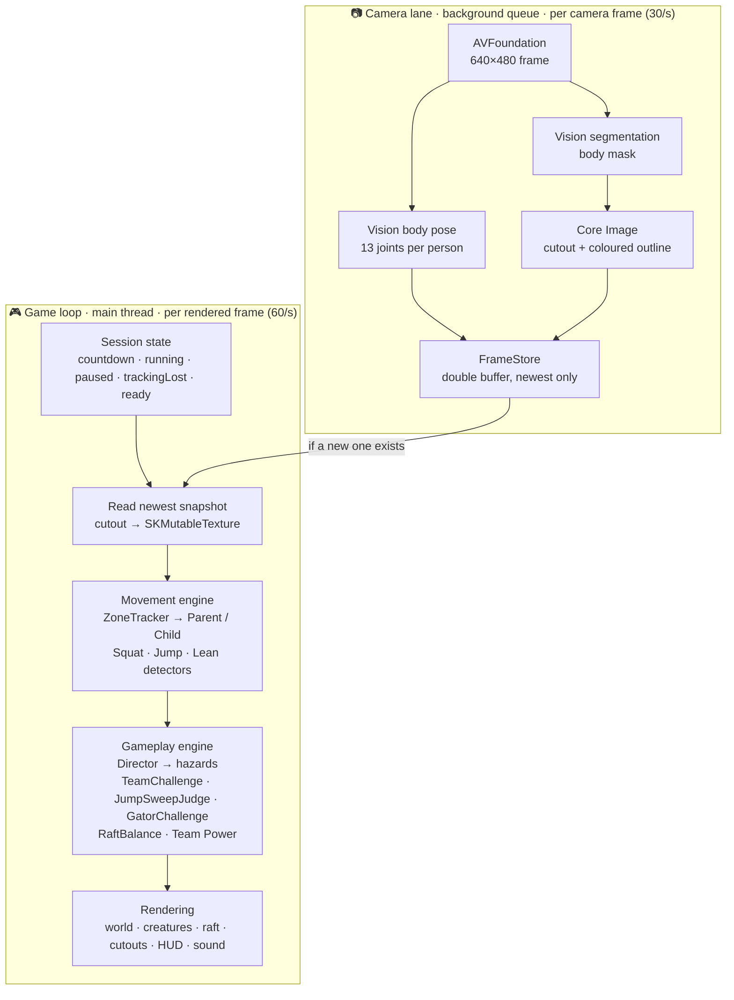
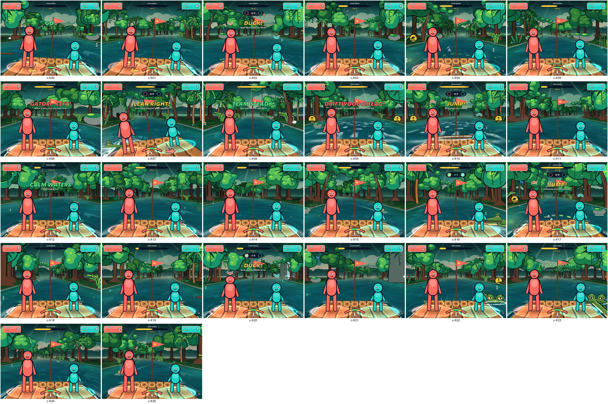
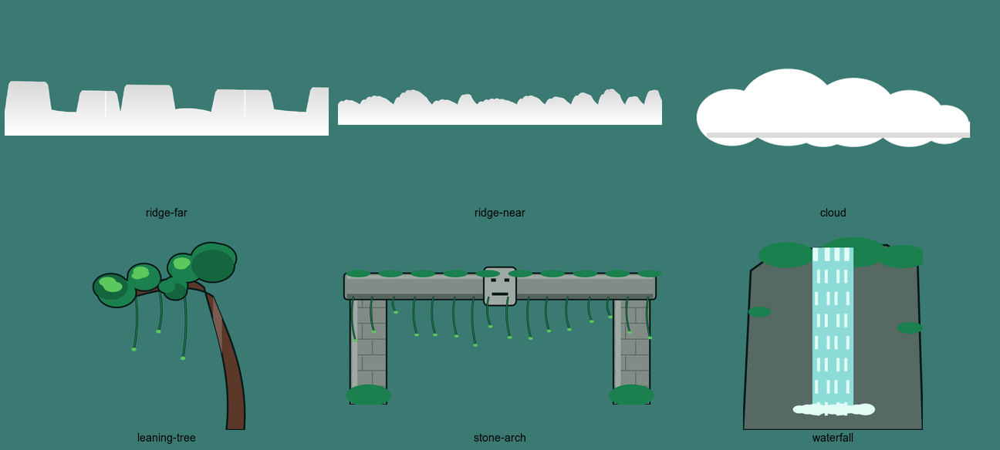
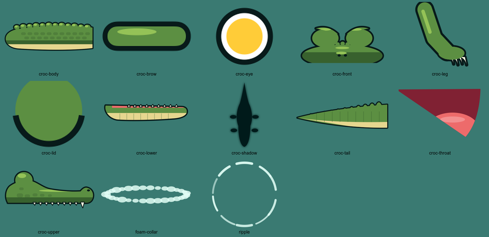
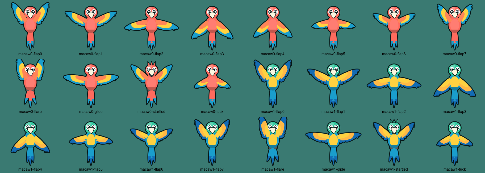
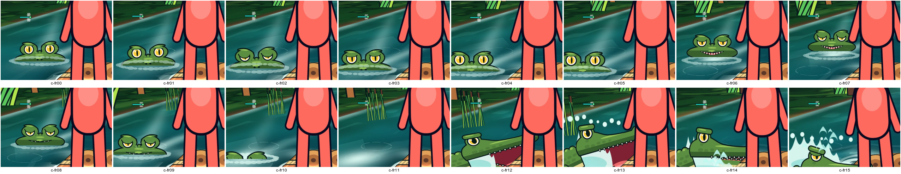
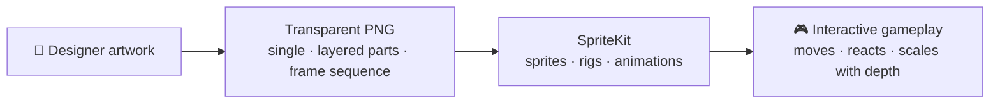
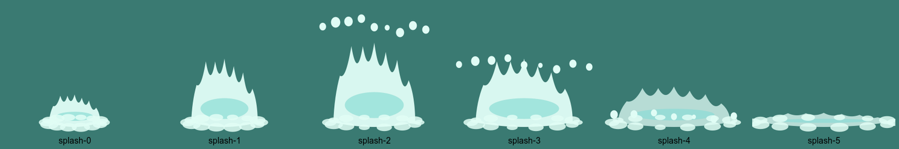
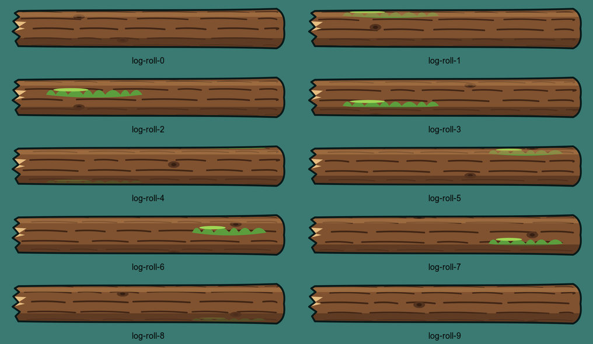

# Technology & Implementation Breakdown

**StuntRunSpike · Jungle Drift · Revision 11 · 22 October 2026**

A team brief on *which* Apple frameworks, APIs and animation techniques build each part of the game, what designers deliver, and what is proven so far. Every API named here was checked against the current source code.

> [!IMPORTANT]
> - **100% Apple frameworks.** No third-party libraries or Swift packages.
> - **Real iPad testing covers camera, cutout and squat only**, in the earlier **Stunt Run** mode (iPad Pro 13" M4).
> - **All of Jungle Drift has only run in the iPad simulator.**
> - **All current art is placeholder drawn in code.** No designer image files yet.

### Status key

| Label | Meaning |
|---|---|
| 🟢 **Verified** | Implemented and shown working; the test environment is named |
| 🟡 **Partial** | Implemented, not fully validated |
| 🟠 **Experimental** | Built separately or only partly integrated |
| 🔴 **Not validated** | Needs real-device or real-player testing |
| 💡 **Recommended** | A technique we could use, not implemented |

## Contents

1. [Technology stack](#1-technology-stack)
2. [How the entire game works](#2-how-the-entire-game-works)
3. [Environment & animation technology](#3-environment--animation-technology)
4. [Designer-to-developer pipeline](#4-designer-to-developer-pipeline)
5. [Feasibility, performance & risks](#5-feasibility-performance--risks)
6. [Technical appendix (developers)](#6-technical-appendix-developers)
7. [Speaking script (2 minutes)](#7-speaking-script-2-minutes)

---

## 1. Technology stack

| Component | Framework | Exact API / technique | Purpose | Status |
|---|---|---|---|---|
| App shell & dev panel | SwiftUI + Observation | `SpriteView`, `@Observable GameModel`, `@State` | Hosts the game, settings panel, metrics overlay | 🟢 |
| 2D game world | SpriteKit | `SKScene` (`WorldScene`), `SKSpriteNode`, `SKNode`, `SKLabelNode`, `SKAction` | Draws everything at 60 fps | 🟢 |
| Fake-3D depth | SpriteKit + own maths | Custom `Projection` (`screen(x:h:z:)`, `ppu(z)`); `SKWarpGeometryGrid` | Things shrink with distance; decks and floors in perspective | 🟢 |
| Shaders | SpriteKit | `SKShader` + `SKUniform` — `floor`, `sky` (Stunt Run); `river`, `jungleSky` (Jungle) | River, sky, light shafts, fog, lane markings | 🟢 |
| Masking | SpriteKit | `SKCropNode` | Cuts crocodile and log at the waterline | 🟢 |
| Live body texture | SpriteKit | `SKMutableTexture.modifyPixelData` | Copies each camera cutout into the game | 🟢 |
| Camera | AVFoundation | `AVCaptureSession` (640×480, 30 fps), `AVCaptureVideoDataOutput` (`alwaysDiscardsLateVideoFrames`), `AVCaptureDevice.RotationCoordinator`; Center Stage off | Front-camera frames | 🟢 |
| Body cutout | Vision | `VNGeneratePersonSegmentationRequest` (`.balanced`; `.fast` when the device runs hot) | Body vs room mask | 🟢 |
| Body joints | Vision | `VNDetectHumanBodyPoseRequest`, `VNSequenceRequestHandler` | 13 joints per person | 🟢 |
| Compositing | Core Image | `CIContext(mtlDevice:)`, `CIBlendWithMask` | Body + coloured outline, room removed | 🟢 |
| Metal | Metal (indirect) | Only `MTLCreateSystemDefaultDevice()` to run Core Image on the GPU; SpriteKit uses Metal internally; no custom Metal code | GPU-accelerated cutout | 🟢 |
| Threading | GCD + Swift 6 | One serial `DispatchQueue` for camera + Vision; `NSLock` double buffer (`FrameStore`); `async` only for camera permission/setup; main-actor default, pure types `nonisolated` | Keeps Vision off the render thread | 🟢 |
| Movement detection | Own Swift code | `SquatDetector`, `JumpDetector`, `LeanEstimator`, `ZoneTracker` | Squat, jump, lean; who is left/right | 🟢 code · 🔴 jump/lean on real bodies |
| Audio | AVFoundation | `AVAudioEngine`, 10 × `AVAudioPlayerNode`, `AVAudioMixerNode`, synthesized `AVAudioPCMBuffer`s | Sound effects + jungle ambience | 🟢 placeholder sounds |
| Tests | Own harness | `LogicTests/main.swift` compiled with `swiftc` (`run.sh`); no XCTest / Swift Testing | 47 test groups: rules, detectors, animators | 🟢 |
| Art generation | UIKit / Core Graphics | `UIGraphicsImageRenderer` → `SKTexture` at launch (115 Jungle textures, ~90 ms) | Placeholder art until designer assets arrive | 🟢 temporary |
| Offline 3D bake | RealityKit (build tool) | `RealityRenderer` in `Tools/BakeTeamDuck` → `TeamDuckShatter.png` + `.json` | TEAM DUCK shatter sprite sheet | 🟢 authoring tool, not shipped |
| Full 3D version | RealityKit | `RealityView`, `ModelEntity`, `UnlitMaterial`, `LowLevelTexture` (separate `StuntRun3D` target) | Comparison only | 🟠 rejected |

> [!NOTE]
> **Why SpriteKit instead of RealityKit?** The camera always faces forward and the player cutouts are flat images. A full RealityKit version was built and played the same game, but on iPad it gave little visual gain and cost more memory and frame stability (`FINDINGS.md`, Revision 4).
>
> **Runtime vs authoring.** RealityKit appears only in a build tool and the separate 3D experiment. Authoring tools (RealityKit, Blender, design apps) never become app dependencies.

---

## 2. How the entire game works

### What runs when

| Timing | What runs |
|---|---|
| **Per camera frame** (~30/s, background queue) | Pose detection, segmentation, Core Image cutout, publish to `FrameStore` |
| **Per rendered frame** (60/s, main thread) | Session state, snapshot read, detectors, hazard clocks, raft physics (1/120 s substeps), creature poses, world scrolling, shader values, HUD |
| **Event-driven** | `descentStarted`, `bottomReached`, `repCompleted`, `takeoff`, `landed`, `settled`, lost/found → contributions, Team Power, banners, sounds, celebrations |

### How latency stays low

- Only one camera frame is processed at a time; late frames are dropped, never queued.
- Vision runs on its own queue. The render loop never waits; it takes the newest result.
- Small input frames (640×480) and `.balanced` segmentation quality.
- Feedback fires on the **earliest** event: the lane lights up as soon as a player *starts* to squat.
- **Measured on a real iPad Pro M4 (Stunt Run): ~69 ms** from squat to on-screen reaction.

### Real camera vs simulator

| | Real camera (iPad / Mac) | Simulator |
|---|---|---|
| Input | Front camera → Vision | Synthetic test card through the same queue and compositing (segmentation doesn't run in the Simulator) |
| Movement | Real poses → detectors | `SimulatedSquat` / `SimulatedJump` / `SimulatedLean` → **the same detectors** |
| Scoring | Detectors + rules | Same. Buttons never add points directly |

---

## 3. Environment & animation technology

<table>
<tr>
<td width="50%"> Jungle Drift gameplay (simulator)</td>
<td width="50%"> Far ridges, cloud, leaning tree, stone gateway, waterfall</td>
</tr>
</table>

### Environment

| Visual | Framework | Technique (as implemented) | Designer delivers | Developer builds |
|---|---|---|---|---|
| **Endless river** | SpriteKit | Full-screen sprite with the `river` **`SKShader`**: each pixel is projected onto a virtual water plane and drawn as water or bank. Scroll via `u_offset` | Palette, water/foam style references | Shader maths, scroll speed, bank edge matching scenery |
| **Perspective & parallax** | SpriteKit | `Projection` places every sprite by (x, height, depth). Far layers (hills, treelines, clouds) slide at 0.12–0.8× the camera pan | Assets drawn for the game camera; far layers as flat silhouettes | Projection, depth order, parallax rates |
| **River curves** | SpriteKit | `proj.curve` eases over distance; shader and scenery share one bank-width formula (`riverHalfWidth`) | — | Curve rules, keeping props on the bank |
| **Trees & vegetation** | SpriteKit | Pooled sprites: 48 bank + 32 back-row trees, recycled 90–96 units ahead with a fade-in; sway from a travelling wind-gust function | Modular trees, palms, ferns, reeds, heliconia | Spawning, recycling, sway, fog tint |
| **Riverbanks** | SpriteKit | Bank ground drawn in the `river` shader (mud lip, undergrowth, dappled light); props on top | Prop art; bank colour references | Bank shading, prop placement |
| **River flow** | SpriteKit | Shader: water moves at 22% of bank speed (raft rides the current); layered waves, glints, current arrows | — | Flow speeds, wave layers |
| **Ripples** | SpriteKit | Shader rings (2 event-driven slots) + pooled `rippleRing` sprites | `ripple` PNG | Triggering rings from events |
| **Foam & wake** | SpriteKit | Shader: foam lapping the raft (reacts to bob and tilt), raft wake, croc V-wake; foam-collar sprite on creatures | `foam-collar` PNG | Making foam respond to raft and creatures |
| **Landmarks** | SpriteKit | One at a time from 5 (temple, stone gateway, kapok, 3-frame waterfall, fallen tree) + one every ~150 units | Landmark illustrations, waterfall frames | Scheduling, scale, shade under the gateway |
| **Lighting & atmosphere** | SpriteKit | `jungleSky` shader (haze, sun glow, light shafts) + fog tint; 4 biomes crossfade. No `SKLightNode` | Colour script per biome | Biome blending, fog values |

### Characters

<table>
<tr>
<td width="50%"> Crocodile layered parts</td>
<td width="50%"> Macaw 8-frame flap cycle + poses, 2 palettes</td>
</tr>
<tr>
<td colspan="2"> Crocodile acting: approach → blink → snarl → sink → lunge (simulator, 10 fps)</td>
</tr>
</table>

| Visual | Framework | Technique (as implemented) | Designer delivers | Developer builds |
|---|---|---|---|---|
| **Birds (macaws)** | SpriteKit | **Texture sequence** (8 flap frames + 4 poses × 2 variants) + **procedural flight** (`BirdFlight`: path, banking, per-bird rhythm); shadow on the raft | 24 PNGs, fixed body pivot | Flight paths, flap timing, reactions, depth |
| **Crocodile rig** | SpriteKit | **Layered sprites** (`CrocRig`): head, jaw, throat, body, tail, leg, eye/pupil/lid/brow; head-on view with 2 mouth shapes; `SKCropNode` waterline; lower jaw drawn under the deck | Parts at fixed hinge points | Hinge rotation, layering, waterline mask |
| **Crocodile ram** | SpriteKit | `CrocAnimator`: 9 states (lurk → surface → swim → snarl → lunge → bite → cling → retreat → gone) on the game clock; bite lands exactly on the gameplay strike | Key expressions (snarl, dazed, pleased) | State timing, outcome-based reactions |
| **Tail sweep** | SpriteKit | Head-on croc + **16-segment tail chain** + tip; `TailSweepAnimator`: coil, accelerating whip, follow-through, overshoot | Tail segment + tip, head-on expressions | Chain motion, timing, shadows |
| **Piranha** | SpriteKit | `PiranhaRig` (body, tail, hinged jaw, fin) on an arc from `PiranhaAnimator` | Body, tail, jaw, fin parts | Arc path, snap timing |
| **River log** | SpriteKit | 10 roll frames + root and branch layers; `LogAnimator`: drift, wave lift, accelerating roll, exit | Roll frames, roots, branch | Roll speed, raft tilt, splash |

### Gameplay visuals

| Visual | Framework | Technique (as implemented) | Designer delivers | Developer builds |
|---|---|---|---|---|
| **Raft rocking & balance** | SpriteKit + own physics | `RaftBalance` (spring, damping, player leans); deck via `SKWarpGeometryGrid`; tilt capped at 9° (4° with Reduce Motion) | Deck, log ends, flag | Physics tuning, tilt and bob |
| **Anticipation** | SpriteKit | Inside each animator: croc sinks, birds flare, tail coils, wave lifts the log | Anticipation key poses | Timing before the action window |
| **Warnings** | SpriteKit | Screen-edge badges, `SKLabelNode` banners, path dashes, edge glow, ticks | Badge icons, banner style | Warning → reveal → DUCK!/JUMP! order |
| **Success / failure** | SpriteKit + AVFoundation | Rating pop-ups, sparks, feathers, 6-frame splash (`SKAction.animate`), sounds | Effect frames, rating style | Triggered from rule results only |
| **Co-op rewards** | SpriteKit | Team lock 0/2 → 2/2, Team Power bar, TEAM banners, RIVER SPIRIT celebration | Reward visuals | Linking to `TeamChallenge` outcomes |
| **Hero animation** | SpriteKit (+ RealityKit offline) | TEAM DUCK (Stunt Run): pre-baked 3D sprite sheet via `SKAction.animate` | — | Re-baking, placement, timing |

### When a shader is the right tool

| ✅ Use a shader when… | ❌ Use sprites/frames when… |
|---|---|
| The effect fills the screen and changes every pixel every frame (water, sky, fog) | It's a character or prop with a clear shape. Easier for designers to edit |
| It must react continuously to game values (raft tilt, croc position) | The designer needs exact control of the look |
| Sprites would need thousands of nodes | It's a one-off event (pooled sprites or frames) |

---

## 4. Designer-to-developer pipeline

| Method | Example | Pipeline | Who animates |
|---|---|---|---|
| **A. Static assets** | Trees, rocks, banks, landmarks | Illustration → transparent PNG → SpriteKit sprite → projected and moved by code | Developer |
| **B. Frame-by-frame** | Wing flaps, splash, waterfall, log roll | Key poses → PNG sequence (fixed pivot) → `SKAction.animate` | **Designer** (shape change) |
| **C. Layered character** | Crocodile, piranha, tail | Separate parts → layered sprites → rotation around pivots → reacts to game events | Designer draws parts; developer moves them |
| **D. Shader environment** | River, sky | Palette + references → `SKShader` → runtime flow | Developer (designer art-directs) |
| **E. Offline 3D** | TEAM DUCK shatter | 3D scene (`RealityRenderer`) → rendered frames → sprite sheet + JSON → SpriteKit | Developer / technical artist; **not shipped in the app** |

<table>
<tr>
<td width="50%"> Method B: 6-frame splash</td>
<td width="50%"> Method B: 10-frame log roll</td>
</tr>
</table>

### Asset specification (from [`DesignerKit/ASSET_SPEC.md`](DesignerKit/ASSET_SPEC.md))

| Item | Current contract |
|---|---|
| Format | **PNG, transparent background** |
| Resolution | Export **@2x**: pixels = 2× canvas points; file names end in `@2x.png` |
| Canvas sizes | Fixed per file, e.g. `croc-upper` 380×200 pt · `croc-body` 440×170 · `croc-eye` 80×80 · macaw 320×270 · splash 280×260 |
| Pivots / hinges | Fixed, in pt from top-left, e.g. jaw hinge (40,130) · neck (420,92) · **bird body centre (160,124) on all 12 poses** · splash baseline (140,236) |
| Frame naming | `macaw0-flap0…flap7`, `macaw0-glide/tuck/flare/startled`, `macaw1-…`, `splash-0…5` |
| Frame consistency | Flap frame 7 loops to frame 0; the pivot never moves between frames |
| Style | One ink colour `#081A1A`; outline ~5 pt (croc), 4.5 pt (birds); flat cel shading, no gradients; water effects without outlines |
| References | `DesignerKit/reference-placeholder/` (current art) and `DesignerKit/guides/` (pivots marked) |
| Count | 45 files: croc 13 · birds 24 · water 8 |
| Trial | Send **one part first** (e.g. `croc-upper` + eye set) to test in game |

> [!WARNING]
> **Not yet in the contract:**
> - Specs for the piranha, log, tail segments, head-on croc mouths, environment pieces, landmarks and badges.
> - Texture atlases (`SKTextureAtlas` isn't used yet).
> - Editable source file format.
> - Animation preview format.
> - Texture memory budget.
>
> Agree these before production art starts.

### Who authors which movement

| 🎨 Designer authors (shape changes) | 💻 Developer generates in code |
|---|---|
| Wing-flap frames and bird poses | Flight paths, banking, speed, flock rhythm |
| Croc parts and expressions (snarl, dazed, pleased) | Jaw opening, head bob, thrash, tail swing, blinks, pupil size |
| Splash, waterfall and log-roll frames | Ripples, wakes, foam, droplet arcs |
| Static props and landmarks | Scrolling, scaling, wind sway, recycling |
| Key anticipation poses | Easing, timing, squash and stretch |

---

## 5. Feasibility, performance & risks

| Component | Status | Tested on | Evidence | Remaining risk |
|---|---|---|---|---|
| SpriteKit moving world | 🟢 Stunt Run · 🟡 Jungle | Stunt Run: **iPad Pro 13" M4** + simulator · Jungle: **simulator only** | iPad: 60 fps in every 5 s window over ~5 min with Vision. Sim Jungle: 60 fps, 16.7 ms max frame | Jungle on iPad unmeasured |
| Continuous jungle | 🟡 | Simulator | Revision 7–11 recordings; optical-flow check confirms forward travel | GPU cost of full-screen shader + ~300 nodes on iPad |
| Character animation | 🟡 | Simulator | Frame-by-frame inspection; tests for croc states, bite timing, flight smoothness | Placeholder art; readability at 2.5–3 m |
| Shaders & water | 🟡 | Simulator | Reactive foam, wakes and rings recorded | Shader cost on iPad together with Vision |
| Body segmentation | 🟢 | **iPad M4**, M5 Mac | ~13 ms per frame on iPad; cutouts of 1–2 people at 2.5–3 m | Halo on fast moves; one combined mask; outline colour split at screen centre |
| Two-player pose tracking | 🟡 | **iPad M4**, Mac | Both tracked; left/right flipped when crossing | `ZoneTracker` fix only unit-tested |
| Parent/Child identity | 🟡 | Unit tests | 1 s zone memory, 0.1 crossing margin | Left/right only; crossing swaps roles |
| Squat detection | 🟡 | **iPad M4** (live) | ~69 ms to feedback; 2 implausible reps found | Accuracy vs manual count unmeasured; fixes not re-run on iPad |
| Jump detection | 🔴 | Unit tests + simulator | Synthetic poses (jump vs tiptoe vs squat) | Never tested on real bodies; jumps may leave the camera frame |
| Lean / balance | 🔴 | Unit tests + simulator | Raft and lean tests | Real children's lean angles unknown |
| Cooperative gameplay | 🟢 logic | macOS tests + simulator scripts | 47 test groups pass; `coop` (16 steps) and `sweeps` (13 steps) scripts match across revisions | Fun and clarity with families untested |
| Real-device performance | 🟢 Stunt Run · 🔴 Jungle | iPad M4 | 60 fps, ~370 MB, Vision ~28 ms per frame, no overheating in ~5 min | 10-min heat test not done; Jungle never on iPad; battery unmeasured |
| Accessibility & play space | 🟡 | Simulator + iPad framing | Reduce Motion wired; 2.5–3 m distance worked; head cropping seen | Jump safety, floor space, comfort with raft tilt |

### Top 3 technical risks

| # | Risk | Why | How we validate |
|---|---|---|---|
| 1 | **Jump & lean on real bodies** | 2 of 3 movements tested only with synthetic data. Thresholds (lift 0.14 torso lengths; lean 2.5°–12°) are guesses | iPad session with adult + child: game logs vs manual count; tune thresholds; check whether jumps leave the frame. Consent required, no footage kept |
| 2 | **Jungle performance with Vision on iPad** | Vision uses ~28 of 33 ms per camera frame; Jungle adds a full-screen shader and ~300 nodes | Run Jungle on iPad M4 with the metrics overlay + 10-minute heat test. Fallbacks: `.fast` segmentation, fewer background effects, texture atlases 💡 |
| 3 | **Parent–child tracking & readability** | Size difference, crossing, head crop; real cutouts may blend into the busy jungle | Playtest framing and iPad height; per-person masks (`VNGeneratePersonInstanceMaskRequest`) 💡 only if needed |

---

## 6. Technical appendix (developers)

| System | Framework | Key APIs | Source | Notes |
|---|---|---|---|---|
| Scene management | SwiftUI + SpriteKit | `SpriteView`, `SKScene.update(_:)`, `didChangeSize` | [`StuntRunApp.swift`](StuntRunSpike/StuntRunApp.swift), [`WorldScene.swift`](StuntRunSpike/WorldScene.swift) | Frame order: flow → poll → inputs → mode → visuals → HUD. Switching game rebuilds the scene |
| Camera capture | AVFoundation | `AVCaptureSession`, `.vga640x480`, `alwaysDiscardsLateVideoFrames`, `RotationCoordinator` | [`CameraPipeline.swift`](StuntRunSpike/CameraPipeline.swift) | Mirrored connection; rotation fixed at 0° on Mac |
| Segmentation | Vision | `VNGeneratePersonSegmentationRequest`, `OneComponent8` output | [`CameraPipeline.swift`](StuntRunSpike/CameraPipeline.swift) | `.fast` when thermal state is serious/critical |
| Body pose | Vision | `VNDetectHumanBodyPoseRequest`, `recognizedPoints(.all)` | [`CameraPipeline.swift`](StuntRunSpike/CameraPipeline.swift), [`Pose.swift`](StuntRunSpike/Pose.swift) | Joints < 0.1 confidence dropped; ≥ 4 joints required |
| Compositing | Core Image | `CIContext(mtlDevice:)`, `CIBlendWithMask`, `render(_:toBitmap:)` | [`CameraPipeline.swift`](StuntRunSpike/CameraPipeline.swift) | Output → `FrameStore` → `SKMutableTexture` |
| Projection | Own maths | `Projection.screen(x:h:z:)`, `ppu(z)`, `depthZ(z)` | [`WorldScene.swift`](StuntRunSpike/WorldScene.swift) | Player plane z = 1.9 |
| Water shader | SpriteKit | `SKShader`, `SKUniform` (`u_raft`, `u_croc`, `u_log`, `u_ring0/1`…) | [`Shaders+Jungle.swift`](StuntRunSpike/Shaders+Jungle.swift) | Never name a uniform `u_time` (reserved by SpriteKit) |
| Character animation | SpriteKit | `SKCropNode`, layered `SKSpriteNode`s, `SKAction.animate` | [`JungleCreatures.swift`](StuntRunSpike/JungleCreatures.swift), [`JungleAnimation.swift`](StuntRunSpike/JungleAnimation.swift), [`JumpSweepLogic.swift`](StuntRunSpike/JumpSweepLogic.swift), [`WorldScene+JumpSweeps.swift`](StuntRunSpike/WorldScene+JumpSweeps.swift) | Poses are pure functions of the hazard clock (tested) |
| Platform balance | Own code | `RaftBalance.step`, `LeanEstimator`, `GatorChallenge` | [`JungleLogic.swift`](StuntRunSpike/JungleLogic.swift) | 1/120 s substeps |
| Game events | Own code | `SquatEvent`, `JumpEvent`, `TeamChallenge`, `JumpSweepJudge`, `SessionFlow` | [`SquatDetector.swift`](StuntRunSpike/SquatDetector.swift), [`PiranhaLogic.swift`](StuntRunSpike/PiranhaLogic.swift), [`CoopLogic.swift`](StuntRunSpike/CoopLogic.swift), [`WorldScene+Gameplay.swift`](StuntRunSpike/WorldScene+Gameplay.swift) | Animations never award points |
| Audio | AVFoundation | `AVAudioEngine`, `AVAudioPlayerNode` pool, `AVAudioPCMBuffer` | [`AudioFX.swift`](StuntRunSpike/AudioFX.swift) | Sounds synthesized at launch |
| Testing & diagnostics | Own code | `LogicTests/run.sh`; `-scenario coop` / `sweeps`; `-evidenceDir`; `-artSheet`; `SpriteView` debug overlay | [`LogicTests/main.swift`](LogicTests/main.swift), [`WorldScene+Session.swift`](StuntRunSpike/WorldScene+Session.swift) | Simulator scripts produce comparable game logs |

### Bottlenecks & unnecessary complexity

1. **Vision budget:** ~28 of 33 ms per camera frame on iPad M4. There's no room for a second Vision request without running some work on alternate frames.
2. **`WorldScene` is one class for two modes** across many extensions. `WorldScene+Jungle.swift` alone is ~1,400 lines (director, hazards, HUD, test script). Split it by mode and by hazard.
3. **`JungleRuntime` is a catch-all** because Swift extensions can't store properties.
4. **Art generated at launch:** ~90 ms, uncompressed textures. Real assets in atlases 💡 would cut startup time and draw calls.
5. **Full-screen fragment shader:** the river runs for every pixel below the horizon. Its iPad cost is unmeasured.
6. **`SKCropNode`s** (2 per croc, 1 per log) add render passes. Fine at current counts.
7. **Test scripts and evidence capture live in app code.** Move them behind a debug-only target or flag.

---

## 7. Speaking script (2 minutes)

<b>Show script</b>

> "Let me walk you through how our game is built.
>
> **Technology.** Everything is Apple-native, with no third-party libraries. AVFoundation runs the iPad camera. Vision does two jobs on each frame: it cuts each player's body out of the room, and it finds their joints. Core Image adds the coloured outline. SpriteKit draws the whole game at 60 frames per second. We built a full 3D version in RealityKit as a comparison. For our forward-facing camera and flat body cutouts it wasn't worth the cost, so SpriteKit stays our main renderer.
>
> **Movement.** Our own Swift code turns joints into squat, jump and lean events. Gameplay only listens to those events. Animations never award points, which keeps scoring reliable.
>
> **Animation and assets.** There are three ways art becomes animation. Static PNGs like trees are moved and scaled by code. Frame sequences, like wing flaps and splashes, are drawn by the designer. Layered characters, like the crocodile, arrive as separate parts with fixed hinge points, and code moves the jaw, eyes and tail in sync with the gameplay. Right now all art is placeholder drawn in code, and our asset spec defines exactly what designers deliver.
>
> **The endless world.** It's 2.5D. A small camera formula gives everything depth. The river itself is a shader that redraws the water every frame and reacts to the raft and the crocodile. Trees and props are recycled from a pool as they pass, so the jungle never ends.
>
> **What's proven.** On a real iPad: the camera cutout, two-person tracking, squat detection with about 70 milliseconds of delay, and smooth 60 fps. All of the jungle mode, so far, only in the simulator.
>
> **What's risky.** Jump and lean detection with real bodies, the jungle's performance on the iPad alongside Vision, and tracking a parent and child reliably. Those are our next three tests."

---

**Related documents:**
- [`README.md`](README.md): overview and how to run
- [`ARCHITECTURE.md`](ARCHITECTURE.md): code structure guide
- [`FINDINGS.md`](FINDINGS.md): measurements and revision history
- [`JUNGLE_ART_DIRECTION.md`](JUNGLE_ART_DIRECTION.md): visual style
- [`DesignerKit/ASSET_SPEC.md`](DesignerKit/ASSET_SPEC.md): asset contract
